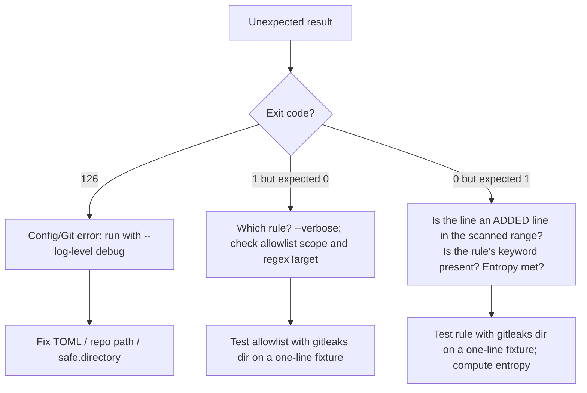

# Gitleaks: Troubleshooting

| | |
|---|---|
| **Cluster** | 08 DevSecOps |
| **Role** | Gate 1 anchor |
| **Prerequisites** | [03-commands-and-cheatsheet.md](03-commands-and-cheatsheet.md) |
| **Target version** | Gitleaks 8.18+ |
| **Capstone phase** | Phase 5 (Months 17-20) |

> Symptom-to-fix tables, verbatim error messages, and a debugging workflow for configuration, Git, CI and rule problems.

---

## 1. Debugging Workflow



The universal isolating technique: put the exact line in a file and run `gitleaks dir thatfile --config .gitleaks.toml --verbose --log-level debug`. This removes Git, ranges and baselines from the equation.

---

## 2. Installation and Invocation

| Symptom | Likely cause | Diagnose | Fix |
|---|---|---|---|
| `gitleaks: command not found` after `go install` | `$GOPATH/bin` not on PATH | `ls $(go env GOPATH)/bin` | `export PATH="$PATH:$(go env GOPATH)/bin"` |
| `unknown command "git" for "gitleaks"` | Version < 8.19 | `gitleaks version` | Upgrade, or use `gitleaks detect` |
| `unknown command "detect"` | Very new version removed legacy verb | `gitleaks version` | Use `gitleaks git .` |
| `Error: unknown flag: --source` | Using legacy flag with new subcommand | | `gitleaks git <path>` takes the path positionally |
| Docker: `fatal: detected dubious ownership in repository at '/repo'` | Git safe.directory check inside container | Run with `--log-level debug` | Add `-e GIT_CONFIG_COUNT=1 -e GIT_CONFIG_KEY_0=safe.directory -e GIT_CONFIG_VALUE_0=/repo` or `git config --global --add safe.directory /repo` in an entrypoint |
| Docker: report file not written | Mounted volume read-only or wrong path | `ls -la out/` | Mount a writable dir for `--report-path`; use `--user "$(id -u):$(id -g)"` |
| Windows: `'gitleaks' is not recognized` | Install path not in PATH, or PowerShell session predates install | `where.exe gitleaks` | Reopen shell; `winget install Gitleaks.Gitleaks` |

---

## 3. Configuration Errors

| Symptom (verbatim) | Cause | Fix |
|---|---|---|
| `ERR failed to load config error="toml: line 12: ..."` | TOML syntax error (often unescaped backslash in a basic string) | Use literal strings `'''regex'''` for regexes |
| `ERR ... error parsing regexp: invalid or unsupported Perl syntax: '(?<'` | Lookbehind not supported by RE2 | Rewrite without lookaround; use capture groups and `secretGroup` |
| `ERR ... error parsing regexp: invalid escape sequence` | `\d` inside a basic `"..."` TOML string | Switch to `'''...'''` |
| `WRN rule ID "x" is not unique` | Duplicate `id` across base and repo config | Rename or use `disabledRules` |
| Config seems ignored | Wrong lookup: `--config` not given and `.gitleaks.toml` not at the *target* root | `--log-level debug` prints `using config ...`; pass `--config` explicitly |
| `[extend] path` and `useDefault` both set | Mutually exclusive on older versions | Pick one; put `useDefault = true` in the base file |
| `secretGroup` out of range | Group index exceeds captures | Count groups; `(?:...)` groups are non-capturing |
| Entropy rule never fires | `secretGroup` missing, entropy computed on whole match including `password =` | Set `secretGroup` to the value group |
| Allowlist regex not applied | Default `regexTarget = "secret"`, your regex describes the line | Set `regexTarget = "line"` or `"match"` |
| Path allowlist matches too much | `tests/` also matches `contests/` | Anchor with `(^|/)tests/` |

---

## 4. Git and Range Problems

| Symptom | Cause | Diagnose | Fix |
|---|---|---|---|
| `ERR ... fatal: not a git repository` (exit 126) | Path is not a repo, or `.git` missing in shallow checkout | `git -C <path> rev-parse --git-dir` | Point at repo root, or use `gitleaks dir` |
| CI range scan finds nothing even with a leak | Shallow clone: `merge-base` fails, `--log-opts` empty or wrong | `git rev-parse --is-shallow-repository` | `fetch-depth: 0` or `git fetch --unshallow` |
| `fatal: ambiguous argument 'origin/main..HEAD'` | Remote branch not fetched | `git branch -r` | `git fetch origin main` before scanning |
| Finding in old commit reported on every PR | Full-history mode used in PR job | Check for missing `--log-opts` | Use merge-base range or baseline |
| Finding disappears after rebase but secret still present | Fingerprint changed; `.gitleaksignore` entry now stale while a different finding is new | `--verbose` shows new commit SHA | Regenerate fingerprints; prefer regex allowlist for fakes |
| Same secret reported twice | Appears in two commits (added, moved) | Expected | Normal; dedupe downstream (DefectDojo) |
| Scan hangs on huge repo | Giant blobs, no size limit | `git count-objects -vH`; `--log-level debug` | `--max-target-megabytes`, path allowlists for `dist/`, lockfiles |
| `warning: inexact rename detection was skipped` | Git diff rename limit | Harmless | `git config diff.renameLimit 10000` if you care |

---

## 5. False Positives and False Negatives

| Symptom | Cause | Fix |
|---|---|---|
| `generic-api-key` on every lockfile hash | Hashes have high entropy | Allowlist `\.(lock|sum)$`, `package-lock\.json$` |
| `generic-api-key` on UUIDs | UUIDs are ~3.6-4.0 bits/char | Allowlist regex `[0-9a-f]{8}-[0-9a-f]{4}-[0-9a-f]{4}-[0-9a-f]{4}-[0-9a-f]{12}` |
| `jwt` fires on test fixtures | JWT shape is unmistakable | Path allowlist for `tests/`; or `regexTarget = "line"` allow on `# test-jwt` |
| `private-key` on public-key test vectors | Rule matches header text | Confirm it is a real header; allowlist fixture paths |
| Real `password = "Summer2026!"` not detected | Low entropy, no structure | Not a scanner problem; use policy (no config in repo), Semgrep rule for assignment to `password` literals |
| Real key base64-encoded not detected | Encoded form has no keyword | v8.21+: `--max-decode-depth 2`; otherwise rely on entropy rule |
| Custom rule never fires | Keyword case / absence; regex anchored wrong | Test with `gitleaks dir` fixture; `keywords` are case-insensitive but must be substrings of the fragment |
| Internal token detected in `docs/` examples | Rule allowlist missing | Add `[rules.allowlist] paths = ['''(^|/)docs/''']` |

---

## 6. Pre-commit Hook Issues

| Symptom | Cause | Fix |
|---|---|---|
| Hook does not run | `pre-commit install` not executed in this clone | `pre-commit install`; document in README; consider `core.hooksPath` |
| `An unexpected error has occurred: CalledProcessError: ... go build` | pre-commit builds from source and Go missing | Use a newer `rev` with prebuilt binaries, or install Go, or `language: docker_image` variant |
| Hook is slow (> 2 s) | Running full history instead of staged | Default hook runs `--staged`; check custom `args` |
| Hook passes but CI fails | Hook scans staged diff; CI scans whole branch incl. earlier commits | Expected; fix the earlier commit |
| `SKIP=gitleaks` used habitually | Culture | PR gate as required check; measure skips |

---

## 7. GitHub Actions Issues

| Symptom | Cause | Fix |
|---|---|---|
| `GITLEAKS_LICENSE` error from `gitleaks-action` on org repo | Licence required for org-owned repos | Obtain key from gitleaks.io, or switch to Docker-based job |
| `Resource not accessible by integration` on SARIF upload | Missing `security-events: write` | Add to `permissions:` |
| SARIF upload: `Code Scanning is not enabled for this repository` | Private repo without Advanced Security | Enable GHAS, or skip upload and rely on job failure + artefact |
| Results from different tools overwrite each other | Same SARIF category | Set `category: gitleaks` |
| Container job: `EACCES` on checkout | Non-root container user | `options: --user 0` on the job container |
| Container job: `dubious ownership` | safe.directory | `git config --global --add safe.directory "$GITHUB_WORKSPACE"` |
| Fork PRs fail with no secret access | Secrets unavailable to forks | Use Docker job (no licence secret) for `pull_request`; use `pull_request_target` only with extreme care |

---

## 8. Diagnostic Commands

```bash
gitleaks version
gitleaks git . --log-level debug --no-banner 2>&1 | head -20       # which config, how many commits
gitleaks dir ./one-line-fixture.txt --config .gitleaks.toml --verbose   # isolate a rule
gitleaks git . --enable-rule <rule-id> --verbose                   # isolate one rule across history
git rev-parse --is-shallow-repository                              # CI clone depth
git merge-base origin/main HEAD                                    # range start
git log --all -S '<string>' --format='%H %aI %ae'                  # where a string entered history
jq 'group_by(.RuleID) | map({rule:.[0].RuleID, n:length})' report.json   # noise by rule
python3 - <<'EOF'
import math, collections, sys
s = sys.stdin.read().strip(); c = collections.Counter(s)
print(-sum(v/len(s)*math.log2(v/len(s)) for v in c.values()))
EOF
```

---

## 9. When to Escalate

- A finding is a **real, live** credential: follow the [remediation workflow](05-production-patterns.md#7-remediation-workflow) immediately; do not spend time on allowlists.
- Gitleaks crashes (`panic:`) on a specific repository: capture `--log-level trace` output, reduce to a minimal reproducer, and open an upstream issue with the redacted trace.
- Suspected false negative on a provider format in the default ruleset: check the current `config/gitleaks.toml` on GitHub; if the format changed (providers do rotate token formats), contribute a rule upstream and add it locally in the meantime.

Next: [07-interview-questions.md](07-interview-questions.md).
