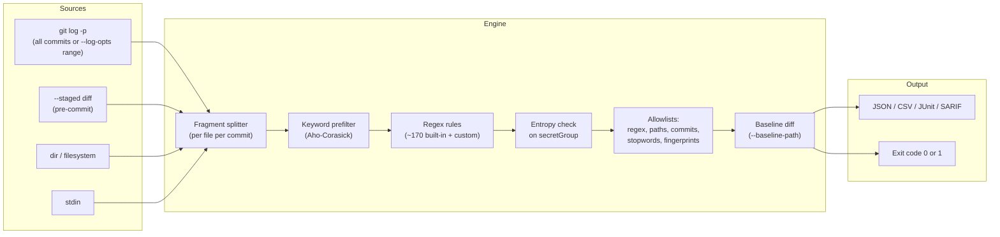

# Gitleaks

| | |
|---|---|
| **Cluster** | 08 DevSecOps |
| **Gate** | 1 - Pre-commit and repository secrets (tool #1 of 20) |
| **Role** | Gate anchor (TruffleHog is the bridge) |
| **Category** | Secret scanning (regex + entropy) |
| **Prerequisites** | Git internals (objects, refs, diffs), basic regex, GitHub Actions basics |
| **Target version** | Gitleaks 8.18+ (v8.19+ for the `git`/`dir`/`stdin` subcommands) |
| **Capstone phase** | Phase 5 (Months 17-20) |
| **Official docs** | https://github.com/gitleaks/gitleaks |

> Gitleaks is a single Go binary that scans Git history, staged changes, directories or stdin for hardcoded secrets using a library of regex rules sharpened by keyword prefilters and Shannon-entropy thresholds. After this folder you will be able to block a credential at `git commit`, tune a `.gitleaks.toml` so the gate has near-zero false positives, write rules for your organisation's own token formats, emit SARIF into GitHub code scanning, and run the remediation workflow when something slips through.

## Why This Tool Exists

Before dedicated secret scanners, teams relied on code review and `grep -r "password"`. Reviewers miss base64 blobs; grep misses history. Two insights made Gitleaks work:

1. **Most secrets have a recognisable shape.** AWS keys start with `AKIA` and are 20 characters; GitHub PATs start with `ghp_`; Slack tokens start with `xox[abp]-`. A keyword prefilter (`keywords = ["AKIA"]`) makes scanning fast because the expensive regex only runs on lines containing the keyword.
2. **Secrets that do not have a shape still have high entropy.** A 32-character hex string assigned to `api_key` has Shannon entropy around 3.8-4.0 bits per character; English prose is around 3.0. An entropy threshold on the captured group catches generic secrets without a provider-specific regex.

Gitleaks packages both, runs concurrently across commits, and finishes a 10,000-commit history in seconds, which is what makes it viable as a pre-commit hook rather than a nightly batch job.

## Architecture

- **Sources.** `gitleaks git` shells out to `git log -p` with optional `--log-opts` and parses the patch stream; `gitleaks dir` walks a filesystem; `gitleaks stdin` reads piped text. The legacy `detect`/`protect` verbs map onto these.
- **Fragment splitter.** Each file hunk in each commit becomes a fragment with its own commit, author, date and path metadata, which is what populates the report.
- **Keyword prefilter.** Rules declare `keywords`; a fragment is only regex-tested by rules whose keywords appear in it. This is the main speed trick.
- **Regex and entropy.** The regex finds a candidate; `secretGroup` selects which capture group is the secret; `entropy` sets the minimum Shannon entropy that group must have.
- **Allowlists.** Global and per-rule: regexes that cancel a match, paths to skip, commits to skip, stopwords (`example`, `test`) and `.gitleaksignore` fingerprints.
- **Baseline.** A previous report whose findings are subtracted from this run so only *new* leaks fail the build.

## The Core Mental Model

- **A finding is a (commit, file, rule, line) tuple with a fingerprint.** Everything about suppression, baselining and deduplication follows from that identity. Rewrite history and the fingerprint changes.
- **Precision comes from layering cheap filters.** Keyword -> regex -> entropy -> allowlist. Each layer removes a class of noise. When you get false positives, ask which layer should have removed them rather than deleting the rule.
- **Gitleaks matches patterns; it does not verify.** A match on `AKIAEXAMPLEEXAMPLE00` is a finding even though that key is fake. Verification is TruffleHog's job; Gitleaks' job is to be fast enough to run on every commit.

## Anchor-and-Bridge Mapping

| Concept in Gitleaks | Equivalent in TruffleHog | Equivalent in GitHub secret scanning |
|---|---|---|
| `[[rules]]` regex + entropy | Detector (regex + verifier) | Partner pattern |
| `keywords` prefilter | Detector `Keywords()` | n/a |
| `[allowlist]` regexes / paths / stopwords | `--exclude-paths`, `--exclude-detectors` | Bypass with reason |
| `.gitleaksignore` fingerprint | n/a (filter by `--results`) | Dismiss alert |
| `--baseline-path` | n/a | Alert already open |
| `gitleaks git --pre-commit --staged` | pre-commit hook `trufflehog git file://. --since-commit HEAD` | Push protection |
| `--report-format sarif` | `--json` | Code scanning alerts |
| Exit code 1 | Exit code 183 with `--fail` | Push rejected |

## Learning Path

| Step | File | Time |
|---|---|---|
| 1 | [01-installation-and-setup.md](01-installation-and-setup.md) | 30 min |
| 2 | [02-core-concepts.md](02-core-concepts.md) | 1 h |
| 3 | [03-commands-and-cheatsheet.md](03-commands-and-cheatsheet.md) | 45 min |
| 4 | [04-hands-on-labs.md](04-hands-on-labs.md) | 2 h |
| 5 | [05-production-patterns.md](05-production-patterns.md) | 1 h |
| 6 | [06-troubleshooting.md](06-troubleshooting.md) | 30 min |
| 7 | [07-interview-questions.md](07-interview-questions.md) | 45 min |

## Role in the Capstone

Gitleaks is the first job in `.github/workflows/devsecops-pipeline.yml` (`gate-1-secrets`) and the first hook in `.pre-commit-config.yaml` at the repository root. The repository-level `.gitleaks.toml` extends the default ruleset with two custom rules for the capstone's internal token formats (the `cap_` service-to-service token issued by the FastAPI auth service and the Vault wrapping-token shape), allowlists `tests/fixtures/`, and is paired with a `.gitleaksignore` for the one documented fake key used in the gate-1 lab. SARIF from the PR job is uploaded under the `gitleaks` category so findings appear in the GitHub Security tab, and the same report is reimported into DefectDojo by the `aspm-publish` job. TruffleHog runs in the same job afterwards to add verification.

## Further Reading

- Gitleaks repository and default config: https://github.com/gitleaks/gitleaks and `config/gitleaks.toml`
- Gitleaks Action: https://github.com/gitleaks/gitleaks-action
- pre-commit framework: https://pre-commit.com
- `git filter-repo` for history rewriting: https://github.com/newren/git-filter-repo
- GitHub docs: removing sensitive data from a repository
- Shannon, "A Mathematical Theory of Communication" (1948), for the entropy intuition
- Sibling: [TruffleHog](../trufflehog/README.md). Gate overview: [Gate 1 README](../README.md). Cluster: [08 DevSecOps](../../README.md)
