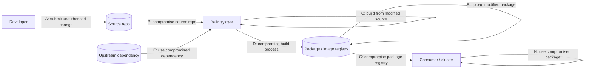
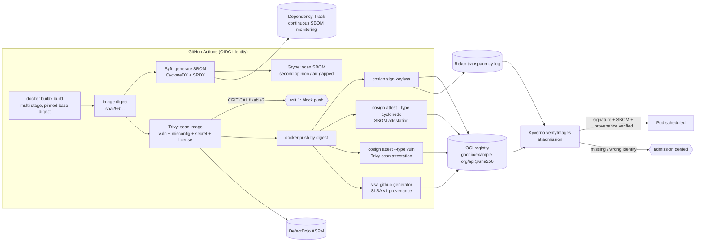
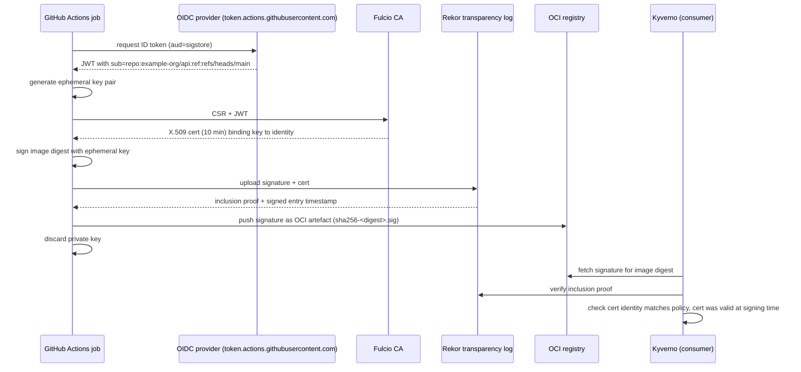

# Gate 4: Software Supply Chain Security (Container, SBOM, Signing & Attestation)

| | |
|---|---|
| **Cluster** | 08 DevSecOps |
| **Gate** | 4 of 7: build artefact to registry |
| **Tools** | Trivy (anchor), Grype, Syft, Sigstore Cosign |
| **Prerequisites** | Docker multi-stage builds, OCI registries, GitHub Actions OIDC (cluster 06), Kubernetes admission basics (cluster 04) |
| **Target versions** | Trivy 0.56+, Grype 0.80+, Syft 1.x, Cosign 2.4+, Kubernetes 1.31+ |
| **Capstone phase** | Phase 5 (Months 17-20) |

> Gate 4 sits between `docker build` and `kubectl apply`. Gates 1-3 inspected what developers wrote; Gate 4 inspects what the build *produced*: the container image, its operating-system packages, its language dependencies, and the metadata that proves where it came from. After this gate you can produce an image that carries a signed SBOM and a signed SLSA provenance attestation, is blocked from the registry if it has fixable critical CVEs, and is rejected at Kubernetes admission if any of those signatures are missing.

---

## 1. Why This Gate Exists: The Supply Chain Threat Model

Application code is usually less than 5% of the bytes in a production container image. The rest is a base operating system, hundreds of transitive open-source packages, and a build toolchain that nobody on the team wrote. Attackers learned that compromising any link in that chain is cheaper than finding a bug in your code.

### 1.1 The SLSA threat map

The [SLSA framework](https://slsa.dev/spec/v1.0/threats) labels the attack points along the path from source to consumer. Memorise these letters; every Gate 4 control maps to one of them.



| Threat | Description | Real incident | Gate 4 control |
|---|---|---|---|
| **A** | Unauthorised change submitted to source | Insider or stolen credentials pushing to `main` | Branch protection, `gitsign` commit signing (Gate 1 + Cosign) |
| **B** | Source repository compromised | GitHub account takeover | OIDC-bound identities, provenance that records the exact commit |
| **C** | Build from source that differs from what was reviewed | CI pulling a mutable branch instead of a reviewed SHA | SLSA provenance binds the artefact to `source.digest` |
| **D** | Build process compromised | **SolarWinds (2020)**: SUNSPOT malware swapped source files during MSBuild | Hermetic, ephemeral builders; SLSA Level 3 provenance generated by a trusted builder the workflow cannot forge |
| **E** | Compromised upstream dependency | **xz-utils (2024)**: a maintainer planted a backdoor in the tarball that was not in Git; **Log4Shell (2021)**: a legitimate but vulnerable dependency everywhere | SBOM (Syft) + continuous scanning (Trivy/Grype/Dependency-Track); pin digests; verify upstream signatures |
| **F** | Modified package uploaded to registry | Pushing a tampered image under an existing tag | Sign by **digest**, never by tag; admission verifies the signature |
| **G** | Package registry compromised | Registry credential theft, tag overwrite | Signature verification independent of the registry (Rekor transparency log) |
| **H** | Consumer uses a compromised package | Pulling `:latest` with no checks | Kyverno `verifyImages` / Sigstore policy-controller at admission |

### 1.2 Lessons from the three canonical incidents

**SolarWinds / SUNBURST (threat D).** The source in Git was clean. The build server was not. Code review, SAST, and SCA all passed because the malicious code was injected *during* compilation. Lesson: scanning source is insufficient; you need **provenance** that proves the artefact was produced by a specific, trusted, ephemeral builder from a specific commit, and that nothing else touched it. This is what SLSA Build Level 3 and `slsa-github-generator` deliver.

**Log4Shell / CVE-2021-44228 (threat E, discovery problem).** The vulnerability was not malicious, but on disclosure day most organisations could not answer "which of our 400 services ship log4j-core 2.x?". Teams spent days grepping jar files on production hosts. Lesson: generate an **SBOM at build time for every artefact** and keep them queryable (Dependency-Track, Gate 3). The question becomes a single API call.

**xz-utils / CVE-2024-3094 (threat E, trust problem).** A long-game social-engineering attack gave a malicious maintainer commit rights; the backdoor lived in test fixtures and a modified release tarball that did not match the Git tree. Lesson: SBOMs and CVE scanners would not have caught it before disclosure. What limits blast radius is **minimal base images** (distroless had no `xz`/`sshd`), **reproducible builds**, and **fast inventory** so you can answer "where is liblzma 5.6.0?" in minutes once the CVE drops. Gate 4 is as much about *response time* as prevention.

---

## 2. The Gate 4 Flow



The ordering matters:

1. **Build** produces an immutable digest. Everything downstream references the digest, never a tag.
2. **SBOM** is generated from the final image (not from source) so it reflects what actually ships, including OS packages.
3. **Scan** blocks the pipeline on policy (`--severity HIGH,CRITICAL --ignore-unfixed --exit-code 1`). Findings also flow to DefectDojo for triage.
4. **Sign** the image digest with a keyless OIDC identity. The certificate records *which workflow in which repository on which branch* produced it.
5. **Attest** by signing in-toto statements whose `subject` is the image digest and whose predicate is the SBOM, the vulnerability report, or SLSA provenance.
6. **Verify at admission** with Kyverno `verifyImages` (Gate 5). The cluster refuses anything not signed by the expected identity or lacking a passing vulnerability attestation.

---

## 3. Tool Comparison

### 3.1 Scanners: Trivy vs Grype + Syft

| Dimension | Trivy (anchor) | Grype + Syft |
|---|---|---|
| Vendor | Aqua Security, Apache-2.0 | Anchore, Apache-2.0 |
| Scope | Vulnerabilities, misconfiguration (IaC), secrets, licenses, SBOM, Kubernetes cluster, VM images | Grype: vulnerabilities only. Syft: SBOM only |
| SBOM | `trivy image --format cyclonedx` and `trivy sbom` consumer | Syft is the de facto SBOM generator; Grype consumes `sbom:` natively |
| Vulnerability DB | Aggregated DB (NVD, GHSA, OSV, distro feeds) published as OCI artefact, refreshed every 6 h | Anchore DB (NVD, GHSA, distro feeds) refreshed daily; v6 schema, mirrorable via `listing.json` |
| Matching | Distro + ecosystem matchers, purl-based | Distro + ecosystem matchers, purl-based, optional CPE matching (more noise, more recall) |
| Air-gapped | `--download-db-only` then `--skip-db-update`, `--db-repository` mirror | `grype db import` tarball, `GRYPE_DB_UPDATE_URL` mirror; Syft needs no DB at all |
| Kubernetes operator | Trivy Operator (VulnerabilityReports, ConfigAuditReports, compliance) | None (Anchore Enterprise is commercial) |
| CI action | `aquasecurity/trivy-action` | `anchore/sbom-action`, `anchore/scan-action` |
| Where it is weak | One monolithic binary does many things moderately; DB download size (~60 MB) per run without caching | Two tools to version; no misconfig/secret scanning; CPE matching needs tuning |
| Choose when | You want one scanner across image, IaC, secrets, cluster | You want SBOM-first, decoupled, regulated pipelines with a second opinion |

Running both is common: Trivy as the pipeline gate, Grype re-scanning stored SBOMs nightly. Disagreement between them is a signal, not a bug.

### 3.2 SBOM formats: CycloneDX vs SPDX

| | CycloneDX 1.6 | SPDX 2.3 / 3.0 |
|---|---|---|
| Steward | OWASP, ECMA-424 standard | Linux Foundation, ISO/IEC 5962:2021 |
| Design focus | Security use cases: vulnerabilities, VEX, services, ML-BOM, SaaSBOM, attestations | Licensing and compliance provenance; 3.0 adds security and build profiles |
| Serialisations | JSON, XML, protobuf | JSON, YAML, RDF, tag-value, XLSX |
| Component identity | `purl`, `cpe`, `swid`, hashes | `externalRefs` with purl/cpe, `SPDXID` |
| Dependency graph | `dependencies[]` by `bom-ref` | `relationships[]` (`DEPENDS_ON`, `CONTAINS`) |
| VEX | Native (`vulnerabilities[].analysis`) | External (OpenVEX, CSAF) |
| Tooling in this gate | Trivy, Syft, Grype, Dependency-Track (primary), Cosign `--type cyclonedx` | Trivy, Syft, Grype, Cosign `--type spdxjson` |
| Recommendation | Default for security pipelines and Dependency-Track | Produce alongside when customers or regulators ask for ISO-standard SBOMs |

Emit both from the same scan; storage is cheap and converters are lossy.

### 3.3 VEX: telling consumers which CVEs do not matter

A scanner reports every CVE in every package it finds. Many are not exploitable in context (the vulnerable function is never called, the OS package is present but the daemon never starts). **VEX (Vulnerability Exploitability eXchange)** is a machine-readable statement, signed by the supplier, with one of four statuses: `not_affected`, `affected`, `fixed`, `under_investigation`, plus a `justification` such as `vulnerable_code_not_in_execute_path`.

- Formats: **OpenVEX** (used by Trivy `--vex`, Grype `--vex`), **CycloneDX VEX**, **CSAF VEX**.
- Trivy additionally ships a **VEX Hub** repository and respects VEX documents attached to images as attestations.
- VEX turns "ignore this CVE" from a `.trivyignore` line into an auditable, expiring, signed artefact. Use it instead of blanket ignores for anything reaching production.

---

## 4. SLSA Levels and Provenance

SLSA (Supply-chain Levels for Software Artifacts) v1.0 defines the **Build track**:

| Level | Requirement | How you achieve it in the capstone |
|---|---|---|
| **L0** | Nothing | Local `docker build && docker push` |
| **L1** | Provenance exists (documents how the artefact was built) | `docker buildx build --provenance=true` or `cosign attest --type slsaprovenance1` from the workflow itself |
| **L2** | Provenance is signed and generated by a hosted build platform | GitHub Actions + Cosign keyless signing the provenance |
| **L3** | Builder is hardened: the workflow cannot access the signing key or forge provenance; builds are isolated | `slsa-framework/slsa-github-generator` reusable workflow (`generator_container_slsa3.yml`), verified with `slsa-verifier` |

Provenance is an in-toto statement with `predicateType: https://slsa.dev/provenance/v1`. Its predicate records `buildDefinition` (builder ID, source repo and digest, parameters) and `runDetails` (builder, start/finish time, byproducts). The consumer checks: *was this built by the builder I trust, from the repo I trust, on the branch I trust?*

---

## 5. Sigstore Components



| Component | Role | Why it matters |
|---|---|---|
| **Cosign** | CLI/library to sign, attest, and verify OCI artefacts and blobs | The user-facing tool |
| **Fulcio** | Certificate authority issuing short-lived (10 minute) certs bound to an OIDC identity | Removes long-lived signing keys; identity *is* the key |
| **Rekor** | Append-only, Merkle-tree transparency log of signatures and attestations | Proves the signature existed at a point in time; makes the ephemeral cert verifiable after expiry; publicly auditable |
| **OIDC** | Identity provider (GitHub, GitLab, Google, Microsoft, custom Dex) | The identity encoded in the certificate (`repo`, `workflow`, `ref`) |
| **TUF** | The Update Framework distributing Sigstore root certificates and keys | Secure bootstrap of trust; `cosign initialize` |
| **policy-controller** | Kubernetes admission controller from Sigstore (`ClusterImagePolicy`) | Alternative to Kyverno `verifyImages` |
| **gitsign** | Keyless signing of Git commits and tags | Extends the same identity model to source (threat A) |

### in-toto attestations

Everything Cosign attests is an **in-toto Statement**:

```json
{
  "_type": "https://in-toto.io/Statement/v1",
  "subject": [{ "name": "ghcr.io/example-org/api", "digest": { "sha256": "<IMAGE_DIGEST>" } }],
  "predicateType": "https://cyclonedx.org/bom",
  "predicate": { "bomFormat": "CycloneDX", "specVersion": "1.6", "components": ["..."] }
}
```

The statement is wrapped in a DSSE envelope and signed. The `subject` digest ties the claim to exactly one artefact; the `predicateType` tells verifiers how to interpret the payload. Standard predicate types used in this gate: CycloneDX (`https://cyclonedx.org/bom`), SPDX (`https://spdx.dev/Document`), Cosign vulnerability (`https://cosign.sigstore.dev/attestation/vuln/v1`), SLSA provenance (`https://slsa.dev/provenance/v1`).

---

## 6. Verification at Admission

A signature nobody checks is decoration. The last step of Gate 4 is enforced in Gate 5 by Kyverno:

```yaml
apiVersion: kyverno.io/v1
kind: ClusterPolicy
metadata:
  name: verify-image-signature-and-sbom
spec:
  validationFailureAction: Enforce
  webhookTimeoutSeconds: 30
  failurePolicy: Fail
  rules:
    - name: verify-keyless-signature
      match:
        any:
          - resources:
              kinds: [Pod]
              namespaces: [prod, staging]
      verifyImages:
        - imageReferences: ["ghcr.io/example-org/*"]
          mutateDigest: true
          required: true
          attestors:
            - entries:
                - keyless:
                    subject: "https://github.com/example-org/*/.github/workflows/release.yml@refs/heads/main"
                    issuer: "https://token.actions.githubusercontent.com"
                    rekor:
                      url: https://rekor.sigstore.dev
          attestations:
            - type: https://cosign.sigstore.dev/attestation/vuln/v1
              attestors:
                - entries:
                    - keyless:
                        subject: "https://github.com/example-org/*/.github/workflows/release.yml@refs/heads/main"
                        issuer: "https://token.actions.githubusercontent.com"
              conditions:
                - all:
                    - key: "{{ scanner.result.summary.critical }}"
                      operator: Equals
                      value: 0
```

`mutateDigest: true` rewrites `image: ghcr.io/example-org/api:1.4.2` to the digest form before the Pod is persisted, closing the tag-mutation hole (threat F). See [`../gate-5-policy-as-code/kyverno/`](../gate-5-policy-as-code/kyverno/README.md).

---

## 7. Anchor-and-Bridge Delta Mapping

| Concept | Trivy (anchor) | Grype | Syft | Cosign |
|---|---|---|---|---|
| Scan an image | `trivy image <ref>` | `grype <ref>` | `syft <ref>` (inventory, no CVEs) | n/a |
| Generate SBOM | `trivy image --format cyclonedx --output sbom.json <ref>` | n/a | `syft <ref> -o cyclonedx-json=sbom.json` | n/a (attests one) |
| Scan an SBOM | `trivy sbom sbom.json` | `grype sbom:sbom.json` | n/a | n/a |
| Fail threshold | `--severity HIGH,CRITICAL --exit-code 1` | `--fail-on high` | n/a | n/a |
| Ignore unfixed | `--ignore-unfixed` | `--only-fixed` | n/a | n/a |
| Ignore file | `.trivyignore` / `.trivyignore.yaml` | `.grype.yaml` `ignore:` | `.syft.yaml` `exclude:` | n/a |
| VEX | `--vex openvex.json` | `--vex openvex.json` | n/a | attest VEX as predicate |
| Offline DB | `--download-db-only`, `--skip-db-update` | `grype db import` | no DB needed | `--offline` bundle verification |
| Layers | `--image-config-scanners`, scans squashed FS | `--scope all-layers` | `--scope all-layers` | n/a |
| Output SARIF | `--format sarif` | `-o sarif` | n/a | n/a |
| Attach to image | `trivy image --format cosign-vuln` then `cosign attest --type vuln` | n/a | `syft attest` or `cosign attest --type cyclonedx` | `cosign attest` |

---

## 8. Learning Order and Time Budget

| Week | Focus | Deliverable in the capstone repo |
|---|---|---|
| 1 | Trivy image scanning, severity gating, ignore files, DB caching | `trivy image` step in `release.yml` blocking on fixable CRITICAL |
| 2 | Trivy misconfig/secret/license scanning; Trivy Operator on kind | `trivy config` on `infra/` and `k8s/`; VulnerabilityReports visible in cluster |
| 3 | Syft SBOMs (both formats), Grype SBOM scanning, Dependency-Track upload | `sbom/` artefacts per release; nightly Grype rescan workflow |
| 4 | Cosign keyless sign + attest; SLSA L3 provenance; Kyverno `verifyImages` | Unsigned image rejected on kind; signed image admitted with digest mutation |

Total: roughly 45 hours of the 180-hour Phase 5 budget.

Read the folders in this order:

1. [trivy/](trivy/README.md) (anchor; read all eight files)
2. [syft/](syft/README.md)
3. [grype/](grype/README.md)
4. [cosign/](cosign/README.md)

---

## 9. Role in the Capstone

In the unified capstone repository, Gate 4 lives in `.github/workflows/release.yml` and runs for both the FastAPI and Spring Boot services:

- `build` job: `docker/build-push-action` with `provenance: false` (provenance generated separately at L3), outputs `digest`.
- `sbom-and-scan` job: Syft emits `sbom.cdx.json` and `sbom.spdx.json`; Trivy scans the image with SARIF upload to GitHub code scanning and JSON upload to DefectDojo; Grype scans the Syft SBOM as a second opinion; the job fails on fixable HIGH/CRITICAL unless covered by a VEX statement in `security/vex/`.
- `sign` job: `cosign sign`, `cosign attest --type cyclonedx`, `cosign attest --type vuln`, then `slsa-github-generator` container workflow.
- `platform/kyverno/policies/verify-images.yaml`: enforces signatures and attestations in `staging` and `prod` namespaces; Argo CD syncs it before any workload.
- `security/adrs/0012-trivy-as-primary-scanner.md` and `0013-keyless-signing.md` document the choices.

## 10. Further Reading

- SLSA specification v1.0: https://slsa.dev/spec/v1.0/
- Sigstore documentation: https://docs.sigstore.dev/
- in-toto attestation framework: https://github.com/in-toto/attestation
- CycloneDX specification: https://cyclonedx.org/specification/overview/
- SPDX specification: https://spdx.dev/use/specifications/
- OpenVEX: https://github.com/openvex/spec
- NTIA "Minimum Elements for an SBOM" (2021) and CISA 2024 update
- "Reflections on Trusting Trust", Ken Thompson (1984), the original supply chain paper
- CNCF Software Supply Chain Best Practices white paper
