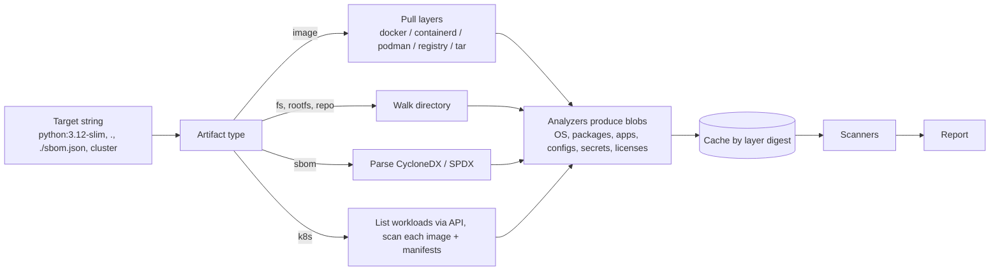
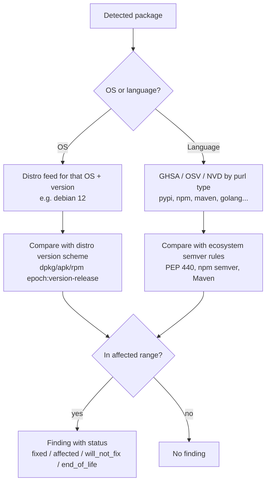

# Trivy: Core Concepts

| | |
|---|---|
| **Cluster** | 08 DevSecOps |
| **Role** | Anchor |
| **Prerequisites** | [01-installation-and-setup.md](01-installation-and-setup.md), container image layers, package managers |
| **Target version** | Trivy 0.56+ |
| **Capstone phase** | Phase 5 (Months 17-20) |

> This file explains how Trivy turns bytes into findings: how it resolves targets, what the analyzers detect, how vulnerability matching differs between OS and language packages, how severity and fixability are decided, how misconfiguration checks are evaluated in Rego, how the ignore and VEX mechanisms work, and how the databases are built and distributed. Read it before trusting or disputing a Trivy report.

---

## 1. Targets and the Artifact Pipeline

Every Trivy invocation follows the same pipeline: **target → artifact → analyzers → scanners → report**.



### 1.1 Image targets

`trivy image <ref>` tries sources in this order unless `--image-src` restricts it: `docker` daemon, `containerd`, `podman`, `remote` registry. Each image layer is a tar; Trivy applies them in order into a virtual squashed filesystem, honouring whiteout files (`.wh.*`) that delete files from earlier layers. The result is what a process in the container sees, so packages removed in a later layer are **not** reported.

Two notable flags:

- `--input image.tar` scans an exported image (`docker save`) or OCI layout (`--input ./oci-dir`). This is how CI scans without a daemon or registry access.
- `--image-config-scanners misconfig,secret` additionally inspects the image config JSON (the `Dockerfile` history, `ENV`, `USER`, `EXPOSE`), which is how Trivy reports "image runs as root" or "secret in ENV".

### 1.2 Filesystem, rootfs, repo

- `trivy fs <dir>` is for **source trees and build contexts**. It looks for lockfiles, IaC files, and secrets. It does not look for OS package databases by default because a source tree has none.
- `trivy rootfs <dir>` is for **unpacked operating systems**: a `chroot`, a mounted container filesystem, a host's `/`. It enables OS package analyzers and scans installed binaries.
- `trivy repo <url|dir>` is `fs` with Git awareness: `--branch`, `--commit`, `--tag` check out a specific ref; remote URLs are shallow-cloned to a temp dir.

### 1.3 Config and SBOM

- `trivy config <dir>` enables only the misconfiguration scanner. It never downloads the vulnerability DB, which makes it fast enough to run on every PR against `infra/`.
- `trivy sbom <file>` parses CycloneDX (JSON/XML) or SPDX (JSON/tag-value), rebuilds the package list from `purl`s, and runs the vulnerability scanner against that list. This means the SBOM's quality bounds the scan's quality: an SBOM without OS package `purl`s yields no OS findings.

### 1.4 Kubernetes and VM

- `trivy k8s` lists workloads via the API, extracts image references, scans each image (pulling from the registry), and scans manifests for misconfigurations and RBAC issues. For continuous scanning use the Trivy Operator instead ([05-production-patterns.md](05-production-patterns.md)).
- `trivy vm <ami:id|ebs:vol-id|file.vmdk>` mounts disk images (ext4, xfs, NTFS) read-only and runs `rootfs` logic over them.

---

## 2. Analyzers: What Trivy Detects

Analyzers are the eyes. Each one claims files by path pattern and emits typed results. The `--list-all-pkgs` flag shows everything they found even if nothing is vulnerable, which is the fastest way to debug "why did Trivy miss X?".

### 2.1 Operating system packages

| OS family | Detection file | Package DB | Advisory source |
|---|---|---|---|
| Alpine | `/etc/alpine-release`, `/etc/os-release` | `/lib/apk/db/installed` | Alpine SecDB |
| Debian / Ubuntu | `/etc/os-release`, `/etc/debian_version` | `/var/lib/dpkg/status`, `/var/lib/dpkg/status.d/*` (distroless) | Debian Security Tracker, Ubuntu CVE Tracker |
| RHEL / CentOS / Rocky / Alma | `/etc/redhat-release`, `/etc/os-release` | `/var/lib/rpm/Packages` or `rpmdb.sqlite` | Red Hat OVAL v2, CSAF VEX |
| Amazon Linux | `/etc/system-release` | rpm DB | Amazon Linux Security Center (ALAS) |
| SUSE / openSUSE | `/etc/os-release` | rpm DB | SUSE CVRF |
| Oracle Linux | `/etc/oracle-release` | rpm DB | Oracle OVAL |
| Photon | `/etc/os-release` | rpm DB | Photon advisories |
| Wolfi / Chainguard | `/etc/os-release` | apk DB | Wolfi SecDB |
| Distroless (Google) | `/etc/os-release` says Debian | `/var/lib/dpkg/status.d/` | Debian tracker |

If no OS is detected (`scratch` images, or a base whose `/etc/os-release` was deleted), Trivy logs `Unable to detect OS` and reports only language packages. This is correct behaviour, not a bug.

### 2.2 Language packages

Trivy distinguishes **pre-build** (lockfiles in a repo) from **post-build** (what is installed in an image). The analyzer set differs by target:

| Ecosystem | `fs`/`repo` (lockfiles) | `image`/`rootfs` (installed) |
|---|---|---|
| Python | `requirements.txt` (pinned lines only), `Pipfile.lock`, `poetry.lock`, `uv.lock`, `pdm.lock` | `*.dist-info/METADATA`, `*.egg-info` (site-packages) |
| Node.js | `package-lock.json`, `yarn.lock`, `pnpm-lock.yaml`, `bun.lock` | `node_modules/**/package.json` |
| Java | `pom.xml` (resolves parents/BOMs, may call Maven Central unless `--offline-scan`), `*.gradle.lockfile`, `sbt` | `*.jar`, `*.war`, `*.ear`, `*.par` (reads `pom.properties`, falls back to Java DB by SHA-1, recurses into nested/shaded jars) |
| Go | `go.mod` + `go.sum` | Go binaries (reads embedded build info and module list; detects stdlib version) |
| .NET | `packages.lock.json`, `*.deps.json`, `packages.config` | `*.deps.json` |
| Ruby | `Gemfile.lock` | `*.gemspec` |
| Rust | `Cargo.lock` | binaries built with `cargo-auditable` |
| PHP | `composer.lock` | `installed.json` |
| Swift / Dart / Elixir / Conda / Julia | lockfiles | n/a |
| Binaries | n/a | Known-binary analyzer: `node`, `python`, `php`, `java`, `go` executables with version strings |

Two subtleties with Python: unpinned `requirements.txt` lines (`requests>=2.0`) are skipped because the version is unknown; and in images, Trivy reads `site-packages`, so whatever `pip install` actually resolved is what gets scanned, which is more truthful than the lockfile.

### 2.3 Misconfiguration files

| Framework | Files detected |
|---|---|
| Terraform | `*.tf`, `*.tf.json`, `*.tfvars`, Terraform plan JSON (`terraform show -json`) |
| CloudFormation | `*.yaml`/`*.json` with `AWSTemplateFormatVersion` or `Resources` |
| Kubernetes | YAML/JSON with `apiVersion` + `kind` |
| Helm | Chart directories and `.tgz` (rendered with `--helm-values`, `--helm-set`) |
| Dockerfile | `Dockerfile`, `*.Dockerfile`, `Containerfile` |
| Azure ARM / Bicep | `*.json` with `$schema` deployment template |
| Docker Compose | `docker-compose*.yml` |
| Kustomize | rendered if `kustomization.yaml` present |

### 2.4 Secrets

The secret analyzer runs regex rules over regular files (skipping binaries and files above the size limit) and over image config `ENV`/history. Built-in rules cover ~150 patterns: AWS access keys (`AKIA...`), GitHub tokens (`ghp_`, `github_pat_`), Slack, Stripe, private key blocks (`-----BEGIN ... PRIVATE KEY-----`), JWTs, generic `password=` assignments with entropy checks. Custom rules and allow-rules live in `trivy-secret.yaml` ([03-commands-and-cheatsheet.md](03-commands-and-cheatsheet.md#secrets)).

### 2.5 Licenses

The license analyzer classifies: OS package license fields (from dpkg/rpm metadata), language package metadata (`License:` in `METADATA`, `license` in `package.json`), and with `--license-full` the text of `LICENSE*`, `COPYING*`, and source headers using Google's `licenseclassifier`. Licenses are bucketed as `forbidden`, `restricted`, `reciprocal`, `notice`, `permissive`, `unencumbered`, `unknown`, and the buckets map to severities (`forbidden` → CRITICAL, `restricted` → HIGH, by default).

---

## 3. Vulnerability Matching: The Part People Argue About

A finding is produced when a detected package `(ecosystem, name, version)` matches an advisory `(ecosystem, name, affected version range)`. The *ecosystem* decides which data source and version comparison are used.



### 3.1 Why OS matching uses the distro feed, not NVD

Debian ships `openssl 3.0.14-1~deb12u2`. NVD says CVE-2024-XXXX affects "OpenSSL 3.0.0 through 3.0.14". Naively that is vulnerable. But Debian backported the fix into `3.0.14-1~deb12u2` without bumping to 3.0.15. Only the **Debian Security Tracker** knows that `deb12u2` is fixed. Trivy therefore trusts the distro's own feed and compares using the distro's version algorithm (dpkg's epoch:upstream-revision comparison). The same CVE on Alpine, Debian, and Ubuntu can legitimately have three different statuses.

Consequence: a package in an **unsupported** distro version (Debian 10, Alpine 3.15) has no feed, so Trivy reports nothing and warns `This OS version is no longer supported by the distribution`. Silence is not safety.

### 3.2 Status values

| Status | Meaning | Gate behaviour |
|---|---|---|
| `fixed` | A fixed version exists in this distro/ecosystem | Actionable; blocks under default settings |
| `affected` | Confirmed vulnerable, no fix released | Suppressed by `--ignore-unfixed`; track in DefectDojo |
| `will_not_fix` | Distro has declined to fix (low impact, EOL) | Suppressed by `--ignore-unfixed` |
| `fix_deferred` | Fix postponed | Suppressed by `--ignore-unfixed` |
| `under_investigation` | Vendor still analysing | Shown unless `--ignore-status under_investigation` |
| `end_of_life` | OS version unsupported | Shown as a warning, no CVE data |
| `unknown` | No status information | Shown |

`--ignore-status` lets you tune this per status instead of the blunt `--ignore-unfixed`.

### 3.3 Severity selection

Each advisory may carry severities from multiple sources (NVD CVSS v3, Red Hat, Ubuntu, GHSA). Trivy picks in this order: **the distro/vendor's own rating** for OS packages (Red Hat's rating for RHEL packages, Debian's for Debian), then **GHSA** for language packages, then **NVD**. `--severity-source` is not configurable per scan, but JSON output includes `CVSS` blocks from all sources and `SeveritySource` so you can re-rank in DefectDojo. This explains why the same CVE shows `MEDIUM` on a UBI image and `CRITICAL` in NVD.

### 3.4 Language package version semantics

PyPI uses PEP 440 (`1.0.0rc1 < 1.0.0`), npm uses semver with prerelease rules, Maven has its own ordering (`1.0-SNAPSHOT < 1.0`), Go uses `v`-prefixed semver with pseudo-versions. Trivy implements each. Most "Trivy says version X is vulnerable but the advisory says otherwise" disputes come down to an advisory range expressed in a different scheme; `--list-all-pkgs --format json` shows exactly what version string was compared.

---

## 4. Misconfiguration Scanning: Rego Under the Hood

The misconfiguration scanner parses IaC into a JSON-like document and evaluates **Rego** checks (from `trivy-checks`) against it. Terraform is evaluated through a real HCL interpreter that resolves variables, locals, modules (local and registry), and `for_each`, which is why Trivy can tell that `var.enable_encryption` defaults to `false`.

Check metadata is what you see in the report:

```text
AVD-AWS-0088 (HIGH): Bucket does not have encryption enabled
═══════════════════════════════════════════════════════════
S3 Bucket does not have encryption enabled. Unencrypted data at rest is at risk.

See https://avd.aquasec.com/misconfig/avd-aws-0088
───────────────────────────────────────────────────────────
 infra/terraform/s3.tf:3-12
───────────────────────────────────────────────────────────
   3 ┌ resource "aws_s3_bucket" "artifacts" {
   4 │   bucket = "example-org-artifacts"
   5 │   tags = {
   ...
```

IDs follow `AVD-<PROVIDER>-<NNNN>` (cloud) or `DS<NNN>` (Dockerfile) or `KSV<NNN>` (Kubernetes). Each check has a severity, a description, a resolution, and a link.

A minimal custom check (full tutorial in [04-hands-on-labs.md](04-hands-on-labs.md)):

```rego
# METADATA
# title: Container image must come from the organisation registry
# description: Only images from ghcr.io/example-org are allowed in Kubernetes manifests
# scope: package
# schemas:
#   - input: schema["kubernetes"]
# custom:
#   id: ORG-K8S-0001
#   avd_id: ORG-K8S-0001
#   severity: HIGH
#   short_code: image-from-org-registry
#   recommended_action: Use ghcr.io/example-org/<image>@sha256:<digest>
#   input:
#     selector:
#       - type: kubernetes
package user.kubernetes.ORG0001

import rego.v1

deny contains res if {
    some container in input.spec.template.spec.containers
    not startswith(container.image, "ghcr.io/example-org/")
    res := result.new(
        sprintf("container %q uses image %q outside the approved registry", [container.name, container.image]),
        container,
    )
}
```

Load it with `trivy config --config-check ./checks --check-namespaces user k8s/`. The `METADATA` comment block is parsed by Trivy to populate ID, severity, and description; `result.new` attaches source line numbers from the parsed object.

### 4.1 Helm and Kubernetes

Helm charts are rendered in-process with `helm template` semantics. Supply the values that production uses (`--helm-values values-prod.yaml`) or you will scan the chart defaults, which is rarely what runs. Kubernetes checks (KSV series) cover Pod Security Standards (privileged, hostPath, capabilities, runAsNonRoot, read-only root FS, seccomp), resource limits, probes, image tags, and RBAC wildcards.

### 4.2 Dockerfile

DS checks cover: `USER` not set (`DS002`), `latest` tag in `FROM` (`DS001`), `ADD` instead of `COPY` (`DS005`), `apt-get` without `--no-install-recommends` and cleanup (`DS017`, `DS029`), `HEALTHCHECK` missing (`DS026`), secrets in `ENV`/`ARG` (`DS031`), `COPY --from` referencing own image, exposed port 22 (`DS004`).

---

## 5. Suppression: `.trivyignore`, `.trivyignore.yaml`, VEX

Three mechanisms, increasing in rigour.

### 5.1 `.trivyignore` (flat)

```text
# Accepted: vulnerable function not reachable, re-evaluate quarterly (ticket SEC-421)
CVE-2023-45853
# Misconfig: dev-only bucket
AVD-AWS-0088
# Secret: test fixture
generic-unwanted-rule
```

One ID per line, no expiry, applies to everything. Fine for a lab, too coarse for production.

### 5.2 `.trivyignore.yaml` (structured, with expiry and scope)

```yaml
vulnerabilities:
  - id: CVE-2023-45853
    paths:
      - "usr/lib/x86_64-linux-gnu/libz.so.1.2.13"
    purls:
      - "pkg:deb/debian/zlib1g@1:1.2.13.dfsg-1?distro=debian-12"
    statement: "zlib minizip component not compiled in; see SEC-421"
    expired_at: 2027-01-31
misconfigurations:
  - id: AVD-AWS-0088
    paths:
      - "infra/terraform/dev/*.tf"
    statement: "Dev bucket holds synthetic data only"
    expired_at: 2026-12-31
secrets:
  - id: aws-access-key-id
    paths:
      - "tests/fixtures/**"
    statement: "Example keys in test fixtures"
licenses:
  - id: GPL-3.0
    paths:
      - "usr/share/doc/**"
    statement: "Documentation only, not linked"
```

`expired_at` makes suppressions self-expiring: after the date the finding reappears, forcing re-review. `paths` and `purls` scope the ignore to the specific package rather than the CVE globally. Point Trivy at it with `--ignorefile .trivyignore.yaml` (the default file name is `.trivyignore` so the YAML form must be referenced explicitly or via `trivy.yaml`).

### 5.3 `--ignore-policy` (Rego)

For organisation-wide rules ("ignore anything with CVSS < 7 and no exploit"):

```rego
package trivy

import rego.v1

default ignore := false

ignore if {
    input.Severity == "LOW"
}

ignore if {
    input.PkgName == "linux-libc-dev"   # headers, never executed
}

ignore if {
    input.VulnerabilityID in {"CVE-2005-2541"}   # tar: documented, by design
}
```

`trivy image --ignore-policy ignore.rego <ref>`. `input` is the finding object (same shape as JSON output `Results[].Vulnerabilities[]`).

### 5.4 VEX

VEX is the supplier's signed statement about exploitability. Trivy supports OpenVEX, CycloneDX VEX, and CSAF, from three sources:

1. **Local file**: `trivy image --vex openvex.json <ref>`.
2. **Attached to the image** as an attestation: `--vex oci` fetches `cosign attest`-ed VEX documents from the registry.
3. **VEX Hub** (`--vex repo`): a community repository of VEX documents published by upstream projects (for example Kubernetes, Go). Configured in `~/.trivy/vex/repository.yaml`.

An OpenVEX document:

```json
{
  "@context": "https://openvex.dev/ns/v0.2.0",
  "@id": "https://example.com/vex/api-2026-10-27",
  "author": "Example Org Security <security@example.com>",
  "timestamp": "2026-10-27T09:00:00Z",
  "version": 1,
  "statements": [
    {
      "vulnerability": { "name": "CVE-2023-45853" },
      "products": [
        { "@id": "pkg:oci/api@sha256%3A<IMAGE_DIGEST>?repository_url=ghcr.io/example-org",
          "subcomponents": [ { "@id": "pkg:deb/debian/zlib1g@1:1.2.13.dfsg-1" } ] }
      ],
      "status": "not_affected",
      "justification": "vulnerable_code_not_present",
      "impact_statement": "minizip is not built into Debian's zlib1g package"
    }
  ]
}
```

With `--vex`, Trivy filters `not_affected` and `fixed` statements out of the report (they remain in JSON under `ExperimentalModifiedFindings` for audit). VEX differs from ignore files in that it is **tied to a specific product digest and subcomponent**, is authored, timestamped, and can be signed and attested. Use it for anything that reaches production; use `.trivyignore.yaml` for pipeline hygiene.

---

## 6. Databases and Distribution

### 6.1 trivy-db

Built by `aquasecurity/trivy-db` from ~25 upstream sources (NVD, GHSA, OSV, Debian, Ubuntu, Alpine, Red Hat, Amazon, SUSE, Oracle, Photon, Wolfi, Chainguard, Rocky, Alma, Go vuln DB, Ruby advisories, PHP, Rust, Bitnami, k8s). Published every 6 hours as an OCI artefact at `ghcr.io/aquasecurity/trivy-db:2` (schema version 2). Size ~60 MB compressed. Trivy checks `NextUpdate` in `metadata.json` and only re-downloads when stale, unless `--skip-db-update`.

### 6.2 trivy-java-db

Maps `sha1(jar)` and `groupId:artifactId:version` to Maven coordinates, built from the Maven Central index. Downloaded lazily the first time a jar without `pom.properties` is encountered (~600 MB uncompressed). Pre-download in CI images: `trivy image --download-java-db-only`.

### 6.3 trivy-checks

The misconfiguration bundle, `ghcr.io/aquasecurity/trivy-checks:1`. Also embedded in the binary as a fallback; the remote bundle allows new checks between Trivy releases. `--skip-check-update` uses the embedded copy only.

### 6.4 Cache backends

`--cache-backend fs` (default), `redis://host:6379` (shared across CI runners; supports TLS via `--redis-ca/--redis-cert/--redis-key`), `memory` (ephemeral). The cache stores analyzer results per layer digest, so two services sharing `python:3.12-slim` analyse the base layers once.

---

## 7. Output Model

JSON output (`--format json`) is the canonical shape everything else is rendered from:

```json
{
  "SchemaVersion": 2,
  "CreatedAt": "2026-10-27T08:05:19Z",
  "ArtifactName": "ghcr.io/example-org/api:1.4.2",
  "ArtifactType": "container_image",
  "Metadata": {
    "OS": { "Family": "debian", "Name": "12.7" },
    "ImageID": "sha256:<IMAGE_ID>",
    "RepoDigests": ["ghcr.io/example-org/api@sha256:<DIGEST>"],
    "ImageConfig": { "config": { "User": "10001" } }
  },
  "Results": [
    {
      "Target": "ghcr.io/example-org/api:1.4.2 (debian 12.7)",
      "Class": "os-pkgs",
      "Type": "debian",
      "Vulnerabilities": [
        {
          "VulnerabilityID": "CVE-2024-45490",
          "PkgID": "libexpat1@2.5.0-1",
          "PkgName": "libexpat1",
          "PkgIdentifier": { "PURL": "pkg:deb/debian/libexpat1@2.5.0-1?arch=amd64&distro=debian-12.7" },
          "InstalledVersion": "2.5.0-1",
          "FixedVersion": "2.5.0-1+deb12u1",
          "Status": "fixed",
          "Layer": { "Digest": "sha256:<LAYER>", "DiffID": "sha256:<DIFF>" },
          "SeveritySource": "debian",
          "Severity": "HIGH",
          "CVSS": { "nvd": { "V3Vector": "CVSS:3.1/AV:N/AC:L/PR:N/UI:N/S:U/C:N/I:N/A:H", "V3Score": 7.5 } },
          "References": ["https://security-tracker.debian.org/tracker/CVE-2024-45490"],
          "PublishedDate": "2024-08-30T03:15:03Z"
        }
      ]
    },
    {
      "Target": "usr/local/lib/python3.12/site-packages",
      "Class": "lang-pkgs",
      "Type": "python-pkg",
      "Vulnerabilities": []
    },
    {
      "Target": "Dockerfile",
      "Class": "config",
      "Type": "dockerfile",
      "MisconfSummary": { "Successes": 24, "Failures": 1 },
      "Misconfigurations": [ { "ID": "DS026", "Severity": "LOW", "Title": "No HEALTHCHECK defined" } ]
    }
  ]
}
```

`Results[]` is grouped by **target** (OS, each language root, each config file). `Class` is `os-pkgs`, `lang-pkgs`, `config`, `secret`, or `license`. `Layer.DiffID` tells you which layer, and therefore which `Dockerfile` instruction, introduced the package. The `PURL` is the key that makes Trivy output interoperable with Grype, Syft, and Dependency-Track.

---

## 8. Kubernetes: Trivy Operator Concepts

The Operator turns one-shot scans into continuously reconciled CRDs:

| CRD | Produced for | Content |
|---|---|---|
| `VulnerabilityReport` | Each container image of each workload (ReplicaSet, StatefulSet, DaemonSet, CronJob, Job, Pod) | Vulnerabilities per container |
| `ConfigAuditReport` | Each workload, Service, ConfigMap, Role, etc. | KSV misconfiguration checks |
| `ExposedSecretReport` | Each container image | Secrets found in image filesystem |
| `SbomReport` | Each container image | CycloneDX SBOM |
| `RbacAssessmentReport` / `ClusterRbacAssessmentReport` | Roles, ClusterRoles | Dangerous RBAC (wildcards, secrets read, escalate) |
| `InfraAssessmentReport` | kube-system components | Control-plane misconfig |
| `ClusterComplianceReport` | Cluster | CIS Kubernetes Benchmark, NSA/CISA Hardening Guide, PSS, EKS CIS |

The operator watches workloads, creates a scan Job per image in its own namespace (or uses `trivy server` mode), and writes the report as an owned CRD so it is deleted with the workload. Metrics are exported in Prometheus format (`trivy_image_vulnerabilities{severity="Critical"}`), which is how the capstone's Grafana dashboard gets its CVE panel.

---

## 9. Where Trivy Is Weak

- **Reachability.** Trivy does not know whether vulnerable code is called. Snyk and commercial SCA do partial reachability analysis. Compensate with VEX.
- **Secrets.** Regex-only, no verification against provider APIs, no Git history scanning. Use Gitleaks/TruffleHog (Gate 1) for repos; Trivy's secret scanner is a backstop for images.
- **License accuracy.** Heuristic classification; `unknown` is common for OS packages. Use Syft + Dependency-Track or FOSSA for compliance-grade license work.
- **Java without Java DB.** Shaded or renamed jars without `pom.properties` need the Java DB and a SHA-1 match; locally built jars will not match.
- **Unsupported OS versions.** No feed, no findings, only a warning. Monitor that warning in CI.
- **Rego learning curve** for custom checks, though the same skill transfers to Gate 5 (OPA/Conftest).

---

## Next

[03-commands-and-cheatsheet.md](03-commands-and-cheatsheet.md) lists every flag you will actually use, grouped by task.
