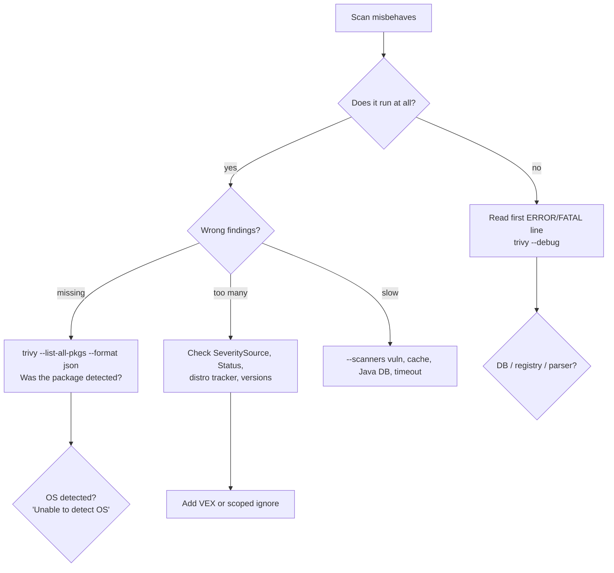

# Trivy: Troubleshooting

| | |
|---|---|
| **Cluster** | 08 DevSecOps |
| **Role** | Anchor |
| **Prerequisites** | [02-core-concepts.md](02-core-concepts.md), [03-commands-and-cheatsheet.md](03-commands-and-cheatsheet.md) |
| **Target version** | Trivy 0.56+, Trivy Operator 0.24+ |
| **Capstone phase** | Phase 5 (Months 17-20) |

> Symptom-first reference. Start with the table, confirm with the diagnostic command, apply the fix. Error messages are quoted as Trivy prints them so you can grep this file from a CI log.

---

## 1. Debugging Workflow



Always start with:

```bash
trivy --debug image <ref> 2>&1 | tee trivy-debug.log
trivy --version
cat ~/.cache/trivy/db/metadata.json
```

---

## 2. Symptom to Fix Table

### 2.1 Database and network

| Symptom | Likely cause | Diagnose | Fix |
|---|---|---|---|
| `FATAL  init error: DB error: failed to download vulnerability DB: ... TOOMANYREQUESTS: retry-after: ...` | GHCR rate limit on anonymous pulls from a shared CI egress IP | Check the repo in the log line | Cache `~/.cache/trivy` across runs; set `--db-repository` to `mirror.gcr.io/aquasec/trivy-db:2` or an internal mirror; authenticate to GHCR (`docker login ghcr.io`) |
| `FATAL ... failed to download vulnerability DB: ... x509: certificate signed by unknown authority` | Corporate TLS inspection proxy | `curl -v https://ghcr.io/v2/` | Add the proxy CA to the system trust store (`update-ca-certificates`) or `SSL_CERT_FILE`; never use `--insecure` in production |
| `FATAL ... failed to download vulnerability DB: ... dial tcp: lookup ghcr.io: no such host` | Air-gapped runner | `getent hosts ghcr.io` | Mirror DBs and use `--db-repository`/`--skip-db-update`; see [05-production-patterns.md](05-production-patterns.md#air-gapped) |
| `WARN  ... The vulnerability database may be outdated` / `the DB is out of date` | `--skip-db-update` with an old cache | `jq .UpdatedAt ~/.cache/trivy/db/metadata.json` | Refresh the mirror; alert on DB age > 48 h |
| `FATAL ... unable to initialize the Java DB: ... TOOMANYREQUESTS` | Java DB (~600 MB) pulled on every run | Debug log shows `javadb` download | Pre-download in the CI image (`--download-java-db-only`), cache, or `--skip-java-db-update` when no jars are expected |
| `FATAL ... DB schema version mismatch` / `unsupported DB version` | Old Trivy binary with a new DB (or vice versa) | `trivy --version` vs `metadata.json` `Version` | Upgrade Trivy; `trivy clean --vuln-db` then re-download |
| `FATAL ... invalid cache: ... bolt ... timeout` / `database is locked` | Two Trivy processes sharing one cache dir | `lsof ~/.cache/trivy/db/trivy.db` | Serialise, or give each job its own `--cache-dir`, or use Redis backend |

### 2.2 Image access

| Symptom | Likely cause | Diagnose | Fix |
|---|---|---|---|
| `FATAL  image scan error: scan error: unable to initialize a scanner: ... unable to find the specified image "x:y" in ["docker" "containerd" "podman" "remote"]` | Image not local and not pullable (typo, private, wrong tag) | `docker pull x:y`; `crane manifest x:y` | Fix ref; `docker login`; use digest; set `--image-src remote` to skip daemon probing |
| `... remote error: GET https://ghcr.io/v2/...: UNAUTHORIZED` / `DENIED` | Missing or wrong registry credentials | `crane auth get ghcr.io` | `docker login`; in Actions use `docker/login-action` before Trivy; for ECR ensure the OIDC role has `ecr:BatchGetImage`, `ecr:GetDownloadUrlForLayer`, `ecr:GetAuthorizationToken` |
| `... MANIFEST_UNKNOWN: manifest unknown` | Tag deleted or image pushed to another repo | `crane ls <repo>` | Use the digest emitted by the build step |
| `... no child with platform linux/amd64 in index` | Multi-arch index without the requested platform | `crane manifest --platform linux/arm64 <ref>` | `--platform linux/arm64` |
| `Cannot connect to the Docker daemon at unix:///var/run/docker.sock` | Running in a container without the socket or in rootless mode | `docker info` | Use `--image-src remote` or `--input image.tar`; or mount the socket (lab only) |
| `FATAL ... failed to extract layer ... archive/tar: invalid tar header` | Corrupt or non-OCI tarball passed to `--input` | `tar -tf image.tar \| head` | Export with `docker save` or `buildx --output type=oci`; confirm not a gzip of a tar |
| Scan of a 6 GB image times out: `context deadline exceeded` | Default 5-minute timeout | Debug log stalls at layer extraction | `--timeout 20m`; `--scanners vuln` to skip secret scanning; `--skip-dirs` for huge data dirs |

### 2.3 Detection gaps ("Trivy missed X")

| Symptom | Likely cause | Diagnose | Fix |
|---|---|---|---|
| `INFO  Unable to detect OS` / only language findings | `scratch` or base without `/etc/os-release`, or `os-release` deleted to "harden" | `trivy image --format json <ref> \| jq .Metadata.OS` | Expected for scratch/static binaries. If distro packages are present, restore `/etc/os-release`; for distroless ensure `/var/lib/dpkg/status.d` is intact |
| `WARN  This OS version is no longer supported by the distribution  family="debian" version="10"` then zero findings | EOL base image: no feed, so no CVEs reported | Same `.Metadata.OS` | Upgrade base; add `--exit-on-eol 1` so the pipeline fails loudly |
| Python packages missing in a `fs` scan | `requirements.txt` lines unpinned (`>=`) are skipped | `--list-all-pkgs` shows none | Use a lockfile (`poetry.lock`, `uv.lock`, `pip-compile` output); or scan the built image |
| Python packages missing in an image scan | Installed into a non-standard prefix or `.pyc`-only bundle; `dist-info` stripped | `find / -name '*.dist-info' -maxdepth 6` inside the container | Do not strip `dist-info`; keep `site-packages` metadata |
| Java jar reported as `unknown` or not reported | No `pom.properties` and SHA-1 not in Java DB (shaded/local build) | `--list-all-pkgs` shows `(jar)` with no version | Keep `pom.properties` in the jar; publish internal jars to a Maven repo and add to SBOM via build plugin; combine with `cyclonedx-maven-plugin` SBOM and `trivy sbom` |
| Go binary shows stdlib only | Built with `-trimpath` and stripped module info, or not Go modules | `go version -m binary` | Build with module info (default); do not strip `.go.buildinfo` |
| Node packages missing in image | `npm ci --omit=dev` removes dev deps (correct) or `node_modules` outside `/app` | `--list-all-pkgs` | Expected if dev deps removed; otherwise check `--skip-dirs` |
| `requirements.txt` named differently not scanned | Analyzer matches by filename | | `--file-patterns "pip:requirements-.*\.txt"` |
| Lockfile inside `node_modules`/`vendor` ignored | Default skip of vendored dirs | | Intended; override with `--skip-dirs ""` only if you really want vendored scanning |
| Secret in a `.md` or `.lock` file not detected | Built-in allow rules skip markdown, lockfiles, binaries | `--debug` shows `skipping file` | `disable-allow-rules: [markdown]` in `trivy-secret.yaml` |
| Secret scanning finds nothing in image `ENV` | `--image-config-scanners secret` not set | | Add the flag |

### 2.4 Too many / wrong findings

| Symptom | Likely cause | Diagnose | Fix |
|---|---|---|---|
| CVE reported but vendor says fixed | Fix backported in a revision Trivy's feed snapshot predates, or distro tracker still lists as open | Compare `security-tracker.debian.org/tracker/CVE-...`; check `FixedVersion` and `SeveritySource` in JSON | Wait for DB refresh (6 h); if tracker is wrong, file upstream; VEX `fixed` for the interim |
| CVE on a package your app never uses (e.g. `linux-libc-dev`, `perl-base`) | Base image bloat | `Layer.DiffID` points to base layer | Minimal base image; `.trivyignore.yaml` scoped by purl with statement; VEX |
| Same CVE twice: once for `openssl` once for `libssl3` | Two binary packages from one source package | Normal: both installed | Fix via base image rebuild; both disappear together |
| Severity differs from NVD | Trivy prefers vendor rating for OS packages (`SeveritySource: redhat`) | JSON `SeveritySource` and `CVSS` block | Expected; re-rank in DefectDojo if your policy demands NVD |
| Misconfig `AVD-AWS-0088` flagged although `aws_s3_bucket_server_side_encryption_configuration` exists | Resource not linked because bucket referenced by string instead of `aws_s3_bucket.x.id`, or in another module not scanned | `trivy config --debug` | Reference the resource attribute; scan the plan JSON (`terraform show -json`) for resolved graph |
| Helm chart misconfigs that do not match production | Scanned with default values | | `--helm-values values-prod.yaml`, `--helm-set` |
| Kubernetes checks on CRDs or operators that cannot comply | Built-in checks assume Pods | | Scoped `.trivyignore.yaml` misconfigurations entry with `paths` |
| Secret finding in test fixture | Expected test data | | `allow-rules` with narrow `path` or `regex` in `trivy-secret.yaml` |
| License `unknown` for most OS packages | dpkg/rpm metadata lacks SPDX IDs | | Accept; use `--license-full` on sources, or Syft + Dependency-Track for compliance |

### 2.5 CI-specific

| Symptom | Likely cause | Diagnose | Fix |
|---|---|---|---|
| `aquasecurity/trivy-action` step passes though table shows HIGH | `exit-code` not set (defaults to `0`) | Read step inputs | `exit-code: "1"` (string) |
| Gate fails on findings that `.trivyignore.yaml` covers | Action uses `trivyignores` input pointing to flat file; YAML needs `--ignorefile` | | `trivyignores: .trivyignore.yaml` or `TRIVY_IGNOREFILE` env |
| SARIF upload: `Code Scanning could not process the submitted SARIF file: ... too many results` | > 25,000 results or > 10 MB | Count rules in SARIF | Scan `HIGH,CRITICAL` for SARIF; split categories; `--ignore-unfixed` |
| SARIF upload: `Resource not accessible by integration` | Missing `security-events: write` or PR from a fork | Workflow `permissions` | Add permission; forks cannot upload, use `if: github.event.pull_request.head.repo.full_name == github.repository` |
| Second Trivy step re-downloads DB | New process, cache not reused | Timestamps in log | Same `--cache-dir`; `TRIVY_SKIP_DB_UPDATE=true` in later steps; `skip-setup-trivy: true` |
| `Error: Trivy failed with exit code 1` but table is empty | Scan error (pull/timeout) not a finding | Scroll up for `FATAL` | Fix the underlying error; distinguish with `--exit-code 2` for findings so `1` means error |
| Different results locally vs CI | Different DB snapshot time or different platform pulled | `metadata.json` both sides; `--platform` | Pin DB via mirror; scan by digest with explicit platform |

### 2.6 Trivy Operator

| Symptom | Likely cause | Diagnose | Fix |
|---|---|---|---|
| No `VulnerabilityReport` for a workload | Image pull failure in scan Job, namespace excluded, or workload kind not targeted | `kubectl get jobs -n trivy-system`; `kubectl logs job/<scan-job>`; operator logs | Create `imagePullSecret` and set `operator.privateRegistryScanSecretsNames` or configure `trivy.registry.*`; check `operator.excludeNamespaces`, `operator.targetWorkloads` |
| Scan Jobs stuck `Pending` | Node resources, PodSecurity admission in `trivy-system`, or nodeSelector | `kubectl describe job` | Label namespace `pod-security.kubernetes.io/enforce=baseline`; set `trivy.resources`; `nodeSelector` |
| Scan Job `OOMKilled` | Huge image or SBOM | Job pod events | Raise `trivy.resources.limits.memory`; use `trivy.mode=ClientServer`; exclude giant images |
| `Error: unable to download the Java DB` in Jobs | Each Job downloads Java DB | Job logs | `trivy.mode=ClientServer`; `trivy.javaDbRegistry` mirror; `trivy.skipJavaDBUpdate=true` |
| Reports stale after image rebuild with same tag | Report keyed by ReplicaSet, not image digest; same tag means same ReplicaSet if no pod spec change | `kubectl get rs -n <ns>` | Deploy by digest (Kyverno `mutateDigest`), or `operator.vulnerabilityScannerReportTTL=24h` |
| `ClusterComplianceReport` empty | Cron not fired yet | `kubectl get clustercompliancereport cis -o yaml` `status.updateTimestamp` | Wait for `compliance.cron`; or delete the report to trigger |
| Metrics show no `trivy_vulnerability_id` labels | `operator.metricsVulnIdEnabled=false` (default, cardinality) | | Enable deliberately, watch Prometheus series count |
| Operator RBAC error `cannot list resource "cronjobs"` | Chart RBAC trimmed | Operator logs | Reinstall chart with default RBAC or add rules |

---

## 3. Verbatim Errors Explained

```text
FATAL  image scan error: scan error: scan failed: failed analysis: analyze error: pipeline error: failed to analyze layer (sha256:...): post analysis error: post analysis error: Walk the directory: ... file too large
```

A single file exceeds the secret scanner size limit (default 1 MB is skipped, but very large archives can still trip walkers). Add `--skip-files` for the artefact or `--scanners vuln`.

```text
WARN  [secret] If your scanning is slow, please try '--scanners vuln' to disable secret scanning
```

Informational. Secret scanning reads every regular file; on images with large data directories it dominates run time.

```text
INFO  [javadb] Downloading Java DB...
```

A jar without `pom.properties` was encountered. If this appears in a Python service's scan, you probably have a bundled `.jar` (for example in a PDF library); confirm with `--list-all-pkgs`.

```text
WARN  [vex] no VEX statements found that match
```

The VEX document's `products[].@id` did not match the scanned artefact purl (registry, repo name, or digest differs). Use the exact `pkg:oci/...` form Trivy prints in `--format cyclonedx` `metadata.component.purl`, or omit the digest for repo-wide statements.

```text
ERROR  [misconfig] ... failed to load check ... rego_parse_error: unexpected ident token
```

Rego syntax error in a custom check, typically mixing legacy syntax with `import rego.v1` (which requires `if` and `contains`). Run `opa check --strict checks/` and `opa fmt -w`.

```text
WARN  [misconfig] ... Check ... has no input selector; it will be evaluated against all inputs
```

Add `custom.input.selector[].type` in the `METADATA` block so the check runs only on the intended framework.

```text
2026-10-27T10:12:00Z  WARN  [license] license is not found  pkg="libfoo"
```

Package metadata lacks a license field. Use the `unknown` bucket severity in `trivy.yaml` to decide whether this blocks.

---

## 4. Diagnostic Commands

```bash
# Everything Trivy found, vulnerable or not, per target
trivy image --list-all-pkgs --format json <ref> | jq '.Results[] | {Target, Class, Type, pkgs: (.Packages|length)}'

# Which feed and rating produced a finding
trivy image --format json <ref> | jq '.Results[].Vulnerabilities[]? | select(.VulnerabilityID=="CVE-2024-45490") | {PkgName, InstalledVersion, FixedVersion, Status, Severity, SeveritySource, purl: .PkgIdentifier.PURL}'

# OS detection
trivy image --format json <ref> | jq '.Metadata.OS'

# Layer attribution
trivy image --format json <ref> | jq -r '.Results[].Vulnerabilities[]? | "\(.VulnerabilityID)\t\(.Layer.DiffID)"' | sort | uniq -c

# Confirm DB freshness and schema
cat ~/.cache/trivy/db/metadata.json; trivy --version

# Confirm config file is being read
trivy image --debug <ref> 2>&1 | grep -i 'Loaded'

# Test registry access the way Trivy does (without the daemon)
trivy image --image-src remote --debug <ref> 2>&1 | grep -iE 'remote|auth|401|403'

# Operator: list scan jobs and their pods' last error
kubectl get jobs -n trivy-system -o json | jq -r '.items[] | "\(.metadata.name)\t\(.status.failed // 0)"'
kubectl logs -n trivy-system -l app.kubernetes.io/name=trivy-operator --tail=200 | grep -iE 'error|fail'

# Validate a VEX document's product id matches the SBOM purl
jq -r '.metadata.component.purl' sbom.cdx.json
jq -r '.statements[].products[]."@id"' vex.json
```

---

## 5. Performance Checklist

| Symptom | Fix |
|---|---|
| Every CI run downloads 60 MB DB | Cache `~/.cache/trivy` (actions/cache) or shared Redis; `TRIVY_SKIP_DB_UPDATE` in later steps |
| Java DB download in non-Java projects | `--skip-java-db-update` or pre-bake in runner image |
| Secret scan slow | `--scanners vuln` for the gate; secret scan in a separate advisory step; `--skip-dirs` for data |
| Large monorepo `fs` scan slow | `--skip-dirs node_modules,.git,target,.venv`; scan services individually in a matrix |
| Operator scans flood the cluster | `operator.scanJobsConcurrentLimit`, `ClientServer` mode, exclude namespaces, node selector for scan jobs |
| Repeated scans of same base | Layer cache works automatically if the cache dir persists |
| Timeout | `--timeout 15m`; look for huge layers with `docker history` |

---

## 6. When It Is Not Trivy's Fault

- **The distro tracker is wrong or late.** Debian/Ubuntu/Alpine trackers occasionally lag or mark incorrectly; Trivy mirrors them. File upstream, use VEX in the interim.
- **NVD severities inflate.** A CRITICAL network-exploitable CVSS on a library used offline is still CRITICAL in the DB. That is a policy decision, not a scanner bug: express it as VEX.
- **The image is not what you think.** Scanning `:latest` on a laptop and in CI pulls different digests. Always scan by digest.
- **The build does something clever.** Multi-stage builds that copy binaries without package metadata (`COPY --from=builder /usr/bin/app /app`) give Trivy nothing to identify. Keep metadata or publish an SBOM from the build stage and `trivy sbom` it.

---

## Next

[07-interview-questions.md](07-interview-questions.md) consolidates the knowledge from this folder.
