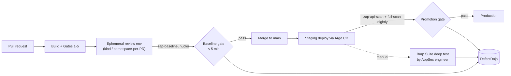

# Gate 6: Dynamic Application Security Testing (DAST)

| | |
|---|---|
| **Cluster** | 08 DevSecOps |
| **Gate** | 6 of 7: Automated, Fast Template, and Interactive DAST |
| **Tools** | OWASP ZAP (anchor), Nuclei (bridge), Burp Suite (bridge) |
| **Prerequisites** | Gates 1-5, HTTP fundamentals, the capstone services running in kind |
| **Capstone phase** | Phase 5 (Months 17-20) |
| **Feeds** | DefectDojo ASPM hub ([../aspm-and-siem/](../aspm-and-siem/README.md)) |

> Gates 1-5 inspect artefacts at rest: source, lockfiles, images, manifests, Terraform. Gate 6 is the first gate that inspects the application *while it runs*. After this gate you will be able to stand up an ephemeral copy of your own service, drive an authenticated black-box scan against it from CI, decide which findings block promotion, and ship the rest into DefectDojo for tracking. Everything here is defensive testing of systems you own or are explicitly authorised to test.

---

## 1. Why a Dynamic Gate Exists

Static analysis sees code; it does not see configuration drift, middleware, reverse proxies, TLS settings, framework defaults, or the way three services compose at runtime. A SAST rule cannot know that the ingress controller strips your `Content-Security-Policy` header, that Spring Boot Actuator is exposed on the public listener, or that a FastAPI dependency returns 200 for an unauthenticated request because a `Depends()` was removed in a refactor. DAST finds the class of bugs that only exist when the HTTP surface is assembled.

The unifying pattern of this gate: **deploy a disposable instance of your own application, point a scanner at it with valid credentials, and treat the scanner output as a regression suite.**

### DAST vs SAST vs IAST vs SCA

| Dimension | SAST (Gate 2) | SCA (Gate 3) | DAST (Gate 6) | IAST |
|---|---|---|---|---|
| Inspects | Source / bytecode | Dependency manifests, SBOM | Running HTTP surface | Instrumented runtime (agent inside the process) |
| Needs running app | No | No | Yes | Yes, plus traffic |
| Language awareness | High | High | None (black box) | High |
| Finds | Taint flows, injection sinks, insecure APIs | Known CVEs in third-party code | Misconfig, auth gaps, missing headers, reflected injection, exposed endpoints | Confirmed exploitable flows with stack traces |
| False positives | Medium-high | Low (but reachability unknown) | Low for passive, medium for active | Very low |
| Coverage limit | Only code you own | Only declared deps | Only what the crawler/spec reaches | Only exercised paths |
| Typical runtime in CI | 1-10 min | Seconds | 2-60 min | Adds latency to tests |
| Capstone tools | SonarQube, Semgrep, Checkmarx | Snyk, Dependency-Track | ZAP, Nuclei, Burp | Not in the 20 (Contrast, Seeker are commercial) |

DAST does not replace the earlier gates. It is the gate that validates that the earlier gates, deployment configuration, and platform defaults *composed* into something safe.

---

## 2. Where DAST Runs

| Environment | Scan type | Time budget | Blocks? | Why |
|---|---|---|---|---|
| Ephemeral review environment per PR | ZAP baseline (passive), Nuclei with curated tags | under 5 minutes | Yes on FAIL rules | Cheap, fast, catches regressions in headers, cookies, exposed debug routes |
| Staging (post-merge) | ZAP API scan from OpenAPI, Nuclei full `-as` | 10-30 minutes | Yes on High | Realistic config, real ingress, real auth provider |
| Pre-production promotion | ZAP full active scan with authentication | 30-90 minutes, nightly | Yes on High/Critical | Active attacks need time; run on a schedule, not per commit |
| Staging, manual | Burp Suite Professional | Hours to days | Produces tickets | Business logic, multi-step auth, BOLA; humans find what crawlers cannot |
| Production | Passive only, or nothing | n/a | No | Active scanning mutates data and trips alarms; only with written authorisation and a change ticket |

**Never run active scans against production or against anything you do not own.** Active scans submit forms, delete records, trigger emails, and create thousands of log lines. The capstone deploys a throwaway namespace precisely so the scanner can be reckless.

---

## 3. Authenticated Scanning

An unauthenticated scan of an API with a global auth middleware tests exactly one thing: that the middleware returns 401. Real coverage requires the scanner to hold a session.

| Method | How | Tool support |
|---|---|---|
| Static bearer token / API key header | Inject `Authorization: Bearer <TOKEN>` on every request | ZAP replacer, Nuclei `-H`, Burp session rule |
| Form login | Scanner POSTs credentials, tracks cookie | ZAP form-based auth, Burp macro |
| JSON login | Scanner POSTs JSON body, extracts token from response | ZAP JSON-based auth with verification regex, Burp macro + session rule |
| OIDC / browser flow | Headless browser executes the redirect dance | ZAP browser-based auth (Automation Framework), Burp built-in browser recording |
| Script-based | Custom script performs arbitrary login steps | ZAP Zest/GraalJS scripts, Burp extensions |

Critical detail: tell the scanner how to **verify** it is still logged in (a logged-in regex, a logged-out regex, or a poll URL) so it re-authenticates when the session expires mid-scan. Without verification, an hour-long active scan can run fifty minutes unauthenticated and report nothing.

The capstone issues a short-lived test user in the review environment; the token is minted inside the pipeline job and never stored in the repository.

---

## 4. Spec-Driven Scanning (OpenAPI, GraphQL, SOAP)

Crawlers are bad at APIs: no links to follow, request bodies with required schemas, and 422 responses on malformed input. Feed the spec instead.

| Spec | FastAPI | Spring Boot | ZAP | Nuclei | Burp |
|---|---|---|---|---|---|
| OpenAPI 3 | `/openapi.json` built in | springdoc `/v3/api-docs` | `zap-api-scan.py -f openapi`, `openapi` AF job | Not directly (custom templates per path) | Pro: OpenAPI import; Enterprise: API scan |
| GraphQL | Strawberry/Ariadne schema | Spring for GraphQL `/graphql` introspection | `zap-api-scan.py -f graphql`, `graphql` AF job | Custom templates, `graphql` tag | GraphQL extension / InQL |
| SOAP/WSDL | Rare | Spring-WS | `zap-api-scan.py -f soap` | Rare | Wsdler extension |

Spec-driven scanning also tests the *spec itself*: endpoints that exist in the spec but return 404, or routes reachable in the app that are absent from the spec (shadow APIs, found by comparing the ZAP site tree with the spec).

---

## 5. Tool Comparison

| Dimension | OWASP ZAP | Nuclei | Burp Suite |
|---|---|---|---|
| Licence | Apache 2.0 | MIT (engine and templates) | Community free; Professional and Enterprise/DAST commercial |
| Primary role | Automated DAST in CI, full proxy/scanner | Fast template-driven checks for known CVEs and misconfigurations | Manual penetration testing; Enterprise for scheduled scanning |
| Automation | Excellent: packaged scans, Automation Framework YAML, REST API, GitHub Actions | Excellent: single binary, exit codes, JSON/SARIF | Enterprise: good (REST/GraphQL API, CI drivers). Pro: REST API limited. Community: none |
| Crawl coverage | Traditional spider plus AJAX spider (headless browser), spec import | None (you give it URLs; pair with katana/httpx) | Best-in-class crawler (Pro), handles complex JS and auth |
| Active attack depth | Good: ~60 active rules, scan policies, fuzzable | Shallow by design: known-pattern checks, some fuzzing (`-dast` mode) | Deepest: Scanner, Intruder, Collaborator for out-of-band |
| False positives | Low-medium; tune with `rules.tsv`, alert filters | Low; templates are matcher-based (not literally zero, as the marketing claims) | Low-medium; manual verification is the point |
| Speed in CI | Baseline under 2 min; full scan 10-60 min | Seconds to minutes at `-rl 150` | Enterprise scans minutes to hours |
| Cost | Free | Free (ProjectDiscovery Cloud optional) | Pro per-seat; Enterprise per-scan-agent |
| Learn curve | Medium | Low | Medium-high |
| Weak spot | UI is dated; AJAX spider slow; active scan of large apps needs tuning | No crawl, no auth flows, no business logic | Price; Community version intentionally throttled; CI story needs Enterprise |

Use ZAP as the default CI gate, Nuclei for fast CVE/misconfiguration regression on staging, and Burp when a human needs to think.

---

## 6. Anchor-and-Bridge Delta Mapping

| Concept | OWASP ZAP (anchor) | Nuclei | Burp Suite |
|---|---|---|---|
| Unit of detection | Scan rule (passive/active, numeric id) | Template (YAML, string id) | Scanner check (Pro), or manual test |
| Grouping | Scan policy | Tags, severity, workflow | Scan configuration |
| Scope | Context with include/exclude regex | Target list; `-exclude-hosts` | Target scope |
| Discovery | Spider + AJAX spider + OpenAPI import | None (katana/httpx externally) | Crawler (Pro), Target site map |
| Auth | Context authentication + session management + users | `-H` header only | Session handling rules + macros |
| Tuning FPs | `rules.tsv`, alert filters | Edit matchers, `-exclude-templates`, `-exclude-id` | Issue false-positive marking |
| Output | HTML/JSON/XML/SARIF/Markdown | JSONL/JSON/SARIF/Markdown | HTML/XML (Pro); Enterprise API |
| CI runner | `ghcr.io/zaproxy/zaproxy:stable`, `zaproxy/action-*` | `projectdiscovery/nuclei-action` | Enterprise CI driver / GraphQL API |
| Headless control | REST API, `zap.yaml` | CLI flags | REST API (Pro, limited) / Enterprise API |
| Severity scale | Risk (Informational/Low/Medium/High) x Confidence | severity: info/low/medium/high/critical | Severity x Confidence (Certain/Firm/Tentative) |

---

## 7. Rules of Engagement

This wiki documents DAST so you can test **your own** applications. Before any scan:

1. **Ownership or written authorisation.** You own the target, or you hold a signed scope document naming hosts, time windows, and contacts. Bug-bounty programmes publish scope; anything outside it is off limits.
2. **Non-production first.** Active scans go to ephemeral or staging environments. Production gets passive scans only, if at all, and only inside a change window.
3. **Isolated data.** The scan target uses seeded, synthetic data. Never point an active scanner at a database with customer or patient records.
4. **Rate limits.** Configure `-rl` (Nuclei), scan policy thread counts (ZAP), or resource pool (Burp) so you do not take down the service you are testing or starve neighbours in a shared cluster.
5. **Tell the SOC.** Scans generate the same signals as attacks. Falco ([../gate-7-runtime-and-secrets/falco/](../gate-7-runtime-and-secrets/falco/README.md)) and Wazuh will light up; pre-register the scanner's source IP and user agent.
6. **Record evidence.** Keep scan reports in DefectDojo as audit evidence; they prove the gate ran.

Violating these is not a grey area. Unauthorised scanning is a criminal offence in most jurisdictions regardless of intent.

---

## 8. Learning Order and Time Budget

| Week | Focus | Deliverable |
|---|---|---|
| 1 | ZAP concepts, Docker baseline scan against `inventory-api` on localhost | First HTML report, `rules.tsv` tuned to zero WARN |
| 2 | ZAP API scan from `openapi.json`, Automation Framework `zap.yaml`, authentication | Authenticated AF scan with exit status |
| 3 | ZAP in GitHub Actions, SARIF upload, DefectDojo import | PR comment and Dojo findings per PR |
| 4 | Nuclei: templates, custom checks for actuator/CORS/headers, nightly staging run | 6 custom templates, SARIF in CI |
| 5 | Burp Suite: proxy, Repeater, Intruder, Autorize on `orders-service`; write one finding per OWASP API Top 10 category you can reproduce | Manual test report in DefectDojo |
| 6 | Tuning: speed, scan policies, false-positive rules, the ZAP full scan nightly | Nightly scan under 30 minutes, zero untriaged findings |

Approximately 40 hours of the 180-hour Phase 5 budget.

---

## 9. Tool Folders

- [owasp-zap/](owasp-zap/README.md) - anchor. Start here.
- [nuclei/](nuclei/README.md) - bridge. Fast templated checks.
- [burp-suite/](burp-suite/README.md) - bridge. Interactive testing.

Related: [Gate 7 Runtime and Secrets](../gate-7-runtime-and-secrets/README.md) detects what Gate 6 missed. [ASPM and SIEM](../aspm-and-siem/README.md) is where every report in this gate ends up. The cluster overview is at [../README.md](../README.md).
