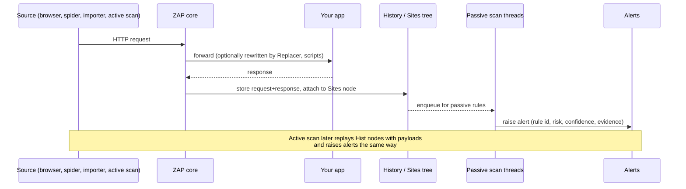

# OWASP ZAP: Core Concepts

| | |
|---|---|
| **Cluster** | 08 DevSecOps |
| **Role** | Anchor (Gate 6 DAST) |
| **Prerequisites** | [01-installation-and-setup.md](01-installation-and-setup.md) |
| **Target version** | ZAP 2.15+ |
| **Capstone phase** | Phase 5 (Months 17-20) |

> This file explains how ZAP works internally: how requests become history, how history becomes alerts, how contexts and authentication shape coverage, how scan policies shape depth, and how the Automation Framework and REST API expose all of it to a pipeline. Read it before tuning anything; most "ZAP found nothing" and "ZAP never finishes" problems are conceptual, not configuration.

---

## 1. The Request Lifecycle



Three facts follow:

1. Passive scanning is asynchronous. A scan that "finishes" the spider may still have passive work queued; this is why `passiveScan-wait` exists in the Automation Framework and why the baseline script waits for the passive queue before reporting.
2. The Sites tree is the unit of scope. Nodes are grouped by scheme, host, port, path, and for data-driven paths by parameters. Active scan targets nodes, not raw URLs.
3. ZAP tests only what is in the tree. Coverage comes from spidering, importing, or proxying real traffic (for example, running your Playwright end-to-end suite through ZAP).

---

## 2. Discovery: Spiders and Importers

### Traditional spider

Fetches a page, parses HTML (`href`, `src`, forms, `<meta http-equiv=refresh>`), parses JavaScript for URL-like strings, parses `robots.txt`, `sitemap.xml`, and `.svn/.git` hints if enabled. Fast; limited by `maxDepth`, `maxChildren`, `maxDuration`. Submits forms with generated values (`parseComments`, `postForm`, `processForm`). Blind to URLs assembled at runtime by JavaScript.

### AJAX spider

Launches a headless Firefox (bundled in the Docker image) or Chrome, loads the page, clicks every element, and records resulting requests through ZAP's proxy. Finds SPA routes and XHR endpoints. Slow (minutes), memory-heavy, non-deterministic. Control it with `maxDuration`, `maxCrawlDepth`, `numberOfBrowsers`, `clickDefaultElems`, `clickElemsOnce`.

### Importers

| Importer | Add-on | Input | Produces |
|---|---|---|---|
| OpenAPI | `openapi` | v2/v3 JSON or YAML, URL or file | One history entry per operation with schema-derived example bodies |
| GraphQL | `graphql` | Introspection endpoint or SDL file | Queries/mutations generated to configurable depth, with argument strategies |
| SOAP | `soap` | WSDL | One request per operation |
| HAR / URL list | `exim` | Browser export, text file of URLs | Raw history entries |
| Postman | `postman` | Collection JSON | Requests from the collection |

For APIs, importers beat spiders every time: no links to follow, correct content types, and required fields filled.

### Technology set

A context has a technology list (Db.PostgreSQL, Language.Python, OS.Linux, WS.Apache, etc.). Active rules that do not apply to the configured technologies skip their payloads, which can halve active scan time. The default is "everything enabled".

---

## 3. Passive vs Active Scanning

| Property | Passive | Active |
|---|---|---|
| Sends additional requests | No | Yes, many (hundreds per parameter at High strength) |
| Safe against production | Observes only; yes when authorised | No; mutates data, can trigger emails, deletes, charges |
| Typical findings | Missing CSP/HSTS/X-Content-Type-Options, cookie flags, information disclosure (versions, stack traces, comments), insecure forms, mixed content, outdated JS libraries (Retire.js) | Reflected/stored XSS, SQL/NoSQL/LDAP/XPath injection, OS command injection, path traversal, remote file inclusion, SSRF probes (via OAST), CRLF injection, buffer overflow, parameter tampering, external redirect |
| Rule ids | 10000-10999 (pscan), 90000+ shared, 100000+ scripts | 0-9 legacy, 20000-20999, 30000-30999, 40000-40999, 90000+ |
| Where configured | `passiveScan-config` job, Options, Passive Scan Rules | Scan policy |
| Threshold | Per-rule alert threshold | Per-rule alert threshold **and** attack strength |

### Attack strength and alert threshold

- **Attack strength** (Low / Medium / High / Insane): how many payload variants a rule sends. Low is a handful; Insane can be thousands per parameter. Default Medium.
- **Alert threshold** (Off / Low / Medium / High / Default): how confident the rule must be before raising. High threshold = fewer false positives, more false negatives. Off disables the rule.

A scan policy is a named table of (rule, enabled, strength, threshold). The Docker image ships `Default Policy`; the full scan uses a tuned one. You can define policies inline in `zap.yaml` under `activeScan.policyDefinition` or import `.policy` XML files.

### Input vectors

Which parts of a request the active scanner fuzzes: query string, POST body (form, JSON, XML, multipart, GraphQL), cookies, headers (off by default), URL path segments (off by default), script-defined. Enabling header and path injection increases coverage and time; enable them for the nightly scan, not the PR scan.

---

## 4. Alerts

An alert is:

| Field | Meaning |
|---|---|
| `pluginId` | Rule id (stable across versions; the canonical key for tuning) |
| `alertRef` | `pluginId` plus optional suffix when one rule raises multiple distinct alerts (`10055-1`) |
| `name` | Human name ("Content Security Policy (CSP) Header Not Set") |
| `risk` | Informational (0), Low (1), Medium (2), High (3) |
| `confidence` | False Positive (0), Low (1), Medium (2), High (3), User Confirmed (4) |
| `cweid`, `wascid` | Taxonomy ids; DefectDojo maps `cweid` |
| `url`, `method`, `param`, `attack`, `evidence` | Where, what, and the proof |
| `solution`, `reference`, `otherinfo` | Remediation text |
| `tags` | OWASP Top 10 2021 mappings, CWE, policy tags |

ZAP groups alert instances by rule and name in reports; DefectDojo further dedups on (title, cwe, endpoint) hash.

### Alert filters

Alert filters rewrite alerts after they are raised: change risk (including to False Positive), by rule id, URL regex, parameter, attack, evidence, method. In the AF they are the `alertFilter` job; in the desktop they live on the context. Use them when a finding is real but accepted (documented risk acceptance), or when a rule is noisy only on one path.

### `rules.tsv` for packaged scans

Tab-separated: `<rule id>\t<action>\t<comment>`. Actions:

| Action | Effect |
|---|---|
| `IGNORE` | Do not report at all |
| `INFO` | Report as INFO, never affects exit code |
| `WARN` | Default; exit 2 unless `-I` |
| `FAIL` | Exit 1 |
| `OUTOFSCOPE` | Treat URLs matching the regex in the third column as out of scope for this rule |

Lines starting with `#` are comments. Rule ids not listed default to WARN. With `-c rules.tsv` or `-u <URL to rules file>`.

---

## 5. Contexts, Scope, and Authentication

A **context** is a named bundle:

```text
Context
├── Include regexes       http://host.docker.internal:8000/.*
├── Exclude regexes       .*/logout.*  .*/metrics.*
├── Technology            Python, PostgreSQL, Linux
├── Authentication method form | json | http | script | browser | autodetect | client
│   ├── Login URL / request body
│   └── Verification: logged-in regex, logged-out regex, poll URL
├── Session management    cookie | http (header) | script | headers (AF)
├── Users                 name + credentials (username, password, or token)
├── Structure modifiers   data-driven nodes, structural parameters
└── Alert filters
```

### Authentication methods

| Method | When | Key parameters |
|---|---|---|
| **Form-based** | Classic `application/x-www-form-urlencoded` login | `loginPageUrl`, `loginRequestUrl`, `loginRequestBody: username=&password=` |
| **JSON-based** | SPA/API login posting JSON | `loginRequestUrl`, `loginRequestBody: {"username":"","password":""}` |
| **HTTP/NTLM** | Basic/Digest/NTLM | realm, host, port |
| **Script-based** | Multi-step logins, CSRF tokens, custom headers | A Zest or GraalJS script, with parameters |
| **Browser-based** | OIDC redirects, SSO, JS-heavy login pages | `loginPageUrl`, `loginPageWait`, browser id; ZAP drives Firefox and records the resulting session |
| **Client script** | Replay a recorded browser session (Zest recorded via the ZAP browser extension) | script name |
| **Autodetect** | Let ZAP try to figure it out (AF only) | none |

### Session management

How ZAP recognises and reuses the session once logged in:

| Method | Behaviour |
|---|---|
| Cookie-based | Replays `Set-Cookie` values from login |
| HTTP auth | Re-sends Basic/NTLM headers |
| Header-based (AF `headers`) | Injects headers whose values come from the login response, e.g. `Authorization: Bearer ` |
| Script-based | Custom extraction and injection |
| Autodetect | AF heuristics |

### Verification

`verification.method` is `response` (check the login response), `request` (check each request), `both`, or `poll` (hit `pollUrl` every `pollFrequency` requests/seconds and apply the regexes). `loggedInRegex` / `loggedOutRegex` are matched against the whole response (`\QWelcome\E`, `"authenticated":\s*true`, or `\Q401 Unauthorized\E` for logged out). Verification is what lets ZAP **re-authenticate automatically**; omit it and expired tokens silently void the scan.

### Users

Named credential sets. Spider, AJAX spider, and active scan each take a `user` parameter and run as that user. Scanning with two users of different privilege and comparing which URLs each reached is the poor man's authorisation test (the Access Control Testing add-on automates it).

### Bearer token without a login flow

In CI you often already have a token (minted by the pipeline for a scan user). Skip authentication entirely and inject the header with the Replacer:

```text
-config replacer.full_list(0).description=auth
-config replacer.full_list(0).enabled=true
-config replacer.full_list(0).matchtype=REQ_HEADER
-config replacer.full_list(0).matchstr=Authorization
-config replacer.full_list(0).regex=false
-config replacer.full_list(0).replacement=Bearer <TOKEN>
```

Passed to packaged scans via `-z "<options>"`, or as a `replacer` job in the AF. The downside: no re-authentication on expiry, so mint a token whose lifetime exceeds the scan.

---

## 6. The Automation Framework (AF)

The AF is a YAML plan: an `env` block, then an ordered `jobs` list. ZAP runs the jobs sequentially; each job reads from and writes to the shared session. It replaced the ad-hoc shell-and-API approach and is what the packaged scans use internally since 2.12 (`--autooff` disables that).

```yaml
env:
  contexts:
    - name: <context name>
      urls: [ ... ]                 # top-level URLs, also used as spider seeds
      includePaths: [ regex, ... ]
      excludePaths: [ regex, ... ]
      authentication:
        method: json
        parameters: { loginRequestUrl: ..., loginRequestBody: ... }
        verification: { method: poll, pollUrl: ..., pollFrequency: 60, pollUnits: requests, loggedInRegex: ..., loggedOutRegex: ... }
      sessionManagement:
        method: headers
        parameters: { Authorization: "Bearer " }
      technology: { include: [ ... ], exclude: [ ... ] }
      users:
        - name: scan-user
          credentials: { username: ..., password: ... }
  vars:
    BASE_URL: http://host.docker.internal:8000       # referenced as ${BASE_URL}; env vars also resolve
  parameters:
    failOnError: true
    failOnWarning: false
    progressToStdout: true
jobs:
  - type: addOns            # install/uninstall/update add-ons before anything else
  - type: passiveScan-config
  - type: replacer          # header injection rules
  - type: requestor         # send specific hand-written requests (e.g. seed data, login warm-up)
  - type: openapi | graphql | soap | import
  - type: spider
  - type: spiderAjax
  - type: passiveScan-wait
  - type: activeScan-config  # input vectors, handle anti-CSRF, max rule duration
  - type: activeScan-policy  # define named policies
  - type: activeScan
  - type: alertFilter
  - type: report
  - type: exportdata        # HAR/URL export of the session
  - type: exitStatus
```

Key behaviours:

- `${VAR}` substitutes `env.vars` and process environment variables, so secrets arrive via `-e TOKEN=...` on `docker run`, never in the file.
- Each job accepts `tests` (statistic thresholds, alert counts, URL presence) which can fail the plan: "fail if fewer than 20 URLs were found" is the best guard against accidental zero-coverage scans.
- `alwaysRun: true` on `report`/`exitStatus` ensures a report even when an earlier job errored.
- The desktop UI has an Automation tab that builds and saves plans, and "Export Context" produces the `env` block.

---

## 7. The REST API

Every ZAP capability is exposed at `http://<zap>:<port>/<format>/<component>/<type>/<name>/?apikey=...` where format is `JSON`, `XML`, `HTML`, or `OTHER`, and type is `view` (read) or `action` (write).

| Task | Endpoint |
|---|---|
| Version | `/JSON/core/view/version/` |
| Access a URL (seed) | `/JSON/core/action/accessUrl/?url=` |
| Start spider | `/JSON/spider/action/scan/?url=&contextName=&recurse=true` then poll `/JSON/spider/view/status/?scanId=` |
| AJAX spider | `/JSON/ajaxSpider/action/scan/?url=` and `/JSON/ajaxSpider/view/status/` |
| Import OpenAPI | `/JSON/openapi/action/importUrl/?url=&hostOverride=` |
| Passive queue size | `/JSON/pscan/view/recordsToScan/` |
| Active scan | `/JSON/ascan/action/scan/?url=&recurse=true&scanPolicyName=` then `/JSON/ascan/view/status/?scanId=` |
| Alerts | `/JSON/alert/view/alerts/?baseurl=&start=&count=`; summary `/JSON/alert/view/alertsSummary/` |
| Reports | `/OTHER/core/other/htmlreport/`, `/OTHER/core/other/jsonreport/`, `/OTHER/core/other/xmlreport/`, or the reports add-on `/JSON/reports/action/generate/?title=&template=sarif-json&reportDir=` |
| Contexts | `/JSON/context/action/newContext/`, `includeInContext`, `/JSON/authentication/action/setAuthenticationMethod/`, `/JSON/users/action/newUser/` |
| Shutdown | `/JSON/core/action/shutdown/` |

The Python client (`pip install zaproxy`, module `zapv2`) mirrors this: `zap.spider.scan()`, `zap.ascan.scan()`, `zap.core.alerts()`, `zap.core.htmlreport()`. The older third-party `zap-cli` (`pip install zapcli`) wraps common tasks (`zap-cli quick-scan`, `zap-cli report`) but is less maintained than the AF; prefer AF for new work and the Python client for custom orchestration.

---

## 8. Sessions, Persistence, and Memory

A ZAP **session** is the HSQLDB holding history and alerts. Docker runs use an in-memory/temporary session; `-newsession /zap/wrk/name` or `-session` persists it (`.session` plus data files) so you can reopen it in the desktop to inspect evidence. Memory grows with history: a full active scan of a large app can exceed the default JVM heap. The Docker scripts read `ZAP_JVM_OPTIONS` (e.g. `-Xmx4g`); the `-config` flag `database.recoverylog=false` and `view.mode=daemon` reduce overhead further.

---

## 9. Add-ons and Maturity

Add-ons come from the Marketplace in three maturities: **release** (stable, in `:stable`), **beta**, **alpha** (in `:weekly`, or enabled in packaged scans with `-a`). Scan rules live in `ascanrules`/`pscanrules` (release), `ascanrulesBeta`/`pscanrulesBeta`, `ascanrulesAlpha`/`pscanrulesAlpha`. Other add-ons you will meet: `automation`, `openapi`, `graphql`, `soap`, `replacer`, `reports`, `selenium` (browsers), `spiderAjax`, `retire` (JS library CVEs), `oast` (out-of-band callbacks for blind SSRF/XXE), `accessControl`, `authhelper` (auto-detection and browser auth), `scripts`, `zest`, `exim`, `sqliplugin` (sqlmap-derived SQLi), `commonlib`, `network`. The AF `addOns` job can `install`/`uninstall` by id and `updateAddOns: true` pulls the latest at start (non-reproducible; disable in CI, rebuild the image instead).

---

## 10. Scripts

ZAP embeds GraalJS (JavaScript), Zest (ZAP's own recorded-script format), Kotlin, Python (Jython) and Ruby engines via add-ons. Script types: authentication, session management, httpsender (modify every request/response), proxy, active rules, passive rules, standalone, targeted, payload generators, variants (custom input vectors), extender. Use httpsender scripts to add a per-request HMAC signature, or an active rule script to test a business rule unique to your app. Scripts are loaded via the `script` AF job or mounted into `/home/zap/.ZAP/scripts/`.

---

## 11. Out-of-Band Testing (OAST)

Blind injection (SSRF, blind XXE, blind command injection) produces no visible response. The `oast` add-on registers an external callback service (the ZAP project's public `oast.pro`, or your own BOAST/Interactsh server) and embeds unique callback URLs in payloads; a callback proves the vulnerability. In the capstone, run a self-hosted Interactsh in the review cluster so that a staging app never makes requests to an external service, and so the evidence stays internal.

---

## 12. How the Packaged Scans Fit Together

| Script | Steps | Default time cap |
|---|---|---|
| `zap-baseline.py` | Start ZAP, (optional) import OpenAPI with `-O`/hook, traditional spider for `-m` minutes (default 1), optional AJAX spider `-j`, wait for passive scan, apply rules, report | about 2 min |
| `zap-full-scan.py` | Same as baseline, then **active scan** with the full policy, then report | unbounded unless `-T` |
| `zap-api-scan.py` | Start ZAP, import `-f openapi|soap|graphql` from `-t` (URL or file), optionally `-O` host override, run **API-tuned active scan policy** (no HTML-only rules), report | about 5-20 min |

All three accept `-c rules.tsv`, `-r/-J/-w/-x` report flags, `-z` raw ZAP options, `-n context.context`, `-U user`, `--hook hooks.py` (Python callbacks at each stage), `-I` (do not fail on WARN), `-l` minimum level to report, `-d` debug.

Next: [03-commands-and-cheatsheet.md](03-commands-and-cheatsheet.md).
