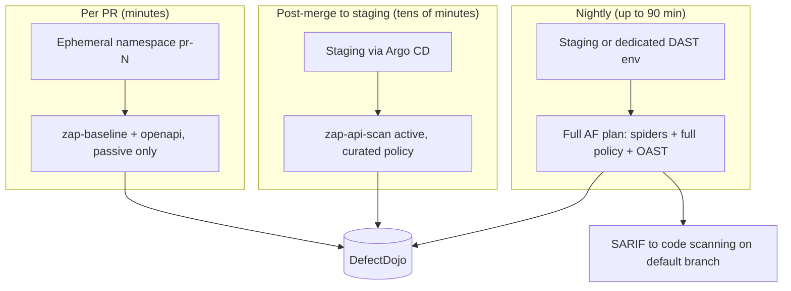

# OWASP ZAP: Production Patterns

| | |
|---|---|
| **Cluster** | 08 DevSecOps |
| **Role** | Anchor (Gate 6 DAST) |
| **Prerequisites** | [04-hands-on-labs.md](04-hands-on-labs.md) |
| **Target version** | ZAP 2.15+ |
| **Capstone phase** | Phase 5 (Months 17-20) |

> How to run ZAP across many services without it becoming the slowest, noisiest step in the pipeline: environment strategy, speed tuning, policy design, false-positive governance, secrets, SARIF and ASPM integration, multi-team ownership, and the anti-patterns that make teams turn DAST off. Everything here assumes you are scanning your own applications in environments you control.

---

## 1. Environment Strategy



| Decision | Recommendation | Why |
|---|---|---|
| Review environment per PR | Namespace per PR in a shared kind/EKS cluster, Helm chart with `seedData=true`, TTL controller deletes after 24 h | Scanner can be destructive; data is synthetic |
| Staging | Shared, long-lived, same ingress/TLS/auth provider as production | Catches platform-layer regressions (ingress headers, WAF rules) |
| Dedicated DAST environment | Only if staging is shared with QA and active scans disrupt them | Active scans create garbage rows and emails |
| Production | Passive scan via a proxied synthetic-monitoring run, or nothing | Authorised change windows only; never active |

Make the scan target discoverable: the Helm chart emits a `ConfigMap` with `dast.target.url` and `dast.openapi.url` so the pipeline does not hardcode hostnames.

---

## 2. Speed Tuning

A full scan that takes four hours gets disabled. Budget first, then tune to fit.

| Lever | Setting | Effect |
|---|---|---|
| Replace spidering with import | `openapi`/`graphql` job, drop `spider` for API-only services | Minutes saved, better coverage |
| Scope the AJAX spider | `maxDuration: 3`, `maxCrawlDepth: 5`, `inScopeOnly: true`, `clickElemsOnce: true`, `runOnlyIfModern: true` | AJAX spider is the slowest discovery step |
| Explicit allow-list policy | `defaultThreshold: Off`, enable 10-15 rules | 60 rules at Medium strength against 200 params is hours |
| Attack strength | Low for PR/merge, Medium nightly, High only for targeted re-tests | Strength grows payload count superlinearly |
| Technology set | `technology.include: [Language.Python, Db.PostgreSQL]` | Skips MySQL/Oracle/MSSQL/PHP payloads |
| Threads | `threadPerHost: 4-8` for a single service | Default 2 is conservative; raise until the app's p99 degrades |
| Rule time cap | `maxRuleDurationInMins: 2-5` | Stops one rule from hogging the budget |
| Scan time cap | `maxScanDurationInMins`, `-T` | Guarantees a report |
| Input vectors | Disable `httpHeaders`, `cookieData`, `urlPath` for PR scans | Each adds a multiplier |
| Exclude noise paths | `excludePaths` for `/metrics`, `/docs`, `/static`, logout | Static assets dominate request counts |
| Passive alert cap | `maxAlertsPerRule: 10` | Report size and memory |
| JVM | `ZAP_JVM_OPTIONS=-Xmx4g`, `database.recoverylog=false` | Avoids GC thrash on large sessions |
| Parallelise | One job per service in a matrix | Wall-clock, not CPU |
| Incremental | Compare `exportdata` URL lists between runs; scan only new/changed routes in PR | Advanced; needs custom scripting |

Measure: `jq '.runs[0].results | length'` on SARIF for finding count and the job's `time taken` lines for each phase. Keep a dashboard of scan duration per service; a sudden jump means the app grew a new surface or started timing out.

---

## 3. Policy Design

Maintain three policies as `.policy` XML or inline `policyDefinition` blocks in Git:

| Policy | Rules | Strength | Used by |
|---|---|---|---|
| `capstone-pr` | None active (passive only) | n/a | PR baseline |
| `capstone-api` | SQLi (40018, 40022), XSS reflected (40012), command injection (90020), path traversal (6), CRLF (40003), external redirect (20019), SSRF/cloud metadata (90034), server-side code injection (90019), XXE (90023), SSTI (90035), log4shell (40043) | Low-Medium | Post-merge |
| `capstone-full` | Default Policy plus beta rules (`-a`) | Medium | Nightly |

Review the policy quarterly against new ZAP releases (rules move from alpha to beta to release) and against findings from Burp manual tests: if a human found a class of bug ZAP missed, check whether a rule exists and enable it.

---

## 4. False-Positive Governance

False positives are the leading cause of DAST abandonment. Make every suppression a reviewed code change.

1. `.zap/rules.tsv` and `alertFilter` blocks live in the repository, under CODEOWNERS of the security team plus the service team.
2. Every suppression line has a comment with a DefectDojo finding id or risk acceptance id.
3. Prefer the narrowest filter: `urlRegex` plus `parameter` over a bare `ruleId`.
4. Never suppress an active-scan High without a DefectDojo risk acceptance record with an expiry.
5. Quarterly, run a scan with an empty rules file and diff the counts against the tuned run; suppressions that no longer fire are deleted.
6. Mark accepted-but-real findings as `Info`, not `False Positive`, so they remain visible in reports.

DefectDojo's deduplication does the rest: a finding that fires every night is one finding with a history, not thirty.

---

## 5. Authentication at Scale

| Pattern | Use |
|---|---|
| Pipeline-minted bearer token via Replacer | Services with API-key or client-credentials auth; simplest; set TTL >= scan budget |
| JSON login with `poll` verification in AF | Services with password grant in non-production; self-healing on expiry |
| Browser-based auth (authhelper add-on) | OIDC/SSO front-ends; record once, ZAP replays |
| Dedicated `dast-scanner` identity in the IdP | Audit trail; rate limits and feature flags can key off it |
| Multiple users per context | Authorisation testing (Access Control add-on) |

Rules:

- The scan identity has the least privilege that still gives coverage; never an admin in staging unless the admin UI is in scope and the environment is disposable.
- Credentials come from GitHub Actions secrets or Vault (`vault kv get -field=password secret/dast/scan-user`); never from the plan file.
- Rotate scanner credentials when the pipeline is modified by someone outside CODEOWNERS.
- Tag scanner traffic: `-config connection.defaultUserAgent="capstone-dast/1.0"` and a header via Replacer (`X-Scanner: zap`) so WAF, Falco, and Wazuh exceptions can be precise.

---

## 6. Secrets and Hardening of ZAP Itself

| Concern | Control |
|---|---|
| API key | Random per run; never `api.disablekey=true` on a reachable port |
| Network | ZAP container in the job's network only; no `-p` exposure in CI |
| Container | `runAsNonRoot`, `readOnlyRootFilesystem: false` (ZAP writes to `/home/zap`), drop all capabilities, seccomp RuntimeDefault |
| Image provenance | Pin by digest; verify Cosign signature when the project publishes one; scan with Trivy like any image |
| Reports | Contain request/response bodies, possibly tokens. Store as short-retention artifacts; prefer `traditional-xml` over `-plus` variants for DefectDojo |
| Add-on updates | `updateAddOns: false` in CI; refresh by rebuilding the base image weekly |
| OAST | Self-host Interactsh/BOAST inside the cluster; do not use the public callback service for staging |
| Logs | Mask tokens in GitHub Actions (`::add-mask::`) before anything prints |

---

## 7. Output Integration

### SARIF to GitHub code scanning

```yaml
- type: report
  parameters: { template: sarif-json, reportDir: /zap/wrk, reportFile: zap }
```

```yaml
- uses: github/codeql-action/upload-sarif@v3
  with: { sarif_file: zap.sarif, category: zap-<service> }
```

Use a distinct `category` per service so alerts are tracked independently. SARIF from DAST has no file locations; GitHub shows them under "Code scanning" with the URL in the message.

### DefectDojo

- `scan_type: ZAP Scan` expects the **XML** report (`traditional-xml` or `-x`).
- Use `reimport-scan` with a stable `test_title` per (service, environment) so dedup and `close_old_findings` behave.
- Pass `branch_tag`, `commit_hash`, `build_id`, `version`, `environment` for traceability.
- Set `minimum_severity=Low` in PR scans and `Info` nightly.
- See [../../aspm-and-siem/defectdojo/](../../aspm-and-siem/defectdojo/README.md).

### PR comments

`traditional-md` report or the `action-baseline` issue. Keep the comment to the WARN/FAIL table plus a link to the artifact.

### Metrics

Parse the JSON report in a tiny script and push `dast_alerts_total{service,risk}` and `dast_scan_duration_seconds{service}` to the Prometheus Pushgateway; alert on scan duration growth and on `High > 0` for the default branch.

---

## 8. Multi-Service, Multi-Team

| Pattern | Detail |
|---|---|
| Reusable workflow | `.github/workflows/reusable-dast.yaml` with inputs `service`, `target_url`, `openapi_url`, `plan_path`; each service workflow calls it |
| Plan inheritance | Base `zap-base.yaml` plus per-service overlay merged with `yq` in the job |
| Central rules | `-u https://raw.githubusercontent.com/example-org/security-policies/main/zap/rules.tsv` for org-wide defaults; per-repo `.zap/rules.tsv` for local additions |
| Ownership | Service team owns fixes; security team owns policies; both sign off suppressions |
| Backstage | A TechDocs page per service shows the latest DefectDojo posture; a Backstage scaffolder template adds the DAST workflow to new services by default |
| SLAs | Defined in DefectDojo: Critical 7 days, High 30, Medium 90; the DAST gate blocks promotion when any finding is past SLA |

---

## 9. GitOps and Platform Interaction

- The review environment is created by Argo CD ApplicationSet (pull request generator) rather than by `helm` in the job, when the cluster is shared: the job waits for `argocd app wait` then scans.
- Kyverno/Gatekeeper admission policies apply to the ZAP Job too: it must run non-root, with resource limits, and from an allowed registry. Mirror `ghcr.io/zaproxy/zaproxy` into your registry.
- Network policies: allow the ZAP pod egress to the target namespace and to DefectDojo only.
- Falco exception: a rule exception keyed on `k8s.pod.labels[app]=zap` or on the scanner's `container.image.repository`, so "Contact K8S API Server From Container" and outbound-connection rules do not page for the scanner. See [../../gate-7-runtime-and-secrets/falco/05-production-patterns.md](../../gate-7-runtime-and-secrets/falco/05-production-patterns.md).

---

## 10. Cost

ZAP is free; the cost is compute minutes and engineer attention.

| Item | Typical | Reduce by |
|---|---|---|
| GitHub-hosted runner minutes (PR baseline) | 5-8 min per PR | Caching the image, passive-only, `-m 1` |
| Nightly full scan compute | 1-2 vCPU-hours per service | In-cluster CronJob on spot nodes |
| Triage time | 1-2 h/week per team initially | Rules file discipline; DefectDojo dedup |
| Staging disruption | Non-zero | Dedicated DAST env or off-hours schedule |

---

## 11. Anti-Patterns

| Anti-pattern | Consequence | Instead |
|---|---|---|
| Running the full scan on every PR | 40-minute PRs, scans disabled within a month | Baseline per PR, full nightly |
| Scanning unauthenticated and calling it coverage | Only the auth middleware is tested | Token via Replacer or AF auth with verification |
| `-I` everywhere forever | Gate never fails | `-I` only for the first two weeks while tuning |
| One global `IGNORE` for a noisy rule | Real instances hidden | Narrow `alertFilter` with `urlRegex` |
| Active scanning production | Data corruption, incident, possibly legal exposure | Ephemeral/staging only |
| Hardcoding tokens in `zap.yaml` | Secret in Git | `${VAR}` from environment or Vault |
| `updateAddOns: true` in CI | Non-reproducible results, surprise failures | Rebuild image weekly |
| Ignoring the "Total of N URLs" line | Silent zero-coverage scans pass | `tests:` on spider stats; alert on URL count drop |
| Treating ZAP as a pentest replacement | Business-logic bugs ship | Burp manual testing on a cadence ([../burp-suite/](../burp-suite/README.md)) |
| No DefectDojo | Findings live in artifacts nobody opens | Reimport every run |

---

## 12. Decision Checklist

Before enabling the DAST gate on a service:

- [ ] Target environment is ephemeral or staging, with synthetic data, owned by us.
- [ ] Spec URL (`/openapi.json`, `/v3/api-docs`) is reachable, or the UI has a working spider/AJAX plan.
- [ ] A least-privilege scan identity exists; credentials in Vault/Actions secrets.
- [ ] Coverage assertion (`tests` on URL count) is in the plan.
- [ ] Policy chosen (`capstone-pr`, `capstone-api`, `capstone-full`) and time caps set.
- [ ] `rules.tsv` / `alertFilter` baseline reviewed; zero unexplained suppressions.
- [ ] Outputs: XML to DefectDojo, SARIF to code scanning, Markdown to PR.
- [ ] Falco/Wazuh/WAF exceptions registered for the scanner identity.
- [ ] Scan duration and finding count metrics visible on a Grafana panel.
- [ ] Owner for triage named in CODEOWNERS.

Next: [06-troubleshooting.md](06-troubleshooting.md).
