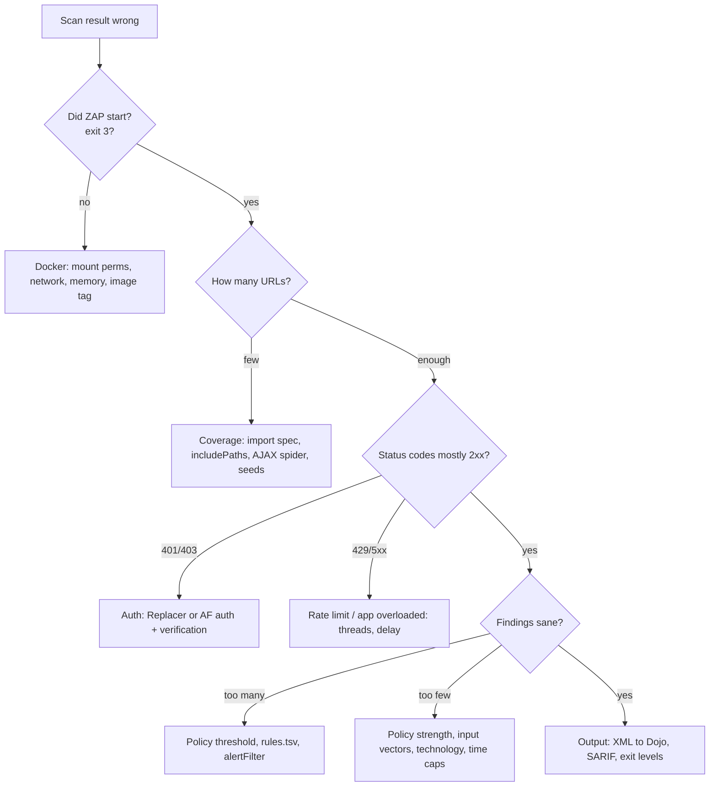

# OWASP ZAP: Troubleshooting

| | |
|---|---|
| **Cluster** | 08 DevSecOps |
| **Role** | Anchor (Gate 6 DAST) |
| **Prerequisites** | [04-hands-on-labs.md](04-hands-on-labs.md) |
| **Target version** | ZAP 2.15+ |
| **Capstone phase** | Phase 5 (Months 17-20) |

> Symptom-to-fix tables for the failures you will actually hit: zero URLs, unauthenticated scans, scans that never end, Docker permission and networking errors, memory, report problems, and CI-specific issues. Followed by a debugging workflow and the verbatim error messages.

---

## 1. Coverage Problems

| Symptom | Likely cause | Diagnose | Fix |
|---|---|---|---|
| `Total of 1 URLs` / `Total of 2 URLs` | Target returned a redirect or SPA shell; spider found no links; API has no HTML | Run `curl -sI <target>`; check `zap-out/*.json` for `instances[].uri` | Import the spec (`zap-api-scan.py -f openapi` or `openapi` job); add `-j` for SPAs; seed URLs with `requestor` job |
| Spider stops instantly, `urls.added: 0` | `includePaths` regex does not match the target (missing scheme, trailing slash, port) | Compare `env.contexts[].urls` and `includePaths`; both must share scheme/host/port | Use `"${BASE_URL}/.*"` with the exact `BASE_URL` |
| OpenAPI import adds nothing | Spec `servers` points elsewhere and no `targetUrl`/`-O`; spec is v3.1 features unsupported; spec unreachable | Set `-d`; look for `Failed to import` in logs; `curl <spec>` | Add `-O <target>` / `targetUrl`; downgrade the spec to 3.0 (`openapi: 3.0.3`) |
| Only `/docs` and `/openapi.json` scanned, all API routes 401 | Scan is unauthenticated | Check history status codes (daemon `core/view/messages`) | Add Replacer header or AF `authentication` + `sessionManagement` |
| AJAX spider finds 0 URLs | Headless Firefox failed to start; page needs login; `inScopeOnly` excludes everything | Look for `WebDriver` / `geckodriver` errors in log; try `browserId: chrome-headless` | Ensure `ZAP_JVM_OPTIONS=-Xmx3g`; run `spiderAjax` with `user:`; use `:stable` not `:bare` |
| Active scan reports `0 params scanned` | All nodes are GET with no params and body injection disabled | `ascan/view/scanProgress` shows `reqCount` per plugin | Enable `inputVectors.postData.json`; check that imported requests carry bodies |
| Scan hits `429 Too Many Requests` | App rate limiting the scanner | Status histogram | Exempt scanner identity/IP in the app or lower `threadPerHost`, add `delayInMs` |

---

## 2. Authentication Problems

| Symptom | Likely cause | Diagnose | Fix |
|---|---|---|---|
| `Authentication verification failed` in AF log | `loggedInRegex` / `loggedOutRegex` not matching; verification URL wrong | Enable `-d`; inspect the login response in a persisted session | Use `\Q...\E` to quote literals; match on body or header; use `method: poll` with `pollUrl` returning user info |
| Login works in desktop, fails in Docker | Login body contains CSRF token not fetched; `loginPageUrl` missing | Compare request in desktop history | Set `loginPageUrl`; ensure anti-CSRF token name (`_csrf`, `csrf_token`) is in Options, Anti-CSRF tokens list |
| Token works for first 10 minutes then everything is 401 | Token TTL shorter than scan; Replacer has no re-login | Status histogram shows 401 after a point | Mint a longer-lived token for the scan identity, or switch to AF JSON auth with verification |
| `` not substituted | Login response is not JSON or key path differs | `-d` output shows raw response | Use the exact key (`` for nested) |
| Scanner logs the user out | Spider hit `/logout` | History contains logout URL | `excludePaths: ["${BASE_URL}/.*logout.*"]`; the AF also treats `logout` as excluded from spidering by default when in the context exclusions |
| Form auth posts to wrong URL | `loginRequestUrl` is the page, not the form action | Check 302/200 after login | Set `loginRequestUrl` to the form `action` |
| Browser-based auth hangs | Login page JS needs more time or a different browser | `loginPageWait` | Increase `loginPageWait: 10`; `browserId: firefox-headless` |

---

## 3. Runtime and Docker Problems

| Symptom | Likely cause | Diagnose | Fix |
|---|---|---|---|
| `PermissionError: [Errno 13] Permission denied: '/zap/wrk/report.html'` | Mounted dir not writable by uid 1000 | `ls -ld zap-out` | `chmod 777 zap-out` (lab) or `--user $(id -u)` or `chown 1000:1000` |
| `Failed to connect to host.docker.internal` / `Connection refused` | Linux Docker without `--add-host`; target not listening; wrong port | `docker run --rm --add-host=host.docker.internal:host-gateway curlimages/curl -s <target>` | Add `--add-host=host.docker.internal:host-gateway` or `--network host` |
| `Target does not appear to be reachable` then exit 3 | Target TLS cert self-signed and ZAP refuses; or HTTP->HTTPS redirect to unreachable host | `-d` | Add `-config network.connection.dnsTtlSuccessfulQueries=-1`? No: use `-O` override, or trust: `-z "-config certificate.use=0"`; in AF `network` options or import CA |
| `Exception in thread "main" java.lang.OutOfMemoryError: Java heap space` | Large session, AJAX spider | Memory graph | `-e ZAP_JVM_OPTIONS="-Xmx4g"`; `maxAlertsPerRule`; shorten spider |
| Container killed (`OOMKilled`) in Kubernetes | Limits below JVM heap | `kubectl describe pod` | Set `limits.memory` >= `Xmx + 1Gi` |
| `ZAP failed to start` / exit 3 after 2 minutes | ZAP needs more than the script's startup wait on a slow runner; port clash | `docker logs` | Pass `-P <port>`; use a larger runner; check for an existing ZAP on the port |
| `Error: Add-on openapi not installed` | Using `:bare` image | `zap.sh -addonlist` | Use `:stable`, or AF `addOns` job with `install: [openapi]` |
| Replacer `-z` options ignored | Shell quoting broke the string with spaces in `Bearer <TOKEN>` | `-d` prints parsed params | Quote the whole `-z "..."` and single-quote the replacement; in AF use the `replacer` job |
| Scan never ends | No `maxScanDurationInMins`; rule stuck (`maxRuleDurationInMins`); AJAX spider infinite states | `ascan/view/scanProgress` shows one plugin consuming time | Set both caps, `-T`; disable the stuck rule or lower strength |
| Many `Connection reset` / `Read timed out` | App overwhelmed | App metrics | Lower `threadPerHost`, add `delayInMs: 50`, raise app replicas |

---

## 4. Report and Output Problems

| Symptom | Likely cause | Diagnose | Fix |
|---|---|---|---|
| DefectDojo import fails `Parser not found` / zero findings | Uploaded JSON or Markdown to `ZAP Scan` | Check file extension | Upload the XML (`-x` or `traditional-xml`) |
| SARIF upload rejected by GitHub | File too large (> 10 MB) or too many results | `jq '.runs[0].results | length'` | `maxAlertsPerRule`, drop Informational via `report.risks` |
| `report` job writes nothing | `reportDir` not writable or missing; plan errored earlier and `alwaysRun` absent | Job log | `alwaysRun: true`; check mount |
| HTML report shows evidence with tokens | `-plus` templates include requests | Open report | Use plain templates for shared artifacts; mask tokens |
| Exit code 0 despite findings | `-I` set; `exitStatus` levels too high; `fail_action: false` | Review flags | Remove `-I`; set `warnLevel: Medium`; add gate step |
| Exit code 2 with "no" findings | A Medium-risk Informational-confidence alert exists; `passiveScan-wait` found late alerts | Read the report | Tune threshold; raise `warnLevel: High` for PR |

---

## 5. CI-Specific Problems

| Symptom | Likely cause | Diagnose | Fix |
|---|---|---|---|
| `action-baseline` cannot reach `http://localhost:8000` | Action runs ZAP in Docker; `localhost` is the container | Step log `Connection refused` | Use `host.docker.internal` on macOS/Windows runners; on Ubuntu runners the action already uses `--network host`, so ensure the port-forward is on the host, or target the review ingress hostname |
| Issue not created | `allow_issue_writing: false`, missing `issues: write` permission, or `token` absent | Step log `Issue writing disabled` | Set permissions and inputs |
| Secrets appear in logs | Replacer header printed in debug output | Search logs | `::add-mask::` the token; avoid `-d` in CI |
| Step times out at 360 minutes | No caps on full scan | Job duration | `timeout-minutes` on the job plus `-T`/`maxScanDurationInMins` |
| Different results every run | Add-on auto-update; non-deterministic AJAX spider; app data mutated by previous active scan | Compare add-on versions in log | `updateAddOns: false`; reseed the environment per run |
| kind port-forward dies mid-scan | Pod restarted under load | `kubectl get pods` | Run ZAP in-cluster (Job) or expose via ingress/NodePort |

---

## 6. Verbatim Messages and Meaning

```text
WARN-NEW: ... FAIL-NEW: 0 FAIL-INPROG: 0 WARN-NEW: 3 WARN-INPROG: 0 INFO: 0 IGNORE: 2 PASS: 58
```
Summary line. `INPROG` means the alert was already present in a previous (persisted) session, rarely seen in CI.

```text
Automation plan failures:
	Job spider test "coverage: at least 15 URLs" failed: automation.spider.urls.added was 3
```
A `tests` assertion failed with `onFail: error`; coverage regressed.

```text
Job activeScan: unexpected error while running: java.lang.IllegalArgumentException: Context not found: inventory-api
```
Context name in the job does not match `env.contexts[].name` (case sensitive).

```text
ERROR org.zaproxy.zap.extension.openapi... Failed to import the definition: Target URL not specified and the OpenAPI definition does not define any server
```
Spec has no `servers`; set `targetUrl`/`-O`.

```text
Authentication verification failed: logged-out indicator found
```
The regex for logged-out matched after login; credentials wrong or the login response is an error page.

```text
java.net.UnknownHostException: inventory-api.capstone.svc
```
Running outside the cluster with in-cluster DNS names; use port-forward address or run as a Job.

```text
The URL is not in scope: http://host.docker.internal:8000/items
```
`scanOnlyInScope` or context mismatch; fix `includePaths`.

---

## 7. Debugging Workflow



Step-by-step:

1. Run with `-d` locally, never in CI, and read the first 50 lines (parsed params, add-ons, version).
2. Persist the session: `-z "-newsession /zap/wrk/debug"`; open `debug.session` in the desktop UI to see exactly what was requested and what came back.
3. Use the daemon and `core/view/messages` to get a status histogram.
4. Reduce to a single rule (`policyDefinition` with one rule) to isolate time or false-positive issues.
5. Compare with `curl`: reproduce the alert's request from the report and confirm the evidence manually.
6. Check ZAP's own log inside the container: `/home/zap/.ZAP/zap.log` (`docker cp` or mount `/home/zap/.ZAP`).

---

## 8. Diagnostic Commands

```bash
# Version, add-ons
docker run --rm ghcr.io/zaproxy/zaproxy:stable zap.sh -version
docker run --rm ghcr.io/zaproxy/zaproxy:stable zap.sh -addonlist 2>/dev/null | head -n 40

# Reachability from inside the ZAP container
docker run --rm --add-host=host.docker.internal:host-gateway --entrypoint curl ghcr.io/zaproxy/zaproxy:stable -sI http://host.docker.internal:8000/healthz

# ZAP log after a run (mount the home dir)
docker run --rm -v $(pwd)/zaphome:/home/zap/.ZAP -v $(pwd)/zap-out:/zap/wrk ghcr.io/zaproxy/zaproxy:stable zap-baseline.py -t http://host.docker.internal:8000 -I; tail -n 50 zaphome/zap.log

# Daemon diagnostics
Z=http://localhost:8090; K=<ZAP_API_KEY>
curl -s "$Z/JSON/core/view/sites/?apikey=$K"
curl -s "$Z/JSON/core/view/urls/?apikey=$K" | jq '.urls | length'
curl -s "$Z/JSON/spider/view/allUrls/?apikey=$K" | jq '.allUrls | length'
curl -s "$Z/JSON/ascan/view/scans/?apikey=$K"
curl -s "$Z/JSON/ascan/view/scanProgress/?apikey=$K&scanId=0" | jq '.scanProgress[1].HostProcess[] | select(.Plugin[3]!="Complete")'
curl -s "$Z/JSON/pscan/view/recordsToScan/?apikey=$K"
curl -s "$Z/JSON/context/view/context/?apikey=$K&contextName=inventory-api"
curl -s "$Z/JSON/users/view/usersList/?apikey=$K&contextId=1"
curl -s "$Z/JSON/replacer/view/rules/?apikey=$K"

# Kubernetes Job
kubectl --namespace capstone logs job/zap-nightly-<id> | grep -E "Job|Total of|FAIL|WARN|error" 
kubectl --namespace capstone describe pod -l job-name=zap-nightly-<id> | sed -n '/Events/,$p'
```

Next: [07-interview-questions.md](07-interview-questions.md).
