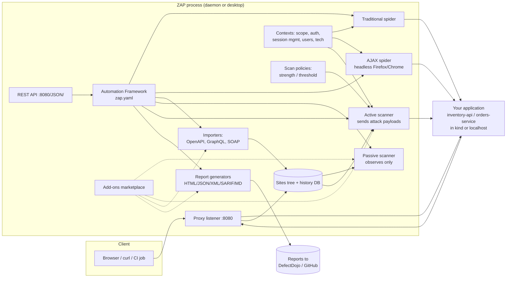

# OWASP ZAP (Zed Attack Proxy)

| | |
|---|---|
| **Cluster** | 08 DevSecOps |
| **Gate** | 6: Automated DAST |
| **Role** | Anchor |
| **Category** | Dynamic application security testing, intercepting proxy |
| **Prerequisites** | HTTP/TLS fundamentals, Docker, the capstone `inventory-api` and `orders-service` running locally or in kind |
| **Target version** | ZAP 2.15+ (`ghcr.io/zaproxy/zaproxy:stable`), Automation Framework add-on 0.40+ |
| **Capstone phase** | Phase 5 (Months 17-20) |
| **Official docs** | https://www.zaproxy.org/docs/ |

> ZAP is a free, Apache-licensed intercepting proxy and scanner that sits between a client and your web application, records every request, passively analyses responses, crawls for new URLs, and (when told to) actively attacks parameters to confirm vulnerabilities. After this folder you will be able to run ZAP headlessly in CI against an ephemeral copy of your own service, authenticate it, feed it your OpenAPI spec, tune out false positives, fail the build on real findings, and push the results into DefectDojo. ZAP is only ever pointed at applications you own or are explicitly authorised to test.

## Why This Tool Exists

Before automated DAST, dynamic testing meant a human with a proxy clicking through the application for a week before each release. That did not scale to daily deploys, and it meant that configuration regressions (a removed security header, a debug endpoint left enabled, a new unauthenticated route) shipped silently between pentests.

ZAP began in 2010 as a fork of the Paros proxy and became the OWASP flagship project. The insight that made it the CI default was not the proxy; it was the **packaged scans and the Automation Framework**: a single Docker image that boots ZAP, spiders or imports a spec, runs the passive and active scanners, applies a rules file, writes HTML/JSON/SARIF, and exits non-zero on failure. DAST became a pipeline step rather than a project. In 2024 the project moved under the Software Security Project (Checkmarx-sponsored) while remaining open source; the name "OWASP ZAP" is still universally used.

## Architecture

- **Proxy listener.** Every request ZAP sees, whether proxied from a browser or generated by its own spider, passes through here and lands in the history database.
- **Sites tree and history.** The in-memory/HSQLDB model of everything observed. Scanners read from it; reports are rendered from its alerts.
- **Spiders.** The traditional spider parses HTML/JS for links; the AJAX spider drives a real headless browser to find URLs created by JavaScript. Importers add URLs from OpenAPI/GraphQL/SOAP definitions without crawling.
- **Passive scanner.** Runs on every response, never sends extra traffic. Finds missing headers, cookie flags, information disclosure, insecure forms. Safe for any environment you are authorised to observe.
- **Active scanner.** Replays requests with attack payloads (SQLi, XSS, path traversal, command injection, SSRF probes). Mutates state. Only for disposable environments.
- **Contexts.** A named scope with include/exclude regexes, authentication method, session management, users, and technology hints. Almost every advanced feature hangs off a context.
- **Scan policies.** Which active rules run, at what attack strength (Low/Medium/High/Insane) and alert threshold (Low/Medium/High/Off).
- **Automation Framework.** Declarative YAML describing environment, contexts, and an ordered list of jobs. The modern way to run ZAP in CI.
- **REST API.** Everything the UI can do, over HTTP, protected by an API key. Clients exist for Python, Java, Node, Go.
- **Add-ons.** Scan rules ship as add-ons at release/beta/alpha maturity; reports, importers, and authentication helpers are add-ons too.

## The Core Mental Model

1. **ZAP is a recorder with opinions.** Everything flows through a proxy into a history. Passive rules annotate that history; active rules replay it with payloads. If a URL never entered the history (not crawled, not imported, not proxied), ZAP cannot test it. Coverage is the first problem to solve, before tuning.
2. **Alerts are risk x confidence, scoped by context, filtered by rules.** A finding is a rule id, a risk level, and a confidence level. The baseline scan turns alerts into PASS/WARN/FAIL per rule via `rules.tsv`; the Automation Framework does the same with `alertFilter` and `exitStatus`. Tuning is editing those mappings, not disabling the scanner.
3. **Authentication is a state machine you must describe.** Login request, session token location, logged-in/logged-out indicators, and users. ZAP re-authenticates when the verification check fails. Get this wrong and the scan is silently unauthenticated.

## Anchor-and-Bridge Mapping

| Concept in ZAP | Equivalent in Nuclei | Equivalent in Burp Suite |
|---|---|---|
| Scan rule (numeric id, e.g. 10038) | Template (`id: spring-actuator-exposed`) | Scanner check / Issue type |
| Passive scan | Templates that only match on normal responses (`info`, headers) | Passive scanner issues |
| Active scan | Templates with payloads / `-dast` fuzzing | Active scanner (Pro) / Intruder |
| Scan policy | `-tags`, `-severity`, `-templates` selection | Scan configuration (crawl + audit) |
| Context include/exclude regex | `-l targets.txt`, `-exclude-hosts` | Target scope |
| Context authentication + users | `-H "Authorization: Bearer <TOKEN>"` | Session handling rules + macros |
| Traditional + AJAX spider | None (use katana) | Crawler (Pro) |
| OpenAPI import | None (write templates per path) | OpenAPI parser (Pro) |
| `rules.tsv` / `alertFilter` | `-exclude-id`, template edits | Mark as false positive |
| `zap.yaml` Automation Framework | CLI flags + shell script | Enterprise scan definition / GraphQL API |
| REST API with `api.key` | n/a | Pro REST API (`:1337/<API_KEY>/v0.1/`) |
| `ghcr.io/zaproxy/zaproxy:stable` | `projectdiscovery/nuclei` | Enterprise scanning agent |
| Report templates (`traditional-html`, `sarif-json`) | `-sarif-export`, `-json-export`, `-markdown-export` | Report generation (Pro/Enterprise) |

## Learning Path

| Step | File | Time |
|---|---|---|
| 1 | [01-installation-and-setup.md](01-installation-and-setup.md) - Docker image, desktop, daemon, first baseline scan against localhost | 2 h |
| 2 | [02-core-concepts.md](02-core-concepts.md) - proxy, spiders, passive vs active, contexts, policies, auth, AF, API | 4 h |
| 3 | [03-commands-and-cheatsheet.md](03-commands-and-cheatsheet.md) - every packaged-scan flag, AF job reference, API calls, rules.tsv | 2 h |
| 4 | [04-hands-on-labs.md](04-hands-on-labs.md) - 7 labs from baseline to authenticated AF scan in GitHub Actions with DefectDojo upload | 8 h |
| 5 | [05-production-patterns.md](05-production-patterns.md) - ephemeral environments, speed tuning, policy design, SARIF, anti-patterns | 3 h |
| 6 | [06-troubleshooting.md](06-troubleshooting.md) - zero URLs found, auth not working, scan never finishes, Docker permission errors | 1 h |
| 7 | [07-interview-questions.md](07-interview-questions.md) - 30 questions | 1 h |

## Role in the Capstone

ZAP is Gate 6 in the capstone pipeline (`.github/workflows/gate-6-dast.yaml`):

1. **Per pull request.** After Gates 1-5 pass and the PR image is deployed to a namespace `pr-<N>` in the kind/EKS review cluster, the workflow port-forwards or uses the review ingress and runs `zaproxy/action-baseline` against `inventory-api` and `orders-service`. A `rules.tsv` in `.zap/` maps known-accepted alerts to IGNORE. WARN posts a PR comment; FAIL blocks merge.
2. **Post-merge to staging.** `zaproxy/action-api-scan` consumes `https://staging.example.com/openapi.json` (FastAPI) and `/v3/api-docs` (Spring Boot) with a bearer token minted for a scan-only user by the pipeline. Output: `report.json` and SARIF uploaded to GitHub code scanning.
3. **Nightly.** `zap-full-scan.py` driven by `.zap/zap-full.yaml` (Automation Framework) with form/JSON authentication, AJAX spider for the Backstage-served frontend, and a custom scan policy. Runs in under 30 minutes after tuning.
4. **Every run** uploads `report.xml` to DefectDojo via `/api/v2/reimport-scan/` with `scan_type=ZAP Scan`, product `inventory-api` or `orders-service`, engagement named after the branch. Deduplication in Dojo keeps the finding count stable across runs.
5. **Falco and Wazuh** are told about the scanner: the review namespace is labelled `security.example.com/dast-target=true` and the Falco exception list excludes the scanner's source so Gate 7 does not page on-call during a scan.

Artefacts produced: `zap-report.html` (human), `zap-report.json` (machine), `zap.sarif` (GitHub), `zap-report.xml` (DefectDojo).

## Further Reading

- ZAP documentation: https://www.zaproxy.org/docs/
- Automation Framework reference: https://www.zaproxy.org/docs/automate/automation-framework/
- Packaged scans (baseline/full/API): https://www.zaproxy.org/docs/docker/
- Alert reference (all rule ids): https://www.zaproxy.org/docs/alerts/
- ZAP API: https://www.zaproxy.org/docs/api/
- OWASP Web Security Testing Guide (what to test for): https://owasp.org/www-project-web-security-testing-guide/
- OWASP API Security Top 10 (2023): https://owasp.org/API-Security/
- Simon Bennetts, "ZAP in Ten" video series: https://www.zaproxy.org/zap-in-ten/
