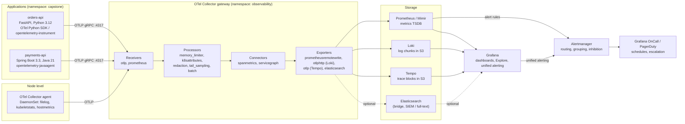

# 09 Observability Stack

| | |
|---|---|
| **Cluster** | 09 Observability |
| **Anchor** | OpenTelemetry + LGTM (Loki, Grafana, Tempo, Mimir/Prometheus) |
| **Bridge** | ELK Stack (Elasticsearch, Logstash/Elastic Agent, Kibana) |
| **Core unifying pattern** | Unified OTLP telemetry (metrics, logs, traces) and cross-signal correlation |
| **Prerequisites** | Clusters 04 (Kubernetes, Helm), 07 (FastAPI, Spring Boot), basic Linux/networking |
| **Capstone phase** | Phase 4 (Months 13-16, ~160 hrs shared with SRE) |

> This cluster teaches you to instrument a service once, ship every signal over one protocol (OTLP) to one pipeline (the OpenTelemetry Collector), and store each signal in the backend built for it. By the end you will have the FastAPI `orders-api` and Spring Boot `payments-api` emitting traces, metrics and logs that are correlated by `trace_id`, a Grafana workspace that jumps from a latency spike to the exact trace and its log lines in two clicks, and a 99.9% SLO with multi-window burn-rate alerts paging an on-call schedule.

---

## 1. Why This Cluster Exists

Monitoring answers questions you knew to ask in advance ("is CPU above 80%?"). Observability answers questions you did not anticipate ("why did checkout latency for EU tenants on the new release double at 14:03?"). The shift from one to the other happened because microservices and agentic AI systems fail in combinatorial ways that no pre-built dashboard can enumerate. You need high-cardinality, high-dimensionality data and the ability to pivot between signals.

The roadmap's unifying pattern for this cluster is **unified OTLP telemetry and correlation**:

1. **Instrument once.** OpenTelemetry SDKs (or zero-code agents) produce traces, metrics and logs in one vendor-neutral data model with one set of semantic conventions.
2. **Route centrally.** The OTel Collector decouples instrumentation from storage. Receivers accept OTLP and Prometheus data; processors batch, redact PII, enrich with Kubernetes metadata and apply tail sampling; exporters fan out to Prometheus/Mimir, Loki, Tempo or Elasticsearch simultaneously.
3. **Store per signal.** Metrics go to a TSDB (Prometheus/Mimir), logs to a label-indexed chunk store (Loki) or a full-text index (Elasticsearch), traces to an object-storage trace store (Tempo).
4. **Correlate in one pane.** Grafana links a `histogram_quantile` spike to a trace exemplar, the trace to its log lines via `trace_id`, and the logs back to the pod's metrics.

Once this pattern is in your head, ELK is a bridge: the same signals, a different index model and query language.

---

## 2. The Signals

### 2.1 Three pillars plus two

| Signal | What it is | Cardinality shape | Best store | Query language |
|---|---|---|---|---|
| **Metrics** | Pre-aggregated numeric time series with label sets | Low cardinality by design; cost scales with distinct label combinations | Prometheus, Mimir, Thanos, Cortex | PromQL |
| **Logs** | Timestamped, semi-structured event records | Unbounded content, low-cardinality stream labels | Loki (label index) or Elasticsearch (full-text index) | LogQL, KQL/Lucene/ES\|QL |
| **Traces** | Trees of spans describing one request across services | One trace per request; sampled | Tempo, Jaeger, Elastic APM | TraceQL |
| **Profiles** | Continuous CPU/memory stack samples per process | Per process, per minute | Pyroscope (Grafana), Parca | Flame graphs, Pyroscope query |
| **Events** | Discrete state changes (deploys, scaling, incidents, Kubernetes Events) | Sparse | Loki, Grafana annotations, Elasticsearch | LogQL, annotation queries |

OpenTelemetry formally defines traces, metrics, logs and (since 2024) a profiling signal; events are modelled as logs with an `event.name` attribute. Baggage carries key-value context alongside the trace context but is not itself stored.

### 2.2 Cardinality is the cost driver

Every backend in this cluster prices you on **the number of distinct series or streams**, not on the number of data points. Understand this and you understand every cost conversation:

- **Prometheus**: `http_requests_total{method, route, status, pod}` with 5 methods x 40 routes x 10 statuses x 50 pods = 100,000 series from one metric. Add `user_id` and you have an outage. Each active series costs roughly 2-4 KB of RAM in the head block.
- **Loki**: each unique label set is a *stream*, and each stream needs its own chunk in memory. Put `request_id` in a label and you create a stream per request. Loki's design is to keep labels under ~15 values each and push high-cardinality fields into the log line or into structured metadata.
- **Elasticsearch**: indexes every field of every document. Cardinality costs less per field but every document costs disk and JVM heap; a field type explosion (`Limit of total fields [1000] has been exceeded`) is the equivalent failure mode.
- **Tempo**: cardinality is not a storage problem (object storage is cheap) but the metrics-generator and span-metrics connector re-introduce the Prometheus constraint when they turn span attributes into metric labels.

Rule of thumb carried through every folder here: **identity belongs in traces and log lines; dimensions belong in labels.**

---

## 3. Reference Architecture



**Component roles.**

- **OTel SDK / agent** (in-process): creates spans, metric instruments and log records; propagates W3C `traceparent` headers; exports OTLP to the nearest Collector. Zero-code agents (`opentelemetry-instrument` for Python, `-javaagent` for Java) do this without source changes.
- **OTel Collector agent (DaemonSet)**: one per node. Tails container logs with `filelog`, scrapes kubelet and host metrics, forwards to the gateway. Keeps application exporters simple (`localhost` or node IP).
- **OTel Collector gateway (Deployment)**: centralised policy. Tail sampling (needs all spans of a trace on one instance), PII redaction, Kubernetes attribute enrichment, fan-out to backends. Horizontally scaled behind a Service, with a load-balancing exporter when tail sampling is enabled.
- **Prometheus / Mimir**: Prometheus scrapes `/metrics` and `/actuator/prometheus` directly and also receives remote-write from the Collector. Mimir is the horizontally scalable, multi-tenant long-term store.
- **Loki**: indexes only stream labels (`namespace`, `app`, `pod`, `level`), stores compressed chunks in object storage.
- **Tempo**: stores 100% of received traces in Parquet blocks in object storage; its metrics-generator derives RED metrics and service graphs.
- **Grafana**: single pane. Data source correlations (trace-to-logs, logs-to-trace, exemplars) make the signals navigable.
- **Alertmanager**: deduplicates, groups, routes and silences alerts from Prometheus and Grafana; sends to Slack, PagerDuty, Grafana OnCall or webhooks.

---

## 4. Correlation: The Reason to Unify

Correlation is what you buy with OpenTelemetry. Three mechanisms, each covered in depth in the tool folders:

| Mechanism | Direction | How it works | Where to configure |
|---|---|---|---|
| **`trace_id` in logs** | logs -> traces | SDK log handler injects `trace_id`/`span_id` into every log record (Python `logging`, Logback MDC). Loki derived field or Elasticsearch APM link opens the trace. | [opentelemetry/02-core-concepts.md](opentelemetry/02-core-concepts.md), [loki/05-production-patterns.md](loki/05-production-patterns.md) |
| **Exemplars in metrics** | metrics -> traces | Histogram buckets carry a sample `trace_id` with the observation. Prometheus stores exemplars (`--enable-feature=exemplar-storage`); Grafana renders them as dots on the latency panel. | [prometheus/02-core-concepts.md](prometheus/02-core-concepts.md), [grafana/02-core-concepts.md](grafana/02-core-concepts.md) |
| **Span metrics / service graph** | traces -> metrics | Collector `spanmetrics` connector or Tempo metrics-generator aggregates spans into `calls_total` and `duration_bucket` series labelled by `service.name`, `span.name`, `status.code`. RED dashboards appear with no manual metric code. | [tempo/02-core-concepts.md](tempo/02-core-concepts.md), [opentelemetry/05-production-patterns.md](opentelemetry/05-production-patterns.md) |
| **Resource attributes as join keys** | all | `service.name`, `service.namespace`, `k8s.pod.name`, `deployment.environment` are stamped on every signal by the SDK and the `k8sattributes` processor, so Grafana can pivot by the same labels across Prometheus, Loki and Tempo. | [opentelemetry/02-core-concepts.md](opentelemetry/02-core-concepts.md) |

The capstone acceptance test is the "two-click" workflow: Grafana latency panel -> exemplar dot -> Tempo trace -> "Logs for this span" -> Loki lines for that `trace_id`.

---

## 5. LGTM vs ELK Comparison Matrix

| Dimension | LGTM (Loki, Grafana, Tempo, Mimir/Prometheus) | ELK (Elasticsearch, Logstash/Agent, Kibana) |
|---|---|---|
| **Index model** | Loki: labels only; log content stored as compressed chunks. Prometheus: inverted index over label pairs per block. Tempo: trace ID index plus Parquet column scans | Full inverted Lucene index over every mapped field; `doc_values` columnar store for aggregations; optional `dense_vector` HNSW graphs |
| **Storage cost** | Low. Object storage for logs and traces (roughly 5-10x cheaper per GB ingested than ELK for operational logs). Prometheus local disk ~1-2 bytes/sample | High. Hot tier on NVMe, index overhead 1-2x raw size, JVM heap per node; mitigated by ILM warm/cold/frozen tiers and searchable snapshots |
| **Query language** | PromQL (metrics), LogQL (logs; PromQL-shaped), TraceQL (traces) | KQL and Lucene (Kibana search bar), Query DSL (JSON), ES\|QL (piped, SQL-like) |
| **Full-text search** | Brute-force grep over chunks selected by labels; fast when labels narrow the scan, slow for "find this string across everything for 30 days" | Sub-second across billions of documents; analyzers, fuzziness, phrase queries, relevance scoring |
| **High-cardinality analytics** | Weak in Loki (streams explode); use Tempo/TraceQL or a columnar store instead | Strong: `terms`, `cardinality`, `percentiles` aggregations over any field |
| **SIEM / security analytics** | Not a product focus; Loki can feed detections but lacks a rules library | Elastic Security: prebuilt detection rules, MITRE ATT&CK mapping, case management, endpoint integration (Platinum+ for most) |
| **Vector / semantic search** | None | `dense_vector` kNN, hybrid BM25 + kNN with RRF, ELSER sparse encoder; directly useful for RAG (cluster 10) |
| **Traces** | Tempo (OTLP native, TraceQL, metrics-generator) | Elastic APM (OTLP ingest via APM Server / EDOT), APM UI, service maps |
| **HA / scaling** | Microservices mode of Loki/Tempo/Mimir scales each component independently; stateless on object storage; Prometheus HA is a pair of identical scrapers | Shard/replica model; node roles (master, data_hot, data_warm, ml); scaling requires shard planning and rebalancing |
| **Operational complexity** | Several small services with simple configs; more moving pieces but each is stateless | Fewer services but Elasticsearch itself is operationally dense (heap, shards, watermarks, mappings) |
| **Licensing** | AGPLv3 (Grafana, Loki, Tempo, Mimir), Apache-2.0 (Prometheus, OTel) | Elastic License 2.0 + SSPL dual, AGPLv3 added in 2024; Basic features free, Platinum/Enterprise paid; OpenSearch fork is Apache-2.0 |
| **When it wins** | Cloud-native operational debugging, Kubernetes, cost-constrained teams, teams already on Prometheus labels | SIEM, compliance log retention with ad-hoc full-text search, business analytics on logs, RAG/vector workloads |

The honest summary from the roadmap: Loki is 5-10x cheaper for routine cloud-native operational debugging; ELK builds full inverted indexes over every parsed field and in exchange delivers full-text search, high-cardinality aggregations, SIEM threat hunting and hybrid BM25 + vector search at higher storage and JVM memory cost. Most mature platforms run both: LGTM for engineering, Elastic for security.

---

## 6. Anchor-and-Bridge Vocabulary Mapping

| Concept | OpenTelemetry (anchor) | Prometheus / PromQL | Loki / LogQL | Tempo / TraceQL | Elastic / KQL / ES\|QL |
|---|---|---|---|---|---|
| Service identity | `service.name` resource attribute | `job` / `service_name` label | `service_name` label | `resource.service.name` | `service.name` (ECS) |
| Dimension | attribute | label | label (low-card) or structured metadata | `span.*` / `resource.*` attribute | field |
| Series/stream selector | n/a | `{job="orders-api", route="/orders"}` | `{namespace="capstone", app="orders-api"}` | `{ resource.service.name = "orders-api" }` | `service.name : "orders-api"` |
| Filter by content | attribute filter in Collector `filter` processor | label matcher `=~` | line filter `\|= "timeout"` | `{ span.http.status_code >= 500 }` | `message : *timeout*` / `WHERE message LIKE "*timeout*"` |
| Parse structure | OTTL `ParseJSON()` | n/a | `\| json`, `\| logfmt`, `\| pattern` | n/a | ingest pipeline `json` / `grok` processors |
| Rate | counter instrument + delta | `rate(x_total[5m])` | `rate({...}[5m])` | `{ } \| rate()` | `STATS count() BY bucket(@timestamp, 5m)` |
| Group | aggregation by attribute | `sum by (route) (...)` | `sum by (level) (count_over_time(...))` | `\| count() by (span.http.route)` | `terms` agg / `STATS ... BY field` |
| Percentile | histogram instrument | `histogram_quantile(0.99, sum by (le) (rate(x_bucket[5m])))` | `quantile_over_time(0.99, {...} \| unwrap duration [5m])` | `\| quantile_over_time(duration, .99)` | `percentiles` agg / `PERCENTILE(field, 99)` |
| Request tree | span, parent span, links | n/a | n/a | structural `>`, `>>`, `~` | APM transaction + spans |
| Correlation key | `trace_id`, `span_id` | exemplar `trace_id` | derived field `trace_id` | trace ID | `trace.id` (ECS) |
| Alert | n/a (Collector has no alerting) | alerting rule -> Alertmanager | ruler rule -> Alertmanager | n/a (via span metrics in Prometheus) | Kibana rule -> connector |
| Collector/agent | OTel Collector | Prometheus scrape, exporters | Alloy (Promtail successor), Fluent Bit | OTel Collector | Elastic Agent, Beats, Logstash, EDOT Collector |
| Retention | Collector has none | `--storage.tsdb.retention.time` | `limits_config.retention_period` + compactor | `compactor.compaction.block_retention` | ILM policy phases |
| Multi-tenancy | resource attributes | Mimir `X-Scope-OrgID` | `X-Scope-OrgID` | `X-Scope-OrgID` | separate indices / spaces / document-level security |

---

## 7. The Local Lab Stack (docker-compose)

Every tool folder's Lab 1 assumes this stack. It runs on a laptop with 8 GB RAM. Save as `observability-lab/docker-compose.yml`; per-service config files are shown in each folder's `01-installation-and-setup.md`.

```yaml
# observability-lab/docker-compose.yml
# Insecure by design for a laptop lab: no TLS, no auth. Never expose these ports beyond localhost.
name: observability-lab

services:
  otel-collector:
    image: otel/opentelemetry-collector-contrib:0.115.0
    command: ["--config=/etc/otelcol/config.yaml"]
    volumes:
      - ./otel-collector/config.yaml:/etc/otelcol/config.yaml:ro
    ports:
      - "4317:4317"    # OTLP gRPC
      - "4318:4318"    # OTLP HTTP
      - "8889:8889"    # Prometheus exporter (span metrics, app metrics)
      - "13133:13133"  # health_check extension
    depends_on: [loki, tempo, prometheus]

  prometheus:
    image: prom/prometheus:v3.0.1
    command:
      - --config.file=/etc/prometheus/prometheus.yml
      - --web.enable-remote-write-receiver
      - --enable-feature=exemplar-storage
      - --enable-feature=native-histograms
      - --storage.tsdb.retention.time=7d
    volumes:
      - ./prometheus/prometheus.yml:/etc/prometheus/prometheus.yml:ro
      - ./prometheus/rules:/etc/prometheus/rules:ro
      - prometheus-data:/prometheus
    ports: ["9090:9090"]

  alertmanager:
    image: prom/alertmanager:v0.27.0
    command: ["--config.file=/etc/alertmanager/alertmanager.yml"]
    volumes:
      - ./alertmanager/alertmanager.yml:/etc/alertmanager/alertmanager.yml:ro
    ports: ["9093:9093"]

  loki:
    image: grafana/loki:3.3.0
    command: ["-config.file=/etc/loki/config.yaml"]
    volumes:
      - ./loki/config.yaml:/etc/loki/config.yaml:ro
      - loki-data:/loki
    ports: ["3100:3100"]

  tempo:
    image: grafana/tempo:2.6.1
    command: ["-config.file=/etc/tempo/tempo.yaml"]
    volumes:
      - ./tempo/tempo.yaml:/etc/tempo/tempo.yaml:ro
      - tempo-data:/var/tempo
    ports: ["3200:3200"]   # Tempo HTTP API; OTLP arrives via the collector

  grafana:
    image: grafana/grafana:11.3.1
    environment:
      GF_SECURITY_ADMIN_USER: admin
      GF_SECURITY_ADMIN_PASSWORD: <ADMIN_PASSWORD>   # lab only; use SSO in production
      GF_FEATURE_TOGGLES_ENABLE: traceqlEditor,correlations
    volumes:
      - ./grafana/provisioning:/etc/grafana/provisioning:ro
      - ./grafana/dashboards:/var/lib/grafana/dashboards:ro
      - grafana-data:/var/lib/grafana
    ports: ["3000:3000"]
    depends_on: [prometheus, loki, tempo]

  orders-api:
    build: ../services/orders-api
    environment:
      OTEL_SERVICE_NAME: orders-api
      OTEL_EXPORTER_OTLP_ENDPOINT: http://otel-collector:4317
      OTEL_EXPORTER_OTLP_PROTOCOL: grpc
      OTEL_RESOURCE_ATTRIBUTES: deployment.environment=lab,service.namespace=capstone
      OTEL_PYTHON_LOGGING_AUTO_INSTRUMENTATION_ENABLED: "true"
      OTEL_TRACES_SAMPLER: parentbased_traceidratio
      OTEL_TRACES_SAMPLER_ARG: "1.0"
    command: ["opentelemetry-instrument", "uvicorn", "app.main:app", "--host", "0.0.0.0", "--port", "8000"]
    ports: ["8000:8000"]
    depends_on: [otel-collector]

  payments-api:
    build: ../services/payments-api
    environment:
      JAVA_TOOL_OPTIONS: "-javaagent:/otel/opentelemetry-javaagent.jar"
      OTEL_SERVICE_NAME: payments-api
      OTEL_EXPORTER_OTLP_ENDPOINT: http://otel-collector:4317
      OTEL_RESOURCE_ATTRIBUTES: deployment.environment=lab,service.namespace=capstone
      OTEL_INSTRUMENTATION_MICROMETER_ENABLED: "true"
    ports: ["8080:8080"]
    depends_on: [otel-collector]

volumes:
  prometheus-data: {}
  loki-data: {}
  tempo-data: {}
  grafana-data: {}
```

Bring it up and verify:

```bash
docker compose up -d
docker compose ps
curl -s localhost:13133 | head -c 200          # collector health
curl -s localhost:9090/-/ready                   # Prometheus
curl -s localhost:3100/ready                     # Loki
curl -s localhost:3200/ready                     # Tempo
curl -s localhost:3000/api/health                # Grafana
```

Expected (Grafana):

```json
{"commit":"...","database":"ok","version":"11.3.1"}
```

---

## 8. The Kubernetes Deployment

The production shape used by the capstone, all in namespace `observability`:

```bash
helm repo add prometheus-community https://prometheus-community.github.io/helm-charts
helm repo add grafana https://grafana.github.io/helm-charts
helm repo add open-telemetry https://open-telemetry.github.io/opentelemetry-helm-charts
helm repo update

kubectl create namespace observability

# 1. Prometheus Operator + Prometheus + Alertmanager + Grafana + node-exporter + kube-state-metrics
helm upgrade --install kps prometheus-community/kube-prometheus-stack \
  --namespace observability --values kps-values.yaml

# 2. Loki (simple scalable mode on S3) and Alloy as the log collector
helm upgrade --install loki grafana/loki --namespace observability --values loki-values.yaml
helm upgrade --install alloy grafana/alloy --namespace observability --values alloy-values.yaml

# 3. Tempo (monolithic for the lab, tempo-distributed for production)
helm upgrade --install tempo grafana/tempo --namespace observability --values tempo-values.yaml

# 4. OpenTelemetry Operator (needs cert-manager) and the Collector + Instrumentation CRDs
helm upgrade --install opentelemetry-operator open-telemetry/opentelemetry-operator \
  --namespace observability --set manager.collectorImage.repository=otel/opentelemetry-collector-contrib
kubectl apply -f otel-collector-gateway.yaml      # OpenTelemetryCollector CR
kubectl apply -f otel-instrumentation.yaml        # Instrumentation CR for auto-injection
```

Applications opt in with one annotation per language:

```yaml
# orders-api Deployment pod template
metadata:
  annotations:
    instrumentation.opentelemetry.io/inject-python: "observability/capstone"
# payments-api Deployment pod template
metadata:
  annotations:
    instrumentation.opentelemetry.io/inject-java: "observability/capstone"
```

Each folder's `01-installation-and-setup.md` and `05-production-patterns.md` give the full `values.yaml` files, and `04-hands-on-labs.md` walks through them in order.

---

## 9. Learning Order and Time Budget

| Step | Folder | Why in this order | Time |
|---|---|---|---|
| 1 | [opentelemetry/](opentelemetry/README.md) | The anchor. Learn the data model, SDKs and Collector before any backend; every other tool is "where OTLP goes" | 35 hrs |
| 2 | [prometheus/](prometheus/README.md) | Labels, PromQL and alerting are the vocabulary Loki and Tempo reuse; also where the SLO rules live | 30 hrs |
| 3 | [grafana/](grafana/README.md) | Visualise what you have so far; set up data sources and correlations once, then add signals | 20 hrs |
| 4 | [loki/](loki/README.md) | LogQL is PromQL for logs; wire `trace_id` derived fields | 20 hrs |
| 5 | [tempo/](tempo/README.md) | TraceQL, metrics-generator, exemplar linking; closes the correlation loop | 15 hrs |
| 6 | [elk-stack/](elk-stack/README.md) | Bridge. Map every LGTM concept to Elastic; understand when the inverted index is worth its cost (SIEM, RAG) | 25 hrs |
| 7 | [../11-sre/](../11-sre/README.md) | Turn the metrics into SLIs, SLOs and burn-rate paging | (Phase 4, shared) |

Total: roughly 145 hours of the 160-hour Phase 4 budget; the remainder is Backstage and OnCall in clusters 04 and 11.

---

## 10. Role in the Capstone

The capstone deliverable for this cluster, from the roadmap: *instrument both services with OpenTelemetry SDKs exporting to an OTel Collector; build unified Grafana dashboards correlating metrics, Loki logs and traces; configure a 99.9% SLO with multi-window burn-rate alerts paging an OnCall schedule.*

Concretely the repository gains:

| Artefact | Location in capstone repo | Produced by |
|---|---|---|
| `opentelemetry-instrument` entrypoint and `OTEL_*` env in the FastAPI Dockerfile/Deployment | `services/orders-api/` | OpenTelemetry |
| `-javaagent` in `JAVA_TOOL_OPTIONS` for Spring Boot; Logback JSON encoder with `trace_id` MDC | `services/payments-api/` | OpenTelemetry |
| `OpenTelemetryCollector` (gateway + agent) and `Instrumentation` CRs | `platform/observability/otel/` | OpenTelemetry |
| `kube-prometheus-stack` values, `ServiceMonitor`s, `PrometheusRule` with SLO recording rules and burn-rate alerts | `platform/observability/prometheus/` | Prometheus |
| Loki + Alloy values, log-based alert rules | `platform/observability/loki/` | Loki |
| Tempo values with metrics-generator remote-writing to Prometheus | `platform/observability/tempo/` | Tempo |
| Grafana data sources with trace-to-logs and exemplar links, dashboards-as-code ConfigMaps (RED/USE, SLO burn-rate, Kubernetes cluster), unified alerting contact points | `platform/observability/grafana/` | Grafana |
| ECK manifests and Logstash/Elastic Agent pipeline for the security log stream (optional) | `platform/observability/elastic/` | ELK |
| ADR "Loki for operational logs, Elastic for SIEM" | `capstone/adrs/` | this README |

Everything is deployed by Argo CD from cluster 04, provisioned on infrastructure from cluster 05, and feeds the SRE on-call process in cluster 11. The LLM/agent services from clusters 02-03 and 10 reuse the same pipeline with `gen_ai.*` semantic conventions.

---

## 11. Further Reading

- OpenTelemetry specification and semantic conventions: https://opentelemetry.io/docs/specs/
- Prometheus documentation: https://prometheus.io/docs/
- Grafana, Loki, Tempo, Mimir documentation: https://grafana.com/docs/
- Elastic Stack documentation: https://www.elastic.co/guide/
- Google SRE Workbook, chapter 5 "Alerting on SLOs" (source of the multi-window burn-rate method): https://sre.google/workbook/alerting-on-slos/
- Charity Majors, Liz Fong-Jones, George Miranda, *Observability Engineering* (O'Reilly, 2022)
- Brian Brazil, *Prometheus: Up & Running* (O'Reilly, 2nd ed. 2023)
- Cindy Sridharan, *Distributed Systems Observability* (O'Reilly, 2018)
