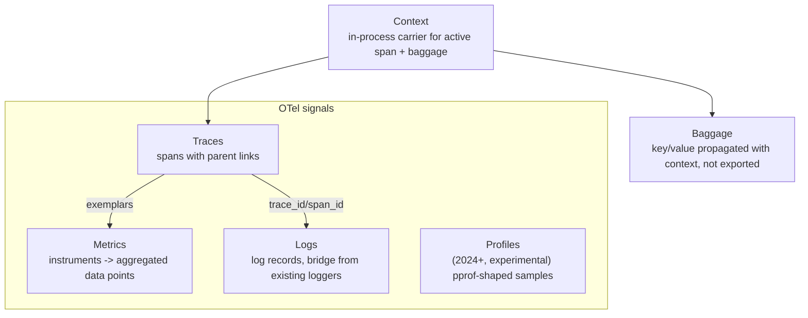
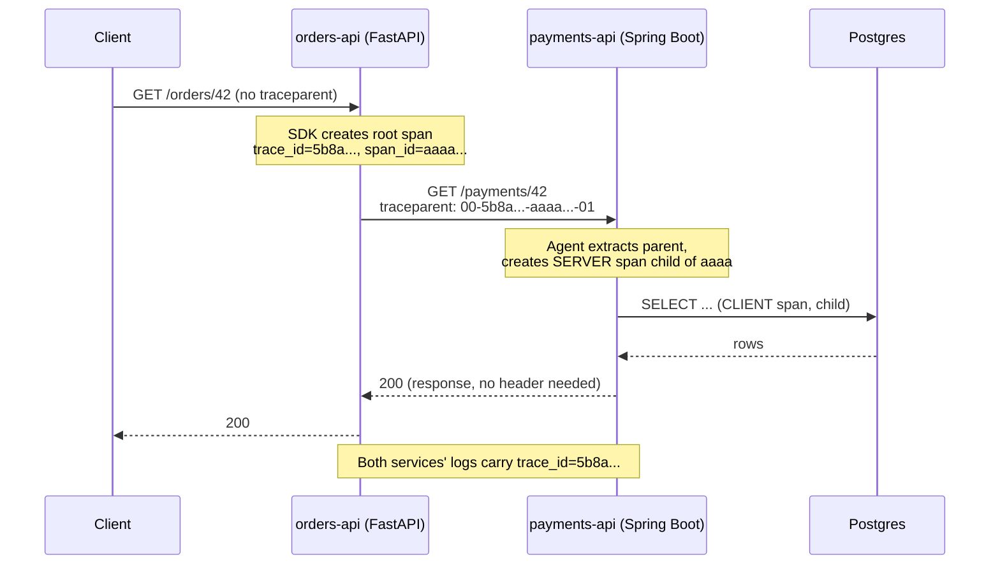
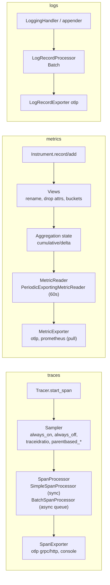
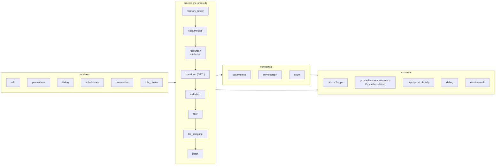
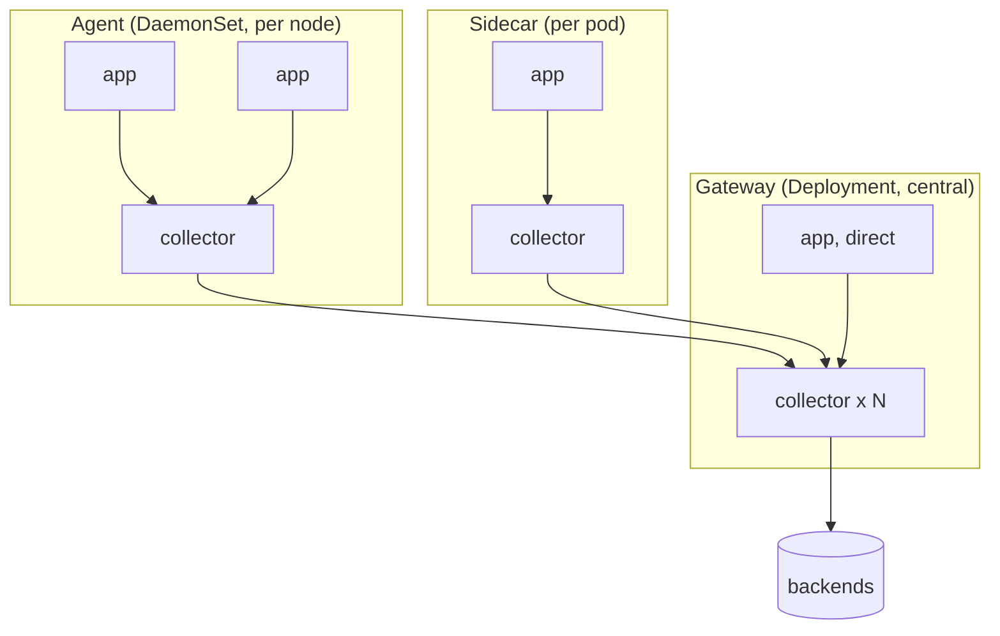

# OpenTelemetry: Core Concepts

| | |
|---|---|
| **Cluster** | 09 Observability |
| **Role** | Anchor |
| **Prerequisites** | [01-installation-and-setup.md](01-installation-and-setup.md); HTTP headers; basic statistics (percentiles) |
| **Target version** | Specification 1.3x, Collector 0.110+, Python SDK 1.27+, Java agent 2.x |
| **Capstone phase** | Phase 4 (Months 13-16) |

> This file explains how OpenTelemetry works underneath: the signals and their data model, how context travels between processes, what the SDK does between your code and the wire, how semantic conventions make telemetry interoperable (including the `gen_ai.*` conventions for LLM calls), and how the Collector's receivers, processors, connectors and exporters compose into pipelines. Read it before writing any instrumentation; every lab and production pattern assumes this vocabulary.

---

## 1. The Specification and Its Layers

OpenTelemetry is a specification first and code second. The spec has three layers, each with its own stability guarantee:

| Layer | Contents | Stability |
|---|---|---|
| **API** | Interfaces for creating spans, metric instruments, log records; context and propagation interfaces | Stable for traces, metrics, logs. Backwards compatible forever |
| **SDK** | Reference implementation: providers, processors, exporters, samplers, resource detection, configuration via `OTEL_*` env vars | Stable for traces, metrics, logs |
| **Data (OTLP + semantic conventions)** | Protobuf schema for the wire; attribute names and their meaning | OTLP stable; semantic conventions stable for HTTP, partly experimental elsewhere (GenAI is experimental) |

The split between API and SDK is the design choice that matters most for library authors: a library such as `httpx` or Spring's `RestTemplate` instrumentation depends only on the API. If no SDK is configured, every API call is a no-op costing a few nanoseconds. The application owner decides, at deployment time, whether to install an SDK and where to export.

### Signals



- **Traces** describe the path of one request. A trace is a set of spans sharing a `trace_id`; each span has a `span_id` and an optional `parent_span_id`.
- **Metrics** are numeric measurements aggregated over time. Instruments record; the SDK aggregates into data points; readers export.
- **Logs** in OTel are not a new logging API. The Logs Bridge API connects existing loggers (`logging`, Logback, Log4j) to the OTel pipeline so records carry resource attributes and `trace_id`.
- **Profiles** (pprof-based, experimental since 2024) record CPU and memory stack samples; Grafana Pyroscope and Elastic Universal Profiling consume them.
- **Baggage** is a propagated map of key-values (for example `tenant.id=acme`) that services downstream can read and copy onto spans. It is not exported by itself and it is visible to every hop, so never put secrets in it.
- **Context** is the in-process object that holds the active span and baggage; propagation serialises it into carriers (HTTP headers, message headers).

---

## 2. Context Propagation

### In-process

Each language has a context mechanism: Python uses `contextvars`, Java uses a thread-local plus explicit `Context.makeCurrent()`, and async frameworks need instrumentation that copies context across task boundaries. When a span is started it becomes the *current span*; child spans read the current span as their parent.

### Cross-process: W3C Trace Context

OTel's default propagator implements the W3C `traceparent` and `tracestate` headers.

```text
traceparent: 00-5b8aa5a2d2c872e8321cf37308d69df2-051581bf3cb55c13-01
             ^^ ^^^^^^^^^^^^^^^^^^^^^^^^^^^^^^^^ ^^^^^^^^^^^^^^^^ ^^
             |  trace-id (16 bytes, hex)          parent-id (8 B)  trace-flags (01 = sampled)
             version
tracestate: vendorA=opaque,vendorB=opaque
baggage: tenant.id=acme,request.priority=high
```



Rules of propagation:

1. The **client** instrumentation injects headers when making an outbound call (`httpx`, `requests`, `RestTemplate`, `WebClient`, Kafka producer headers).
2. The **server** instrumentation extracts headers on the inbound call and makes the remote span the parent.
3. Sampling decisions travel in `trace-flags`. A `parentbased` sampler respects the inbound decision so a trace is either entirely sampled or not (head sampling).
4. Message queues propagate via message headers; batch consumers use **span links** rather than parent relationships because one consumer span can relate to many producer spans.
5. Propagators are configurable: `OTEL_PROPAGATORS=tracecontext,baggage,b3multi` adds Zipkin B3 headers for legacy services.

When a trace "breaks" (two separate traces where one was expected), one of these rules was violated: an unistrumented HTTP client, a thread pool that dropped context, a proxy stripping headers, or a service with a `always_off`/ratio sampler ignoring the parent.

---

## 3. The Data Model

### 3.1 Resource and Instrumentation Scope

Every exported item is wrapped like this on the wire:

```text
ResourceSpans / ResourceMetrics / ResourceLogs
  resource: { attributes: service.name, service.namespace, service.version, deployment.environment,
              k8s.namespace.name, k8s.pod.name, host.name, process.pid, telemetry.sdk.language ... }
  ScopeSpans / ScopeMetrics / ScopeLogs
    scope: { name: "opentelemetry.instrumentation.fastapi", version: "0.49b0" }
    spans[] / metrics[] / log_records[]
```

- **Resource**: who produced the telemetry. Set once per process. Resource detectors fill in cloud (`cloud.provider`, `cloud.region`, `aws.ecs.*`), container (`container.id`), Kubernetes (via the Collector's `k8sattributes` processor or the Operator's injected env), host and process attributes.
- **Instrumentation scope**: which library produced it. Backends usually drop it; it is useful for filtering noisy instrumentations in the Collector.

### 3.2 Spans

| Field | Meaning | Example |
|---|---|---|
| `trace_id`, `span_id`, `parent_span_id` | identity and tree position | 16-byte / 8-byte random |
| `name` | low-cardinality operation name | `GET /orders/{order_id}`, `SELECT orders`, `chat anthropic.claude` |
| `kind` | `INTERNAL`, `SERVER`, `CLIENT`, `PRODUCER`, `CONSUMER` | HTTP handler is `SERVER`, outbound call is `CLIENT` |
| `start_time`, `end_time` | nanosecond timestamps | duration derived |
| `attributes` | key-value pairs (string, bool, int, double, arrays) | `http.request.method=GET`, `http.response.status_code=200` |
| `events` | timestamped annotations within the span, with attributes | `exception` event with `exception.type`, `exception.message`, `exception.stacktrace` |
| `links` | references to other spans (other traces) | consumer span linking to producer spans |
| `status` | `UNSET`, `OK`, `ERROR` plus description | HTTP 5xx server spans are `ERROR`; 4xx are `UNSET` by convention |
| `trace_state`, `flags` | vendor state, sampled flag | |

Span names must be low cardinality: use the route template (`/orders/{order_id}`), never the concrete URL. Attribute values can be high cardinality; that is where `order_id` belongs.

### 3.3 Metrics

Instruments are what code calls; aggregations are what the SDK stores; data points are what gets exported.

| Instrument | Sync/Async | Monotonic | Default aggregation | Use for | Prometheus equivalent |
|---|---|---|---|---|---|
| `Counter` | sync | yes | Sum | requests served, bytes sent, tokens consumed | counter `_total` |
| `UpDownCounter` | sync | no | Sum (non-monotonic) | active requests, queue depth, items in cart | gauge |
| `Histogram` | sync | n/a | Explicit bucket histogram (or exponential) | request duration, payload size, TTFT | histogram `_bucket/_sum/_count` or native histogram |
| `Gauge` | sync (1.2x+) | n/a | Last value | temperature, current config value | gauge |
| `ObservableCounter` | async callback | yes | Sum | CPU time, GC count read from runtime | counter |
| `ObservableUpDownCounter` | async callback | no | Sum | memory in use | gauge |
| `ObservableGauge` | async callback | n/a | Last value | heap limit, fan speed | gauge |

**Aggregation temporality.** A sum can be exported as **cumulative** (value since process start; Prometheus model) or **delta** (value since last export; Datadog/StatsD model). OTLP supports both; Prometheus-based backends want cumulative. The SDK default is cumulative; set `OTEL_EXPORTER_OTLP_METRICS_TEMPORALITY_PREFERENCE=delta` only when the backend requires it. The Collector's `cumulativetodelta` and `deltatocumulative` processors convert.

**Histogram buckets.** Default explicit boundaries are `0, 5, 10, 25, 50, 75, 100, 250, 500, 750, 1000, 2500, 5000, 7500, 10000` (milliseconds in old conventions; seconds in current `http.server.request.duration`, which uses `0.005 ... 10`). Override with a View. The **exponential histogram** (base-2 buckets, auto-scaled) maps to Prometheus native histograms and avoids choosing boundaries.

**Exemplars.** When a histogram records a value while a sampled span is active, the SDK can attach `{trace_id, span_id, value, timestamp}` to the bucket as an exemplar. Set `OTEL_METRICS_EXEMPLAR_FILTER=trace_based` (default) and ensure the exporter path preserves them (`prometheusremotewrite` exporter and Prometheus `--enable-feature=exemplar-storage`).

**Views** rename instruments, change aggregation, drop attributes (the cardinality knife), or set buckets:

```python
from opentelemetry.sdk.metrics import MeterProvider
from opentelemetry.sdk.metrics.view import View, ExplicitBucketHistogramAggregation

views = [
    View(
        instrument_name="http.server.request.duration",
        aggregation=ExplicitBucketHistogramAggregation(
            boundaries=[0.005, 0.01, 0.025, 0.05, 0.1, 0.25, 0.3, 0.5, 1, 2.5, 5, 10]
        ),
        attribute_keys={"http.request.method", "http.route", "http.response.status_code"},  # drop everything else
    ),
]
provider = MeterProvider(views=views)
```

### 3.4 Logs

A log record has: `time`, `observed_time`, `severity_number` (1-24) and `severity_text`, `body` (string or structured), `attributes`, `trace_id`, `span_id`, `trace_flags`, plus the enclosing resource and scope. OTel does not ask you to replace your logger; the **Logs Bridge** (Python `LoggingHandler`, Logback/Log4j appenders) converts framework records to OTLP and stamps the active trace context. The `filelog` receiver in the Collector is the alternative path for applications that only write to stdout: it tails container logs and parses them, and the `k8sattributes` processor adds the resource.

---

## 4. Semantic Conventions

Semantic conventions are the dictionary. Use them exactly or your dashboards will not match anyone else's.

### HTTP (`http.*`, stable)

| Attribute | On | Example |
|---|---|---|
| `http.request.method` | client & server span | `GET` |
| `http.route` | server span | `/orders/{order_id}` |
| `url.full` | client span | `http://payments-api:8080/payments/42` |
| `url.path`, `url.scheme` | server span | `/orders/42`, `https` |
| `http.response.status_code` | both | `200` |
| `server.address`, `server.port` | both | `payments-api`, `8080` |
| `client.address` | server | `10.0.3.17` |
| `user_agent.original` | server | `curl/8.5.0` |
| `error.type` | both | `timeout`, `500` |

Metrics: `http.server.request.duration` (histogram, seconds), `http.server.active_requests` (updowncounter), `http.client.request.duration`.

Older instrumentations emitted `http.method`, `http.status_code`, `http.target`. Set `OTEL_SEMCONV_STABILITY_OPT_IN=http` (or `http/dup` for both) to get the new names; the Collector `transform` processor can rename the old ones during migration.

### Database (`db.*`)

`db.system.name` (`postgresql`), `db.namespace` (database name), `db.operation.name` (`SELECT`), `db.collection.name` (table), `db.query.text` (sanitised: parameters replaced with `?`). Span name: `{db.operation.name} {db.collection.name}`. Never record raw query parameters; the SQLAlchemy and JDBC instrumentations sanitise by default.

### Messaging (`messaging.*`)

`messaging.system` (`kafka`, `aws_sqs`), `messaging.destination.name`, `messaging.operation.type` (`publish`, `receive`, `process`), `messaging.message.id`. Producer span kind `PRODUCER`, consumer `CONSUMER`; batch processing uses links.

### Generative AI (`gen_ai.*`, experimental)

For the LLM and agent services in clusters 02, 03 and 10:

| Attribute | Example |
|---|---|
| `gen_ai.system` | `anthropic`, `aws.bedrock`, `openai`, `vertex_ai` |
| `gen_ai.operation.name` | `chat`, `text_completion`, `embeddings`, `execute_tool` |
| `gen_ai.request.model` | `<MODEL_ID>` |
| `gen_ai.response.model` | model actually used |
| `gen_ai.request.max_tokens`, `gen_ai.request.temperature`, `gen_ai.request.top_p` | `1024`, `0.2` |
| `gen_ai.usage.input_tokens`, `gen_ai.usage.output_tokens` | `812`, `164` |
| `gen_ai.response.finish_reasons` | `["stop"]` |
| `gen_ai.response.id` | provider response id |
| `gen_ai.tool.name`, `gen_ai.tool.call.id` | `lookup_order`, tool invocation id |
| `server.address` | API endpoint host |

Span name: `{gen_ai.operation.name} {gen_ai.request.model}` for model calls, `execute_tool {gen_ai.tool.name}` for tool calls. Metrics: `gen_ai.client.token.usage` (histogram, attribute `gen_ai.token.type=input|output`) and `gen_ai.client.operation.duration`. Prompt and completion content are **opt-in** events (`gen_ai.content.prompt`, `gen_ai.content.completion`) because they may contain personal data; keep them off in production or route them through the `redaction` processor. Time-to-first-token for streaming is not yet a standard attribute; the convention used in this wiki is a span event `gen_ai.first_token` and a custom histogram `gen_ai.client.time_to_first_token`.

### Resource conventions

`service.name` (required), `service.namespace`, `service.version`, `service.instance.id`, `deployment.environment.name` (older: `deployment.environment`), `k8s.cluster.name`, `k8s.namespace.name`, `k8s.deployment.name`, `k8s.pod.name`, `k8s.container.name`, `host.name`, `cloud.provider`, `cloud.region`, `cloud.account.id`.

---

## 5. The SDK Pipeline



### Samplers (head sampling)

| Sampler | Behaviour |
|---|---|
| `always_on` | record everything (labs, low traffic) |
| `always_off` | record nothing (API still works, no export) |
| `traceidratio` with arg `0.1` | keep 10% of traces based on a hash of `trace_id`; consistent across services for the same trace |
| `parentbased_always_on` (default) | root spans: always on; children: follow the parent's flag |
| `parentbased_traceidratio` | root spans: ratio; children: follow parent. **Use this** so distributed traces are complete |

Head sampling decides at the root with no knowledge of the outcome, so it drops 90% of errors along with 90% of successes. Tail sampling in the Collector fixes that; see section 6 and [05-production-patterns.md](05-production-patterns.md).

### Batch processor defaults

`BatchSpanProcessor`: queue 2048 spans, export up to 512 per batch, every 5 s, export timeout 30 s. If the queue fills, spans are dropped and the SDK logs `Queue is full, likely spans will be dropped`. Tune with `OTEL_BSP_MAX_QUEUE_SIZE`, `OTEL_BSP_SCHEDULE_DELAY`, `OTEL_BSP_MAX_EXPORT_BATCH_SIZE`.

### Configuration precedence

Code > environment variables > defaults. The zero-code agents are configured entirely by `OTEL_*` variables, which is why the Kubernetes `Instrumentation` CR is just a bundle of env vars plus an init container.

---

## 6. The Collector Processing Model



### Components

**Receivers** (sources): `otlp` (gRPC 4317 / HTTP 4318), `prometheus` (full scrape_config syntax, so the Collector can replace Prometheus scraping), `filelog` (tail files, multiline, parsers), `kubeletstats` (pod/container CPU, memory, network from each node's kubelet), `k8s_cluster` (cluster-level: deployments, nodes, pod phases), `hostmetrics` (CPU, memory, disk, filesystem, network, load, processes), `k8sobjects` (Kubernetes Events as logs), `jaeger`, `zipkin`, `kafka`, `sqlquery`.

**Processors** (stages, order matters):

| Processor | Purpose | Notes |
|---|---|---|
| `memory_limiter` | refuse data when heap exceeds a limit so the Collector does not OOM | **first** in every pipeline; receivers apply backpressure |
| `k8sattributes` | look up pod by source IP or `k8s.pod.uid` and add `k8s.namespace.name`, `k8s.pod.name`, `k8s.deployment.name`, labels/annotations | needs RBAC to list pods, replicasets, namespaces |
| `resource` / `resourcedetection` | add, update, delete resource attributes; detect env (`env`, `system`, `eks`, `ec2`, `gcp`, `azure`) | |
| `attributes` | add/update/delete/hash/extract span, metric or log attributes | `hash` for pseudonymising user ids |
| `transform` | OTTL statements over any signal: rename, parse JSON, set severity, truncate, compute | the Swiss-army knife; see cheatsheet |
| `redaction` | allow-list attribute keys, block values matching regex (card numbers, emails) | the PII gate |
| `filter` | drop spans/metrics/logs matching OTTL conditions | drop `/healthz` spans, drop debug logs |
| `probabilistic_sampler` | hash-based sampling of traces or logs in the Collector | cheap, stateless |
| `tail_sampling` | buffer whole traces for `decision_wait`, then apply policies (errors, latency, rate limit, attribute match, composite) | stateful; requires all spans of a trace on the same instance |
| `groupbytrace` | regroup spans by trace before tail sampling | |
| `cumulativetodelta`, `deltatocumulative` | temporality conversion | |
| `metricstransform`, `resource`, `span` | rename metrics, aggregate labels, rename spans from attributes | |
| `batch` | group items for efficient export | **last** |

**Connectors** are both an exporter of one pipeline and a receiver of another, enabling traces -> metrics derivation:

- `spanmetrics`: emits `calls_total`/`duration` histograms by `service.name`, `span.name`, `span.kind`, `status.code` plus configured dimensions; supports exemplars.
- `servicegraph`: emits `traces_service_graph_request_total` etc. by `client`/`server` for Grafana's service graph panel.
- `count`: counts spans/logs/metrics matching conditions into a metric.
- `routing`: route by attribute (for example per tenant) to different exporters.
- `forward`: chain pipelines.

**Exporters** (sinks): `otlp` (gRPC), `otlphttp` (HTTP/protobuf or JSON; Loki 3 accepts OTLP logs at `/otlp`), `prometheusremotewrite`, `prometheus` (expose a scrape endpoint), `debug`, `file`, `kafka`, `elasticsearch`, `loadbalancing` (consistent hashing by `trace_id` to a set of gateway Collectors), `awsxray`, `awscloudwatchlogs`, `azuremonitor`, `googlecloud`.

**Extensions** (not in pipelines): `health_check` (HTTP endpoint for probes), `pprof` (Go profiling), `zpages` (live pipeline/trace debug pages), `bearertokenauth`, `basicauth`, `oauth2client`, `sigv4auth` (AWS), `file_storage` (persistent queue for exporters), `headers_setter`, `opamp` (remote config).

### Pipelines

A pipeline is `(signal type, receivers, processors, exporters)`. Receivers and exporters can be shared across pipelines; a shared receiver fans out to every pipeline that lists it. Processors are instantiated per pipeline, so `batch` in two pipelines is two batchers.

```yaml
service:
  pipelines:
    traces:
      receivers: [otlp]
      processors: [memory_limiter, k8sattributes, redaction, tail_sampling, batch]
      exporters: [otlp/tempo, spanmetrics, servicegraph]
    metrics:
      receivers: [otlp, prometheus, kubeletstats]
      processors: [memory_limiter, k8sattributes, filter/drop-noisy, batch]
      exporters: [prometheusremotewrite]
    metrics/spanmetrics:
      receivers: [spanmetrics, servicegraph]
      processors: [batch]
      exporters: [prometheusremotewrite]
    logs:
      receivers: [otlp, filelog]
      processors: [memory_limiter, k8sattributes, transform/parse-json, redaction, batch]
      exporters: [otlphttp/loki]
```

### Core vs Contrib vs Custom (`ocb`)

The OpenTelemetry Collector Builder compiles a binary from a manifest that lists exactly the components you need:

```yaml
# builder-config.yaml
dist:
  name: otelcol-capstone
  description: Capstone Collector distribution
  output_path: ./dist
  otelcol_version: 0.115.0

receivers:
  - gomod: go.opentelemetry.io/collector/receiver/otlpreceiver v0.115.0
  - gomod: github.com/open-telemetry/opentelemetry-collector-contrib/receiver/prometheusreceiver v0.115.0
  - gomod: github.com/open-telemetry/opentelemetry-collector-contrib/receiver/filelogreceiver v0.115.0
  - gomod: github.com/open-telemetry/opentelemetry-collector-contrib/receiver/kubeletstatsreceiver v0.115.0
processors:
  - gomod: go.opentelemetry.io/collector/processor/batchprocessor v0.115.0
  - gomod: go.opentelemetry.io/collector/processor/memorylimiterprocessor v0.115.0
  - gomod: github.com/open-telemetry/opentelemetry-collector-contrib/processor/k8sattributesprocessor v0.115.0
  - gomod: github.com/open-telemetry/opentelemetry-collector-contrib/processor/tailsamplingprocessor v0.115.0
  - gomod: github.com/open-telemetry/opentelemetry-collector-contrib/processor/redactionprocessor v0.115.0
  - gomod: github.com/open-telemetry/opentelemetry-collector-contrib/processor/transformprocessor v0.115.0
  - gomod: github.com/open-telemetry/opentelemetry-collector-contrib/processor/filterprocessor v0.115.0
exporters:
  - gomod: go.opentelemetry.io/collector/exporter/otlpexporter v0.115.0
  - gomod: go.opentelemetry.io/collector/exporter/otlphttpexporter v0.115.0
  - gomod: go.opentelemetry.io/collector/exporter/debugexporter v0.115.0
  - gomod: github.com/open-telemetry/opentelemetry-collector-contrib/exporter/prometheusremotewriteexporter v0.115.0
connectors:
  - gomod: github.com/open-telemetry/opentelemetry-collector-contrib/connector/spanmetricsconnector v0.115.0
  - gomod: github.com/open-telemetry/opentelemetry-collector-contrib/connector/servicegraphconnector v0.115.0
extensions:
  - gomod: go.opentelemetry.io/collector/extension/zpagesextension v0.115.0
  - gomod: github.com/open-telemetry/opentelemetry-collector-contrib/extension/healthcheckextension v0.115.0
```

```bash
go install go.opentelemetry.io/collector/cmd/builder@v0.115.0
builder --config builder-config.yaml
./dist/otelcol-capstone --config otel-config.yaml
```

Benefits: smaller image, fewer CVEs to triage in cluster 08's scanners, and no surprise components. Cost: you own the build in CI.

---

## 7. Deployment Patterns



| Pattern | Pros | Cons | Use |
|---|---|---|---|
| **Sidecar** | per-pod isolation, tenant-specific config, app talks to `localhost` | resource overhead per pod, many configs to manage | multi-tenant platforms, strict isolation |
| **Agent (DaemonSet)** | tails node logs (`filelog`), scrapes kubelet, adds node metadata cheaply, apps send to node IP | per-node resources; still needs a gateway for tail sampling | **default** for logs and infra metrics |
| **Gateway (Deployment)** | central policy (sampling, redaction, routing), fewer backend connections, easy scaling | single hop of latency, needs load balancing by `trace_id` for tail sampling | **default** for application telemetry |

The capstone runs agent + gateway: the agent DaemonSet handles logs and infrastructure metrics; applications send OTLP straight to the gateway Service; the gateway does `k8sattributes`, `redaction`, `tail_sampling`, `spanmetrics` and export.

### OTel Operator CRDs

- `OpenTelemetryCollector`: `spec.mode` is `deployment`, `daemonset`, `statefulset` or `sidecar`; `spec.config` is the Collector YAML; the Operator creates the workload, Service, ConfigMap, and (optionally) a `ServiceMonitor` and HPA.
- `Instrumentation`: SDK config + language-specific auto-instrumentation images; pods opt in via `instrumentation.opentelemetry.io/inject-<lang>` annotations (`true`, `<name>`, or `<namespace>/<name>`).
- `TargetAllocator` (and `spec.targetAllocator` in the Collector CR): shards Prometheus scrape targets across a StatefulSet of Collectors and can consume `ServiceMonitor`/`PodMonitor` CRs, letting the Collector replace Prometheus's scraper while keeping the Operator's CRDs.
- `OpAMPBridge`: remote configuration via the OpAMP protocol.

---

## 8. Sampling: Head vs Tail

| | Head sampling (SDK) | Tail sampling (Collector) |
|---|---|---|
| Decision point | at root span creation | after the whole trace arrives (`decision_wait`, default 30 s) |
| Knowledge | none about outcome | duration, status, attributes of every span |
| Cost | near zero; reduces SDK and network load | memory to buffer traces (`num_traces` x avg spans x ~1 KB); CPU for policies |
| Completeness | `parentbased` keeps traces whole | requires all spans of a trace on the same Collector: `loadbalancing` exporter with `routing_key: traceID` in front |
| Typical policy | 10-25% ratio | keep 100% of errors, 100% slower than 2 s, 5% of the rest, cap at N traces/s |
| Effect on span metrics | metrics reflect only sampled traces unless computed before sampling | compute `spanmetrics` **before** `tail_sampling` in the pipeline so RED metrics are exact |

Most teams run both: head sampling at 25-50% to cap SDK cost, then tail sampling in the gateway to keep the interesting traces. Exemplars still work because the SDK records them only when the span is sampled.

---

## 9. Log Correlation Mechanics

### Python `logging`

With `OTEL_PYTHON_LOG_CORRELATION=true`, the `logging` instrumentation installs a handler that injects `otelTraceID`, `otelSpanID`, `otelTraceSampled`, `otelServiceName` into the record. Use them in a JSON formatter:

```python
import json, logging
from opentelemetry import trace

class JsonFormatter(logging.Formatter):
    def format(self, record: logging.LogRecord) -> str:
        span = trace.get_current_span().get_span_context()
        payload = {
            "ts": self.formatTime(record, "%Y-%m-%dT%H:%M:%S%z"),
            "level": record.levelname,
            "logger": record.name,
            "msg": record.getMessage(),
            "trace_id": format(span.trace_id, "032x") if span.is_valid else None,
            "span_id": format(span.span_id, "016x") if span.is_valid else None,
        }
        for k in ("order_id", "tenant_id"):
            if hasattr(record, k):
                payload[k] = getattr(record, k)
        return json.dumps(payload)

handler = logging.StreamHandler()
handler.setFormatter(JsonFormatter())
logging.basicConfig(level=logging.INFO, handlers=[handler])
```

### Java Logback MDC

The javaagent puts `trace_id`, `span_id`, `trace_flags` into MDC automatically (`otel.instrumentation.logback-mdc.enabled=true`, default). Emit JSON with the Logstash encoder:

```xml
<!-- src/main/resources/logback-spring.xml -->
<configuration>
  <appender name="JSON" class="ch.qos.logback.core.ConsoleAppender">
    <encoder class="net.logstash.logback.encoder.LogstashEncoder">
      <includeMdcKeyName>trace_id</includeMdcKeyName>
      <includeMdcKeyName>span_id</includeMdcKeyName>
      <includeMdcKeyName>trace_flags</includeMdcKeyName>
      <customFields>{"service":"payments-api"}</customFields>
    </encoder>
  </appender>
  <root level="INFO">
    <appender-ref ref="JSON"/>
  </root>
</configuration>
```

With `OTEL_LOGS_EXPORTER=otlp` the agent additionally ships each record over OTLP (Logback appender instrumentation) with the trace context already in the record. Choose one path to Loki (stdout via `filelog`/Alloy, or OTLP) to avoid duplicates.

---

## 10. Cost, Security and Cardinality Levers (Preview)

| Lever | Where | Effect |
|---|---|---|
| Drop health-check spans | `filter` processor: `IsMatch(attributes["http.route"], "^/(healthz|readyz|metrics)$")` | 20-40% fewer spans in Kubernetes |
| Drop attributes from metrics | SDK Views `attribute_keys`, or `transform` with `delete_matching_keys` | caps Prometheus series |
| Head + tail sampling | SDK sampler + `tail_sampling` | 80-95% fewer stored traces, all errors kept |
| Shorten string attributes | `transform`: `truncate_all(attributes, 256)` | smaller spans and logs |
| Redact PII | `redaction` processor, `attributes` `hash` action | compliance |
| TLS + auth to Collector | `tls` on receivers, `bearertokenauth`/`oauth2client` extensions | no plaintext telemetry across untrusted networks |
| Limit `k8sattributes` extraction | only the metadata you query by | smaller resource blocks |

These are expanded with full configs in [05-production-patterns.md](05-production-patterns.md).

---

## 11. Summary

- OTel separates API, SDK, protocol and Collector so instrumentation is written once.
- Context propagation (W3C `traceparent`) is what makes traces, logs and exemplars join up.
- Resource attributes are the cross-signal join key; semantic conventions are the shared dictionary, including `gen_ai.*` for LLM calls.
- Metric instruments map to Prometheus types; temporality and bucket choice are configuration, not code.
- The Collector is an ordered pipeline: `memory_limiter` first, `batch` last, enrichment and redaction in between, connectors to derive metrics from traces.
- Head sampling is cheap and blind; tail sampling is informed and stateful; use both.

Next: [03-commands-and-cheatsheet.md](03-commands-and-cheatsheet.md).
