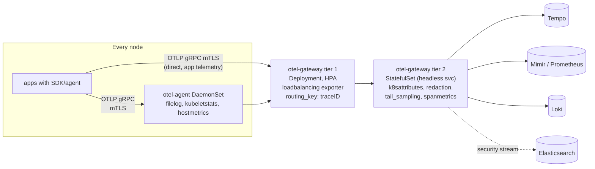

# OpenTelemetry: Production Patterns

| | |
|---|---|
| **Cluster** | 09 Observability |
| **Role** | Anchor |
| **Prerequisites** | [04-hands-on-labs.md](04-hands-on-labs.md) Labs 1-6 |
| **Target version** | Collector 0.110+, Operator 0.110+, Kubernetes 1.31+ |
| **Capstone phase** | Phase 4 (Months 13-16) |

> How to run OpenTelemetry at production scale: securing the pipeline (TLS, authentication, redaction), making it highly available and horizontally scalable (gateway tiers, load-balanced tail sampling, persistent queues), controlling cost (sampling, filtering, cardinality limits), integrating with CI/CD and GitOps, multi-tenancy, instrumenting LLM/agent workloads, anti-patterns, and a decision checklist.

---

## 1. Reference Production Topology



Two gateway tiers are only needed when tail sampling is on: tier 1 is stateless and hashes traces to a consistent tier-2 instance so each trace is buffered in exactly one place. Without tail sampling, a single Deployment behind a ClusterIP Service is enough.

---

## 2. Security Hardening

### 2.1 TLS everywhere

Issue certificates with cert-manager (already required by the Operator):

```yaml
apiVersion: cert-manager.io/v1
kind: Certificate
metadata: { name: otel-collector-tls, namespace: observability }
spec:
  secretName: otel-collector-tls
  issuerRef: { name: internal-ca, kind: ClusterIssuer }
  dnsNames:
    - otel-collector.observability.svc
    - otel-collector.observability.svc.cluster.local
  usages: [server auth]
```

```yaml
# Collector receiver with TLS (and optional mTLS)
receivers:
  otlp:
    protocols:
      grpc:
        endpoint: 0.0.0.0:4317
        tls:
          cert_file: /etc/otelcol/tls/tls.crt
          key_file: /etc/otelcol/tls/tls.key
          client_ca_file: /etc/otelcol/tls/ca.crt        # require client certs (mTLS)
          min_version: "1.3"
      http:
        endpoint: 0.0.0.0:4318
        tls:
          cert_file: /etc/otelcol/tls/tls.crt
          key_file: /etc/otelcol/tls/tls.key
```

SDK side (Python / Java read the same variables):

```yaml
env:
  - { name: OTEL_EXPORTER_OTLP_ENDPOINT, value: https://otel-collector.observability.svc.cluster.local:4317 }
  - { name: OTEL_EXPORTER_OTLP_CERTIFICATE, value: /etc/otel/tls/ca.crt }
  - { name: OTEL_EXPORTER_OTLP_CLIENT_CERTIFICATE, value: /etc/otel/tls/tls.crt }
  - { name: OTEL_EXPORTER_OTLP_CLIENT_KEY, value: /etc/otel/tls/tls.key }
```

In a service mesh (Istio/Linkerd) with mTLS, keep the Collector plaintext inside the mesh and let the sidecars encrypt; do not double-encrypt.

### 2.2 Authentication at the Collector

```yaml
extensions:
  bearertokenauth/server:
    scheme: Bearer
    tokens: ["${env:OTLP_INGEST_TOKEN}"]            # from a Kubernetes Secret, rotated by External Secrets Operator
  oidc:
    issuer_url: https://idp.example.com/realms/platform
    audience: otel-collector
receivers:
  otlp:
    protocols:
      grpc:
        auth: { authenticator: oidc }                 # or bearertokenauth/server
```

For the egress side use `oauth2client`, `sigv4auth` (Amazon Managed Prometheus, X-Ray), or `basicauth` with secrets injected via env from Kubernetes Secrets. Never write credentials into the ConfigMap.

### 2.3 PII and secret redaction, defence in depth

1. **SDK level**: do not record request bodies, do not capture headers by default (`OTEL_INSTRUMENTATION_HTTP_SERVER_CAPTURE_REQUEST_HEADERS` only for safe headers such as `x-request-id`), sanitised DB statements (default), `OTEL_INSTRUMENTATION_GENAI_CAPTURE_MESSAGE_CONTENT=false`.
2. **Gateway level**: `redaction` for value patterns, `attributes` `delete`/`hash` for known keys, `transform` `delete_matching_keys` for key patterns.

```yaml
processors:
  redaction:
    allow_all_keys: false
    allowed_keys:
      - ^http\..*
      - ^url\..*
      - ^server\..*
      - ^db\.(system|namespace|operation\.name|collection\.name)$
      - ^messaging\..*
      - ^gen_ai\.(system|operation\.name|request\..*|response\.(model|finish_reasons|id)|usage\..*|tool\.name)$
      - ^(order|payment|tenant)\.id$
      - ^k8s\..*
      - ^service\..*
    blocked_values:
      - "4[0-9]{12}(?:[0-9]{3})?"
      - "3[47][0-9]{13}"
      - "[A-Za-z0-9._%+-]+@[A-Za-z0-9.-]+\\.[A-Za-z]{2,}"
      - "(?i)(bearer|basic)\\s+[a-z0-9._=-]+"
      - "(?i)AKIA[0-9A-Z]{16}"
    summary: info
  attributes/hash:
    actions:
      - { key: user.id, action: hash }
      - { key: enduser.id, action: hash }
      - { key: client.address, action: delete }
```

An allow-list (`allow_all_keys: false`) is stricter than a block-list and is the right default for regulated environments. The `summary: info` option adds `redaction.masked.count` / `redaction.masked.keys` attributes so you can alert when masking happens unexpectedly.

### 2.4 Pod security and supply chain

- Run as non-root (UID 10001), `readOnlyRootFilesystem`, drop all capabilities. Only the log-tailing agent needs root or a `DAC_READ_SEARCH` capability on `/var/log/pods`; document that exception in an ADR.
- Pin the Collector image by digest; build a custom distribution with `ocb` to shrink the CVE surface; scan it with Trivy/Grype in cluster 08's pipeline.
- NetworkPolicy: allow ingress to the gateway only from application namespaces and the agent; egress only to the backends.

```yaml
apiVersion: networking.k8s.io/v1
kind: NetworkPolicy
metadata: { name: otel-collector-ingress, namespace: observability }
spec:
  podSelector: { matchLabels: { app.kubernetes.io/component: opentelemetry-collector } }
  policyTypes: [Ingress]
  ingress:
    - from:
        - namespaceSelector: { matchLabels: { telemetry: enabled } }
        - podSelector: { matchLabels: { app.kubernetes.io/name: otel-agent-collector } }
      ports: [{ port: 4317 }, { port: 4318 }]
    - from:
        - podSelector: { matchLabels: { app.kubernetes.io/name: prometheus } }
      ports: [{ port: 8888 }]
```

---

## 3. High Availability and Scaling

### 3.1 Gateway sizing

Rule of thumb per Collector replica (contrib, 1 vCPU, 2 GiB): roughly 10-20k spans/s or 50-100k metric data points/s or 10-20 MB/s of logs through `batch` + `otlp` export. `tail_sampling` memory is `num_traces x average spans per trace x ~1-2 KB`; 100k traces of 10 spans needs ~1.5-2 GiB. Set `memory_limiter.limit_mib` to about 80% of the container limit and `spike_limit_mib` to 20% of the limit.

```yaml
spec:
  mode: deployment
  replicas: 3
  autoscaler:
    minReplicas: 3
    maxReplicas: 12
    targetCPUUtilization: 65
    targetMemoryUtilization: 75
  podDisruptionBudget: { minAvailable: 2 }
  topologySpreadConstraints:
    - maxSkew: 1
      topologyKey: topology.kubernetes.io/zone
      whenUnsatisfiable: ScheduleAnyway
      labelSelector: { matchLabels: { app.kubernetes.io/name: otel-collector-collector } }
```

### 3.2 Load-balanced tail sampling

```yaml
# Tier 1 (stateless)
exporters:
  loadbalancing:
    routing_key: traceID
    protocol:
      otlp:
        tls: { ca_file: /etc/otelcol/tls/ca.crt }
        sending_queue: { enabled: true, queue_size: 10000 }
    resolver:
      k8s:
        service: otel-gateway-sampler-collector-headless.observability
        ports: [4317]
```

Tier 2 is `mode: statefulset` so the headless Service gives stable endpoints; scaling tier 2 re-hashes a fraction of traces, causing a few incomplete traces during the change. Scale tier 2 rarely and during low traffic.

### 3.3 Persistent exporter queues

Backends fail. Without a persistent queue, data buffered in memory is lost on Collector restart.

```yaml
extensions:
  file_storage:
    directory: /var/lib/otelcol/queue
    timeout: 10s
    compaction: { on_start: true, directory: /var/lib/otelcol/queue, max_transaction_size: 65536 }
exporters:
  otlp/tempo:
    endpoint: tempo-distributor.observability.svc:4317
    sending_queue: { enabled: true, num_consumers: 10, queue_size: 20000, storage: file_storage }
    retry_on_failure: { enabled: true, initial_interval: 5s, max_interval: 60s, max_elapsed_time: 900s }
```

Mount a PVC (or `emptyDir` with a size limit for agents) at `/var/lib/otelcol/queue`. Watch `otelcol_exporter_queue_size / otelcol_exporter_queue_capacity`; alert above 0.8.

### 3.4 SDK-side resilience

- Export to the **node-local agent** (`$(HOST_IP):4317` via downward API) or to a ClusterIP Service with multiple gateway replicas; gRPC clients hold one connection, so prefer a headless Service with client-side round-robin or the `loadbalancing` exporter when connection skew becomes a problem.
- Keep `OTEL_BSP_MAX_QUEUE_SIZE` default (2048) unless export latency is high; a bigger queue hides a slow pipeline.
- Set `OTEL_EXPORTER_OTLP_TIMEOUT=5000` so a dead Collector cannot stall application threads (exports are async, but shutdown flushes synchronously).

---

## 4. Cost Control

| Lever | Typical saving | Config |
|---|---|---|
| Drop health/readiness/metrics spans | 20-40% of spans | `filter` processor on `http.route` |
| Head sampling 25% + tail sampling (errors, slow, 5% baseline) | 80-95% of trace storage | SDK `parentbased_traceidratio` + `tail_sampling` |
| Compute span metrics before sampling | keeps RED metrics exact for free | pipeline order |
| Drop high-cardinality metric attributes | prevents series explosions | SDK Views, `transform` on `datapoint` |
| Drop debug logs in prod | 30-60% of log volume | `filter` on `severity_number` |
| Truncate attributes | 10-20% bytes | `transform` `truncate_all(attributes, 256)` |
| Stop exporting unused metrics | varies | `filter` by `name` / `IsMatch(name, "^jvm_.*")` on noisy runtimes |
| Shorter metric export interval only where needed | network | `OTEL_METRIC_EXPORT_INTERVAL=60000` default is fine |

### Cardinality guard rails in the Collector

```yaml
processors:
  transform/cardinality:
    metric_statements:
      - context: datapoint
        statements:
          - delete_key(attributes, "client.address")
          - delete_key(attributes, "user_agent.original")
          - delete_key(attributes, "url.path")              # route is enough
          - delete_key(attributes, "http.request.header.x-request-id")
          - delete_matching_keys(attributes, "^(user|order|payment|session)\\.id$")
  filter/metric-noise:
    metrics:
      metric:
        - 'IsMatch(name, "^process\\.runtime\\.jvm\\.buffer.*")'
        - 'name == "http.client.request.duration" and resource.attributes["service.name"] == "batch-worker"'
```

Pair this with Prometheus-side limits (`sample_limit`, `label_limit` in scrape configs, and Mimir per-tenant series limits) so a single deploy cannot take the metrics backend down. The alert `topk(10, count by (__name__)({__name__=~".+"}))` in [../prometheus/06-troubleshooting.md](../prometheus/06-troubleshooting.md) is the detection side.

### Measuring the pipeline's own cost

```promql
# bytes per second leaving the collector per exporter
sum by (exporter) (rate(otelcol_exporter_sent_spans[5m]))
sum by (exporter) (rate(otelcol_exporter_sent_log_records[5m]))
# sampling ratio achieved
sum(rate(otelcol_processor_tail_sampling_count_traces_sampled{sampled="true"}[5m]))
/ sum(rate(otelcol_processor_tail_sampling_count_traces_sampled[5m]))
```

---

## 5. Multi-Tenancy

Options, from simplest to strictest:

1. **Tenant as a resource attribute** (`tenant.id`) plus per-tenant dashboards. No isolation.
2. **Routing connector** to per-tenant exporters that set `X-Scope-OrgID` for Loki/Tempo/Mimir:

   ```yaml
   connectors:
     routing:
       default_pipelines: [traces/shared]
       error_mode: ignore
       table:
         - statement: route() where resource.attributes["tenant.id"] == "acme"
           pipelines: [traces/acme]
   exporters:
     otlp/tempo-acme:
       endpoint: tempo-distributor.observability.svc:4317
       headers: { X-Scope-OrgID: acme }
   ```

3. **Per-namespace sidecar Collectors** (`mode: sidecar`) with tenant-specific credentials, so a tenant's workloads can never write to another tenant's stream.
4. **Separate Collector gateways per tenant** behind a shared Operator, each with its own NetworkPolicy and backend tenant.

Baggage can carry `tenant.id` from the edge; copy it onto spans with a span processor or OTTL (`set(attributes["tenant.id"], ...)`) early, because baggage is not stored.

---

## 6. CI/CD and GitOps Integration

### Validate configs in the pipeline

```yaml
# .github/workflows/otel-config.yml
name: otel-config
on:
  pull_request:
    paths: ["platform/observability/otel/**"]
jobs:
  validate:
    runs-on: ubuntu-latest
    steps:
      - uses: actions/checkout@v4
      - name: Validate collector configs
        run: |
          docker run --rm -v "$PWD/platform/observability/otel:/cfg:ro" \
            otel/opentelemetry-collector-contrib:0.115.0 validate --config /cfg/gateway.yaml
          docker run --rm -v "$PWD/platform/observability/otel:/cfg:ro" \
            otel/opentelemetry-collector-contrib:0.115.0 validate --config /cfg/agent.yaml
      - name: Render Operator CR and lint
        run: |
          kubectl kustomize platform/observability/otel | kubeconform -strict -ignore-missing-schemas -
```

For `OpenTelemetryCollector` CRs, extract `spec.config` with `yq` and validate it the same way; in Argo CD, the Operator reconciles the CR and the Collector reloads with a rolling restart.

### Instrumentation smoke test in CI

Spin up a Collector with the `debug` exporter and the service under test, hit an endpoint, and assert a span appeared:

```bash
docker compose -f compose.test.yml up -d
curl -sf localhost:8000/orders/42 > /dev/null
sleep 6
docker compose -f compose.test.yml logs otel-collector | grep -q 'http.route: Str(/orders/{order_id})' && echo "instrumentation OK"
```

### Semantic convention linting

Use `weaver` (OTel's schema tool) or a simple grep in CI to fail on deprecated attribute names (`http.method`, `http.status_code`, `net.peer.name`) in application code.

### Versioning

Pin Collector, Operator and auto-instrumentation image versions in Git; upgrade monthly; read the Collector changelog for component renames (`logging` -> `debug` exporter, `loki` exporter deprecated in favour of `otlphttp`). Renovate/Dependabot can track `otel/opentelemetry-collector-contrib` tags.

---

## 7. Instrumenting LLM and Agent Workloads

The pattern used in clusters 02, 03 and 10 (Bedrock, LangGraph, Strands, vLLM, MCP):

| Element | Span | Key attributes |
|---|---|---|
| Agent invocation | `invoke_agent <agent>` | `gen_ai.operation.name=invoke_agent`, `gen_ai.agent.name`, `gen_ai.conversation.id` |
| Model call | `chat <model>` (CLIENT) | `gen_ai.system`, `gen_ai.request.model`, `gen_ai.usage.input_tokens`, `gen_ai.usage.output_tokens`, `gen_ai.response.finish_reasons`, `server.address` |
| Tool call | `execute_tool <tool>` | `gen_ai.tool.name`, `gen_ai.tool.call.id`, plus the tool's own child spans (DB, HTTP, MCP) |
| MCP call | `mcp.call_tool <server>/<tool>` (CLIENT) | `rpc.system=mcp`, `rpc.service`, `rpc.method`, `server.address` |
| Retrieval (RAG) | `retrieve <index>` | `db.system.name=qdrant`, `db.collection.name`, `db.operation.name=search`, custom `rag.top_k`, `rag.hits` |
| Guardrail | `guardrail <name>` | custom `guardrail.action=blocked|allowed`, `guardrail.category` |

Metrics: `gen_ai.client.token.usage` (histogram by `gen_ai.token.type`, `gen_ai.request.model`, `gen_ai.system`), `gen_ai.client.operation.duration`, `gen_ai.client.time_to_first_token` (wiki convention), `gen_ai.server.request.duration` and `gen_ai.server.time_per_output_token` on the vLLM side (vLLM exposes Prometheus metrics natively).

Cost derived in Prometheus:

```promql
# approximate spend per model per hour: tokens * price per 1k; prices as recording-rule constants
sum by (gen_ai_request_model) (increase(gen_ai_client_token_usage_token_sum{gen_ai_token_type="input"}[1h]))  / 1000 * on (gen_ai_request_model) group_left llm_price_per_1k_input_tokens
```

Policies:

- **Content capture off by default**; when enabled for debugging, route through `redaction` and restrict retention to days.
- **Tail-sample all LLM traces** (they are low volume, high value) with a `string_attribute` policy on `gen_ai.system`.
- **Never put prompts in metric attributes or log labels.**
- Use `gen_ai.conversation.id` plus `session.id` for multi-turn correlation rather than long traces; a conversation spanning hours should be many traces linked by attribute, not one trace.

---

## 8. Instrumentation Governance

- **Resource attribute standard**: `service.name`, `service.namespace`, `service.version` (from the image tag via downward API), `deployment.environment.name`, `k8s.*` from `k8sattributes`. Enforce with a Kyverno/OPA policy that rejects Deployments without `app` labels (the `k8sattributes` processor uses them).
- **Span naming**: route templates for HTTP, `{operation} {collection}` for DB, `{operation} {model}` for LLM, verbs for internal spans. Reject raw URLs or IDs in span names in code review.
- **Golden path**: the Backstage template (cluster 04) generates Deployments with the `inject-*` annotation, the `OTEL_*` env, JSON logging config and a `ServiceMonitor`, so new services are observable on day one.
- **Semantic convention versions**: emit `OTEL_SEMCONV_STABILITY_OPT_IN=http` everywhere at the same time and rename in the Collector during the migration window.

---

## 9. Anti-Patterns

| Anti-pattern | Why it hurts | Do instead |
|---|---|---|
| Exporting from applications directly to backends | couples every service to storage credentials and formats; no central redaction | always through a Collector |
| `always_on` sampling in production | cost and backend overload | `parentbased_traceidratio` + tail sampling |
| `traceidratio` (non-parentbased) | child services drop spans their parents kept: broken traces | `parentbased_*` |
| `resource_to_telemetry_conversion` with every k8s attribute | every pod UID becomes a label; Prometheus cardinality explosion | trim resource attributes first, or use `target_info` joins |
| Putting `user.id` / `request.id` on metrics | series explosion | spans and logs only |
| No `memory_limiter` | Collector OOMKilled under burst; data loss | first processor in every pipeline |
| `batch` before `tail_sampling`/`k8sattributes` | breaks `connection`-based pod association and groups spans oddly | `batch` last |
| Both OTLP log export and `filelog` on the same pods | duplicate lines in Loki | pick one path per workload |
| Logging full prompts/completions to spans | PII and cost | content capture off; sample to a short-retention store if needed |
| Running `otelcol-contrib` as root everywhere | unnecessary privilege | root only on the log-tailing agent, documented |
| Hard-coding endpoints in code | environment coupling | `OTEL_EXPORTER_OTLP_ENDPOINT` env var |
| Ignoring `otelcol_exporter_send_failed_*` | silent data loss | alert on it and on queue saturation |

---

## 10. Alerts on the Pipeline Itself

```yaml
groups:
  - name: otel-collector
    rules:
      - alert: OtelCollectorExportFailures
        expr: sum by (exporter) (rate(otelcol_exporter_send_failed_spans[5m]) + rate(otelcol_exporter_send_failed_metric_points[5m]) + rate(otelcol_exporter_send_failed_log_records[5m])) > 0
        for: 10m
        labels: { severity: warning }
        annotations: { summary: "OTel exporter {{ $labels.exporter }} failing", runbook_url: "https://wiki.example.com/runbooks/otel-export-failures" }
      - alert: OtelCollectorQueueNearFull
        expr: otelcol_exporter_queue_size / otelcol_exporter_queue_capacity > 0.8
        for: 5m
        labels: { severity: warning }
      - alert: OtelCollectorRefusingData
        expr: sum(rate(otelcol_receiver_refused_spans[5m])) + sum(rate(otelcol_receiver_refused_metric_points[5m])) + sum(rate(otelcol_receiver_refused_log_records[5m])) > 0
        for: 5m
        labels: { severity: critical }
        annotations: { summary: "memory_limiter is refusing data; scale the gateway or raise limits" }
      - alert: OtelCollectorDown
        expr: absent(up{job="otel-collector-collector"} == 1)
        for: 2m
        labels: { severity: critical }
```

---

## 11. Decision Checklist

Before promoting an OTel setup to production, answer each:

1. Does every application export to a Collector, never directly to a backend?
2. Is `memory_limiter` first and `batch` last in every pipeline?
3. Are receivers TLS-terminated (or inside a mesh) and authenticated across trust boundaries?
4. Is PII redaction enforced in the gateway with an allow-list, and tested with a fixture like Lab 5?
5. Is sampling `parentbased_*` in SDKs and is tail sampling load-balanced by `trace_id`?
6. Are span metrics computed before sampling?
7. Are persistent queues enabled for exporters to backends that can be unavailable?
8. Are high-cardinality attributes stripped from metrics (Views + `transform`)?
9. Are Collector self-metrics scraped and alerted on (export failures, queue, refused)?
10. Is the Collector image pinned by digest and built from a minimal `ocb` manifest?
11. Is the `Instrumentation` CR the only source of SDK config, and does the golden-path template use it?
12. Is there an ADR recording the sampling policy, retention and redaction rules?
13. Are `gen_ai.*` content-capture flags off in production?
14. Can you reproduce the "metric -> exemplar -> trace -> logs" workflow from a fresh browser session?

---

## 12. Further Reading

- Collector scaling guide: https://opentelemetry.io/docs/collector/scaling/
- Collector security best practices: https://opentelemetry.io/docs/security/config-best-practices/
- Tail sampling processor README: https://github.com/open-telemetry/opentelemetry-collector-contrib/tree/main/processor/tailsamplingprocessor
- GenAI semantic conventions: https://opentelemetry.io/docs/specs/semconv/gen-ai/
- Operator documentation: https://opentelemetry.io/docs/kubernetes/operator/
