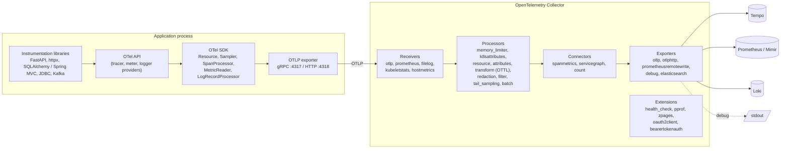

# OpenTelemetry

| | |
|---|---|
| **Cluster** | 09 Observability |
| **Role** | Anchor |
| **Category** | Telemetry instrumentation, collection and pipeline (vendor-neutral) |
| **Prerequisites** | Python 3.12+ or Java 21 basics, Docker, Kubernetes 1.31+ fundamentals (cluster 04), HTTP and gRPC basics |
| **Target version** | OpenTelemetry Specification 1.3x, Collector 0.110+ (contrib), Python SDK 1.27+, Java agent 2.x, OTel Operator 0.110+ |
| **Capstone phase** | Phase 4 (Months 13-16) |
| **Official docs** | https://opentelemetry.io/docs/ |

> OpenTelemetry (OTel) is the CNCF standard for producing, collecting and exporting telemetry: traces, metrics, logs (and, newly, profiles). It gives you one API, one wire protocol (OTLP), one data model and one set of semantic conventions so that an application is instrumented once and the backend becomes a configuration decision. After this folder you will be able to instrument a FastAPI service and a Spring Boot service with and without code changes, run and configure an OpenTelemetry Collector that enriches, redacts, samples and fans out telemetry to Prometheus, Loki and Tempo, deploy it on Kubernetes with the OTel Operator, and debug a broken pipeline from "no data" to "exemplars link to the right trace".

## Why This Tool Exists

Before OpenTelemetry, every observability vendor shipped its own agent and SDK. Instrumenting a service for Datadog, then migrating to New Relic, then to a self-hosted Jaeger meant rewriting instrumentation three times. Two CNCF projects, OpenTracing (an API for traces) and OpenCensus (Google's SDK for traces and metrics), tried to fix this and in 2019 merged into OpenTelemetry.

The insight was to separate four things that vendors had fused together:

1. **API**: the thin interface applications and libraries code against (`tracer.start_span`, `counter.add`). Libraries depend only on this and it is a no-op unless an SDK is installed.
2. **SDK**: the implementation that samples, batches and exports. Swappable, configured by environment variables.
3. **Protocol (OTLP)**: a protobuf schema over gRPC or HTTP that every backend now accepts.
4. **Collector**: a standalone process that receives any telemetry, transforms it, and exports it anywhere. Instrumentation never knows where data ends up.

Add semantic conventions (an `http.request.method` attribute means the same thing in every language and every backend) and you get telemetry that is portable, correlatable and queryable with shared dashboards.

## Architecture

- **API**: stable, language-specific, dependency-free. Instrumentation libraries and your code call it.
- **Instrumentation libraries**: hook into frameworks to create spans and metrics automatically. Installed as packages (Python) or bundled in the javaagent (Java).
- **SDK**: the configurable implementation. Holds the `Resource` (who am I), `Sampler` (which traces to keep), `BatchSpanProcessor` (buffer and ship), `PeriodicExportingMetricReader`, and `LoggerProvider`.
- **Exporter**: serialises to OTLP. Prefer gRPC in-cluster, HTTP/protobuf when traversing proxies.
- **Collector**: receivers, processors, connectors, exporters wired into pipelines per signal. Runs as a sidecar, a node agent (DaemonSet) or a central gateway.
- **Backends**: anything that speaks OTLP, Prometheus remote-write or a vendor protocol.

## The Core Mental Model

1. **Context propagation is the product; everything else is plumbing.** A trace is only useful if the `trace_id` created in `orders-api` arrives in `payments-api`, in both services' logs, and as an exemplar on the latency histogram. OTel standardises *how* that ID travels (W3C `traceparent` header, in-process context) so every library and language agrees. When tracing "does not work", nine times out of ten context was not propagated.

2. **The Collector is a programmable telemetry router.** Think of it as a pipeline where receivers are sources, exporters are sinks and processors are stages in between. Because it is separate from the application, you can change sampling, redact PII, switch backends and add Kubernetes metadata without redeploying services.

3. **Resource attributes are the join key across signals.** `service.name`, `service.namespace`, `deployment.environment`, `k8s.pod.name` are attached to every span, metric point and log record. Backends turn them into labels, and Grafana pivots on them.

4. **Cardinality is decided at instrumentation time.** A `user.id` attribute on a span is free; the same attribute on a metric is a series explosion. OTel lets you put rich attributes on spans and logs while keeping metric attribute sets small, and the Collector can drop attributes that leak into metrics.

## Anchor-and-Bridge Mapping

| Concept in OpenTelemetry | Prometheus | Loki | Tempo | Elastic (APM / ECS) |
|---|---|---|---|---|
| Resource attribute `service.name` | `job` / `service_name` label (via `prometheusremotewrite` exporter, `target_info` series) | `service_name` stream label | `resource.service.name` TraceQL scope | `service.name` ECS field |
| Span attribute | n/a (unless via spanmetrics -> label) | structured metadata or log line field | `span.<attr>` scope | `labels.*` / `span.*` |
| Counter instrument | `_total` counter | n/a | n/a | `metricset` document |
| Histogram instrument (explicit buckets) | classic histogram `_bucket`, `_sum`, `_count` | n/a | `duration` intrinsic (from spans) | `histogram` field type |
| Exponential histogram | native histogram | n/a | n/a | not supported natively |
| Exemplar | exemplar on `_bucket` series | n/a | trace link target | n/a |
| Log record with `trace_id` | n/a | line with derived field `trace_id` | trace -> logs link | `trace.id` ECS field |
| OTLP push | remote-write receiver (`--web.enable-remote-write-receiver`) or Prometheus exporter scraped | `/otlp/v1/logs` endpoint | `otlp` receiver | APM Server / EDOT OTLP endpoint |
| `batch` + `memory_limiter` processor | scrape interval and sample limits | `per_stream_rate_limit` | `max_bytes_per_trace` | bulk queue, circuit breakers |
| Sampler (head) / `tail_sampling` processor | n/a | n/a | n/a (stores what it receives) | APM transaction sample rate |
| `spanmetrics` connector | RED metrics in Prometheus | n/a | metrics-generator (same output) | APM service metrics |

## Learning Path

| Step | File | Time |
|---|---|---|
| 1 | [01-installation-and-setup.md](01-installation-and-setup.md) | 3 hrs |
| 2 | [02-core-concepts.md](02-core-concepts.md) | 8 hrs |
| 3 | [03-commands-and-cheatsheet.md](03-commands-and-cheatsheet.md) | 4 hrs |
| 4 | [04-hands-on-labs.md](04-hands-on-labs.md) | 12 hrs |
| 5 | [05-production-patterns.md](05-production-patterns.md) | 5 hrs |
| 6 | [06-troubleshooting.md](06-troubleshooting.md) | 2 hrs |
| 7 | [07-interview-questions.md](07-interview-questions.md) | 1 hr |

## Role in the Capstone

OpenTelemetry is the first thing added in Phase 4 and the thing every other tool in this cluster consumes.

- `services/orders-api/`: the FastAPI service runs under `opentelemetry-instrument` with `OTEL_*` environment variables set in the Deployment; `httpx`, `SQLAlchemy`/`asyncpg`, `boto3` and `logging` are auto-instrumented. A few manual spans wrap the LLM/agent calls with `gen_ai.*` attributes.
- `services/payments-api/`: the Spring Boot service runs with `-javaagent:opentelemetry-javaagent.jar`; Micrometer metrics are bridged to OTLP; Logback emits JSON with `trace_id` from MDC.
- `platform/observability/otel/`: an `OpenTelemetryCollector` CR in `daemonset` mode (filelog, kubeletstats, hostmetrics) and one in `deployment` mode (the gateway: `k8sattributes`, `redaction`, `tail_sampling`, `spanmetrics`, fan-out to Prometheus remote-write, Loki and Tempo), plus an `Instrumentation` CR so new services from the Backstage golden path template get instrumentation with one annotation.
- Downstream: Prometheus stores metrics and exemplars (SLO rules live there), Loki stores logs, Tempo stores traces, Grafana correlates them, and the SRE burn-rate alerts in cluster 11 are computed from the span metrics and HTTP server metrics OTel produces.

## Further Reading

- OpenTelemetry Specification: https://opentelemetry.io/docs/specs/otel/
- Semantic Conventions (HTTP, DB, messaging, GenAI): https://opentelemetry.io/docs/specs/semconv/
- OTLP protocol specification: https://opentelemetry.io/docs/specs/otlp/
- W3C Trace Context: https://www.w3.org/TR/trace-context/
- Collector documentation and contrib component READMEs: https://opentelemetry.io/docs/collector/ and https://github.com/open-telemetry/opentelemetry-collector-contrib
- OTTL language reference: https://github.com/open-telemetry/opentelemetry-collector-contrib/tree/main/pkg/ottl
- OpenTelemetry Operator: https://github.com/open-telemetry/opentelemetry-operator
- Ted Young and Austin Parker, *Learning OpenTelemetry* (O'Reilly, 2024)
