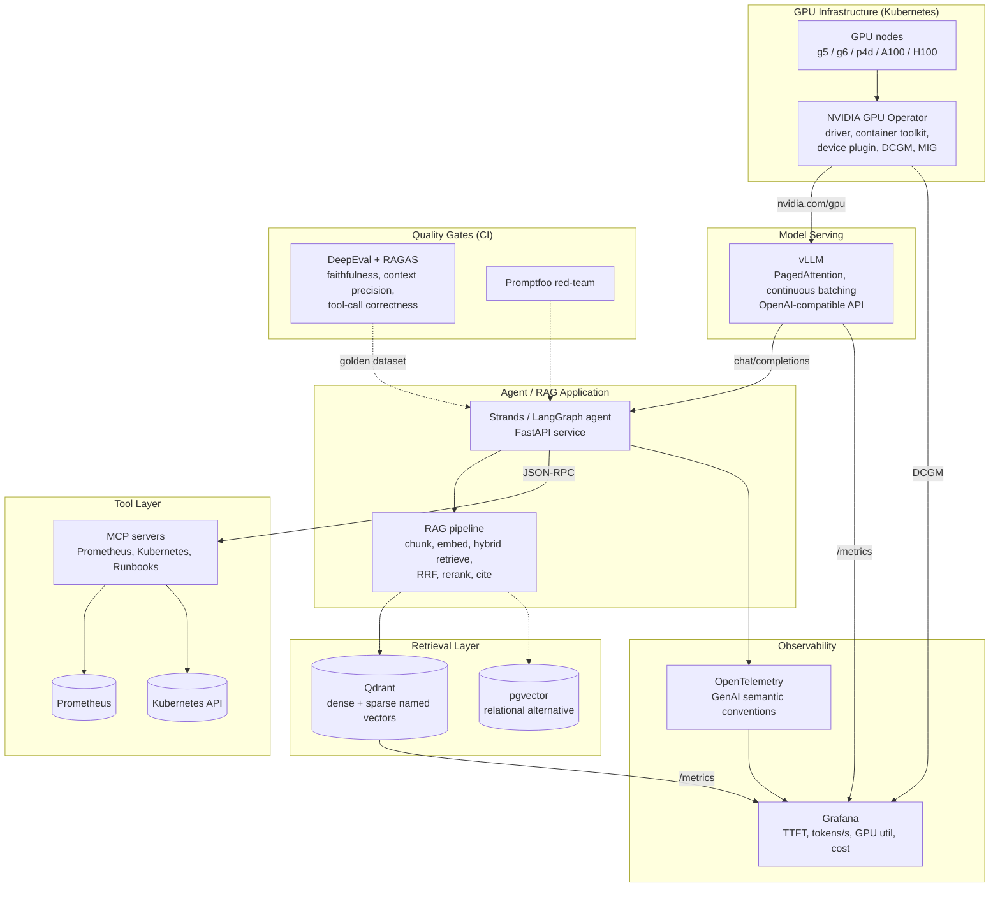

# Cluster 10: AI Infrastructure, RAG, Vector Databases, MCP & LLM Evals

| | |
|---|---|
| **Cluster** | 10 AI Infra & RAG/MCP |
| **Anchor tools** | vLLM (serving), Qdrant (vector store), MCP (tool protocol), DeepEval (CI evals) |
| **Bridge tools** | NVIDIA GPU Operator, pgvector, Milvus, Pinecone, RAGAS, Promptfoo, LangSmith |
| **Prerequisites** | Cluster 04 (Kubernetes, Helm), Cluster 09 (Prometheus, OpenTelemetry), Cluster 07 (Python/FastAPI), Cluster 02 (Bedrock) or Cluster 03 (LangGraph/Strands) |
| **Capstone phase** | Phase 6 (Months 21-24, ~200 hrs) |
| **Core unifying pattern** | CUDA/K8s scheduling, hybrid retrieval, tool protocol, CI evals |

> This cluster is where the AI pieces of the capstone become infrastructure. After working through it you will be able to run open-weights models on GPU nodes in Kubernetes with vLLM, build a hybrid (dense + sparse) retrieval pipeline over operational runbooks in Qdrant, expose Prometheus and Kubernetes to an agent through MCP servers, and block pull requests when DeepEval/RAGAS scores drop. Everything here is treated with the same SRE, DevSecOps and FinOps rigour as any other distributed system.

---

## 1. Why This Cluster Exists

Clusters 02 and 03 taught you to *call* models (Bedrock, Vertex AI, Azure OpenAI) and to *orchestrate* them (LangChain, LangGraph, Strands). Cluster 10 is about *owning the stack underneath*:

- **Serving.** Some workloads cannot go to a managed API: data residency, cost at scale, latency budgets, fine-tuned or LoRA-adapted models, or simply the need for deterministic control of the model version. That means GPUs, Kubernetes device plugins, and an inference engine (vLLM) that squeezes every token out of expensive silicon.
- **Retrieval.** Agents are only as good as the context they are given. Production RAG is not "embed and cosine search"; it is parsing, chunking, hybrid search, Reciprocal Rank Fusion, reranking, access-control filtering, and continuous evaluation.
- **Tools.** Before the Model Context Protocol, M agent frameworks times N data sources meant M x N bespoke integrations. MCP turns that into M + N by standardising Resources, Prompts and Tools over JSON-RPC.
- **Evals.** LLM systems are probabilistic. Evals are their unit and integration tests. Without a CI gate, every prompt tweak is an untested deploy.

The roadmap's phrasing is the thesis of the whole cluster:

> **Treat AI agents as first-class distributed systems.** Apply your SRE, DevSecOps and FinOps rigour directly to AI workloads: trace every LLM and MCP tool call with OpenTelemetry, scan prompts and agent tools with Promptfoo/Semgrep, enforce token cost budgets, and block PR merges when DeepEval/RAGAS faithfulness drops below threshold.

---

## 2. The LLMOps Stack



| Layer | What it does | Anchor | Bridges | Folder |
|---|---|---|---|---|
| GPU infrastructure | Makes `nvidia.com/gpu` a schedulable Kubernetes resource; exposes DCGM telemetry; partitions GPUs | NVIDIA GPU Operator | Time-slicing, MIG, MPS; EKS/GKE/AKS node pools; Kueue | [gpu-workloads-kubernetes/](gpu-workloads-kubernetes/README.md) |
| Model serving | Turns a GPU and a checkpoint into an OpenAI-compatible HTTP API at high throughput | **vLLM** | TGI, SGLang, TensorRT-LLM/NIM, Ollama, llama.cpp, KServe, Ray Serve, llm-d | [vllm/](vllm/README.md) |
| Retrieval pattern | Parse, chunk, embed, index, hybrid retrieve, fuse, rerank, generate, cite, evaluate | RAG reference pipeline | LangChain / LlamaIndex / custom | [rag-architecture/](rag-architecture/README.md) |
| Vector databases | Approximate nearest-neighbour search with payload filtering | **Qdrant** | pgvector, Milvus, Pinecone | [vector-databases/](vector-databases/README.md) |
| Tool protocol | Standard JSON-RPC interface between agents and data sources / actions | **MCP** | OpenAPI tools, function calling | [mcp/](mcp/README.md) |
| Evals | Unit and integration tests for probabilistic systems, enforced in CI | **DeepEval** | RAGAS, Promptfoo, LangSmith | [llm-evals/](llm-evals/README.md) |

---

## 3. Why AI Workloads Are Distributed Systems

Every failure mode you learned in Clusters 04, 09 and 11 shows up again with new names:

| Classic distributed-systems concern | How it appears in the LLMOps stack |
|---|---|
| Capacity planning | VRAM is the binding constraint. Weights + KV cache must fit; `--max-model-len` and `--gpu-memory-utilization` are capacity knobs, not tuning trivia. |
| Queueing theory | vLLM's scheduler is a batching queue. `vllm:num_requests_waiting` is your queue depth; TTFT is your queueing latency. |
| Backpressure and admission control | Rate-limit at the gateway, cap `--max-num-seqs`, reject when queue depth exceeds SLO instead of letting p99 explode. |
| Idempotency and retries | LLM calls are expensive and non-deterministic; retries without budgets multiply cost. Agents must bound their loops. |
| Consistency | Vector indexes are eventually consistent after upsert (segments, optimizers, flushes). Readers must tolerate stale results or request strong consistency. |
| Multi-tenancy | Payload/tenant filters in the vector DB, namespaces, Row Level Security in pgvector; per-tenant token budgets. |
| Observability | Trace every LLM and tool call (OTel GenAI semantic conventions), export vLLM and DCGM metrics, log prompts carefully (PII). |
| Security | Prompt injection via retrieved documents is the new SQL injection. MCP servers are privileged clients of your infrastructure; least privilege applies. |
| Cost | GPUs are the most expensive compute you will run. A GPU utilisation SLO (e.g. > 60 %) is as important as an availability SLO. |
| Testing | Evals are the test suite. A faithfulness regression is a failing build. |

---

## 4. Anchor-and-Bridge Mapping Across the Cluster

| Concept | vLLM (anchor) | Managed equivalent | Vector DB (Qdrant anchor) | Bridge |
|---|---|---|---|---|
| Model endpoint | `vllm serve` OpenAI-compatible API | Bedrock `InvokeModel` / `Converse` | n/a | TGI, Ollama expose similar APIs |
| Capacity knob | `--max-model-len`, `--gpu-memory-utilization` | Provisioned Throughput | `hnsw_config.m`, RAM vs `on_disk` | Milvus `load`, Pinecone serverless |
| Queue depth | `vllm:num_requests_waiting` | throttling 429s | `rest_responses_duration_seconds` | pgvector `pg_stat_activity` |
| Horizontal scale | Replicas + TP/PP | automatic | shards + replicas | Milvus query nodes |
| Multi-tenancy | `--api-key`, gateway | IAM | payload `is_tenant` index | pgvector RLS, Pinecone namespaces |
| Backup | PVC/S3 model cache | n/a | snapshots to S3 | `pg_dump`, `milvus-backup`, Pinecone backups |

---

## 5. Recommended Learning Order

Follow the roadmap golden rule: never learn two sibling tools at the same time. Get fluent in the anchor, then map.

| Week (of Phase 6) | Focus | Folder | Outcome |
|---|---|---|---|
| 1-2 | GPU fundamentals, memory maths, GPU Operator on a single spot node | [gpu-workloads-kubernetes/](gpu-workloads-kubernetes/README.md) | `nvidia.com/gpu` schedulable, DCGM in Grafana |
| 3-5 | vLLM: install, serve, API, metrics, K8s deployment, autoscaling | [vllm/](vllm/README.md) | vLLM Deployment with TTFT SLO dashboard |
| 6-7 | RAG pattern: chunking, embeddings, hybrid + RRF, reranking | [rag-architecture/](rag-architecture/README.md) | Reference pipeline over runbooks |
| 8-9 | Qdrant deep dive, then pgvector bridge | [vector-databases/qdrant/](vector-databases/qdrant/README.md), [vector-databases/pgvector/](vector-databases/pgvector/README.md) | Hybrid collection, ADR "pgvector vs Qdrant" |
| 10 | Milvus and Pinecone mapping (read-only plus one lab each) | [vector-databases/milvus/](vector-databases/milvus/README.md), [vector-databases/pinecone/](vector-databases/pinecone/README.md) | Decision matrix internalised |
| 11-13 | MCP: servers for Prometheus and Kubernetes, clients in Strands/LangGraph | [mcp/](mcp/README.md) | Agent queries live metrics |
| 14-16 | Evals: DeepEval + RAGAS in CI, Promptfoo red-team, LangSmith traces | [llm-evals/](llm-evals/README.md) | Merge-blocking quality gate |

Time budget: 12-15 hours per week, roughly 60 % hands-on labs, 25 % reading official docs, 15 % writing ADRs.

---

## 6. Cost Rules for GPU Labs

The roadmap sets a target of under $15/month for lab cloud spend. GPUs can blow through that in an afternoon, so:

1. **Local first.** Run Qdrant, pgvector, Milvus standalone, MCP servers and evals on kind/k3d or Docker. Run small models on CPU: Ollama (`qwen2.5:0.5b`, `llama3.2:1b`), or vLLM's CPU build with `Qwen/Qwen2.5-0.5B-Instruct`. Every lab in this cluster has a CPU path first.
2. **Spot or nothing.** When a lab needs a real GPU, use a single spot `g5.xlarge` (1x A10G 24 GB) or `g6.xlarge` (1x L4 24 GB) on EKS via Karpenter, or a Colab/Kaggle T4 for pure vLLM experiments. Never a `p4d`/`p5` for learning.
3. **Nightly teardown.** A GitHub Actions cron runs `terraform destroy -target=module.gpu_nodepool` (or deletes the Karpenter NodePool) every night. GPU nodes must never survive to morning.
4. **Budget alerts.** AWS Budgets at $10 and $15 with SNS to email; Karpenter `consolidationPolicy: WhenEmptyOrUnderutilized` with a 1-minute `consolidateAfter` for GPU pools.
5. **Right-size the model to the lab.** A 7-8B model in FP16 needs ~16 GB; AWQ/GPTQ 4-bit brings it to ~5 GB and fits a T4. You are learning the operations, not benchmarking frontier models.
6. **Measure cost per million tokens.** Each vLLM lab ends by computing $/1M tokens from the instance price and observed throughput, then comparing against Bedrock list prices. That number belongs in your ADR.

---

## 7. Sub-Area Index

| Folder | Role | Files |
|---|---|---|
| [gpu-workloads-kubernetes/](gpu-workloads-kubernetes/README.md) | Foundation for vLLM | Standard 8-file kit |
| [vllm/](vllm/README.md) | **Anchor** | Standard 8-file kit (deepest) |
| [rag-architecture/](rag-architecture/README.md) | Pattern | Standard 8-file kit |
| [vector-databases/](vector-databases/README.md) | Sub-cluster README + decision matrix | README |
| [vector-databases/qdrant/](vector-databases/qdrant/README.md) | **Anchor** | Standard 8-file kit |
| [vector-databases/pgvector/](vector-databases/pgvector/README.md) | Bridge | Standard 8-file kit |
| [vector-databases/milvus/](vector-databases/milvus/README.md) | Bridge | Standard 8-file kit |
| [vector-databases/pinecone/](vector-databases/pinecone/README.md) | Bridge | Standard 8-file kit |
| [mcp/](mcp/README.md) | **Anchor** | Standard 8-file kit |
| [llm-evals/](llm-evals/README.md) | DeepEval anchor; RAGAS, Promptfoo, LangSmith bridges | Sub-cluster |

---

## 8. Role in the Capstone

The Phase 6 deliverable upgrades the FastAPI microservice from Phase 1 into an autonomous **Incident & Platform AI Agent**:

```mermaid
sequenceDiagram
    participant Alert as Alertmanager
    participant Agent as Strands/LangGraph Agent (FastAPI)
    participant MCP as MCP Servers
    participant Q as Qdrant (runbooks)
    participant V as vLLM (GPU) / Bedrock
    participant CI as GitHub Actions

    Alert->>Agent: webhook: HighErrorRate firing
    Agent->>MCP: tools/call prometheus.query(rate(http_5xx[5m]))
    MCP-->>Agent: series
    Agent->>MCP: tools/call k8s.get_pods(namespace=api)
    MCP-->>Agent: pod list, restarts
    Agent->>Q: hybrid query: "5xx spike after deploy" (dense + sparse, RRF)
    Q-->>Agent: top-5 runbook chunks with citations
    Agent->>V: chat/completions (context + tools)
    V-->>Agent: diagnosis + proposed remediation
    Agent-->>Alert: annotated incident with runbook links
    Note over CI: On every PR: DeepEval + RAGAS over golden dataset; fail if faithfulness < 0.85
```

Artefacts this cluster produces in the capstone repository:

- `platform/gpu/` Karpenter NodePool, GPU Operator Helm values, DCGM dashboards.
- `platform/vllm/` Deployment, Service, HPA/KEDA, PDB, NetworkPolicy, Grafana dashboard with TTFT SLO.
- `apps/incident-agent/rag/` ingestion job for `runbooks/`, Qdrant collection schema, hybrid retriever.
- `apps/incident-agent/mcp/` Prometheus and Kubernetes MCP servers.
- `apps/incident-agent/evals/` DeepEval test suite, RAGAS golden set, Promptfoo red-team config, GitHub Actions workflow gate.
- `docs/adrs/` "Why vLLM vs Bedrock for this workload", "Why Qdrant vs pgvector", "Why MCP vs bespoke tools".

---

## 9. Further Reading

- vLLM documentation: https://docs.vllm.ai
- Qdrant documentation: https://qdrant.tech/documentation
- Model Context Protocol specification: https://modelcontextprotocol.io
- DeepEval: https://docs.confident-ai.com ; RAGAS: https://docs.ragas.io
- NVIDIA GPU Operator: https://docs.nvidia.com/datacenter/cloud-native/gpu-operator
- Kwon et al., "Efficient Memory Management for Large Language Model Serving with PagedAttention" (SOSP 2023)
- Lewis et al., "Retrieval-Augmented Generation for Knowledge-Intensive NLP Tasks" (NeurIPS 2020)
- Cormack, Clarke, Buettcher, "Reciprocal Rank Fusion outperforms Condorcet and individual rank learning methods" (SIGIR 2009)
- OpenTelemetry GenAI semantic conventions: https://opentelemetry.io/docs/specs/semconv/gen-ai
