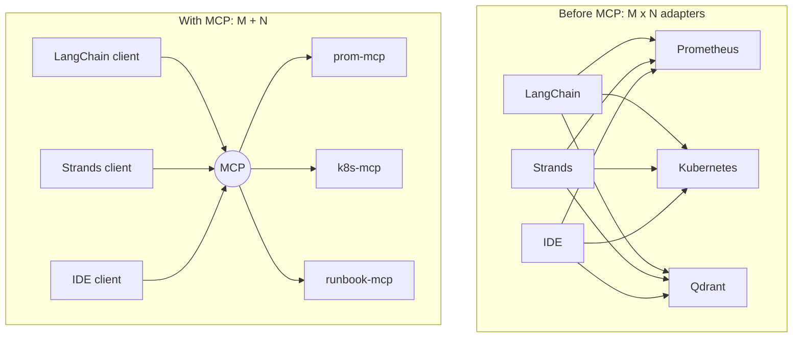
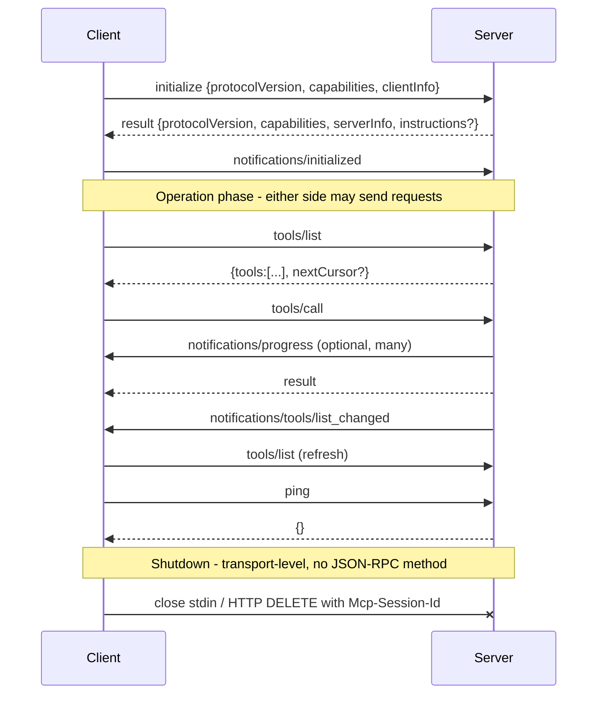
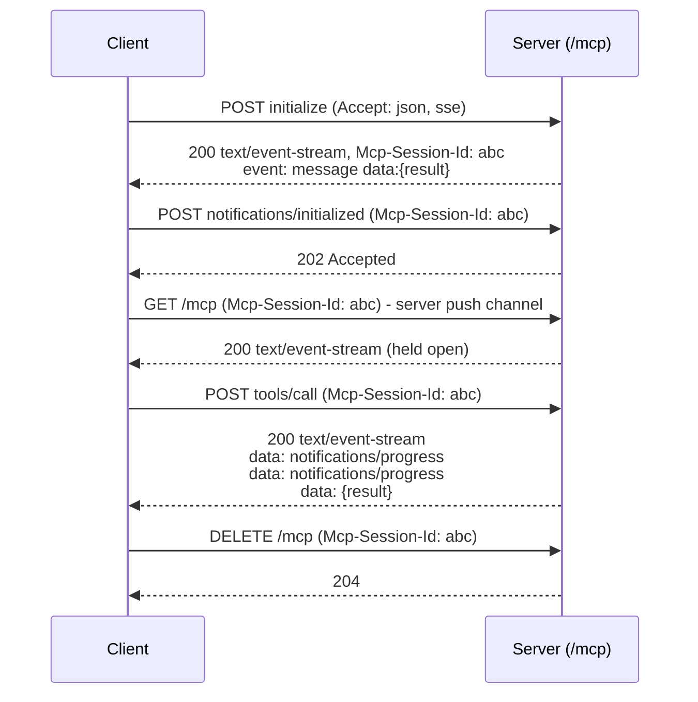
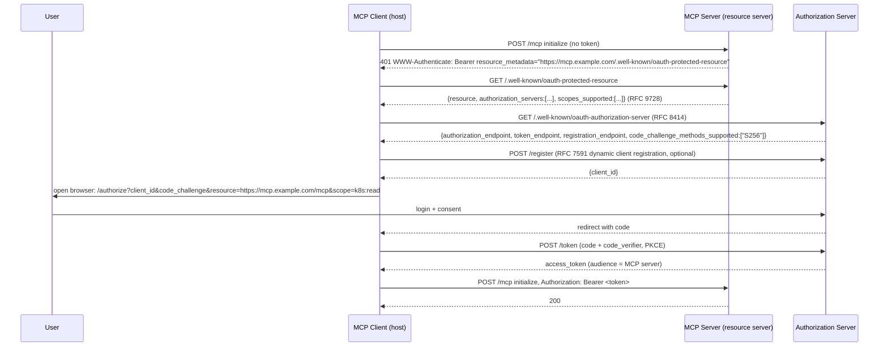

# MCP: Core Concepts

| | |
|---|---|
| **Cluster** | 10 AI Infrastructure, RAG, MCP & Evals |
| **Role** | Anchor |
| **Prerequisites** | [01-installation-and-setup.md](01-installation-and-setup.md), JSON-RPC familiarity, HTTP/SSE basics |
| **Target version** | MCP spec `2025-06-18`; `mcp` Python SDK 1.12+ |
| **Capstone phase** | Phase 6 (Months 21-24) |

> This file explains how MCP works on the wire and in the SDK: JSON-RPC framing, the connection lifecycle and capability negotiation, the two transports, the three server primitives and three client primitives, notifications, pagination, progress, cancellation, logging, the authorization model, and how the Python SDK's `FastMCP` maps onto all of it. Read it once end to end, then keep it open while doing the labs.

---

## 1. The M x N Problem and the Three Roles



| Role | Responsibilities | Examples |
|---|---|---|
| **Host** | Runs the LLM, owns the user session, enforces consent and policy, aggregates tools from many clients into one tool list for the model | Claude Desktop, Claude Code, Cursor, a LangGraph graph, a Strands `Agent` |
| **Client** | One per server. Opens the transport, performs `initialize`, tracks capabilities, routes requests and notifications, implements client primitives (Sampling, Roots, Elicitation) | `mcp.ClientSession`, `MultiServerMCPClient` internals, Strands `MCPClient` |
| **Server** | Exposes Tools, Resources, Prompts for one system; stateless w.r.t. the conversation | `prom-mcp`, `k8s-mcp`, GitHub MCP server, filesystem server |

The spec's design principles are worth memorising because they explain many "why can't I..." questions:

1. Servers should be extremely easy to build (host handles orchestration).
2. Servers should be highly composable (each does one thing).
3. Servers should **not** see the whole conversation or other servers' data (isolation; the host mediates).
4. Features can be added progressively via capability negotiation.

---

## 2. JSON-RPC 2.0 Message Framing

Every MCP message is one of three JSON-RPC 2.0 shapes. There is no MCP-specific envelope.

| Shape | Fields | Direction |
|---|---|---|
| **Request** | `jsonrpc:"2.0"`, `id` (string or integer, never `null`, unique per sender per session), `method`, optional `params` | Either direction |
| **Response** | `jsonrpc`, `id` (echoes request), exactly one of `result` or `error{code,message,data?}` | Reply to a request |
| **Notification** | `jsonrpc`, `method`, optional `params`, **no `id`** | Either direction, never answered |

```json
{"jsonrpc": "2.0", "id": 7, "method": "tools/call",
 "params": {"name": "query_instant", "arguments": {"query": "up"}}}
```

```json
{"jsonrpc": "2.0", "id": 7,
 "result": {"content": [{"type": "text", "text": "..."}], "isError": false}}
```

```json
{"jsonrpc": "2.0", "id": 7,
 "error": {"code": -32602, "message": "Invalid params", "data": {"field": "query"}}}
```

### Error codes

| Code | Meaning | Who raises |
|---|---|---|
| -32700 | Parse error (malformed JSON) | Transport layer |
| -32600 | Invalid request | Missing `jsonrpc`/`method` |
| -32601 | Method not found | Server does not implement e.g. `resources/subscribe` |
| -32602 | Invalid params | Arguments fail JSON Schema validation; unknown tool name |
| -32603 | Internal error | Unhandled exception inside handler |
| -32002 | Resource not found (SDK convention) | `resources/read` with unknown URI |
| -32001 | Request timeout (SDK convention) | Client side |

**Critical distinction:** a *protocol* error (above) means the call could not be made. A *tool execution* error (the Prometheus query returned 400) is **not** a JSON-RPC error. It is a normal `result` with `isError: true` so the LLM can read the message and self-correct:

```json
{"jsonrpc":"2.0","id":8,"result":{"content":[{"type":"text","text":"PromQL parse error: unexpected character '}'"}],"isError":true}}
```

### `_meta` and progress tokens

Any `params` or `result` may carry `_meta`. The spec reserves `_meta.progressToken` on requests so the receiver can emit `notifications/progress` tied to that token. Hosts also use `_meta` for tracing (for example an OpenTelemetry `traceparent`), though that is a convention not a spec field.

### Batching

The `2025-03-26` revision allowed JSON-RPC batch arrays; `2025-06-18` **removed** batching support. Send one message per line (stdio) or per POST (HTTP).

---

## 3. Connection Lifecycle



### `initialize`

```json
{"jsonrpc":"2.0","id":1,"method":"initialize","params":{
  "protocolVersion":"2025-06-18",
  "capabilities":{
    "roots":{"listChanged":true},
    "sampling":{},
    "elicitation":{}
  },
  "clientInfo":{"name":"incident-agent","version":"1.4.0"}
}}
```

```json
{"jsonrpc":"2.0","id":1,"result":{
  "protocolVersion":"2025-06-18",
  "capabilities":{
    "logging":{},
    "prompts":{"listChanged":true},
    "resources":{"subscribe":true,"listChanged":true},
    "tools":{"listChanged":true},
    "completions":{}
  },
  "serverInfo":{"name":"prom-mcp","version":"0.3.0"},
  "instructions":"Use query_instant for current values and query_range for trends. Burn-rate tool returns 1h and 6h windows."
}}
```

Rules:

- The client **must** send `initialize` first and **must not** send other requests until it has sent `notifications/initialized`. The only exceptions are `ping` and logging.
- **Version negotiation:** the client proposes the latest version it supports. If the server supports it, it echoes it; otherwise it replies with the latest version *it* supports. If the client does not support that, it disconnects. This is why a 2025-06-18 client can still talk to a 2024-11-05 server.
- **Capabilities are opt-in and mutual.** If the server did not advertise `resources.subscribe`, the client must not call `resources/subscribe` (it would get -32601). If the client did not advertise `sampling`, the server must not call `sampling/createMessage`.
- `instructions` is free text the host may inject into the system prompt. Keep it short and operational.

### `ping`

Either side may send `{"jsonrpc":"2.0","id":n,"method":"ping"}` and must receive `{"result":{}}` promptly. Hosts use it as a liveness check; set a timeout and reconnect on failure.

### Shutdown

There is no `shutdown` method. For stdio the client closes the server's stdin, waits, then sends SIGTERM, then SIGKILL. For Streamable HTTP the client sends `DELETE /mcp` with `Mcp-Session-Id`; servers may return 405 if they do not support client-initiated termination.

### Timeouts and cancellation

Every request should have a client-side timeout. To cancel in flight the sender emits:

```json
{"jsonrpc":"2.0","method":"notifications/cancelled","params":{"requestId":7,"reason":"user aborted"}}
```

The receiver should stop work and **not** send a response (a late response must be ignored by the sender). `initialize` cannot be cancelled.

---

## 4. Transports

### 4.1 stdio

- Host spawns the server as a subprocess; messages are newline-delimited JSON on stdin/stdout; messages must not contain embedded newlines.
- stderr is free for logs; the host may capture or ignore it.
- One client per process; the process lifetime *is* the session.
- Use for: local developer tooling, Claude Desktop, Claude Code, anything that needs the user's local credentials (kubeconfig, AWS SSO cache).

### 4.2 Streamable HTTP (2025-03-26+)

A single endpoint (conventionally `/mcp`) that supports:

| Verb | Purpose | Response |
|---|---|---|
| `POST` with a request | Send a JSON-RPC request | `application/json` (single response) **or** `text/event-stream` (stream of messages ending with the response) |
| `POST` with a notification/response | Send without expecting a reply | `202 Accepted`, empty body |
| `GET` | Open a long-lived SSE stream for server-initiated messages (notifications, sampling requests) | `text/event-stream` or `405` if unsupported |
| `DELETE` | Terminate session | `200`/`204` or `405` |

Headers:

| Header | Who | Meaning |
|---|---|---|
| `Accept: application/json, text/event-stream` | Client | Must list both |
| `Mcp-Session-Id` | Server assigns in `initialize` response; client echoes on every later request | Session binding. Server returns `404` if the session expired, client must re-initialize |
| `MCP-Protocol-Version: 2025-06-18` | Client, every request after initialize | Lets the server behave per version. Missing header means assume `2025-03-26` |
| `Last-Event-ID` | Client on reconnect to GET stream | Resume a broken SSE stream; server may replay events with ids |
| `Origin` | Browser clients | Server **must** validate to prevent DNS rebinding |



**Stateless mode.** If the server sets no session id (`stateless_http=True` in FastMCP) each POST is self-contained and any replica can serve it. You lose server-initiated messages and subscriptions but gain trivial horizontal scaling behind a normal Kubernetes Service. For the capstone the Prometheus and Runbook servers run stateless; the Kubernetes server runs stateful (it streams log tails as progress).

### 4.3 Legacy HTTP+SSE (2024-11-05)

Two endpoints: `GET /sse` opened first; the server sends an `endpoint` event with a URL the client must `POST` messages to. Still common in older servers and supported by most clients for backwards compatibility. New servers should not implement it; the Python SDK still offers `transport="sse"`.

### 4.4 Choosing

| Criterion | stdio | Streamable HTTP |
|---|---|---|
| Deployment | Per user, per machine | Centralised, shared |
| Credentials | User's local creds | Server identity + OAuth per user |
| Scaling | n/a | Stateless replicas or sticky sessions |
| Streaming server-to-client | Native | SSE (GET stream) |
| Firewall / gateway | n/a | Standard HTTP, API gateway friendly |
| Capstone use | Developer laptops, Claude Code | In-cluster servers for the incident agent |

---

## 5. Server Primitives

### 5.1 Tools (model-controlled)

Discovery:

```json
{"jsonrpc":"2.0","id":2,"method":"tools/list","params":{"cursor":null}}
```

```json
{"jsonrpc":"2.0","id":2,"result":{"tools":[{
  "name":"rollout_restart",
  "title":"Rollout restart a Deployment",
  "description":"Triggers a rolling restart by patching the pod template annotation. Requires human approval.",
  "inputSchema":{"type":"object","properties":{
      "namespace":{"type":"string"},
      "deployment":{"type":"string"}},
    "required":["namespace","deployment"]},
  "outputSchema":{"type":"object","properties":{"restarted_at":{"type":"string"}},"required":["restarted_at"]},
  "annotations":{"readOnlyHint":false,"destructiveHint":true,"idempotentHint":false,"openWorldHint":false}
}]}}
```

Invocation and result:

```json
{"jsonrpc":"2.0","id":3,"method":"tools/call","params":{"name":"rollout_restart","arguments":{"namespace":"api","deployment":"api"}}}
```

```json
{"jsonrpc":"2.0","id":3,"result":{
  "content":[{"type":"text","text":"{\"restarted_at\":\"2025-06-18T10:21:04Z\"}"}],
  "structuredContent":{"restarted_at":"2025-06-18T10:21:04Z"},
  "isError":false}}
```

Content block types: `text`, `image` (`data` base64 + `mimeType`), `audio`, `resource_link` (URI the client may read later), `resource` (embedded resource contents). `structuredContent` (2025-06-18) must validate against `outputSchema` when present; the SDK also puts a JSON-serialised copy in `content` for clients that predate structured output.

**Annotations are hints, not enforcement.** The spec says clients must treat them as untrusted unless the server is trusted. Their purpose is to let hosts pick a UX policy:

| Annotation | Default | Host behaviour in the capstone |
|---|---|---|
| `readOnlyHint` | false | Auto-approve when true |
| `destructiveHint` | true | Always require human approval; log to audit |
| `idempotentHint` | false | Safe to retry on timeout when true |
| `openWorldHint` | true | Server talks to external entities (internet). False for our in-cluster servers |

Tool naming: `^[a-zA-Z0-9_-]{1,64}$` is the safe subset accepted by every host; descriptions should say *when* to use the tool, not just what it does, because the LLM selects tools from descriptions.

### 5.2 Resources (application-controlled)

A resource is content addressed by a URI. The scheme is yours (`prom://`, `k8s://`, `file://`, `https://`).

```json
{"jsonrpc":"2.0","id":4,"method":"resources/list"}
```

```json
{"jsonrpc":"2.0","id":4,"result":{"resources":[
  {"uri":"prom://targets","name":"Scrape targets","description":"All active Prometheus scrape targets and health","mimeType":"application/json"}
]}}
```

Templates (RFC 6570) are listed separately:

```json
{"jsonrpc":"2.0","id":5,"method":"resources/templates/list"}
```

```json
{"jsonrpc":"2.0","id":5,"result":{"resourceTemplates":[
  {"uriTemplate":"k8s://{namespace}/pods/{pod}/logs","name":"Pod logs","mimeType":"text/plain"}
]}}
```

Reading:

```json
{"jsonrpc":"2.0","id":6,"method":"resources/read","params":{"uri":"prom://targets"}}
```

```json
{"jsonrpc":"2.0","id":6,"result":{"contents":[
  {"uri":"prom://targets","mimeType":"application/json","text":"{\"activeTargets\":[...]}"}
]}}
```

Binary contents use `blob` (base64) instead of `text`. Subscriptions (if `resources.subscribe` was advertised):

```json
{"jsonrpc":"2.0","id":7,"method":"resources/subscribe","params":{"uri":"prom://alerts"}}
```

Later, the server pushes `{"method":"notifications/resources/updated","params":{"uri":"prom://alerts"}}` and the client re-reads. `notifications/resources/list_changed` tells the client the catalogue itself changed.

When to use a resource instead of a tool: the data is **context** the host might attach (a runbook, current alerts) rather than an **action** the model should decide to take. Many hosts (including Claude Code) let the user `@`-mention resources; LangChain adapters can load them as `Document`s.

### 5.3 Prompts (user-controlled)

```json
{"jsonrpc":"2.0","id":8,"method":"prompts/list"}
```

```json
{"jsonrpc":"2.0","id":8,"result":{"prompts":[{
  "name":"triage_alert","title":"Triage an alert",
  "description":"Structured incident triage for a firing alert",
  "arguments":[{"name":"alertname","required":true},{"name":"namespace","required":false}]}]}}
```

```json
{"jsonrpc":"2.0","id":9,"method":"prompts/get","params":{"name":"triage_alert","arguments":{"alertname":"HighErrorBudgetBurn"}}}
```

```json
{"jsonrpc":"2.0","id":9,"result":{"description":"Triage HighErrorBudgetBurn","messages":[
  {"role":"user","content":{"type":"text","text":"Alert HighErrorBudgetBurn is firing. 1) Pull burn rate ... 2) ..."}}
]}}
```

Prompt messages can embed resources, so a prompt can pre-attach the relevant runbook. Hosts surface prompts as slash commands (`/triage_alert` in Claude Code).

### 5.4 Completions

If the server advertises `completions`, clients can call `completion/complete` to autocomplete prompt arguments or resource template variables (for example, namespace names). FastMCP supports this via `@mcp.completion()`.

---

## 6. Client Primitives

These are requests the **server** sends to the **client**. They only work if the client advertised the capability during `initialize`.

### 6.1 Sampling

Lets a server ask the host's LLM to generate text without the server holding any model credentials.

```json
{"jsonrpc":"2.0","id":20,"method":"sampling/createMessage","params":{
  "messages":[{"role":"user","content":{"type":"text","text":"Summarise these 400 log lines into 3 bullet points:\n..."}}],
  "modelPreferences":{"hints":[{"name":"claude-sonnet"}],"intelligencePriority":0.5,"speedPriority":0.8,"costPriority":0.6},
  "systemPrompt":"You are a concise SRE assistant.",
  "maxTokens":300}}
```

The host **should** show the user what is being asked and what came back (human in the loop). The response has `role`, `content`, `model`, `stopReason`. Use case in the capstone: `get_logs` can offer a `summarise=true` argument that uses sampling to compress large log output before returning it, protecting the agent's context window. Not all hosts support sampling (Claude Desktop historically did not; Claude Code and the Python `ClientSession` do if you pass a `sampling_callback`).

### 6.2 Roots

The client tells the server which filesystem (or URI) boundaries it should operate in:

```json
{"jsonrpc":"2.0","id":21,"method":"roots/list"}
```

```json
{"jsonrpc":"2.0","id":21,"result":{"roots":[{"uri":"file:///home/<USER>/capstone","name":"capstone repo"}]}}
```

Servers should treat roots as a sandbox hint; clients send `notifications/roots/list_changed` when the workspace changes.

### 6.3 Elicitation (2025-06-18)

A server can request structured input from the *user* mid-tool-call, with a JSON Schema restricted to flat objects of primitive types:

```json
{"jsonrpc":"2.0","id":22,"method":"elicitation/create","params":{
  "message":"rollout_restart is destructive. Confirm the change ticket ID.",
  "requestedSchema":{"type":"object","properties":{
     "ticket":{"type":"string","description":"CHG-xxxxx"},
     "confirm":{"type":"boolean"}},"required":["ticket","confirm"]}}}
```

```json
{"jsonrpc":"2.0","id":22,"result":{"action":"accept","content":{"ticket":"CHG-10422","confirm":true}}}
```

`action` is `accept`, `decline` or `cancel`. Servers must never request secrets through elicitation. This is the spec-native way to implement the capstone's "destructive tools require approval" rule when the host supports it; when it does not, the agent framework (LangGraph `interrupt()`, Strands hooks) provides the approval gate instead.

---

## 7. Utilities

### Notifications of change

| Notification | Direction | Capability required |
|---|---|---|
| `notifications/tools/list_changed` | S -> C | `tools.listChanged` |
| `notifications/resources/list_changed` | S -> C | `resources.listChanged` |
| `notifications/resources/updated` | S -> C | `resources.subscribe` |
| `notifications/prompts/list_changed` | S -> C | `prompts.listChanged` |
| `notifications/roots/list_changed` | C -> S | `roots.listChanged` |

### Pagination

`tools/list`, `resources/list`, `resources/templates/list`, `prompts/list` all accept `params.cursor` and may return `nextCursor`. Cursors are opaque strings; clients must loop until `nextCursor` is absent. Servers with hundreds of tools should paginate; hosts typically fetch all pages at connect time anyway.

### Progress

Request carries `_meta.progressToken`; receiver may send:

```json
{"jsonrpc":"2.0","method":"notifications/progress","params":{"progressToken":"tc-7","progress":3,"total":10,"message":"fetched 3/10 pods"}}
```

`progress` must increase monotonically; `total` and `message` are optional.

### Logging

Server advertises `logging`; client sets verbosity with `logging/setLevel {"level":"info"}` (syslog levels: debug, info, notice, warning, error, critical, alert, emergency); server emits:

```json
{"jsonrpc":"2.0","method":"notifications/message","params":{"level":"warning","logger":"prom-mcp","data":{"msg":"query exceeded 10s","query":"rate(...)"}}}
```

This is how a stdio server logs "to the client" without touching stdout: FastMCP's `ctx.info()/ctx.warning()/ctx.error()` emit these notifications.

---

## 8. Authorization Model (remote servers)

The spec (2025-06-18) classifies an MCP server as an **OAuth 2.1 resource server**; the host's client is the OAuth client; a separate **authorization server** (Keycloak, Entra ID, Okta, Cognito, Auth0) issues tokens.



Key rules:

- **PKCE is mandatory** (`S256`); implicit and password grants are forbidden (OAuth 2.1).
- **Resource indicators (RFC 8707)**: the client includes `resource=<MCP server URL>` so the token is audience-bound. The server **must** verify the audience and **must not** forward the client's token to downstream APIs (the *token passthrough* anti-pattern, see [05-production-patterns.md](05-production-patterns.md)).
- Tokens go in the `Authorization` header, never in the URL.
- Local stdio servers do not use this; they read credentials from the environment.

In the Python SDK: `FastMCP(..., token_verifier=MyVerifier(), auth=AuthSettings(issuer_url=..., resource_server_url=..., required_scopes=[...]))`, where `TokenVerifier.verify_token(token) -> AccessToken | None` validates a JWT (issuer, audience, expiry, scopes) or introspects it (RFC 7662). The SDK publishes the RFC 9728 metadata document and the `WWW-Authenticate` challenge for you.

---

## 9. The Python SDK Mapped to the Protocol

| Protocol concept | `FastMCP` (high level) | `mcp.server.lowlevel.Server` (low level) |
|---|---|---|
| Server identity | `FastMCP("prom-mcp", instructions="...")` | `Server("prom-mcp")` + `InitializationOptions` |
| Tool | `@mcp.tool(name=, title=, description=, annotations=ToolAnnotations(...), structured_output=)` on a typed function | `@server.list_tools()` + `@server.call_tool()` returning `list[types.Content]` |
| Resource | `@mcp.resource("prom://targets", mime_type="application/json")` | `@server.list_resources()` + `@server.read_resource()` |
| Resource template | `@mcp.resource("k8s://{namespace}/pods/{pod}/logs")` - parameters become function args | `@server.list_resource_templates()` |
| Prompt | `@mcp.prompt(title=)` returning `str`, `list[Message]` or `PromptMessage`s | `@server.list_prompts()` + `@server.get_prompt()` |
| Logging notification | `await ctx.info("...")`, `ctx.debug/warning/error` | `server.request_context.session.send_log_message(...)` |
| Progress | `await ctx.report_progress(progress, total, message)` | `session.send_progress_notification(...)` |
| Sampling | `await ctx.session.create_message(messages=[...], max_tokens=)` | same |
| Elicitation | `await ctx.elicit(message=, schema=PydanticModel)` | `session.elicit(...)` |
| Read own resource | `await ctx.read_resource(uri)` | n/a |
| Request identity | `ctx.request_id`, `ctx.client_id` | `server.request_context` |
| Transports | `mcp.run(transport="stdio" \| "streamable-http" \| "sse")` | `stdio_server()`, `StreamableHTTPSessionManager` |
| Mount in ASGI | `mcp.streamable_http_app()` returns Starlette app | custom |
| Lifespan (DB pools) | `FastMCP(lifespan=async_ctx_manager)`; access via `ctx.request_context.lifespan_context` | `Server(lifespan=)` |

A richer example showing the `Context` object:

```python
from dataclasses import dataclass
from contextlib import asynccontextmanager
from collections.abc import AsyncIterator

import httpx
from pydantic import BaseModel, Field
from mcp.server.fastmcp import FastMCP, Context
from mcp.types import ToolAnnotations


@dataclass
class AppContext:
    http: httpx.AsyncClient


@asynccontextmanager
async def lifespan(_server: FastMCP) -> AsyncIterator[AppContext]:
    async with httpx.AsyncClient(base_url="http://prometheus.monitoring.svc:9090", timeout=10) as http:
        yield AppContext(http=http)


mcp = FastMCP("prom-mcp", lifespan=lifespan,
              instructions="Read-only Prometheus access. Prefer query_range for trends.")


class InstantResult(BaseModel):
    result_type: str = Field(description="vector | scalar | string")
    samples: list[dict]


@mcp.tool(annotations=ToolAnnotations(readOnlyHint=True, idempotentHint=True, openWorldHint=False))
async def query_instant(query: str, ctx: Context) -> InstantResult:
    """Evaluate a PromQL expression at the current time. Use for 'what is X right now'."""
    http = ctx.request_context.lifespan_context.http
    await ctx.debug(f"PromQL: {query}")
    r = await http.get("/api/v1/query", params={"query": query})
    body = r.json()
    if body.get("status") != "success":
        # Tool-level error: raise -> SDK returns isError:true with the message
        raise ValueError(body.get("error", "unknown Prometheus error"))
    data = body["data"]
    return InstantResult(result_type=data["resultType"], samples=data["result"])
```

How FastMCP turns this into protocol:

- The function name becomes `tools[].name`; the docstring becomes `description`; the type hints become `inputSchema` (via Pydantic); the `InstantResult` return type becomes `outputSchema` and the return value becomes `structuredContent`.
- `ctx: Context` is detected by type and injected, not exposed in the schema.
- A raised exception becomes `isError: true` with the exception text as the content, **not** a JSON-RPC error. If you want a JSON-RPC error (for example invalid params you detected yourself), raise `mcp.shared.exceptions.McpError(ErrorData(code=-32602, message=...))`.

### Client side

```python
import asyncio
from mcp import ClientSession, StdioServerParameters
from mcp.client.stdio import stdio_client
from mcp.client.streamable_http import streamablehttp_client


async def via_stdio() -> None:
    params = StdioServerParameters(command="uv", args=["run", "server.py"], env={"PROMETHEUS_URL": "http://localhost:9090"})
    async with stdio_client(params) as (read, write):
        async with ClientSession(read, write) as session:
            init = await session.initialize()
            print(init.serverInfo.name, init.protocolVersion)
            tools = await session.list_tools()
            print([t.name for t in tools.tools])
            res = await session.call_tool("query_instant", {"query": "up"})
            print(res.structuredContent)


async def via_http() -> None:
    async with streamablehttp_client("http://127.0.0.1:8000/mcp") as (read, write, get_session_id):
        async with ClientSession(read, write) as session:
            await session.initialize()
            print("session:", get_session_id())
            print(await session.read_resource("prom://targets"))


asyncio.run(via_stdio())
```

---

## 10. Where Each Concept Shows Up in the Capstone

| Concept | Capstone usage |
|---|---|
| Tools with `readOnlyHint` | Every Prometheus tool, `list_pods`, `describe_pod`, `get_logs`, `get_events`, `search_runbooks` |
| `destructiveHint` + Elicitation / LangGraph interrupt | `rollout_restart` |
| Resources + subscription | `prom://alerts` subscribed by the agent's "world model" node; `prom://targets` for scrape health |
| Prompts | `/triage_alert` for humans in Claude Code; the agent uses the same text as its planning prompt |
| Sampling | Log summarisation inside `get_logs(summarise=True)` |
| Stateless Streamable HTTP | `prom-mcp`, `runbook-mcp` behind a ClusterIP Service, 2 replicas |
| Stateful Streamable HTTP | `k8s-mcp` with sticky sessions (one replica in the lab) |
| OAuth 2.1 + RFC 9728 | All in-cluster servers behind the API gateway; Keycloak as AS |
| Logging notifications | Forwarded by the agent into Loki with the trace id |
| Progress | `query_range` over long windows, `get_logs` with large tails |

Continue with [03-commands-and-cheatsheet.md](03-commands-and-cheatsheet.md) for the full method and API reference.
