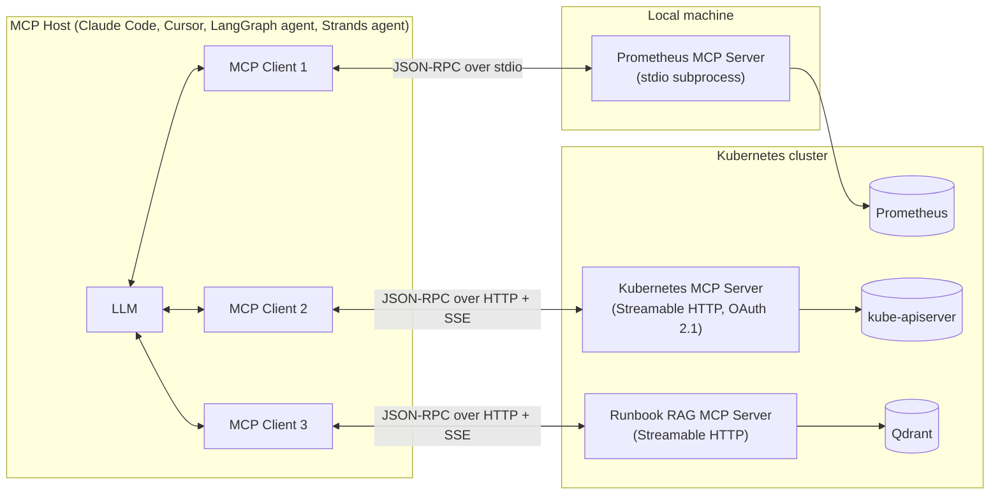
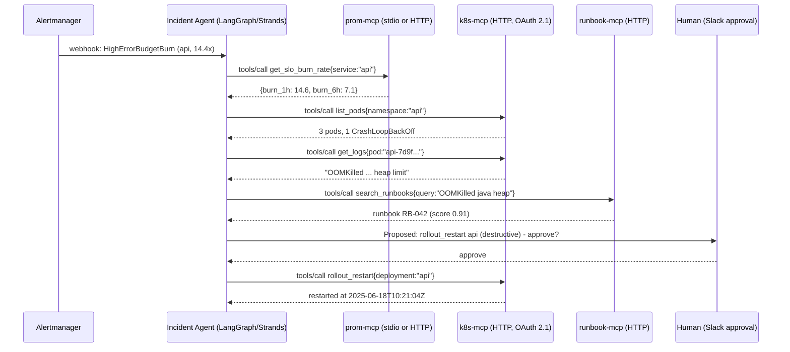

# Model Context Protocol (MCP)

| | |
|---|---|
| **Cluster** | 10 AI Infrastructure, RAG, MCP & Evals |
| **Role** | Anchor |
| **Category** | Tool / context integration protocol for LLM applications |
| **Prerequisites** | Python 3.12+, asyncio basics, JSON, HTTP/SSE, LangGraph or Strands fundamentals ([03-agentic-frameworks](../../03-agentic-frameworks/)), Prometheus & Kubernetes API basics |
| **Target version** | MCP specification `2025-06-18`; Python SDK `mcp` 1.12+; TypeScript SDK `@modelcontextprotocol/sdk` 1.x |
| **Capstone phase** | Phase 6 (Months 21-24) |
| **Official docs** | https://modelcontextprotocol.io and https://github.com/modelcontextprotocol |

> MCP is an open, JSON-RPC 2.0 based client-server protocol that lets any LLM host (Claude Desktop, Claude Code, Cursor, a LangGraph or Strands agent) discover and invoke **Tools**, read **Resources** and fetch **Prompts** from any compliant server, over stdio or HTTP. After this folder you will be able to design, build, secure, deploy on Kubernetes, test and observe MCP servers for Prometheus, Kubernetes and a Qdrant runbook index, and wire them into the capstone incident agent.

## Why This Tool Exists

Before MCP, every agent framework needed its own adapter for every data source. A team with LangChain, LangGraph, Strands and two IDE assistants (M = 5 hosts) that wanted Prometheus, Kubernetes, Jira, GitHub, Confluence and a vector store (N = 6 sources) had to write and maintain M x N = 30 bespoke integrations, each with its own auth story, schema format and error handling. Swapping the agent framework meant rewriting all tool bindings.

MCP (open-sourced by Anthropic in November 2024, now governed as an open standard with contributions from many vendors) reduces that to M + N. A source is wrapped **once** as an MCP server; every host that speaks MCP gets it for free. The key insights were:

1. **Reuse the Language Server Protocol idea.** LSP solved the same M x N problem for editors and languages with JSON-RPC over stdio. MCP copies the shape: capability negotiation at startup, request/response plus notifications, and a small fixed vocabulary of methods.
2. **Separate "what the model may do" (Tools) from "what the model may read" (Resources) from "how the user wants to ask" (Prompts).** Three primitives, each with discovery (`*/list`) and use (`tools/call`, `resources/read`, `prompts/get`).
3. **Make the server dumb about models.** A server never calls an LLM itself unless it explicitly asks the client to (Sampling). That keeps API keys, cost and model choice on the host side.

## Architecture

- **Host**: the application the user interacts with. It owns the LLM, the conversation, consent UI and security policy. One host runs many clients.
- **Client**: a 1:1 connection to a single server inside the host. It performs the handshake, keeps the session, forwards tool calls and surfaces server notifications.
- **Server**: a small program (often tens of lines) that exposes Tools, Resources and Prompts for one system. It can be a local subprocess (stdio) or a remote service (Streamable HTTP).
- **Transport**: how JSON-RPC messages travel. `stdio` for local processes; `Streamable HTTP` for remote servers; legacy `HTTP+SSE` for 2024-11-05 era servers.

## The Core Mental Model

1. **MCP is LSP for AI tools.** Every message is a JSON-RPC 2.0 request, response or notification. The protocol starts with `initialize` (versions and capabilities), and after that both sides may send requests. If you understand LSP you already understand 80 percent of MCP.
2. **The three primitives are about control.** *Tools* are **model-controlled** (the LLM decides to call them). *Resources* are **application-controlled** (the host decides what context to attach). *Prompts* are **user-controlled** (the human picks a slash-command-like template). Deciding which primitive to use is a security decision, not a convenience.
3. **The server is a capability boundary, not a trust boundary.** A server runs with whatever credentials you give it. Least privilege is implemented *outside* the server (RBAC-scoped kubeconfig, read-only Prometheus user, OAuth scopes), and *inside* it by annotating destructive tools and requiring host approval.

## Anchor-and-Bridge Mapping

MCP is the anchor for "tool protocol". The siblings are the native tool systems of each framework and the agent-to-agent protocol.

| Concept in MCP | LangChain / LangGraph | Strands Agents | OpenAI function calling | Google A2A |
|---|---|---|---|---|
| Tool (`tools/list`, `tools/call`) | `@tool` / `BaseTool`, bound via `llm.bind_tools()` | `@tool` decorated function | `tools=[{"type":"function",...}]` in a request | Not a tool protocol; an *agent* is the unit (Agent Card, Tasks) |
| Tool input schema (JSON Schema) | Pydantic `args_schema` | Python type hints and docstring | `parameters` JSON Schema | Task message parts |
| Resource (`resources/read`) | `Document` loaders / retrievers | No direct equivalent; use a tool | No equivalent | Artifacts |
| Prompt (`prompts/get`) | `ChatPromptTemplate` | System prompt string | No equivalent | No equivalent |
| Server process | In-process Python code | In-process Python code | In-process in the caller | Remote HTTP agent |
| Discovery at runtime | Static import | Static import | Static in request | Agent Card at `/.well-known/agent.json` |
| Host adapter | `langchain-mcp-adapters` `MultiServerMCPClient` | `strands.tools.mcp.MCPClient` | n/a | n/a |

## Learning Path

| Step | File | Time |
|---|---|---|
| 1 | [01-installation-and-setup.md](01-installation-and-setup.md) - SDK install, first server, Inspector, Claude Code registration | 2 h |
| 2 | [02-core-concepts.md](02-core-concepts.md) - JSON-RPC framing, lifecycle, transports, primitives, notifications, auth model | 5 h |
| 3 | [03-commands-and-cheatsheet.md](03-commands-and-cheatsheet.md) - protocol method reference, Python/TypeScript SDK API, client configs | 3 h |
| 4 | [04-hands-on-labs.md](04-hands-on-labs.md) - build the Prometheus, Kubernetes and Runbook servers; connect LangGraph and Strands | 10 h |
| 5 | [05-production-patterns.md](05-production-patterns.md) - OAuth 2.1, Kubernetes deployment, threat model, observability, testing, registry | 5 h |
| 6 | [06-troubleshooting.md](06-troubleshooting.md) - handshake failures, stdout corruption, schema errors, timeouts | 1.5 h |
| 7 | [07-interview-questions.md](07-interview-questions.md) - 30 questions, junior to principal | 2 h |

Total: roughly 28 hours, or three weekends.

## What MCP Is Not

- **Not an agent framework.** It does not plan, loop or hold conversation state. LangGraph/Strands do that and consume MCP servers.
- **Not a model API.** The server never needs an LLM API key (unless it uses Sampling, in which case it still goes through the host).
- **Not automatically secure.** A server with cluster-admin credentials is a cluster-admin remote-control. Section 5 of this folder is as important as section 4.
- **Weak spots honestly stated:** stdio servers are per-user and per-machine; remote auth only became well-specified in 2025 and client support varies; large tool lists bloat the model context; schema expressiveness is limited to what the model can reliably follow; versioning of third-party servers is still immature.

## Role in the Capstone

In the Phase 6 capstone, the FastAPI microservice is upgraded into an **Incident & Platform AI Agent** (LangGraph or Strands). MCP is the agent's hands and eyes:

Artefacts produced in the capstone repository:

| Path | Artefact |
|---|---|
| `ai/mcp-servers/prom-mcp/` | Prometheus server: `query_instant`, `query_range`, `list_alerts`, `get_slo_burn_rate`, resource `prom://targets` |
| `ai/mcp-servers/k8s-mcp/` | Kubernetes server with read-only RBAC by default and `rollout_restart` marked destructive |
| `ai/mcp-servers/runbook-mcp/` | Qdrant hybrid search exposed as `search_runbooks` tool |
| `deploy/helm/mcp-servers/` | Deployment, Service, NetworkPolicy, ServiceAccount, RBAC, OTel sidecar config |
| `.mcp.json` | Project-scoped Claude Code registration so every engineer gets the same servers |
| `tests/mcp/` | pytest contract tests using in-memory client sessions; run on every PR |
| `evals/` | DeepEval `ToolCorrectnessMetric` tests asserting the agent calls the right MCP tools |

The DeepEval/RAGAS gates in [../llm-evals/](../llm-evals/README.md) evaluate whether the agent *used* these tools correctly; OpenTelemetry (cluster 09) traces every `tools/call` as a span.

## Further Reading

- Specification: https://modelcontextprotocol.io/specification/2025-06-18 (read "Architecture", "Base Protocol", "Server Features", "Client Features", "Authorization", "Security Best Practices")
- Python SDK: https://github.com/modelcontextprotocol/python-sdk
- TypeScript SDK: https://github.com/modelcontextprotocol/typescript-sdk
- Inspector: https://github.com/modelcontextprotocol/inspector
- Registry: https://github.com/modelcontextprotocol/registry
- JSON-RPC 2.0: https://www.jsonrpc.org/specification
- OAuth 2.1 draft, RFC 9728 (Protected Resource Metadata), RFC 8414 (Authorization Server Metadata), RFC 7591 (Dynamic Client Registration), RFC 7636 (PKCE)
- Language Server Protocol (for the design lineage): https://microsoft.github.io/language-server-protocol/
- Sibling docs in this wiki: [LangGraph](../../03-agentic-frameworks/langgraph/), [Strands Agents](../../03-agentic-frameworks/strands-agents/), [Prometheus](../../09-observability/prometheus/), [Kubernetes](../../04-containers-and-idp/kubernetes/), [Qdrant](../vector-databases/qdrant/)
