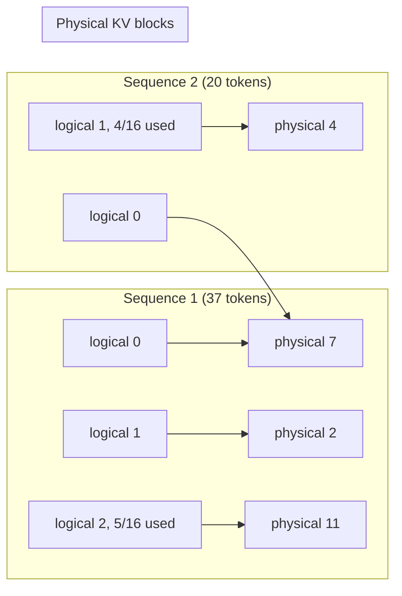
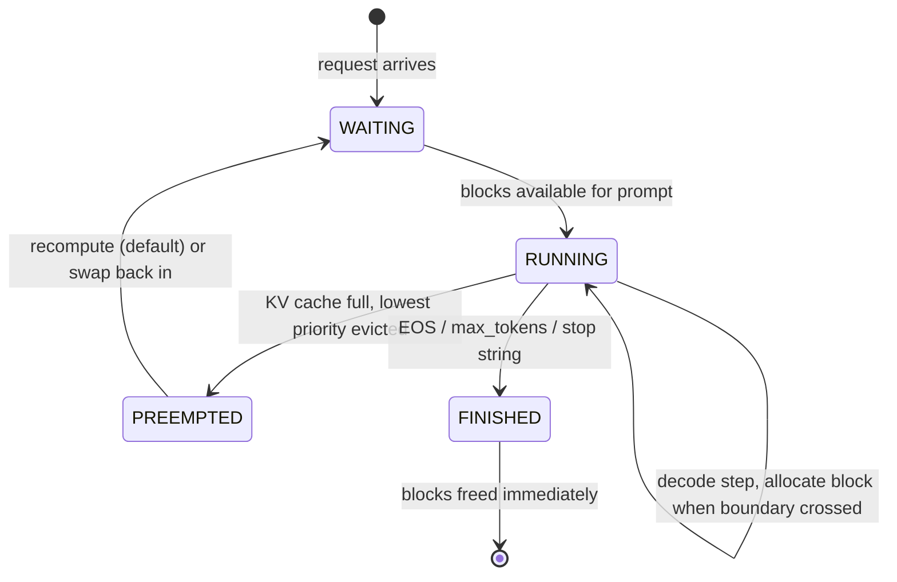

# vLLM: Core Concepts

| | |
|---|---|
| **Cluster** | 10 AI Infra & RAG/MCP |
| **Role** | Anchor |
| **Prerequisites** | Transformer basics (attention, KV cache), [GPU fundamentals](../gpu-workloads-kubernetes/02-core-concepts.md) |
| **Target version** | vLLM 0.10+ (V1 engine) |
| **Capstone phase** | Phase 6 (Months 21-24) |

> This file explains how vLLM works well enough that you can predict, from a model card and a GPU spec sheet, how many concurrent requests you can serve, what TTFT you will see, and which flag to turn when a number is wrong. It covers the KV cache and PagedAttention, the continuous-batching scheduler, prefix caching, chunked prefill, speculative decoding, quantisation, tensor and pipeline parallelism, the OpenAI-compatible API surface including tool calling and guided decoding, and the metrics the engine exposes.

---

## 1. Inference in Two Phases

A decoder-only transformer serves a request in two very different phases:

| Phase | What happens | Bound by | Latency metric |
|---|---|---|---|
| **Prefill** | All prompt tokens are processed in one forward pass; their K and V projections are written to the KV cache | Compute (FLOPs); scales with prompt length | Time to first token (TTFT) |
| **Decode** | One new token per forward pass; attention reads the whole KV cache for that sequence | Memory bandwidth (reading weights + KV cache every step) | Inter-token latency (ITL) / time per output token (TPOT) |

Decode is bandwidth-bound because each step moves every weight byte through the GPU to produce a single token per sequence. The only way to use the FLOPs is to **batch** many sequences into each decode step so the weights are read once and used many times. That is why throughput depends on how many sequences fit in memory at once, and why memory for the KV cache is the thing vLLM optimises.

---

## 2. The KV Cache and Why It Is the Bottleneck

For each token in every sequence, every layer stores a key and a value vector per KV head.

```text
bytes_per_token = 2 (K and V)
               x num_layers
               x num_kv_heads
               x head_dim
               x bytes_per_element   (2 for FP16/BF16, 1 for FP8)
```

Worked examples (from the models' `config.json`):

| Model | layers | kv_heads | head_dim | FP16 bytes/token | KV per 8k-token request |
|---|---|---|---|---|---|
| Llama-3.1-8B (GQA 8 kv heads) | 32 | 8 | 128 | 2 x 32 x 8 x 128 x 2 = **131,072 B = 128 KiB** | 1.0 GiB |
| Llama-3.1-70B | 80 | 8 | 128 | 2 x 80 x 8 x 128 x 2 = **327,680 B = 320 KiB** | 2.5 GiB |
| Qwen2.5-7B | 28 | 4 | 128 | 2 x 28 x 4 x 128 x 2 = **57,344 B = 56 KiB** | 0.44 GiB |
| Mistral-7B-v0.3 | 32 | 8 | 128 | 128 KiB | 1.0 GiB |
| Llama-2-7B (MHA, 32 kv heads) | 32 | 32 | 128 | **512 KiB** | 4.0 GiB |

Grouped-query attention (GQA) is why modern 7-8B models hold 4x more concurrent context than Llama-2 did.

### 2.1 The memory budget

```text
usable        = gpu_memory_total x --gpu-memory-utilization
weights       = params x bytes_per_param          (FP16: 2, FP8/INT8: 1, INT4: 0.5, plus ~5 % overhead)
activations   = a few hundred MB to ~2 GB (CUDA graphs, workspace), roughly fixed
kv_capacity   = usable - weights - activations
max_tokens_in_cache = kv_capacity / bytes_per_token
max_concurrency_at_L = max_tokens_in_cache / L      (L = typical prompt + completion length)
```

**Example 1: Llama-3.1-8B FP16 on one A10G (24 GB), `--gpu-memory-utilization 0.90`**

```text
usable      = 24 x 0.90        = 21.6 GB
weights     = 8.03e9 x 2 bytes = 16.1 GB
activations ~ 1.0 GB
kv_capacity = 21.6 - 16.1 - 1.0 = 4.5 GB
tokens      = 4.5e9 / 131072   = ~34,000 tokens
at --max-model-len 8192 -> ~4 fully-loaded concurrent requests (vLLM will print "Maximum concurrency ... 4.2x")
```

Switching to AWQ 4-bit (weights ~5.5 GB) raises KV capacity to ~15 GB, ~115k tokens, ~14x concurrency on the same card. That is why quantisation is a *throughput* feature, not only a "fit the model" feature.

**Example 2: Llama-3.1-70B on H100 80 GB**

```text
FP16 weights = 70.6e9 x 2 = 141 GB  -> does not fit one GPU; needs TP=2 (160 GB) leaving ~3 GB total KV: unusable
FP8 weights  = 70.6e9 x 1 = ~71 GB  -> fits one H100 with ~1 GB KV: unusable
Practical:   TP=2 with FP8 -> 2 x 72 GB usable - 71 GB - 2 GB = ~71 GB KV / 320 KiB = ~220k tokens
          or TP=4 FP16     -> 4 x 72 - 141 - 4 = ~143 GB KV = ~450k tokens
```

The log line `GPU KV cache size: N tokens` at startup is vLLM doing this arithmetic for you after profiling a real forward pass. Trust the log over your spreadsheet, but use the spreadsheet to choose the GPU before you rent it.

### 2.2 FP8 KV cache

`--kv-cache-dtype fp8` (E4M3 by default on Hopper/Ada, E5M2 available) halves `bytes_per_element` for the cache only, doubling token capacity at a small accuracy cost. It needs calibration scales for best quality (`--quantization` checkpoints often ship them) but works without.

---

## 3. PagedAttention

Pre-vLLM engines allocated each sequence's KV cache as one contiguous tensor sized for `max_model_len`. A 200-token chat in an 8k-context deployment wasted 97 % of its reservation.

PagedAttention divides the cache into **blocks** of `--block-size` tokens (16 by default). A per-sequence **block table** maps logical block index to physical block address, exactly like a page table.



Consequences:

- Waste is bounded to less than one block per sequence (< 16 tokens).
- Blocks are allocated on demand as tokens are generated, so admission is decided by *actual* usage.
- Two sequences sharing a prefix (Seq 1 and Seq 2 above both map logical block 0 to physical block 7) share physical memory via copy-on-write. This is the basis of prefix caching and of cheap parallel sampling (`n > 1`, beam search).
- The attention kernel reads non-contiguous blocks through the block table; vLLM ships custom CUDA kernels (and uses FlashAttention/FlashInfer backends) for this.

---

## 4. Continuous Batching and the Scheduler

Static batching waits for a batch to finish. Continuous batching (also called iteration-level scheduling, from the Orca paper) re-plans at **every forward pass**:



Each iteration the scheduler:

1. Frees blocks of finished sequences.
2. Admits waiting requests while `num_running < --max-num-seqs` and the token budget `--max-num-batched-tokens` is not exceeded.
3. Builds one batch containing a mix of prefill chunks and decode tokens.
4. If allocation fails mid-generation, **preempts** a sequence (`vllm:num_preemptions_total`), discarding its blocks and recomputing later. Preemptions are a sign the cache is undersized for the traffic.

### 4.1 Chunked prefill

Without chunking, one 30k-token prompt would monopolise an iteration and stall every decode request (ITL spike). With `--enable-chunked-prefill` (default in V1) long prompts are split into chunks that fit the remaining `--max-num-batched-tokens` budget, and each iteration mixes prefill chunks with decode tokens. The trade: TTFT of the long prompt gets slightly worse, ITL of everyone else gets much better. Tune the budget:

| `--max-num-batched-tokens` | Effect |
|---|---|
| 2048 (small) | Best ITL, prefill of long prompts takes many iterations, lower throughput |
| 8192 (typical) | Balanced |
| 16384+ | Throughput-oriented batch jobs, worse ITL |

### 4.2 Knobs and what they trade

| Flag | Raises | Lowers |
|---|---|---|
| `--max-num-seqs` (default 256 in V1, 1024 on H100-class) | throughput, GPU utilisation | ITL at saturation, memory headroom |
| `--max-num-batched-tokens` | prefill throughput | decode ITL |
| `--max-model-len` | longest request served | concurrency (reserved per-request ceiling) |
| `--gpu-memory-utilization` | KV capacity | safety margin vs other processes / fragmentation |
| `--enable-prefix-caching` | effective throughput with shared prefixes | nothing significant (small hash overhead) |
| `--kv-cache-dtype fp8` | KV capacity 2x | accuracy slightly |

---

## 5. Automatic Prefix Caching

Every full block is hashed by (prefix hash, token ids in block). When a new request's prompt starts with blocks already resident, the block manager reuses them and prefill skips those tokens. Typical hits:

- System prompts shared across all users (hundreds to thousands of tokens).
- Few-shot examples.
- RAG: the same retrieved document chunks appearing in several prompts.
- Multi-turn chat: the entire previous conversation is a prefix of the next turn.

Metrics: `vllm:prefix_cache_queries_total` and `vllm:prefix_cache_hits_total` (V1); ratio is your hit rate. Cached blocks are evicted LRU when space is needed. To maximise hits, put stable content **first** in the prompt and user-specific content last; caching is prefix-only, a changed token invalidates everything after it.

---

## 6. Speculative Decoding

Decode is bandwidth-bound and under-utilises compute, so vLLM can have a cheap **draft** propose k tokens that the big **target** model verifies in a single forward pass. Accepted tokens are free; rejected ones are resampled. Output distribution is provably identical to the target model's.

Draft options:

| Method | Flag (V1 JSON config) | Notes |
|---|---|---|
| Small draft model (same tokenizer) | `--speculative-config '{"model":"Qwen/Qwen2.5-0.5B-Instruct","num_speculative_tokens":5}'` | 1.5-2.5x at low batch; benefit shrinks as batch grows |
| n-gram lookup | `--speculative-config '{"method":"ngram","num_speculative_tokens":5,"prompt_lookup_max":4}'` | Zero extra memory; great for RAG/summarisation where output copies input |
| EAGLE / EAGLE-3 heads | `--speculative-config '{"method":"eagle3","model":"<eagle-head>","num_speculative_tokens":3}'` | Best acceptance rates; needs a trained head |
| Medusa heads | `"method":"medusa"` | Older approach |

The older flags `--speculative-model` and `--num-speculative-tokens` still appear in tutorials; they map to the JSON config. Speculative decoding helps **latency at low concurrency**; at high concurrency the GPU is already busy and the draft work competes.

---

## 7. Quantisation

| Scheme | Weight bits | Needs calibrated checkpoint | GPU support | Typical use |
|---|---|---|---|---|
| FP16 / BF16 | 16 | no | all | baseline; BF16 preferred on Ampere+ for range |
| FP8 (W8A8, E4M3) | 8 | optional (dynamic works) | Hopper (H100), Ada (L4, L40S) native; Ampere emulated slowly | near-lossless 2x memory, faster on Hopper |
| INT8 (SmoothQuant W8A8) | 8 | yes | Ampere+ | legacy A100 deployments |
| AWQ (W4A16) | 4 | yes, pre-quantised checkpoint | Ampere+ (`awq_marlin` kernel) | fit 7-8B on 8-16 GB; good quality |
| GPTQ (W4A16 / W8A16) | 4 or 8 | yes | Ampere+ (`gptq_marlin`) | widely available checkpoints |
| bitsandbytes (NF4 / INT8) | 4 or 8 | no, on-the-fly | all CUDA | quick experiments; slower kernels |
| GGUF | 2-8 | no (file format) | partial support | compatibility with llama.cpp checkpoints |

Flag: `--quantization awq|awq_marlin|gptq|gptq_marlin|fp8|bitsandbytes|compressed-tensors|gguf`. Most checkpoints carry `quantization_config` in `config.json` and vLLM auto-detects; the flag is only needed to override (for example to force Marlin kernels). Weight-only 4-bit schemes reduce memory and *increase* decode speed (less bandwidth) but prefill is still FP16 compute. FP8 on Hopper speeds up both.

---

## 8. Parallelism

| Strategy | Flag | How | When |
|---|---|---|---|
| **Tensor parallel (TP)** | `--tensor-parallel-size N` | Each layer's weight matrices are split across N GPUs; NCCL all-reduce after every attention and MLP block | Model does not fit one GPU; GPUs on one node with NVLink/NVSwitch. N must divide `num_kv_heads` (or heads replicate) |
| **Pipeline parallel (PP)** | `--pipeline-parallel-size M` | Consecutive layers assigned to M stages; micro-batches flow through | Spanning nodes with slow interconnect; combine TP within node x PP across nodes |
| **Data parallel (replicas)** | Kubernetes `replicas: R` or `--data-parallel-size` | Independent engines behind a load balancer | Model fits one GPU (or one TP group); scale throughput linearly |
| **Expert parallel (MoE)** | `--enable-expert-parallel` | Experts of a mixture-of-experts model distributed across GPUs | DeepSeek-V3/R1, Mixtral, Qwen3-MoE at scale |

Multi-node TP/PP uses Ray as the distributed executor (`--distributed-executor-backend ray`); a head node starts `ray start --head`, workers join, then `vllm serve` launches with `TP x PP = total GPUs`. See Lab 7 in [04-hands-on-labs.md](04-hands-on-labs.md).

Rule of thumb: prefer **replicas** over TP when the model fits one GPU; TP adds communication overhead and couples failure domains. Use TP only to fit, PP only to span nodes.

---

## 9. The OpenAI-Compatible API Surface

| Endpoint | Purpose | vLLM extras |
|---|---|---|
| `GET /v1/models` | list `--served-model-name`s and LoRA adapters | `max_model_len` |
| `POST /v1/chat/completions` | chat with template applied | `guided_json`, `guided_regex`, `guided_choice`, `guided_grammar`, `top_k`, `repetition_penalty`, `min_p`, `add_generation_prompt`, `chat_template_kwargs` (e.g. `enable_thinking`) |
| `POST /v1/completions` | raw prompt | same guided decoding params, `echo`, `logprobs` |
| `POST /v1/embeddings` | pooling models (`--task embed` / `--runner pooling`) | `encoding_format: base64` |
| `POST /v1/rerank`, `/score` | cross-encoder reranker models | |
| `POST /v1/audio/transcriptions` | Whisper-family | |
| `POST /tokenize`, `/detokenize` | tokenizer access | |
| `GET /health`, `/ping`, `/version` | probes | |
| `GET /metrics` | Prometheus exposition | |

### 9.1 Chat templates

vLLM renders `messages` into a prompt string with the Jinja chat template from the model's `tokenizer_config.json`. If a model lacks one (base models) or you need a different format, pass `--chat-template ./template.jinja`. Errors such as `"As of transformers v4.44, default chat template is no longer allowed"` mean the model has no template: supply one or use `/v1/completions`.

### 9.2 Tool calling

```bash
vllm serve Qwen/Qwen2.5-7B-Instruct --enable-auto-tool-choice --tool-call-parser hermes
```

The parser must match the model's tool-call format: `hermes` (Qwen2.5, NousResearch), `llama3_json` (Llama 3.1/3.2), `llama4_pythonic`, `mistral` (with `--tokenizer-mode mistral`), `granite`, `internlm`, `jamba`, `pythonic`, `deepseek_v3`. With `--enable-auto-tool-choice`, `tool_choice: "auto"` works; without it only `"none"` and named tools (via guided decoding) are accepted. Streaming tool calls are supported for most parsers.

### 9.3 Structured outputs (guided decoding)

The backend (`--guided-decoding-backend xgrammar|guidance|outlines`, auto by default) compiles a JSON schema, regex or grammar into a token mask applied at every decode step, so the output is **guaranteed** to conform.

```json
{
  "model": "qwen2.5-7b",
  "messages": [{"role": "user", "content": "Extract the pod and namespace from: 'api-7d9f in prod is crashlooping'"}],
  "response_format": {
    "type": "json_schema",
    "json_schema": {
      "name": "pod_ref",
      "schema": {
        "type": "object",
        "properties": {"pod": {"type": "string"}, "namespace": {"type": "string"}},
        "required": ["pod", "namespace"],
        "additionalProperties": false
      }
    }
  }
}
```

`extra_body={"guided_json": schema}` is the vLLM-native equivalent; `response_format` is the OpenAI-compatible spelling. Also: `{"type": "json_object"}` (any valid JSON), `guided_choice: ["P1","P2","P3"]`, `guided_regex: "^[a-z-]+$"`.

---

## 10. Offline Inference API

For batch jobs (nightly eval sets, bulk embedding, synthetic data) skip HTTP entirely:

```python
from vllm import LLM, SamplingParams

llm = LLM(
    model="Qwen/Qwen2.5-0.5B-Instruct",
    dtype="bfloat16",
    max_model_len=2048,
    gpu_memory_utilization=0.85,   # ignored on CPU
    enable_prefix_caching=True,
)
params = SamplingParams(temperature=0.0, max_tokens=64, stop=["\n\n"])

prompts = [
    [{"role": "user", "content": "Define SLO in one line."}],
    [{"role": "user", "content": "Define error budget in one line."}],
]
outputs = llm.chat(prompts, params)
for out in outputs:
    print(out.outputs[0].text.strip(), "| tokens:", len(out.outputs[0].token_ids))
```

Expected output:

```text
An SLO is a target level of reliability for a service, expressed as a measurable objective over a time window. | tokens: 24
An error budget is the allowed amount of unreliability (1 - SLO) a service can spend over a period before action is required. | tokens: 29
```

`LLM.generate()` takes raw strings; `LLM.chat()` applies the template; `LLM.embed()` / `LLM.encode()` for pooling models. All requests in the list are scheduled together with continuous batching.

---

## 11. Metrics Model

The engine publishes Prometheus metrics every scheduler iteration. The ones you will alert on:

| Metric | Type | Meaning |
|---|---|---|
| `vllm:num_requests_running` | gauge | sequences in the current batch |
| `vllm:num_requests_waiting` | gauge | queue depth (scale-out signal) |
| `vllm:gpu_cache_usage_perc` | gauge | 0-1 fraction of KV blocks in use (saturation) |
| `vllm:num_preemptions_total` | counter | evictions; should be ~0 |
| `vllm:prompt_tokens_total`, `vllm:generation_tokens_total` | counter | throughput and billing |
| `vllm:time_to_first_token_seconds` | histogram | TTFT |
| `vllm:time_per_output_token_seconds` | histogram | ITL |
| `vllm:e2e_request_latency_seconds` | histogram | full request latency |
| `vllm:request_queue_time_seconds`, `vllm:request_prefill_time_seconds`, `vllm:request_decode_time_seconds` | histogram | latency decomposition |
| `vllm:request_success_total{finished_reason=...}` | counter | `stop` vs `length` (truncations) vs `abort` |
| `vllm:prefix_cache_queries_total`, `vllm:prefix_cache_hits_total` | counter | cache hit rate |
| `vllm:iteration_tokens_total` | histogram | tokens per scheduler step (batching efficiency) |

Every metric carries `model_name`. PromQL recipes are in [03-commands-and-cheatsheet.md](03-commands-and-cheatsheet.md) and SLO design in [05-production-patterns.md](05-production-patterns.md).

---

## 12. Putting It Together: A Capacity Walkthrough

Requirement: serve Qwen2.5-7B-Instruct for an internal agent, p95 TTFT < 800 ms, ~20 concurrent requests, prompts ~3k tokens (RAG context), completions ~400 tokens.

1. Memory per request ~3.4k tokens x 56 KiB = 190 MiB. 20 concurrent = 3.8 GiB KV. Plus headroom for 40 = 7.6 GiB.
2. Weights: FP16 15.2 GB does not leave 7.6 GiB on a 24 GB A10G. AWQ 4-bit (5.5 GB) does: 21.6 - 5.5 - 1 = 15 GB KV. One A10G (`g5.xlarge`) suffices; or FP8 on an L4 (`g6.xlarge`).
3. TTFT: prefill of 3k tokens on an A10G at FP16 compute is ~150-250 ms when the GPU is free; with 20 concurrent requests and chunked prefill (`--max-num-batched-tokens 8192`) queueing adds ~100-300 ms. Within budget. Enable prefix caching so the shared system prompt and repeated runbook chunks skip prefill.
4. Set `--max-model-len 8192`, `--max-num-seqs 64`, `--gpu-memory-utilization 0.90`, `--enable-prefix-caching`.
5. Autoscale on `vllm:num_requests_waiting > 5` for 1 minute; set a PDB of `minAvailable: 1`; verify with `vllm bench serve` at 20 and 40 concurrency before go-live.

This is the reasoning you repeat for every model and GPU pairing.
