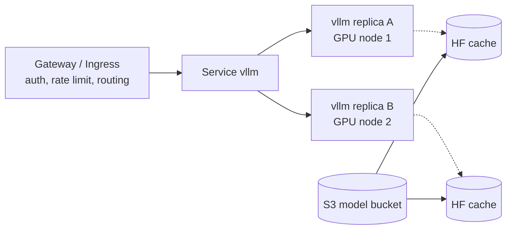

# vLLM: Production Patterns

| | |
|---|---|
| **Cluster** | 10 AI Infra & RAG/MCP |
| **Role** | Anchor |
| **Prerequisites** | [04-hands-on-labs.md](04-hands-on-labs.md) Labs 5-8, Cluster 09 (Prometheus, Grafana), Cluster 11 (SLOs) |
| **Target version** | vLLM 0.10+, Kubernetes 1.31+ |
| **Capstone phase** | Phase 6 (Months 21-24) |

> How to run vLLM as a production service: SLOs and alerting, high availability and rolling upgrades, scaling topologies, weight distribution, the serving-stack landscape (vLLM production stack, llm-d, KServe, Ray Serve, NIM, TGI, SGLang, Ollama, llama.cpp), security hardening including prompt logging and PII, FinOps with a cost model against Bedrock, GitOps layout, anti-patterns, and a go-live checklist.

---

## 1. SLOs for an LLM Endpoint

| SLI | Definition | Typical SLO (internal agent) | PromQL |
|---|---|---|---|
| Availability | `/health` 200 and requests not failing with 5xx | 99.5 % | `1 - sum(rate(vllm:request_success_total{finished_reason="abort"}[5m])) / sum(rate(vllm:request_success_total[5m]))` plus HTTP 5xx from the gateway |
| TTFT | time to first streamed token | p95 < 800 ms | `histogram_quantile(0.95, sum by (le) (rate(vllm:time_to_first_token_seconds_bucket[5m])))` |
| ITL | inter-token latency | p95 < 80 ms (feels fluent) | `histogram_quantile(0.95, sum by (le) (rate(vllm:time_per_output_token_seconds_bucket[5m])))` |
| Saturation | KV cache usage | < 85 % sustained | `max(vllm:gpu_cache_usage_perc)` |
| Truncation rate | completions cut by `max_tokens` | < 2 % | `sum(rate(vllm:request_success_total{finished_reason="length"}[1h])) / sum(rate(vllm:request_success_total[1h]))` |
| GPU utilisation (cost SLO) | DCGM | > 60 % business hours | `avg(DCGM_FI_DEV_GPU_UTIL{pod=~"vllm.*"})` |

Multi-window burn-rate alerts (Cluster 11) apply unchanged; the TTFT SLO is treated like a latency SLO with a `le="0.8"` bucket. Add `0.8` to the histogram buckets if the defaults do not include it (vLLM's TTFT buckets include 0.75 and 1.0; alert on 1.0 or compute from the quantile).

```yaml
groups:
  - name: vllm
    rules:
      - alert: VLLMQueueBacklog
        expr: sum by (namespace) (vllm:num_requests_waiting) > 10
        for: 2m
        labels: {severity: warning}
        annotations: {summary: "vLLM queue depth > 10 for 2m; autoscaler may be at max"}
      - alert: VLLMKVCacheSaturated
        expr: max by (namespace, pod) (vllm:gpu_cache_usage_perc) > 0.9
        for: 5m
        labels: {severity: warning}
      - alert: VLLMPreemptions
        expr: sum by (pod) (rate(vllm:num_preemptions_total[5m])) > 0.1
        for: 10m
        labels: {severity: warning}
        annotations: {summary: "Sequences are being evicted; reduce max-num-seqs or add KV capacity"}
      - alert: VLLMTTFTSLOBurn
        expr: |
          (1 - (sum(rate(vllm:time_to_first_token_seconds_bucket{le="1.0"}[1h])) / sum(rate(vllm:time_to_first_token_seconds_count[1h])))) > 14.4 * 0.005
        for: 2m
        labels: {severity: critical}
```

---

## 2. High Availability and Upgrades



- **Two replicas minimum** for anything user-facing, in different AZs if Karpenter allows (`topologySpreadConstraints` on `topology.kubernetes.io/zone`). A single GPU pod restarts in 2-5 minutes; that is a 99.5 % budget burned in one incident.
- **Rolling updates** with `maxSurge: 1, maxUnavailable: 0`: requires spare GPU capacity for the surge pod. Budget for N+1 GPUs or accept a brief capacity dip with `maxUnavailable: 1`.
- **PodDisruptionBudget** `minAvailable: 1` (or `maxUnavailable: 1` with 3+ replicas) protects against node drains and Karpenter consolidation.
- **Spot interruptions**: Karpenter handles the 2-minute notice by cordoning; `terminationGracePeriodSeconds: 120` plus a `preStop` sleep lets in-flight requests finish. Clients must retry idempotently (generation is not idempotent in content, but the request is safe to resend).
- **Startup time** dominates recovery. Mitigate with: weights on a PVC that survives the pod (`gp3` RWO re-attached on the same AZ), a shared RWX volume (EFS/FSx Lustre) or `--load-format runai_streamer` streaming from S3; pre-pulled images via a DaemonSet; `--enforce-eager` only if CUDA graph capture time matters more than decode speed (usually not).
- **Health probes**: `/health` returns 200 once the engine is up, but a hung GPU can keep it green. Add a synthetic canary (a CronJob sending a 5-token prompt every minute, alert on failure).

---

## 3. Scaling Topologies

| Pattern | When | How |
|---|---|---|
| Replicas (data parallel) | Model fits one GPU | `Deployment` + KEDA on `vllm:num_requests_waiting` or on `vllm:gpu_cache_usage_perc` |
| TP within node | Model too big for one GPU; NVLink available | `-tp 2/4/8`, `nvidia.com/gpu: 4` in one pod |
| TP x PP across nodes | Very large models | Ray cluster via `LeaderWorkerSet` or KubeRay |
| Prefill/decode disaggregation | High TTFT sensitivity at scale | llm-d or vLLM production stack with KV transfer (LMCache/NIXL) |
| Multi-model on one GPU | Many small models, low traffic each | Multi-LoRA (`--enable-lora`), or MIG slices each running a vLLM |
| Scale to zero | Dev/staging | KEDA `minReplicaCount: 0` with an HTTP add-on; accept cold start |

Autoscaling guidance:

- Scale **up** on queue depth (`waiting > 5` for 60 s). Scale **down** slowly (10 min stabilisation). GPU nodes take 2-4 minutes; flapping is expensive.
- Set `maxReplicaCount` equal to your GPU quota and NodePool limit; otherwise pods go `Pending` and the HPA believes it is scaling.
- Prefer KEDA over HPA + Prometheus Adapter: fewer moving parts and native Prometheus queries. The Prometheus Adapter path works too (`seriesQuery: 'vllm:num_requests_waiting'`, `metricsQuery: sum(<<.Series>>{<<.LabelMatchers>>}) by (<<.GroupBy>>)`).

---

## 4. Model Weight Distribution

| Approach | Startup | Cost | Notes |
|---|---|---|---|
| Download from Hugging Face on each pod start | slow (minutes) | egress | fine for labs; rate-limited; depends on hf.co uptime |
| PVC (RWO) per replica, populated on first start | fast after first | EBS GB-month | re-attaches to a pod in the same AZ; new nodes start cold |
| Shared RWX (EFS / FSx for Lustre / Filestore) | fast | higher | one copy; Lustre is fast enough for 70B; EFS is slow for first read |
| S3 bucket + init container (`aws s3 sync`) | medium (S3 is fast: 1-2 GB/s with `s5cmd`) | S3 + egress within region free | version weights by prefix; IRSA for auth; no HF dependency |
| `--load-format runai_streamer` from S3 | fast, streams into GPU | same | avoids disk entirely |
| Weights baked into the image | fast with pre-pull; huge image (15-140 GB) | registry storage | immutable and reproducible; slow pulls; use only with image streaming (e.g. SOCI) |

Capstone choice: S3 bucket `s3://<ACCOUNT_ID>-models/<model>/<revision>/` synced by an init container with IRSA, cached on a `gp3` PVC. The Hugging Face token stays in CI (the sync job), never in the serving namespace.

```yaml
initContainers:
  - name: fetch-weights
    image: peakcom/s5cmd:v2.3.0
    command: ["s5cmd", "sync", "--size-only", "s3://<ACCOUNT_ID>-models/qwen2.5-7b-awq/v1/*", "/data/hf/models/qwen2.5-7b-awq/"]
    volumeMounts: [{name: hf-cache, mountPath: /data/hf}]
    securityContext: {runAsNonRoot: true, runAsUser: 1000, allowPrivilegeEscalation: false, capabilities: {drop: [ALL]}}
```

Then `--model /data/hf/models/qwen2.5-7b-awq`.

---

## 5. The Serving-Stack Landscape

| Stack | What it is | Strengths | Weaknesses | Use when |
|---|---|---|---|---|
| **vLLM (bare Deployment)** | Engine + OpenAI server | Simple, widest model support, best community velocity | You build routing/caching/HA yourself | Default for 1-10 replicas |
| **vLLM production stack** | Helm chart: router + vLLM pods + LMCache KV offload + observability | Prefix-aware routing, session affinity, KV cache sharing across pods | Young project; another component to run | Many replicas with shared prefixes |
| **llm-d** | Kubernetes-native distributed inference (Red Hat/Google/IBM); Inference Gateway + vLLM + disaggregated prefill/decode | Standards-based (Gateway API Inference Extension), P/D disaggregation, KV-aware scheduling | Complex; Hopper-class hardware to benefit | Large-scale, latency-sensitive fleets |
| **KServe** | Serverless model serving CRDs (`InferenceService`) with vLLM runtime | Scale-to-zero, canary, multi-framework, Knative integration | Heavy dependency chain (Knative, Istio optional) | Platform teams standardising all ML serving |
| **Ray Serve (+ KubeRay)** | Python-defined deployments on a Ray cluster | Composable pipelines (preprocess, model, postprocess), multi-node TP/PP, autoscaling per deployment | Ray operational overhead; Python-centric | Multi-model pipelines, multi-node |
| **NVIDIA NIM** | Pre-built, optimised containers (TensorRT-LLM/vLLM inside) per model | Best per-GPU performance on NVIDIA, enterprise support | Licence (NVIDIA AI Enterprise), limited model set, opaque | Enterprises already on NVIDIA AI Enterprise |
| **TGI (Hugging Face)** | Rust/Python server | Mature, Messages API, HF ecosystem | Development slowed; vLLM generally faster | Existing TGI deployments |
| **SGLang** | Engine with RadixAttention and a frontend DSL | Excellent prefix sharing, structured outputs, strong on DeepSeek | Smaller ecosystem than vLLM | Complex agentic programs, many shared prefixes |
| **TensorRT-LLM / Triton** | Compiled engines | Peak NVIDIA throughput, FP8/INT4 kernels | Engine build per model/GPU/shape; brittle | Frozen models, maximum performance |
| **Ollama** | Desktop/server wrapper around llama.cpp with model library | Trivial setup, CPU/Metal, GGUF | Low concurrency, no PagedAttention-class batching, limited metrics | Laptops, dev, tiny traffic |
| **llama.cpp (`llama-server`)** | C++ CPU/GPU inference, GGUF | Runs anywhere, 2-8 bit quants | Throughput far below vLLM on GPUs | Edge, CPU-only servers |
| **Managed (Bedrock / Vertex / Azure OpenAI)** | API | Zero ops, frontier models | Per-token cost at scale, data residency, no custom weights (mostly) | Default until self-hosting pays off |

Decision rule for the capstone: start with bare vLLM Deployments behind a gateway. Move to vLLM production stack or llm-d when you have more than ~8 replicas or need prefix-aware routing. Use KServe only if the platform already runs Knative.

---

## 6. Gateway: Auth, Rate Limiting, Routing

vLLM's `--api-key` is a single shared secret. Put a gateway in front for real multi-tenancy:

- **Kubernetes Gateway API** (Envoy Gateway, Istio, Kong) with JWT validation (OIDC from the agent's workload identity), per-client rate limits (requests/min and, for LLMs, tokens/min via response `usage` parsing), request size limits, timeouts (set 300 s+ for long generations; streaming keeps the connection open).
- **Gateway API Inference Extension** (`InferencePool`, `InferenceModel`): an endpoint picker that routes by KV cache state, queue depth and LoRA adapter presence. This is what llm-d uses.
- **LiteLLM proxy** or **Envoy AI Gateway** if you need a unified OpenAI-compatible front for vLLM plus Bedrock with virtual keys, budgets per team and spend logs.

```yaml
# Envoy Gateway: 60 requests/minute per client id header
apiVersion: gateway.envoyproxy.io/v1alpha1
kind: BackendTrafficPolicy
metadata: {name: vllm-ratelimit, namespace: llm}
spec:
  targetRefs: [{group: gateway.networking.k8s.io, kind: HTTPRoute, name: vllm}]
  rateLimit:
    type: Global
    global:
      rules:
        - clientSelectors: [{headers: [{name: x-client-id, type: Distinct}]}]
          limit: {requests: 60, unit: Minute}
  timeout:
    http: {requestTimeout: 600s}
```

---

## 7. Security Hardening

| Control | Implementation |
|---|---|
| No public exposure | `Service` ClusterIP only; access via gateway inside the mesh; `NetworkPolicy` allowing only agent and monitoring namespaces |
| AuthN/AuthZ | Gateway JWT (OIDC) per workload; `VLLM_API_KEY` as defence in depth, rotated via External Secrets |
| Non-root, restricted | `runAsNonRoot`, drop all capabilities, `seccompProfile: RuntimeDefault`, PSA `restricted` on the namespace; `/dev/shm` as memory `emptyDir` (not hostPath) |
| Image provenance | Pin `vllm/vllm-openai:vX.Y.Z` by digest; Trivy scan (expect many CUDA CVEs; triage by exploitability); Cosign verification via Kyverno |
| `--trust-remote-code` | Avoid. If a model needs it, vendor the code into your own image after review |
| Supply chain of weights | Download from HF in CI, verify SHA256 of safetensors against the model card commit, upload to your S3; serving pods never reach the internet (`HF_HUB_OFFLINE=1`) |
| Prompt logging and PII | `--disable-log-requests`; `--max-log-len 0`; if you need traces, log hashed prompt ids and token counts to OTel, and store full prompts only in an access-controlled store with retention. Never ship raw prompts to a third-party log SaaS without a DPA |
| Prompt injection | Not vLLM's job, but the gateway/agent must treat model output as untrusted (see [../rag-architecture/05-production-patterns.md](../rag-architecture/05-production-patterns.md)) |
| Resource limits | Always set `memory` limits; a tokenizer bomb or huge batch can exhaust host RAM. `--max-model-len` caps per-request work; gateway caps body size |
| Guided decoding DoS | Very large JSON schemas compile slowly; cap schema size at the gateway or pre-compile |
| Telemetry | `VLLM_NO_USAGE_STATS=1` in regulated environments |

---

## 8. FinOps: Cost per Million Tokens

Model inputs you need:

```text
hourly_price    (on-demand or spot, check your region)
total_tok_per_s (from vllm bench serve at your traffic shape)
utilisation     (fraction of the hour the GPU is actually serving at that rate)

cost_per_1M_tokens = hourly_price / (total_tok_per_s x 3600 x utilisation / 1e6)
```

Worked comparison (illustrative prices; recompute with current numbers):

| Option | Throughput at RAG shape | Hourly | Utilisation | $/1M tokens |
|---|---|---|---|---|
| `g5.xlarge` spot, Qwen2.5-7B AWQ | 3,400 tok/s | $0.40 | 100 % | $0.03 |
| same | same | $0.40 | 30 % | $0.11 |
| `g5.xlarge` on-demand | same | $1.01 | 30 % | $0.27 |
| `g6.xlarge` (L4) spot, FP8 | ~3,000 tok/s | $0.35 | 30 % | $0.11 |
| `p4d.24xlarge` on-demand, Llama-3.1-70B FP8 TP=4 (2 instances of model) | ~12,000 tok/s | $32.77 | 60 % | $1.26 |
| Managed small model (list) | n/a | n/a | n/a | typically $0.1-0.3 in / $0.3-1.0 out |
| Managed frontier model (list) | n/a | n/a | n/a | typically $3 in / $15 out |

Observations:

- Self-hosting a 7-8B class model beats managed small-model pricing only above roughly 25-40 % utilisation on spot, and rarely on on-demand at low utilisation.
- Self-hosting a 70B model competes with mid-tier managed pricing only at high utilisation on reserved/spot capacity.
- Quality is not in the table. If a frontier model answers in one shot where a 7B needs three retries plus a reranker, the per-task cost inverts. Measure cost **per resolved task** in your evals, not per token.
- Hidden costs: engineering time, GPU quota lead time, on-call for a new tier, idle dev/staging GPUs. Scale staging to zero.

Cost controls in the capstone:

1. Spot GPU NodePool with `consolidationPolicy: WhenEmptyOrUnderutilized`, `consolidateAfter: 1m`.
2. Nightly teardown workflow (below).
3. GPU utilisation panel with the 60 % SLO; weekly review.
4. Token budgets enforced in the agent (max tokens per task, per tenant per day) and surfaced as `tokens_total` by `tenant` in Prometheus.

```yaml
# .github/workflows/nightly-gpu-teardown.yml
name: nightly-gpu-teardown
on:
  schedule: [{cron: "0 22 * * *"}]   # 22:00 UTC every day
  workflow_dispatch: {}
permissions: {id-token: write, contents: read}
jobs:
  teardown:
    runs-on: ubuntu-latest
    steps:
      - uses: aws-actions/configure-aws-credentials@v4
        with:
          role-to-assume: arn:aws:iam::123456789012:role/gha-gpu-teardown
          aws-region: <REGION>
      - run: aws eks update-kubeconfig --name capstone
      - run: |
          kubectl -n llm scale deployment --all --replicas=0
          kubectl delete nodepool gpu-spot --ignore-not-found
          sleep 120
          aws ec2 describe-instances --filters "Name=instance-type,Values=g5.*,g6.*,p4d.*,p5.*" "Name=instance-state-name,Values=running" \
            --query 'Reservations[].Instances[].InstanceId' --output text | tee leftovers.txt
          test ! -s leftovers.txt || (echo "GPU instances still running" && exit 1)
```

---

## 9. GitOps Layout (Capstone)

```text
platform/vllm/
├── base/
│   ├── kustomization.yaml
│   ├── deployment.yaml          # from Lab 5
│   ├── service.yaml
│   ├── pdb.yaml
│   ├── networkpolicy.yaml
│   ├── servicemonitor.yaml
│   └── scaledobject.yaml
├── overlays/
│   ├── dev/                     # replicas 0 by default, Qwen2.5-0.5B on CPU node
│   └── prod/                    # spot GPU, 2 replicas, FP8 KV
├── dashboards/vllm.json
├── alerts/vllm-rules.yaml
└── README.md                    # links to ADR-0012 "vLLM vs Bedrock"
```

Argo CD syncs `overlays/prod`; image tag bumps come through Renovate PRs that run the eval suite in [../llm-evals/](../llm-evals/README.md) against a canary before merge.

---

## 10. Anti-Patterns

| Anti-pattern | Why it hurts | Instead |
|---|---|---|
| `--gpu-memory-utilization 0.99` | OOM from fragmentation and other processes (DCGM, NCCL buffers) | 0.90-0.95, verify with `nvidia-smi` headroom |
| Default `--max-model-len` (128k on Llama 3.1) | KV capacity reserved for lengths you never serve, low concurrency, startup OOM | set to p99 real length + margin |
| Scaling on CPU utilisation | GPU workloads barely use CPU; HPA never triggers | queue depth / cache usage |
| One replica, user-facing | minutes of downtime per restart | 2+, PDB, canary |
| Logging full prompts to stdout | PII in Loki, cost, compliance | disable; structured OTel attributes |
| `latest` image tag | silent engine changes alter latency and output | pin by digest, test via evals |
| TP across GPUs that fit a replica each | NCCL overhead, coupled failure | replicas |
| `privileged: true` "to see the GPU" | device plugin already injects devices; privilege is unnecessary | `nvidia.com/gpu` limit only |
| Hugging Face download in production pods | hf.co outage = your outage | S3 mirror, offline mode |
| Treating `/health` as proof of correctness | engine can hang with a green probe | synthetic canary + TTFT alerts |

---

## 11. Go-Live Checklist

- [ ] Capacity maths done and matched to `GPU KV cache size` log line; `vllm bench serve` run at expected peak with 20 % headroom
- [ ] Two replicas across AZs, PDB, rolling update strategy, `preStop` drain
- [ ] Weights served from S3 mirror with checksums; `HF_HUB_OFFLINE=1`
- [ ] Non-root, restricted PSA, NetworkPolicy, API key from secret store, gateway JWT + rate limits
- [ ] ServiceMonitor scraping; dashboard with TTFT p95, ITL p95, waiting, cache usage, GPU util, tokens/s, $/1M tokens
- [ ] Alerts: queue backlog, cache saturation, preemptions, TTFT burn rate, pod not ready > 10 min
- [ ] KEDA scaling with max replicas = GPU quota; nightly teardown for non-prod
- [ ] Prompt logging disabled; OTel tracing from the agent with token counts
- [ ] Eval suite (DeepEval/RAGAS) runs against the endpoint in CI; image bumps gated
- [ ] ADR written: model choice, quantisation, GPU type, cost vs managed, exit criteria
