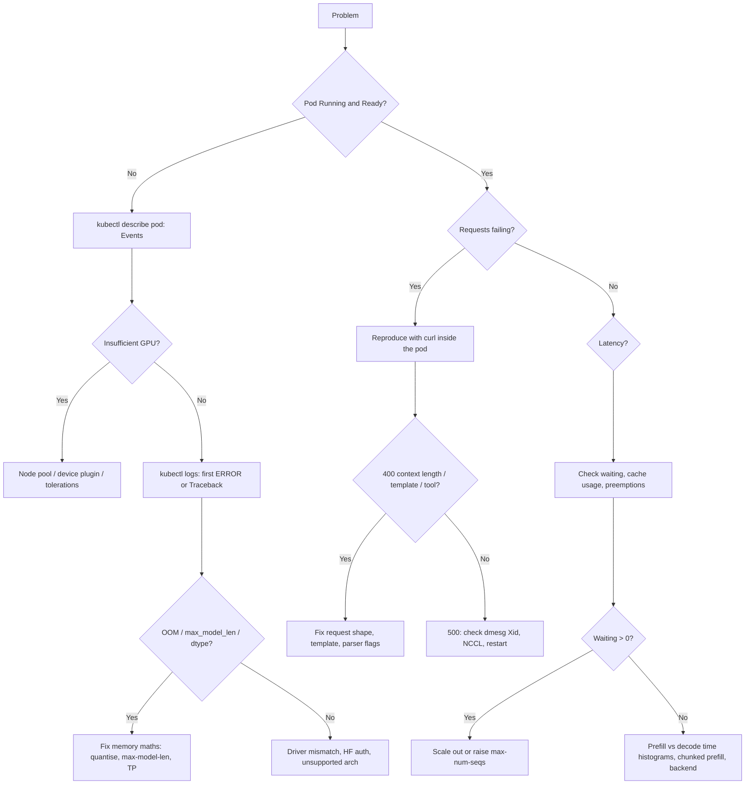

# vLLM: Troubleshooting

| | |
|---|---|
| **Cluster** | 10 AI Infra & RAG/MCP |
| **Role** | Anchor |
| **Prerequisites** | [02-core-concepts.md](02-core-concepts.md), [../gpu-workloads-kubernetes/06-troubleshooting.md](../gpu-workloads-kubernetes/06-troubleshooting.md) |
| **Target version** | vLLM 0.10+ |
| **Capstone phase** | Phase 6 (Months 21-24) |

> Symptom-to-fix tables for the errors you will actually see: CUDA out of memory at startup and at runtime, tiny KV caches, slow TTFT, tokenizer and chat-template failures, tool-call parsing problems, NCCL and multi-GPU hangs, Kubernetes scheduling and probe failures, and quality problems that look like bugs. Ends with a debugging workflow and the diagnostic commands to run first.

---

## 1. First Five Commands

```bash
# 1. Is the engine up and what did it decide at startup?
kubectl -n llm logs deploy/vllm | grep -E 'ERROR|Traceback|KV cache size|concurrency|Loading weights|startup complete' | tail -30

# 2. What is the GPU doing?
kubectl -n llm exec deploy/vllm -- nvidia-smi --query-gpu=name,memory.used,memory.total,utilization.gpu,temperature.gpu --format=csv

# 3. Queue state right now
kubectl -n llm exec deploy/vllm -- curl -s localhost:8000/metrics | grep -E '^vllm:(num_requests_running|num_requests_waiting|gpu_cache_usage_perc|num_preemptions_total)'

# 4. Scheduling / probe events
kubectl -n llm describe pod -l app=vllm | sed -n '/Events/,$p'

# 5. Full environment for a bug report
kubectl -n llm exec deploy/vllm -- vllm collect-env 2>/dev/null | head -40
```

---

## 2. Startup Failures

| Symptom (verbatim) | Likely cause | Diagnose | Fix |
|---|---|---|---|
| `torch.OutOfMemoryError: CUDA out of memory. Tried to allocate 1.50 GiB. GPU 0 has a total capacity of 22.19 GiB of which 812.00 MiB is free` during model load | Weights alone exceed VRAM for this dtype | compute `params x bytes`; `nvidia-smi` for other processes | quantise (AWQ/GPTQ/FP8), add `--tensor-parallel-size`, `--cpu-offload-gb`, bigger GPU |
| `ValueError: The model's max seq len (131072) is larger than the maximum number of tokens that can be stored in KV cache (34816). Try increasing gpu_memory_utilization or decreasing max_model_len` | Default context too long for remaining memory | read the two numbers in the message | `--max-model-len 8192` (or whatever you serve); do not blindly raise utilisation |
| `ValueError: No available memory for the cache blocks. Try increasing gpu_memory_utilization` | Weights + activations consume everything | as above | quantise, TP, smaller model |
| `RuntimeError: Engine core initialization failed` after `Memory profiling` | Profiling forward pass OOMed (often `--max-num-batched-tokens` too high) | set `VLLM_LOGGING_LEVEL=DEBUG` | lower `--max-num-batched-tokens`, `--max-num-seqs`, or utilisation |
| `Bfloat16 is only supported on GPUs with compute capability of at least 8.0. Your NVIDIA Tesla T4 GPU has compute capability 7.5` | Pre-Ampere GPU | `nvidia-smi --query-gpu=compute_cap --format=csv` | `--dtype half` |
| `Cannot find the config file for awq` / `quantization method awq is not supported for the current GPU` | Kernel not supported on this GPU (e.g. AWQ on T4 needs `awq` not `awq_marlin`) | model card + GPU arch | `--quantization awq` on Turing, `awq_marlin` on Ampere+ |
| `OSError: You are trying to access a gated repo` / `401 Client Error` | Missing/invalid `HF_TOKEN` or licence not accepted | `kubectl exec ... -- env \| grep HF_TOKEN \| cut -c1-10` | accept licence on hf.co; mount token from Secret |
| `huggingface_hub.errors.HfHubHTTPError: 429 Too Many Requests` | Many pods downloading simultaneously | pod logs | S3 mirror; PVC cache; `--max-parallel-loading-workers` |
| `Failed to initialize NVML: Driver/library version mismatch` or `CUDA driver version is insufficient for CUDA runtime version` | Host driver older than the image's CUDA runtime | `nvidia-smi` on the node vs image CUDA version | upgrade node driver (GPU Operator), or use an older vLLM image built for your CUDA |
| `RuntimeError: Found no NVIDIA driver on your system` | Pod lacks GPU access | `kubectl describe pod` resources; `runtimeClassName` | request `nvidia.com/gpu: 1`; set `runtimeClassName: nvidia` if the operator did not set a default runtime |
| `ValueError: Unrecognized configuration class` / `architectures ['FooForCausalLM'] are not supported` | Model architecture not in this vLLM version | model `config.json` | upgrade vLLM; check supported models list; `--trust-remote-code` only if the repo code is reviewed |
| Startup hangs at `Graph capturing` for minutes | CUDA graph capture for many shapes | wait; or `--enforce-eager` to confirm | normal (30-120 s); reduce `--max-num-seqs` for fewer shapes; `--enforce-eager` costs decode speed |
| `OSError: [Errno 28] No space left on device` | PVC or `/dev/shm` too small | `df -h /data/hf /dev/shm` | bigger PVC; `shm` `sizeLimit` to 8-16 Gi |
| Pod `OOMKilled` (not CUDA) | Host RAM exhausted during weight load (safetensors are mmapped) or tokenizer | `kubectl describe pod` last state | raise `memory` limit to >= weights size + 4 Gi; `--max-parallel-loading-workers 1` |

---

## 3. Runtime Errors and Latency Problems

| Symptom | Likely cause | Diagnose | Fix |
|---|---|---|---|
| Clients see HTTP 400 `This model's maximum context length is 8192 tokens. However, you requested 9000 tokens` | Prompt + `max_tokens` exceed `--max-model-len` | request sizes | trim context in the RAG layer; raise `--max-model-len` only if memory allows |
| HTTP 500 / `CUDA error: an illegal memory access was encountered` mid-run | Kernel bug or faulty GPU | check `dmesg` for Xid errors on the node | pin to a known-good vLLM version; cordon node if Xid 79/48 recur |
| TTFT p95 grows while throughput flat | Queueing: `num_requests_waiting > 0` | PromQL on waiting and cache usage | scale out; lower `--max-num-seqs` if ITL is also bad; enable chunked prefill |
| TTFT spikes periodically | Long prompts starving decode (no chunked prefill), or prefix cache eviction churn | `vllm:request_prefill_time_seconds` vs queue time | `--enable-chunked-prefill`, lower `--max-num-batched-tokens`; put static content first for cache hits |
| ITL (TPOT) high at low load | CUDA graphs disabled (`--enforce-eager`), wrong attention backend, FP8 on Ampere emulated | startup log `Using FlashAttention backend` | remove `--enforce-eager`; `VLLM_ATTENTION_BACKEND=FLASH_ATTN`; use AWQ instead of FP8 on A10G/A100 |
| `vllm:num_preemptions_total` rising | KV cache oversubscribed | cache usage ~1.0 | lower `--max-num-seqs`, `--kv-cache-dtype fp8`, shorter `--max-model-len`, more replicas |
| Throughput far below benchmark | Clients not concurrent (sequential loop), gateway buffering SSE, or `max_tokens` tiny | compare `num_requests_running` to expected | async clients; disable response buffering at ingress (`nginx.ingress.kubernetes.io/proxy-buffering: "off"`) |
| Streaming works via port-forward but not via ingress | Proxy buffering or idle timeout | curl through ingress with `-N` | disable buffering; raise `proxy-read-timeout` to 600 s |
| Gateway returns 504 on long generations | Upstream timeout < generation time | gateway logs | raise request timeout; prefer streaming |
| `finished_reason="length"` high | `max_tokens` too small or model rambles | metric ratio | raise `max_tokens`; add stop sequences; instruct brevity |

---

## 4. Tokenizer, Chat Template and Tool-Call Problems

| Symptom | Likely cause | Fix |
|---|---|---|
| `ValueError: As of transformers v4.44, default chat template is no longer allowed, so you must provide a chat template if the tokenizer does not define one` | Base (non-instruct) model or missing template | use the `-Instruct` variant; or `--chat-template ./chatml.jinja` |
| `jinja2.exceptions.TemplateError: Conversation roles must alternate user/assistant/user/assistant/...` | Model template rejects consecutive same-role messages or a system message (older Mistral/Gemma) | merge messages client-side; prepend system text to first user message; custom template |
| Model output contains `<|im_end|>`, `<|eot_id|>`, `</s>` literally | Wrong `eos_token` / stop tokens, or `skip_special_tokens: false` | pass `stop` or `stop_token_ids`; check `generation_config.json`; set `--tokenizer-mode mistral` for Mistral tekken models |
| Tool call appears as plain text JSON in `content` | `--enable-auto-tool-choice`/`--tool-call-parser` missing or wrong family | match parser to model: `hermes` (Qwen2.5), `llama3_json` (Llama 3.x), `mistral`, `deepseek_v3` |
| `tool_calls[].function.arguments` is invalid JSON | Small model or wrong parser mangled the call | larger model; `--tool-call-parser` matching; validate and retry in the agent |
| `"auto" tool choice requires --enable-auto-tool-choice and --tool-call-parser to be set` | flags missing | add them |
| `<think>...</think>` inside `content` | Reasoning model without parser | `--reasoning-parser qwen3` / `deepseek_r1`; or send `chat_template_kwargs: {"enable_thinking": false}` |
| Guided decoding returns 400 `Failed to compile grammar` | Schema uses unsupported JSON Schema features (`$ref` cycles, patternProperties) | simplify schema; switch `--guided-decoding-backend guidance` or `outlines` |
| First structured request is very slow | Grammar compile cached per schema | expected once per schema; keep schemas stable; pre-warm |
| Tokenizer counts differ between client and server | Client uses a different tokenizer | use `/tokenize` endpoint for budgeting |

---

## 5. Multi-GPU and NCCL

| Symptom | Likely cause | Diagnose | Fix |
|---|---|---|---|
| Startup hangs after `Initializing distributed environment` | Workers cannot reach each other; `/dev/shm` too small; mismatched `CUDA_VISIBLE_DEVICES` | `NCCL_DEBUG=INFO`; check `df /dev/shm` | `--ipc=host` or `shm` 8-16 Gi; ensure `nvidia.com/gpu: N` equals `-tp N` |
| `ncclUnhandledCudaError` / `NCCL error: unhandled system error` | NIC selection wrong, IB not available | `NCCL_SOCKET_IFNAME=eth0`, `NCCL_IB_DISABLE=1` | set env; in Kubernetes set `hostNetwork` only if required for multi-node |
| `ValueError: Total number of attention heads (32) must be divisible by tensor parallel size (3)` | Invalid TP | model config | TP of 1, 2, 4, 8 matching head counts |
| `RuntimeError: NCCL timeout` during long prefill | One rank stalled, often from preemption or GPU Xid | `dmesg`, DCGM Xid metric | restart; cordon faulty GPU; raise `NCCL_TIMEOUT`? (rarely the real fix) |
| Ray workers show fewer GPUs than expected | `ray start` without `--num-gpus`, or nodes in different Ray clusters | `ray status` | consistent `run_cluster.sh` with head IP; same image on all nodes |
| TP=2 pod `Pending` with `Insufficient nvidia.com/gpu` | Node has 1 GPU each; vLLM TP needs all GPUs in one pod | `kubectl describe node` allocatable | multi-GPU instance type (`g5.12xlarge`), or PP across pods via Ray |
| P2P / NVLink warnings, slow TP | GPUs not NVLinked (A10G in `g5` has no NVLink) | `nvidia-smi topo -m` | expect PCIe speeds; prefer replicas on `g5`; use `p4d`/`p5` for TP-heavy models |

---

## 6. Kubernetes-Specific

| Symptom | Likely cause | Diagnose | Fix |
|---|---|---|---|
| Pod `Pending`: `0/5 nodes are available: 5 Insufficient nvidia.com/gpu` | No GPU node or device plugin not advertising | `kubectl get nodes -o json \| jq '.items[].status.allocatable["nvidia.com/gpu"]'` | Karpenter NodePool limits/quota; GPU Operator health; tolerations |
| Pod `Pending` with Karpenter event `no instance type satisfied` | Spot capacity unavailable in AZ, or requirement mismatch | `kubectl get nodeclaims; kubectl describe nodeclaim` | widen instance families/AZs; allow on-demand fallback |
| Startup probe kills pod before weights load | `failureThreshold x periodSeconds` < load time | pod events `Startup probe failed` | raise threshold (15-20 min for 70B); PVC cache |
| Readiness flaps under load | `/health` is served by the same uvicorn worker; heavy CPU tokenisation starves it | CPU throttling (`container_cpu_cfs_throttled_seconds_total`) | raise CPU request/limit (4+ cores); readiness `timeoutSeconds: 5` |
| Pod evicted: `The node was low on resource: ephemeral-storage` | Weights downloaded to container fs instead of PVC | `kubectl describe pod` | mount PVC at `HF_HOME`; set `ephemeral-storage` limits |
| HPA/KEDA never scales | Prometheus query returns no data (wrong namespace label, ServiceMonitor not selected) | `kubectl get --raw /apis/external.metrics.k8s.io/v1beta1` | fix labels; `release: kube-prometheus-stack` on ServiceMonitor |
| Scrape 401 | `--api-key` also protects `/metrics` | Prometheus target error | `bearerTokenSecret` in ServiceMonitor, or expose metrics on a separate unauthenticated port via sidecar |
| Second replica stuck downloading | New node, empty cache, HF rate limit | logs | S3 mirror + init container; RWX volume |
| `MountVolume.SetUp failed ... Multi-Attach error` on reschedule | RWO PVC still attached to the old node | events | wait for detach; use one PVC per replica (StatefulSet `volumeClaimTemplates`) or RWX |

---

## 7. "It Works but Answers Are Bad"

| Symptom | Likely cause | Fix |
|---|---|---|
| Repetitive or degenerate output | Greedy decoding with no penalty on a small model | `temperature 0.3-0.7`, `repetition_penalty 1.05-1.1`, `top_p 0.9`; use the instruct variant |
| Quality dropped after enabling FP8 KV or INT4 | Quantisation error, especially on long contexts | `--kv-cache-dtype auto` to confirm; use calibrated FP8 checkpoints; prefer AWQ over naive INT4 |
| Different answers each run at `temperature: 0` | Batching changes floating-point reduction order | expected; use `seed` for sampling determinism, do not rely on bitwise reproducibility |
| Model ignores system prompt | Template drops system role (some Gemma/Mistral versions) | check rendered prompt via `/v1/chat/completions` with `"return_tokens_as_token_ids"` or `--chat-template` fix |
| Long-context answers lose the middle | Context beyond trained length with `VLLM_ALLOW_LONG_MAX_MODEL_LEN` | stay within trained length; use RoPE-scaled models |
| Eval scores regress after image bump | Engine defaults changed (V1 scheduler, sampling) | pin digest; run DeepEval suite in CI on bumps |

---

## 8. Debugging Workflow



Useful extra diagnostics:

```bash
# Rendered prompt the model actually sees (debug template issues)
curl -s localhost:8000/v1/chat/completions -H 'Content-Type: application/json' \
  -d '{"model":"qwen2.5-7b","messages":[{"role":"user","content":"hi"}],"max_tokens":1,"return_tokens_as_token_ids":true,"echo":true}' | jq .

# Per-request timing decomposition
curl -s localhost:8000/metrics | grep -E 'vllm:request_(queue|prefill|decode)_time_seconds_sum'

# Attention backend and engine version chosen at startup
kubectl -n llm logs deploy/vllm | grep -E 'Using .* backend|LLM engine \(v'

# GPU errors on the node (Xid)
kubectl debug node/<NODE> -it --image=busybox -- dmesg | grep -i xid

# Does the schema compile?
python -c "import json,xgrammar as xgr; xgr.Grammar.from_json_schema(json.dumps({'type':'object'}))"
```

---

## 9. Where to Look Upstream

- GitHub issues: https://github.com/vllm-project/vllm/issues (search the exact error string; many have a flag workaround).
- Supported models and quantisation/GPU compatibility matrix: https://docs.vllm.ai/en/latest/models/supported_models.html and `features/quantization/supported_hardware`.
- Release notes: engine defaults (V1, chunked prefill, prefix caching) changed across 0.8-0.10; a "regression" after an upgrade is often a new default.
