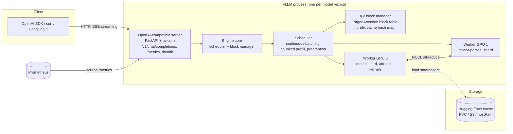

# vLLM

| | |
|---|---|
| **Cluster** | 10 AI Infra & RAG/MCP |
| **Role** | Anchor |
| **Category** | LLM inference and serving engine |
| **Prerequisites** | [GPU workloads on Kubernetes](../gpu-workloads-kubernetes/README.md), Python 3.12+, Docker, Kubernetes 1.31+, Prometheus basics |
| **Target version** | vLLM 0.10+ (V1 engine), CUDA 12.x, PyTorch 2.7+ |
| **Capstone phase** | Phase 6 (Months 21-24) |
| **Official docs** | https://docs.vllm.ai |

> vLLM is the open-source inference engine that turns a GPU and an open-weights checkpoint (Llama, Mistral, Qwen, DeepSeek, Gemma, and hundreds more) into a high-throughput, OpenAI-compatible HTTP API. After working through this folder you will be able to size a GPU for a model, serve it with vLLM on Kubernetes with health probes and autoscaling, expose its metrics to Prometheus with a TTFT SLO, serve LoRA adapters and structured outputs, benchmark it, and compute what it costs per million tokens compared with a managed API.

## Why This Tool Exists

Before vLLM, serving a transformer with Hugging Face `generate()` wasted most of the GPU:

1. **KV-cache fragmentation.** Each request pre-allocated a contiguous block of GPU memory for the maximum possible sequence length. Internal fragmentation and reservation waste commonly consumed 60-80 % of KV-cache memory, so only a handful of requests fit at once.
2. **Static batching.** A batch ran until its *longest* sequence finished. Short requests sat idle, holding memory and compute.
3. **No standard API.** Every team wrote its own FastAPI wrapper, its own tokenizer handling, its own streaming.

The insight of the vLLM paper (Kwon et al., SOSP 2023) was to borrow **virtual memory paging** from operating systems. The KV cache is split into fixed-size blocks (16 tokens by default); a block table maps each sequence's logical blocks to physical blocks anywhere in GPU memory. That is **PagedAttention**. Because memory is no longer contiguous, the scheduler can admit new requests the moment any block frees up, which is **continuous batching**. The result in the paper was 2-4x throughput over the best previous systems at the same latency, and the gap has only widened with prefix caching, chunked prefill, speculative decoding and FP8 KV caches.

## Architecture

- **API server.** Speaks the OpenAI REST surface (`/v1/models`, `/v1/completions`, `/v1/chat/completions`, `/v1/embeddings`, plus `/tokenize`, `/health`, `/metrics`). Applies the chat template, parses tool calls, enforces guided decoding.
- **Engine core / scheduler.** Each iteration (one forward pass) decides which sequences to prefill (process prompt tokens) and which to decode (generate one token). Chunked prefill lets a long prompt be split across iterations so decode requests are not starved.
- **KV block manager.** Allocates 16-token blocks, keeps the block table per sequence, and hashes block contents so identical prefixes (system prompts, few-shot examples, shared documents) are served from cache.
- **Workers.** One process per GPU. With tensor parallelism each worker holds a slice of every layer and they synchronise with NCCL all-reduce every layer; with pipeline parallelism each worker holds whole layers and passes activations forward.

## The Core Mental Model

1. **VRAM is a budget with two line items: weights and KV cache.** Weights are fixed by model size and dtype (`params x bytes`). Everything left after `--gpu-memory-utilization` is KV cache, and KV cache capacity *is* your concurrency. Every tuning decision (`--max-model-len`, `--max-num-seqs`, `--kv-cache-dtype fp8`, quantisation, tensor parallelism) is a trade of one line item against the other. See [02-core-concepts.md](02-core-concepts.md) for the formulas.
2. **The engine is a batching queue.** Requests wait (`vllm:num_requests_waiting`), run (`vllm:num_requests_running`), and get preempted when the cache fills. Time-to-first-token is queueing delay plus prefill; inter-token latency is how many sequences share each decode step. Throughput and latency are in tension and you choose the operating point with `--max-num-seqs` and `--max-num-batched-tokens`.

## Anchor-and-Bridge Mapping

| Concept in vLLM | Hugging Face TGI | SGLang | Ollama / llama.cpp | NVIDIA NIM / TensorRT-LLM | Amazon Bedrock (managed) |
|---|---|---|---|---|---|
| `vllm serve <hf-model>` | `text-generation-launcher --model-id` | `python -m sglang.launch_server --model-path` | `ollama run <model>` (GGUF) | Pre-built container per model | Model ID (`anthropic.claude-...`) |
| OpenAI-compatible `/v1/chat/completions` | `/v1/chat/completions` (Messages API) | OpenAI-compatible | OpenAI-compatible on `:11434/v1` | OpenAI-compatible | `Converse` / `InvokeModel` |
| `--tensor-parallel-size` | `--num-shard` | `--tp` | n/a (single device / CPU) | Engine build time | Hidden |
| `--max-model-len` | `--max-total-tokens` | `--context-length` | `num_ctx` | `max_seq_len` at build | Model limit |
| `--gpu-memory-utilization` | `--cuda-memory-fraction` | `--mem-fraction-static` | n/a | fixed by engine | Hidden |
| `--quantization awq/gptq/fp8` | `--quantize` | `--quantization` | GGUF Q4_K_M etc. | FP8/INT4 engines | Hidden |
| `--enable-prefix-caching` | `--prefix-caching` | RadixAttention (default) | prompt cache | KV reuse | Prompt caching |
| `--enable-lora --lora-modules` | `--lora-adapters` | `--lora-paths` | adapters in Modelfile | NIM LoRA | Custom model import |
| `/metrics` `vllm:*` | `tgi_*` | `sglang:*` | none built-in | NIM metrics | CloudWatch |
| `guided_json` / `response_format` | `grammar` | `regex` / `json_schema` | `format: json` | guided decoding | Tool use / structured output |

## Learning Path

| Step | File | Time |
|---|---|---|
| 1 | [01-installation-and-setup.md](01-installation-and-setup.md): pip, Docker, CPU build, first `vllm serve` | 2 h |
| 2 | [02-core-concepts.md](02-core-concepts.md): PagedAttention, scheduler, memory maths, parallelism, quantisation | 4 h |
| 3 | [03-commands-and-cheatsheet.md](03-commands-and-cheatsheet.md): every flag, every endpoint, metrics reference | 3 h |
| 4 | [04-hands-on-labs.md](04-hands-on-labs.md): CPU lab, T4/A10G lab, K8s Deployment, autoscaling, LoRA, benchmark | 10 h |
| 5 | [05-production-patterns.md](05-production-patterns.md): HA, SLOs, security, cost model, serving-stack comparison | 3 h |
| 6 | [06-troubleshooting.md](06-troubleshooting.md): CUDA OOM, NCCL, chat templates, slow TTFT | 2 h |
| 7 | [07-interview-questions.md](07-interview-questions.md) | 2 h |

## When vLLM Is the Wrong Choice

- You have no sustained traffic. A GPU idling at 5 % utilisation costs more than paying Bedrock per token. Compute the break-even in [05-production-patterns.md](05-production-patterns.md).
- You need a frontier proprietary model (Claude, GPT, Gemini). vLLM only serves open weights.
- Single-user laptop inference: Ollama/llama.cpp with GGUF on CPU/Metal is simpler.
- Absolute lowest latency on NVIDIA with a frozen model: TensorRT-LLM/NIM can beat vLLM at the cost of engine builds and lock-in.
- Extremely complex multi-call programs (many small generations with shared prefixes): SGLang's RadixAttention and frontend language are purpose-built for that.

## Role in the Capstone

vLLM is the self-hosted serving path for the Incident & Platform AI Agent. In the capstone repository it appears as `platform/vllm/`:

- A `Deployment` of `vllm/vllm-openai` serving `Qwen/Qwen2.5-7B-Instruct-AWQ` on a spot `g5.xlarge` node (`nvidia.com/gpu: 1`), with `/health` probes, a PVC-backed Hugging Face cache, a `PodDisruptionBudget`, and a `NetworkPolicy` that only admits the agent namespace.
- A KEDA `ScaledObject` scaling on `vllm:num_requests_waiting` from Prometheus.
- A Grafana dashboard with TTFT p95 (SLO < 800 ms), tokens/s, `vllm:gpu_cache_usage_perc`, and DCGM GPU utilisation side by side.
- The agent (Strands or LangGraph) uses the OpenAI-compatible endpoint through a model-provider abstraction so the same code runs against Bedrock in the managed path. An ADR records the cost-per-million-tokens comparison that justifies which path is default.
- DeepEval/RAGAS in CI run against the vLLM endpoint on a nightly GPU job and against a CPU-served `Qwen2.5-0.5B` on every PR for smoke coverage.

## Further Reading

- Kwon et al., "Efficient Memory Management for Large Language Model Serving with PagedAttention", SOSP 2023: https://arxiv.org/abs/2309.06180
- vLLM V1 engine design blog: https://blog.vllm.ai
- Leviathan et al., "Fast Inference from Transformers via Speculative Decoding", ICML 2023
- Agrawal et al., "SARATHI: Efficient LLM Inference by Piggybacking Decodes with Chunked Prefills" (the basis of chunked prefill)
- vLLM production stack: https://github.com/vllm-project/production-stack ; llm-d: https://llm-d.ai
- OpenAI API reference (the contract vLLM implements): https://platform.openai.com/docs/api-reference
