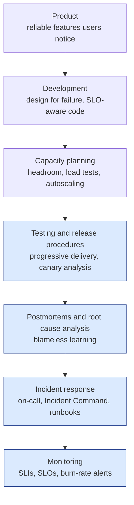
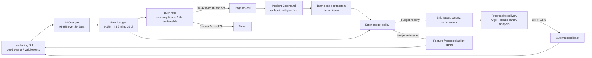
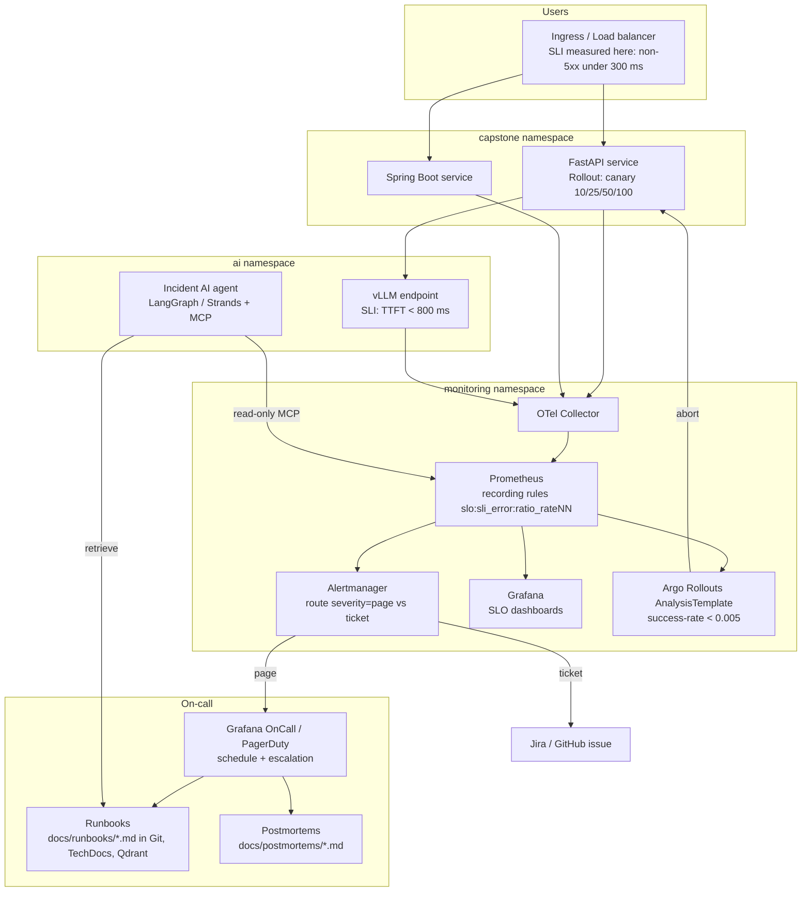

# Cluster 11: Site Reliability Engineering

| | |
|---|---|
| **Cluster** | 11 SRE |
| **Anchor framework** | Google SRE (SRE Book, SRE Workbook) |
| **Core unifying pattern** | User-centric reliability targets (SLIs/SLOs) and burn-rate governance of the error budget |
| **Prerequisites** | Cluster 04 (Kubernetes, Argo CD), Cluster 06 (CI/CD), Cluster 09 (OpenTelemetry, Prometheus, Grafana) |
| **Capstone phase** | Phase 4 (Months 13-16, 160 hours shared with Cluster 09) |
| **Capstone deliverable** | A 99.9% SLO for the FastAPI and Spring Boot services with multi-window burn-rate alerts paging an on-call schedule, linked runbooks, blameless postmortems, and progressive delivery with Argo Rollouts / Flagger and automated canary analysis |

> This cluster teaches reliability as a product feature that is specified, measured, budgeted, and shipped like any other feature. After working through it you will be able to define SLIs from the user's point of view, set an SLO and derive its error budget, alert only when the budget is burning fast enough to matter, run a humane on-call rotation with an Incident Command structure, learn from incidents without blame, and release changes progressively so that a bad deploy rolls itself back before it spends the budget.

---

## 1. Why This Cluster Exists

Before SRE, "reliability" meant a vague promise of "100% uptime" that nobody could measure, so every outage was a surprise, every alert was a CPU threshold, and the only lever was "deploy less often". Google's insight (Ben Treynor Sloss, 2003) was to treat operations as a software problem and to make reliability a quantitative target negotiated with the product owner:

- **Reliability is a feature with a cost.** Each extra nine costs roughly ten times more and the user cannot tell the difference above a certain point (their phone network is less reliable than your 99.99%). So pick a target that is *good enough* and spend the rest on velocity.
- **The gap between the target and perfection is a budget.** A 99.9% SLO over 30 days gives you 43.2 minutes of permitted unreliability. You spend it on releases, experiments, and migrations. When it is gone you stop shipping features and fix reliability.
- **Alert on the budget, not on the machine.** Page a human only when the budget is being consumed so fast that waiting until morning would cost a meaningful fraction of it.
- **Cap toil at 50%.** SREs spend at least half their time on engineering that removes future operational work.

The roadmap's phrasing: *"reliability is engineered as a product feature rather than treated as '100% uptime wishful thinking'"*.

---

## 2. The Google SRE Principles

| Principle | One-line meaning | Where it is covered |
|---|---|---|
| **Embracing risk** | 100% is the wrong target; choose the level of reliability users need and no more | [sli-slo-error-budgets](sli-slo-error-budgets/README.md) |
| **Service Level Objectives** | Define SLIs from the user's perspective, set SLOs, derive error budgets, write an error budget policy | [sli-slo-error-budgets](sli-slo-error-budgets/README.md) |
| **Eliminating toil** | Toil is manual, repetitive, automatable, tactical, scales with service size; cap it at 50% | [oncall-and-incident-management](oncall-and-incident-management/README.md) |
| **Monitoring distributed systems** | Four Golden Signals; symptom-based paging; tickets for cause-based signals | [burn-rate-alerting](burn-rate-alerting/README.md) |
| **Automation** | Automate away the operational load, but understand the system first | [postmortems-and-runbooks](postmortems-and-runbooks/README.md) (executable runbooks) |
| **Release engineering** | Hermetic, reproducible, progressive, reversible releases | [progressive-delivery](progressive-delivery/README.md) |
| **Simplicity** | Every line of code and every alert is a liability; remove what you do not need | All five topics (fewest SLOs, fewest alerts, fewest steps) |

---

## 3. SRE vs DevOps vs Platform Engineering

These three are often confused. They overlap but answer different questions.

| | DevOps | SRE | Platform Engineering |
|---|---|---|---|
| **Question answered** | How do dev and ops collaborate to ship faster and safer? | How reliable must the service be, and how do we engineer to that number? | What paved road do we give product teams so they never have to think about the above? |
| **Primary artefact** | Culture, CI/CD pipelines, shared ownership | SLOs, error budgets, alerts, runbooks, postmortems | Internal Developer Platform (Backstage, golden-path templates, self-service infra) |
| **Measures success by** | DORA metrics (deployment frequency, lead time, change failure rate, time to restore) | SLO attainment, error budget burn, toil percentage, MTTD/MTTA | Developer productivity, adoption of paved road, platform SLOs |
| **Google's framing** | A philosophy | "class SRE implements interface DevOps" (a concrete implementation of DevOps) | The team that builds the platform SREs operate on |
| **In this wiki** | Cluster 06 and the capstone pipeline | This cluster | Cluster 04 (Backstage), Cluster 12 |

The practical takeaway: a platform team *provides* SLO tooling (recording-rule generators, OnCall, Argo Rollouts) as part of the paved road; product teams *own* their SLOs; SRE practice is what both do with the numbers.

---

## 4. The Hierarchy of Reliability (Dickerson's Pyramid)

Mikey Dickerson's hierarchy, from the SRE Book, says you cannot do the higher layers until the lower ones exist. This cluster is ordered bottom-up.



| Layer | Cluster 11 topic | Supporting cluster |
|---|---|---|
| Monitoring | sli-slo-error-budgets, burn-rate-alerting | 09 Observability supplies the telemetry |
| Incident response | oncall-and-incident-management | 12 Production support |
| Postmortems / RCA | postmortems-and-runbooks | 04 Backstage TechDocs hosts them |
| Testing and release | progressive-delivery | 04 Argo CD, 06 CI/CD |
| Capacity planning | touched in 05-production-patterns of each topic | 04 HPA/Karpenter, 12 FinOps |
| Development / Product | SLO-aware design in 07 Backend | 07 FastAPI, Spring Boot |

---

## 5. The Core Unifying Pattern

Everything in this cluster is one closed loop around a single number: **the error budget**.



Read it as a sentence: *the SLI tells us how users experience the service; the SLO turns that into a target; the gap is a budget; the burn rate tells us how fast we are spending it; alerts fire on burn rate, not on CPU; the on-call engineer follows a runbook to stop the burn; the postmortem turns the incident into engineering work; the error budget policy decides whether the team ships faster or slows down; and progressive delivery is how shipping stays cheap in budget terms.*

---

## 6. Capstone Reliability Architecture



What the capstone proves at the end of Phase 4:

1. **SLOs as code.** `slo/fastapi.yaml` (Sloth or Pyrra) generates recording and alerting rules committed to the GitOps repo and reconciled by Argo CD.
2. **Burn-rate paging.** A 14.4x burn over 1 hour and 5 minutes pages the primary on-call through Grafana OnCall within 2 minutes of the condition becoming true; a 3x burn over 1 day opens a ticket.
3. **Runbooks linked from every alert.** `runbook_url` annotations resolve to Markdown in `docs/runbooks/`, rendered by Backstage TechDocs and indexed in Qdrant for the Phase 6 incident agent.
4. **Blameless postmortems** for every SEV1/SEV2, tracked to closure.
5. **Progressive delivery.** The FastAPI `Rollout` shifts 10% of traffic, runs a Prometheus `AnalysisTemplate`, and aborts automatically if the canary's 5xx ratio exceeds 0.5%.

---

## 7. How Other Clusters Plug In

| Cluster | What it supplies to Cluster 11 | What Cluster 11 gives back |
|---|---|---|
| [09 Observability](../09-observability/) | The raw telemetry: OTel instrumentation, Prometheus histograms and counters, Grafana, Loki, Tempo for incident diagnosis | A reason for every dashboard panel to exist (an SLI) and a filter on which signals page |
| [04 Containers & IDP](../04-containers-and-idp/) | Kubernetes primitives, Argo CD GitOps, Backstage catalog and TechDocs | SLO status in the Backstage catalog, Rollout CRDs replacing Deployments, runbooks in TechDocs |
| [06 CI/CD](../06-cicd/) | Pipelines that build immutable artefacts and promote them | Release gates tied to error budget, `promtool test rules` in CI, DORA metrics |
| [12 Enterprise Ops](../12-enterprise-ops/) | Production support model (L1/L2/L3), DR tiers, FinOps | Four Golden Signals triage runbooks, toil accounting, canary analysis, auto-rollback |
| [10 AI Infra / RAG / MCP](../10-ai-infra-rag-mcp/) | vLLM metrics, Qdrant for runbook retrieval, MCP servers over Prometheus and Kubernetes | SLIs for AI (TTFT, grounded rate), the L1 incident agent's guardrails |
| [07 Backend](../07-backend/) | FastAPI and Spring Boot services with health endpoints and metrics | SLO-aware design: timeouts, retries with budgets, graceful degradation |

---

## 8. Topic Comparison Matrix

| Topic | Type | Primary tooling | Output artefact | Depth in this wiki |
|---|---|---|---|---|
| [sli-slo-error-budgets](sli-slo-error-budgets/) | Specification practice | Prometheus recording rules, Sloth, Pyrra, OpenSLO, Grafana SLO | SLO document, recording rules, dashboards, error budget policy | Anchor (deepest) |
| [burn-rate-alerting](burn-rate-alerting/) | Alerting practice | PrometheusRule, Alertmanager, Grafana unified alerting | Multi-window alert rules, routing tree, unit tests | Deep |
| [oncall-and-incident-management](oncall-and-incident-management/) | Operational practice | Grafana OnCall/IRM, PagerDuty, Slack, incident bots | Schedules, escalation policies, severity matrix, comms templates | Deep |
| [postmortems-and-runbooks](postmortems-and-runbooks/) | Learning practice | Git, Backstage TechDocs, Qdrant (for the agent) | Postmortem and runbook templates, five capstone runbooks | Deep |
| [progressive-delivery](progressive-delivery/) | Release practice | Argo Rollouts, Flagger, OpenFeature, Gateway API, Chaos Mesh | Rollout and AnalysisTemplate manifests, DORA dashboard | Deep |

---

## 9. Vocabulary Translation (Anchor-and-Bridge)

The vocabulary differs between the Google texts, the open-source tools, and vendors. Keep this table at hand.

| Google SRE term | Sloth | Pyrra | OpenSLO | Grafana SLO | PagerDuty / Datadog |
|---|---|---|---|---|---|
| SLI (good/valid) | `sli.events.error_query` + `total_query` | `indicator.ratio.errors` + `total` | `spec.indicator.spec.ratioMetric.good/total` | `query.ratio.success/total` | SLI / "monitor-based SLO" |
| SLO target | `objective: 99.9` | `target: "99.9"` | `objectives[].target: 0.999` | `objectives[].value: 0.999` | Target |
| Compliance window | fixed 30d | `window: 4w` | `timeWindow[].duration: 30d` | `objectives[].window: 30d` | Time window |
| Error budget burn rate | generated `slo:error_budget:burn_rate` | `ErrorBudgetBurn` alerts | `alertPolicies` | `alerting.fastBurn/slowBurn` | Burn rate alerts |
| Multi-window alert | generated page/ticket | generated critical/warning | `alertConditions` | fastBurn / slowBurn | Long window / short window |
| Error budget policy | out of scope (document) | out of scope | `spec.budgetingMethod` | out of scope | Out of scope |

---

## 10. Recommended Learning Order and Time Budget

Total: about 70 hours of the 160-hour Phase 4 budget (the rest is Cluster 09).

| Step | Topic | Time | Why this order |
|---|---|---|---|
| 1 | [sli-slo-error-budgets](sli-slo-error-budgets/README.md) | 18 h | Everything else is derived from the error budget. Do not skip the maths. |
| 2 | [burn-rate-alerting](burn-rate-alerting/README.md) | 14 h | Turns the SLO into the only alerts that page. Requires step 1's recording rules. |
| 3 | [oncall-and-incident-management](oncall-and-incident-management/README.md) | 12 h | Where the page goes and what the human does with it. |
| 4 | [postmortems-and-runbooks](postmortems-and-runbooks/README.md) | 12 h | Closes the loop: every page has a runbook, every incident has a postmortem. |
| 5 | [progressive-delivery](progressive-delivery/README.md) | 14 h | The error budget policy's "ship faster" branch, made safe by automated canary analysis. |

Suggested weekly cadence over Months 13-16: alternate one week of Cluster 09 (instrumentation) with one week of Cluster 11 (using the instrumentation), because SLOs with no data and dashboards with no SLO are both wasted work.

---

## 11. Templates in This Cluster

| Template | Location | Used by |
|---|---|---|
| SLO document | inline in [sli-slo-error-budgets/03-reference-and-cheatsheet.md](sli-slo-error-budgets/03-reference-and-cheatsheet.md) | Every service in the capstone catalog |
| Postmortem | [../templates/postmortem-template.md](../templates/postmortem-template.md) | Every SEV1/SEV2 incident |
| Runbook | [../templates/runbook-template.md](../templates/runbook-template.md) | Every paging alert |
| ADR | [../templates/adr-template.md](../templates/adr-template.md) | Decisions such as "Sloth vs Pyrra", "Argo Rollouts vs Flagger" |

---

## 12. Role in the Capstone

Cluster 11 is the governance layer of the capstone monorepo. Concretely it adds these paths:

```text
capstone/
├── slo/                         # Sloth/Pyrra SLO specs (one per service)
│   ├── fastapi.yaml
│   ├── springboot.yaml
│   └── vllm.yaml
├── monitoring/
│   ├── prometheus-rules/        # generated recording + alerting rules (committed, reviewed)
│   ├── alertmanager/            # routing tree, receivers, inhibition
│   └── tests/                   # promtool unit tests run in CI
├── oncall/                      # Grafana OnCall schedules + escalation chains as Terraform
├── docs/
│   ├── runbooks/                # one Markdown file per paging alert, indexed into Qdrant in Phase 6
│   ├── postmortems/             # YYYY-MM-DD-slug.md
│   └── slo/                     # SLO documents + error budget policy
└── deploy/
    └── fastapi/rollout.yaml     # Argo Rollouts canary with AnalysisTemplate
```

The Phase 6 incident AI agent consumes `docs/runbooks/` through hybrid RAG and queries Prometheus and Kubernetes through MCP servers, which is why the runbook format in this cluster is deliberately machine-friendly.

---

## 13. Further Reading

- Beyer, Jones, Petoff, Murphy (eds). *Site Reliability Engineering: How Google Runs Production Systems*. O'Reilly, 2016. Free online at sre.google/sre-book.
- Beyer, Murphy, Rensin, Kawahara, Thorne (eds). *The Site Reliability Workbook*. O'Reilly, 2018. Free online at sre.google/workbook. Chapter 2 (Implementing SLOs) and Chapter 5 (Alerting on SLOs) are the primary sources for this cluster.
- Alex Hidalgo. *Implementing Service Level Objectives*. O'Reilly, 2020.
- Forsgren, Humble, Kim. *Accelerate*. IT Revolution, 2018 (DORA metrics).
- Richard Cook. "How Complex Systems Fail" (1998).
- Sloth (sloth.dev), Pyrra (pyrra.dev), OpenSLO (openslo.com), Argo Rollouts (argoproj.github.io/rollouts), Flagger (flagger.app).
