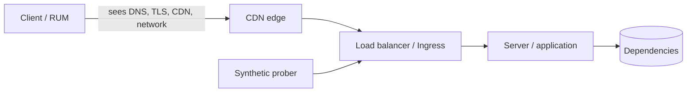
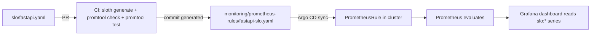

# SLIs, SLOs and Error Budgets: Core Concepts

| | |
|---|---|
| **Cluster** | 11 SRE |
| **Role** | Anchor |
| **Prerequisites** | [01-getting-started.md](01-getting-started.md); comfortable with PromQL `rate()`, `sum()`, `histogram_quantile()` |
| **Target version** | Prometheus 2.55+/3.x, Sloth 0.12+, Pyrra 0.7+ |
| **Capstone phase** | Phase 4 (Months 13-16) |

> This file explains how SLIs, SLOs and error budgets actually work: the maths, the measurement choices, and the organisational contract. Every number used elsewhere in the cluster (43.2 minutes, 1,000 per million, 14.4x) is derived here.

---

## 1. Vocabulary

| Term | Definition | Example |
|---|---|---|
| **SLI** (Service Level Indicator) | A quantitative measure of some aspect of the service, expressed as *good events / valid events* | 99.95% of requests at the ingress returned non-5xx in the last 5 minutes |
| **SLO** (Service Level Objective) | A target value or range for an SLI over a compliance window | 99.9% of requests non-5xx over a rolling 30 days |
| **SLA** (Service Level Agreement) | A contract with consequences (credits, penalties) if a target is missed; always looser than the SLO | 99.5% monthly availability or 10% credit |
| **Error budget** | 1 - SLO target, expressed over the window | 0.1% of 30 days = 43.2 minutes |
| **Burn rate** | How fast the budget is being consumed relative to the rate that would exactly exhaust it at the end of the window (1.0x) | 14.4x means the whole month's budget would be gone in 50 hours |
| **Error budget policy** | The pre-agreed actions taken as budget is consumed | At 0% remaining: feature freeze until 30-day budget is positive |
| **Compliance window** | The period over which the SLO is evaluated; rolling (last 30 days) or calendar (this month) | Rolling 30 days |
| **Valid event** | An event that counts toward the SLI; excludes events you have decided not to measure | Requests to `/healthz` are not valid; 4xx are valid but good |

---

## 2. SLIs: Good Events Over Valid Events

### 2.1 The canonical form

```text
SLI = (good events / valid events) x 100%
```

Everything should be forced into this shape because:

- It is bounded (0-100%), so targets are meaningful.
- It aggregates: you can sum good and valid across pods, regions, and time, then divide. You cannot average percentiles.
- It is the same shape for every SLI type, so dashboards and alert rules are reusable.

The *valid* denominator is a deliberate choice. Common exclusions: health checks, requests rejected by a WAF, requests from load tests (identified by header), and client errors you cannot influence (some teams exclude 4xx; most count 4xx as good because the server did its job).

### 2.2 Specification versus implementation

| | Specification | Implementation |
|---|---|---|
| Written in | Plain English, in the SLO document | PromQL (or SQL, or log query), in the rules file |
| Example | "Proportion of HTTP requests to the public API that return a non-5xx status, measured at the ingress controller" | `sum(rate(http_requests_total{service="fastapi",code!~"5.."}[5m])) / sum(rate(http_requests_total{service="fastapi"}[5m]))` |
| Changes when | The user journey changes | The instrumentation or metric names change |
| Reviewed by | Product owner + engineers | Engineers |

Keep them separate. An SLO review can conclude "the specification is right but the implementation under-counts errors because gateway timeouts return 499" without reopening the business conversation.

### 2.3 SLI types

| Type | Specification pattern | Typical implementation | Applies to |
|---|---|---|---|
| **Availability** | Proportion of valid requests served successfully | `code!~"5.."` / all | Request-driven services |
| **Latency** | Proportion of valid requests served faster than a threshold | `_bucket{le="0.3"}` / `_count` | Request-driven services |
| **Quality / correctness** | Proportion of valid requests served without degradation (no fallback, correct answer) | custom counter `responses_total{degraded="false"}` / all; for AI, `agent_answers_total{grounded="true"}` / all | Services with graceful degradation, ML/AI |
| **Freshness** | Proportion of reads that returned data updated within X | counter of reads where `now - updated_at < X` / all reads | Pipelines, caches, dashboards |
| **Throughput** | Proportion of time windows in which the system processed at least N events | `count_over_time(...)` on a rate above threshold | Batch and streaming |
| **Durability** | Proportion of stored objects still readable | audit job: readable / stored | Storage |
| **Coverage** | Proportion of expected records processed | processed / expected | Data pipelines |

Rules for picking among them:

1. Every request-driven service gets **availability and latency**. That is 80% of the value.
2. Add **quality** when the service can silently return something worse (cached stale, fallback model, truncated answer).
3. Add **freshness** when the user cares about recency more than speed (a dashboard that loads in 100 ms but shows yesterday's data is not good).
4. Never add an SLI you cannot act on.

### 2.4 Where to measure



| Measurement point | Pros | Cons | Use for |
|---|---|---|---|
| **Client (RUM, mobile SDK)** | Truest to the user; catches DNS, CDN, ISP | Noisy, sampled, delayed, includes things you cannot control, privacy constraints | Product analytics, a secondary SLO for front ends |
| **Load balancer / ingress** | Sees every request including ones the app never received (app down = 502s); independent of app bugs; one place for all services | Misses client-side and CDN failures; latency excludes network to user | **The default SLI source** (the roadmap's "non-5xx under 300 ms at the LB") |
| **Server / application** | Rich labels (route, tenant, user tier); can express quality SLIs | Cannot see requests that never arrived; a crashed app emits no errors (the SLI looks perfect while users see 502) | Latency breakdown, quality/correctness SLIs, per-tenant SLOs |
| **Synthetic probes** | Works at zero traffic; deterministic; tests whole path | Only tests what you script; low volume | Availability floor for low-traffic services; freshness checks |

The capstone measures **availability and latency at the ingress** (NGINX ingress controller or Gateway API implementation metrics, with service labels) and **quality SLIs in the application** (grounded answer rate can only be known by the application).

Why the LB is the default: when the FastAPI deployment is at zero ready replicas, the app emits no metrics at all. An app-measured SLI would compute 0/0 (NaN, treated as "no data") and never alert. The ingress emits 502/503 for every request, and the SLI correctly drops to 0%.

### 2.5 Request-based versus window-based SLIs

| | Request-based (event-based) | Window-based (time-based) |
|---|---|---|
| Unit of "good" | A request | A time window (e.g. a minute) |
| SLI | good requests / valid requests | good minutes / total minutes, where a minute is good if some condition held (e.g. error ratio < 1%) |
| Budget unit | Failed requests (1,000 per million) | Bad minutes (43.2 per month) |
| Traffic sensitivity | A 10-minute outage at 3 a.m. with 1% of daily traffic costs 1% of a day's budget share | The same outage costs 10 minutes regardless of traffic |
| Pros | Fair to users (weighted by how many were affected); aggregates cleanly | Intuitive ("minutes of downtime"); good for low-traffic services; matches SLA language |
| Cons | Low-traffic periods make the ratio volatile; a single failure in a quiet hour is 100% error | Hides partial degradation (a minute with 0.9% errors is "good") |
| Prometheus implementation | Ratio of `rate()`s | `avg_over_time((ratio < bool 0.01)[30d:1m])` |

Google recommends request-based SLIs by default. Window-based SLIs are the right tool for batch pipelines and for very low traffic services where a handful of requests would otherwise dominate the ratio.

### 2.6 SLIs for AI agents and LLM endpoints

The same good/valid form applies; the hard part is deciding what "good" means. The roadmap names two: TTFT under 800 ms and grounded answer rate.

| SLI | Specification | Good event | Valid event | Capstone metric |
|---|---|---|---|---|
| **TTFT latency** | Proportion of completions whose first token arrives in under 800 ms | `vllm:time_to_first_token_seconds_bucket{le="0.8"}` | `vllm:time_to_first_token_seconds_count` | vLLM built-in |
| **Completion availability** | Proportion of requests that finish with `stop` or `length` rather than an error | `vllm:request_success_total{finished_reason=~"stop\|length"}` | all `vllm:request_success_total` + error counter | vLLM built-in |
| **Grounded answer rate** | Proportion of agent answers whose claims are supported by retrieved context (judged by an online faithfulness check) | `agent_answers_total{grounded="true"}` | `agent_answers_total` | Application emits after RAGAS/DeepEval-style online judge |
| **Tool-call success** | Proportion of MCP tool calls that return without error | `agent_tool_calls_total{status="ok"}` | `agent_tool_calls_total` | Application |
| **Cost per task** | Proportion of tasks completing under a token-cost ceiling (or a budget SLO: monthly spend under X) | `agent_task_cost_usd_bucket{le="0.05"}` | `agent_task_cost_usd_count` | Application (cost from token counts x price) |
| **End-to-end latency** | Proportion of agent tasks completing in under N seconds | `agent_task_duration_seconds_bucket{le="30"}` | `_count` | Application |

Notes:

- TTFT is the user's perception of "is it working"; total generation time depends on output length and is a poor SLI unless normalised (tokens per second as a throughput SLI).
- Grounded rate requires a judge. Sampling (judge 10% of answers) is acceptable; the SLI then has wider confidence intervals, which argues for a longer window.
- Cost is a *budget*, not a reliability SLI, but treating "cost per task under X" as a quality SLI stops the agent from being "reliable" by brute-forcing with 50 tool calls.

---

## 3. SLOs: Choosing the Target

### 3.1 The nines table

For a 30-day window (43,200 minutes) and a 365-day year (525,600 minutes):

| Target | Error budget (fraction) | Downtime per 30 days | Downtime per year | Failed requests per million |
|---|---|---|---|---|
| 99% ("two nines") | 1% | 432 min = 7 h 12 min | 87 h 36 min = 3.65 days | 10,000 |
| 99.5% | 0.5% | 216 min = 3 h 36 min | 43 h 48 min | 5,000 |
| 99.9% ("three nines") | 0.1% | **43.2 min** | 8 h 46 min | **1,000** |
| 99.95% | 0.05% | 21.6 min | 4 h 23 min | 500 |
| 99.99% ("four nines") | 0.01% | 4.32 min | 52.6 min | 100 |
| 99.999% ("five nines") | 0.001% | 26 s | 5.26 min | 10 |

Worked arithmetic for 99.9% over 30 days:

```text
minutes in 30 days      = 30 x 24 x 60       = 43,200
error budget fraction   = 1 - 0.999          = 0.001
error budget minutes    = 43,200 x 0.001     = 43.2 minutes
error budget per million= 1,000,000 x 0.001  = 1,000 failed requests
```

If the service does 50 requests per second: 50 x 86,400 x 30 = 129,600,000 requests per month, so the budget is 129,600 failed requests. A single 10-minute full outage at 50 rps costs 30,000 requests, about 23% of the month's budget.

### 3.2 How to pick

1. **Start from current performance.** Measure 2-4 weeks. Set the first target slightly below what you achieve so the team can keep it.
2. **Ask what the user would notice.** Users on mobile networks experience roughly 99-99.5% from their ISP alone; a 99.99% backend behind that is invisible to them.
3. **Ask what each nine costs.** Each extra nine typically costs 10x: multi-AZ for 99.9%, multi-region active-active for 99.99%, and you cannot deploy during business hours at 99.999%.
4. **Set the SLO stricter than the SLA.** Internal 99.9% versus contractual 99.5% gives a buffer of 0.4% (172.8 minutes per month) in which you can detect and fix problems before owing credits.
5. **Never 100%.** A 100% target has zero error budget, which forbids every deploy and every experiment and still cannot be met because your dependencies are not 100%.

### 3.3 Latency SLO targets

Latency SLOs have two numbers: the threshold and the proportion. "99% of requests under 300 ms" is better than "p99 latency under 300 ms" because the first is a good/valid ratio that aggregates, while percentiles cannot be averaged across pods or windows. Choose thresholds at the knee of the user experience: 300 ms (feels instant), 1 s (noticeable), 3 s (abandonment starts). Often a service carries two latency SLOs: 90% under 300 ms and 99% under 1 s.

### 3.4 Windows

| Window | Pros | Cons |
|---|---|---|
| Rolling 30 days | Always current; no "budget resets at midnight" cliff | Harder to explain to finance |
| Calendar month | Matches SLA invoices | A bad day on the 29th burns budget that resets two days later |
| Rolling 28 days (Pyrra's `4w`) | Always the same number of weekends | 28 vs 30 confuses the arithmetic |
| Quarterly | Smooths out noise for low-traffic services | Too slow to drive decisions |

Use rolling 30 days unless your SLA forces calendar months.

---

## 4. Error Budgets

### 4.1 Budget remaining

```text
remaining = 1 - (error ratio over window) / (1 - target)
```

For a 99.9% SLO with 0.06% errors over 30 days: remaining = 1 - 0.0006 / 0.001 = 0.4, so 40% left.

In PromQL (what Sloth's `slo:period_error_budget_remaining:ratio` computes):

```promql
1 - (
  (
    sum(increase(http_requests_total{service="fastapi",code=~"5.."}[30d]))
    /
    sum(increase(http_requests_total{service="fastapi"}[30d]))
  )
  / (1 - 0.999)
)
```

### 4.2 Burn rate

```text
burn rate = (error ratio over a window) / (1 - target)
```

A burn rate of 1.0 means the service is failing at exactly the rate that will spend the whole budget by the end of the period. At 99.9%, an error ratio of 0.1% is burn rate 1; 1.44% is 14.4x. The time to exhaust the budget is `period / burn rate`: at 14.4x the 30-day budget lasts 30 / 14.4 = 2.08 days = 50 hours. The alerting consequences are developed in [../burn-rate-alerting/02-core-concepts.md](../burn-rate-alerting/02-core-concepts.md).

### 4.3 Error budget policy

The policy is the contract that makes the SLO matter. Agree it in writing before you need it. A workable default:

| Budget remaining (30-day) | State | Actions |
|---|---|---|
| > 50% | Healthy | Normal release cadence. Teams are encouraged to spend budget: run chaos experiments, canary faster, test risky migrations. |
| 25-50% | Watch | Releases continue; every release requires a canary with analysis. Weekly SLO review notes the trend. |
| 0-25% | Restricted | Only reliability fixes and security patches deploy. Feature work continues on branches. On-call reviews every alert for the week. |
| < 0% (breached) | Frozen | Feature freeze. The team runs a reliability sprint focused on postmortem action items until the 30-day budget is positive again. Engineering manager can grant a written exception for a critical business launch. |
| Repeated breach (2 of 3 months) | Escalation | Re-examine the SLO (too ambitious?) or the architecture (needs investment); leadership decides. |

Also specify:

- **Who is notified** at each threshold (team channel, engineering manager, product owner).
- **What counts**: are planned maintenance windows excluded? (Best practice: no. Users do not care that it was planned.)
- **Dependencies**: if the budget was burned by a dependency you do not own, the freeze still applies to you, but the postmortem action item is a dependency SLO or an architectural decoupling.
- **Override authority**: one named role, in writing, with a postmortem-style note of why.

### 4.4 Spending budget on purpose

A healthy budget that is never spent is wasted velocity. Ways to spend it deliberately: faster canary promotion steps, enabling a risky feature flag to 100%, scheduled game days (inject failure in production during business hours with the incident team watching), dependency upgrades, and chaos experiments on the stable fleet.

---

## 5. SLOs as Code

Hand-writing seven recording rules and two alert rules per SLI does not scale and drifts. Declare the SLI and objective once, generate the rest, and commit both.



| Tool | Model | Strengths | Weaknesses |
|---|---|---|---|
| **Sloth** | CLI generator (also an operator) | Simple spec, generates Workbook-standard multi-window rules, plugin SLIs, works in CI | No UI; 30d period only (configurable but single) |
| **Pyrra** | Operator + UI | Zero-PromQL UI with budget graphs; latency SLIs native; generates rules | Window 4w default; less flexible alert customisation |
| **OpenSLO** | Vendor-neutral spec | Portable between tools; CNCF sandbox | Needs a converter (`oslo`, Sloth plugin); spec only |
| **Grafana SLO** | SaaS feature (Cloud/Enterprise) | Integrated dashboards and alerting; UI | Not in OSS Grafana; lock-in |
| **Keptn / Nobl9 / Datadog SLOs** | Various | Enterprise features | Out of scope for the capstone |

The capstone uses **Sloth in CLI mode in GitHub Actions** (so generated rules are reviewed), and optionally Pyrra for the UI. Full specs are in [03-reference-and-cheatsheet.md](03-reference-and-cheatsheet.md).

---

## 6. Histograms and the Latency SLI

Prometheus classic histograms expose cumulative buckets `_bucket{le="X"}`, plus `_count` and `_sum`. Two ways to express latency:

**Percentile (for dashboards, not SLIs):**

```promql
histogram_quantile(0.99, sum by (le) (rate(http_request_duration_seconds_bucket{service="fastapi"}[5m])))
```

This estimates p99 by linear interpolation within the bucket that contains the 99th percentile. Its accuracy depends on bucket boundaries, and you cannot average it across windows.

**Ratio of buckets (the SLI):**

```promql
sum(rate(http_request_duration_seconds_bucket{service="fastapi",le="0.3"}[5m]))
/
sum(rate(http_request_duration_seconds_count{service="fastapi"}[5m]))
```

This is exact (not interpolated) as long as `0.3` is a real bucket boundary, and it is a good/valid ratio. The `le="0.3"` bucket is cumulative: it counts all requests at or under 300 ms. The SLI error form is `1 - ratio`.

Native histograms (Prometheus 2.40+ experimental, stable in 3.x) replace the `le` label with sparse exponential buckets. The ratio is then `histogram_fraction(0, 0.3, rate(http_request_duration_seconds[5m]))`, which interpolates but far more precisely. Classic histograms remain the default in most instrumentation libraries in 2026, so this wiki uses `le` buckets; the native form is noted in the cheatsheet.

---

## 7. Dependency and Composite SLOs

A service's achievable SLO is bounded by its critical dependencies. If FastAPI calls Postgres (99.95%) and vLLM (99.5%) serially on every request, the best it can do with no mitigation is approximately 0.9995 x 0.995 = 0.9945, which is below a 99.9% target. Options:

1. **Make the dependency non-critical**: cache, fallback, degrade (serve the answer without the AI summary and record a quality SLI miss instead of an availability miss).
2. **Ask the dependency for an SLO** and negotiate: the vLLM team commits to 99.9% and publishes its budget.
3. **Lower your SLO** honestly.

A **composite SLO** rolls several SLIs into one user-journey view, e.g. "checkout works" = login available AND cart available AND payment available. Compute it as the product of availabilities for serial dependencies or, more usefully, instrument the journey end-to-end and measure that directly.

**Multi-tenant SLOs**: aggregate across all tenants for the service SLO, but record per-tenant SLIs (`sum by (tenant)`) so a noisy-neighbour incident can be seen. Do not commit a per-tenant SLO unless the architecture isolates tenants; otherwise one tenant's traffic burst breaches everyone's SLO.

---

## 8. SLO Reviews and Iteration

An SLO is a hypothesis about what users need. Review it:

- **Weekly (15 min, in the team)**: budget remaining, burn events this week, any alert that fired, any action item.
- **Monthly (45 min, with the product owner)**: did we meet the SLO; did users complain when the SLI was fine (SLI is wrong); were we paged when users were fine (SLO too tight or SLI noisy); should the target move.
- **Quarterly**: ratchet targets up where consistently exceeded by a wide margin; retire SLOs nobody looked at.

Document each change in the SLO document's history table so the alert history remains interpretable.

---

## 9. Putting It Together: The Capstone SLO Set

| Service | SLI | Target | Window | Measured at | Budget / 30 d |
|---|---|---|---|---|---|
| fastapi | Availability (non-5xx) | 99.9% | 30 d rolling | Ingress | 43.2 min / 1,000 ppm |
| fastapi | Latency (< 300 ms) | 99% | 30 d rolling | Ingress | 432 min / 10,000 ppm |
| springboot | Availability (non-5xx) | 99.9% | 30 d rolling | Ingress | 43.2 min / 1,000 ppm |
| springboot | Latency (< 300 ms) | 99% | 30 d rolling | Ingress | 432 min / 10,000 ppm |
| vllm | TTFT (< 800 ms) | 95% | 30 d rolling | vLLM server | 5% = 2,160 min-equivalent / 50,000 ppm |
| vllm | Completion success | 99.5% | 30 d rolling | vLLM server | 216 min / 5,000 ppm |
| agent | Grounded answer rate | 98% | 30 d rolling | Application (sampled judge) | 20,000 ppm |
| agent | Tool-call success | 99% | 30 d rolling | Application | 10,000 ppm |

The SLA offered to internal consumers of the API is 99.5% availability, leaving a 0.4% buffer below the SLO.
