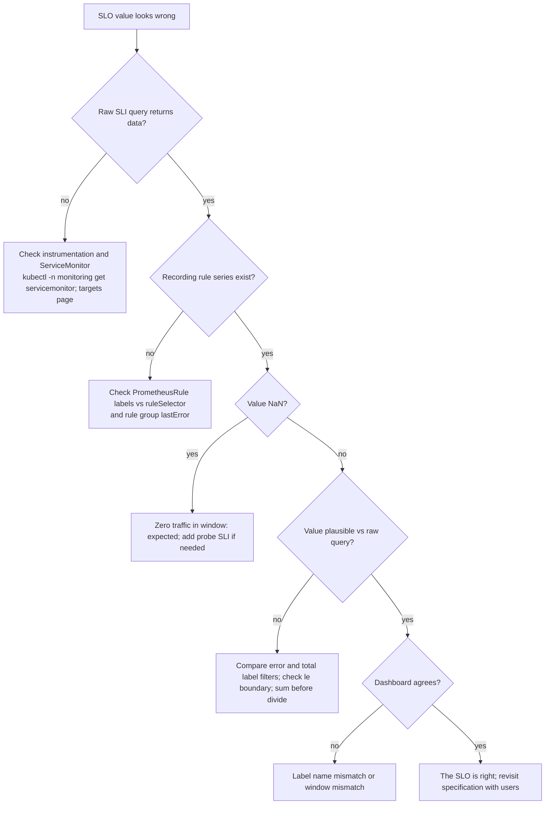

# SLIs, SLOs and Error Budgets: Troubleshooting

| | |
|---|---|
| **Cluster** | 11 SRE |
| **Role** | Anchor |
| **Prerequisites** | [02-core-concepts.md](02-core-concepts.md), [03-reference-and-cheatsheet.md](03-reference-and-cheatsheet.md) |
| **Target version** | Prometheus 2.55+/3.x, Sloth 0.12+, Pyrra 0.7+ |
| **Capstone phase** | Phase 4 (Months 13-16) |

> Two kinds of failure: the practice is failing (nobody looks at the SLO, the budget is always exhausted, users complain while the SLI is green) and the plumbing is failing (recording rules return nothing, the budget is NaN, Sloth will not generate). Both are tabulated here as symptom, cause, diagnosis, fix, followed by a debugging workflow.

---

## 1. Practice Anti-Patterns

| Symptom | Likely cause | Diagnose | Fix |
|---|---|---|---|
| Users complain, SLI is green | Wrong measurement point (app-side only; app down emits no errors) or wrong specification (SLI does not cover the failing journey) | Compare ingress 5xx rate with app-reported 5xx rate during the complaint window; check whether the failing route is in the valid set | Move the SLO of record to the ingress; add synthetic probes; add the missing journey |
| SLI is red, users are fine | SLI counts things users do not care about (health checks, bot traffic, 4xx counted as bad) or threshold too tight | Break the error ratio down `by (route, code)`; talk to support about actual tickets | Refine valid events; move 4xx to good; re-baseline the target |
| Budget always exhausted, nobody acts | Target set aspirationally; policy has no owner | Check the SLO document history; ask who has authority to freeze | Lower the target to what you will defend; name the override authority; leadership reviews breaches |
| Budget always > 95% | Target too loose, or service is over-engineered | Compare target with achieved SLI over 90 days | Raise the target or stop investing; spend budget on experiments |
| Twelve SLOs on one service | Every dashboard metric became an SLO | Count SLOs per user journey | Keep 1-3 per journey; demote the rest to dashboards |
| SLO numbers argued about during incidents | No pre-agreed policy or no shared document | Look for `docs/slo/error-budget-policy.md` | Write the policy in calm times; link it from the SLO document |
| Percentile line on the SLO dashboard "breaches" but budget is fine | Confusing p99 (a dashboard metric) with the SLI ratio | Check whether the panel is `histogram_quantile` or `bucket/count` | Label percentile panels as diagnostics; show the ratio and budget as the SLO |
| Monthly review never happens | Not on the calendar; no agenda | Ask when the last one was | Recurring invite with the agenda from [05-production-patterns.md](05-production-patterns.md#6-the-review-process-in-production) |
| Team excludes "planned maintenance" from the SLI | Belief that planned downtime is free | Check for `maintenance="true"` filters in the SLI | Remove them; the budget is the allowance |
| New service launched without an SLO | Scaffolder does not create one | Check Backstage template outputs | Add `slo/<service>.yaml` to the golden path |

---

## 2. Technical Issues

### 2.1 Recording rules

| Symptom | Likely cause | Diagnose | Fix |
|---|---|---|---|
| `slo:sli_error:ratio_rate5m` returns no data | `PrometheusRule` not selected by Prometheus (label mismatch), or rule group has an error | `kubectl -n monitoring get prometheus -o jsonpath='{.items[0].spec.ruleSelector}'`; `curl $PROM/api/v1/rules \| jq '.data.groups[] \| select(.name\|test("slo"))'`; check `lastError` | Add `release: kube-prometheus-stack` (or whatever the selector wants) to the `PrometheusRule` labels; fix the expr |
| Rule exists, value is `NaN` | 0/0: no traffic in the window | `pq 'sum(rate(http_requests_total{service="fastapi"}[5m]))'` returns 0 | Expected at zero traffic; alert rules must handle it (`> 0` comparisons treat NaN as false, so no alert fires). For a hard floor add a synthetic probe SLI |
| Error ratio > 1 | Error query matches series the total query does not (different label filters) | Compare the label sets of the two queries | Use identical filters except for the error condition |
| Error ratio negative (latency SLI) | Bucket `le="0.3"` rate exceeds `_count` rate (different scrape targets or staleness) | Query both sides separately | Ensure both come from the same ServiceMonitor; use `_bucket{le="+Inf"}` as the denominator |
| Value jumps when a pod restarts | Counter reset mishandled, or per-pod series not aggregated | Look at `sum by (pod)` | `rate()` handles resets; always `sum(rate(...))` not `rate(sum(...))` |
| Sloth-generated series have `sloth_*` labels, dashboards expect `slo` | Label name mismatch between generator and dashboard | Inspect series labels | Standardise on one; in Sloth use `--extra-labels` or relabel in dashboards; Pyrra uses `slo` |
| 30-day rule times out or Prometheus OOMs | `increase()` over 30 d on high-cardinality raw metric | Prometheus logs `query timed out`; rule group `evaluationTime` large | Aggregate first; evaluate every 5 m in its own group; or compute from the 3 d rule |
| Rule group shows `evaluation took longer than interval` | Too many expensive rules in a 30 s group | `prometheus_rule_group_last_duration_seconds` | Split groups by interval |
| `promtool check rules` fails: `field record not found in type rulefmt.Rule` | Fed the Kubernetes `PrometheusRule` wrapper to promtool | Error mentions `apiVersion` | Extract `.spec` first (`yq '.spec'`) |

### 2.2 Histogram bucket boundary does not match the SLO

**Symptom.** `http_request_duration_seconds_bucket{le="0.3"}` returns nothing; the SLO says 300 ms.

**Diagnose.**

```bash
curl --silent --get "$PROM/api/v1/series" \
  --data-urlencode 'match[]=http_request_duration_seconds_bucket{service="fastapi"}' \
  | jq -r '.data[].le' | sort -n | uniq | tr '\n' ' '
```

**Fix.** Choose one:

1. **Change the instrumentation buckets** (preferred). FastAPI with the OTel SDK: use a `View` with `ExplicitBucketHistogramAggregation([0.005, 0.01, 0.025, 0.05, 0.1, 0.25, 0.3, 0.5, 1, 2.5, 5, 10])`. Spring Boot: `management.metrics.distribution.slo.http.server.requests=300ms`. vLLM: not configurable; adopt 0.75 s.
2. **Change the SLO threshold** to the nearest existing boundary and record the decision in the SLO document.
3. **Do not** use `histogram_quantile` to fake it; the SLI becomes an interpolation whose error depends on the bucket width.

### 2.3 Sloth

| Symptom | Likely cause | Fix |
|---|---|---|
| `error: could not load SLO spec: ... unknown version` | Wrong `version:` string | Use `prometheus/v1` for plain specs, `sloth.slok.dev/v1` kind `PrometheusServiceLevel` for Kubernetes |
| `objective must be between 0 and 100` | Wrote `0.999` | Sloth uses percent: `99.9` |
| Generated `{{.window}}` not substituted | Spec query used `[5m]` literally | Use `[{{.window}}]` so Sloth can emit every window |
| Alerts missing from output | `alerting.name` empty or `--disable-alerts` | Set `alerting.name` |
| `PrometheusRule` kind not produced | Input was `prometheus/v1` plain spec | Use the `PrometheusServiceLevel` kind, or wrap the groups yourself |
| Rules render but with `sloth_id` labels you did not want | Default labels | Harmless; filter dashboards on `sloth_service`/`sloth_slo` or relabel |

### 2.4 Pyrra

| Symptom | Likely cause | Fix |
|---|---|---|
| UI shows "No SLOs" | API cannot reach Prometheus or Kubernetes backend | Check `pyrra-api` args `--prometheus-url` and `--api-url`; `kubectl -n monitoring logs deploy/pyrra-api` |
| `ServiceLevelObjective` created, no `PrometheusRule` | Operator (`pyrra-kubernetes`) not running or RBAC missing | `kubectl -n monitoring get deploy pyrra-kubernetes`; check events |
| Generated `PrometheusRule` not evaluated | Missing Prometheus selector labels on the SLO object (they are propagated) | Add `prometheus: kube-prometheus-stack`, `role: alert-rules`, `release: ...` labels to the `ServiceLevelObjective` metadata |
| `target` rejected | Written as a number | Pyrra requires a string: `target: "99.9"` |
| Latency SLO shows 0% availability | `success.metric` missing `le` or wrong bucket | Include `le="0.3"` in the success metric selector |
| Window mismatch with your policy | Pyrra `4w` = 28 d | Use `window: 30d` explicitly if you want 30 days |

### 2.5 Dashboards

| Symptom | Likely cause | Fix |
|---|---|---|
| Budget remaining panel shows > 100% | Negative error ratio or formula inverted | Verify `1 - ratio/budget`; check for negative latency SLI |
| Burn-down line is flat at 43.2 | Query uses the objective constant instead of the computed remaining | Query `slo:error_budget:remaining` or Sloth's `slo:period_error_budget_remaining:ratio` |
| Panel "No data" with variable | Variable label name (`slo`) does not match series label (`sloth_slo`) | Align label names |
| Values differ between Pyrra UI and Grafana | Different windows (28 d vs 30 d) or Pyrra uses rate-based approximation | Pick one source of truth for the budget of record |

---

## 3. Debugging Workflow



Useful commands:

```bash
# Rule health
curl --silent "$PROM/api/v1/rules" | jq -r '.data.groups[] | "\(.name) \(.lastEvaluation) \(.evaluationTime) \(.rules | map(select(.health!="ok")) | length) unhealthy"'

# Specific rule errors
curl --silent "$PROM/api/v1/rules" | jq -r '.data.groups[].rules[] | select(.health!="ok") | "\(.name): \(.lastError)"'

# Scrape target health for the service
curl --silent "$PROM/api/v1/targets" | jq -r '.data.activeTargets[] | select(.labels.service=="fastapi") | "\(.scrapeUrl) \(.health) \(.lastError)"'

# Prometheus Operator: did it accept the PrometheusRule?
kubectl --namespace monitoring logs deploy/kube-prometheus-stack-operator | grep -i -E 'prometheusrule|invalid'

# Cardinality of the SLI inputs
curl --silent --get "$PROM/api/v1/series" --data-urlencode 'match[]=http_request_duration_seconds_bucket{service="fastapi"}' | jq '.data | length'
```

---

## 4. Common Error Messages

| Message | Where | Meaning | Fix |
|---|---|---|---|
| `many-to-many matching not allowed: matching labels must be unique on one side` | Prometheus rule eval | Dividing two vectors with multiple series each | `sum()` both sides or use `on()`/`group_left` |
| `parse error: unexpected character inside braces` | promtool | Quoting issue in label matcher, often from YAML interpolation | Use block scalar `expr: \|` |
| `vector contains metrics with the same labelset after applying rule labels` | Prometheus | Two recording rules emit the same name and labels | Make `slo` label unique per rule |
| `level=warn ... msg="Error on ingesting results from rule evaluation with different value but same timestamp"` | Prometheus logs | Duplicate rule definitions (Sloth and Pyrra both generating) | Keep one generator per SLO |
| `found duplicate series for the match group` | Prometheus | `group_left` matching ambiguous | Narrow the `on()` labels |
| `the server could not find the requested resource (post servicelevelobjectives.pyrra.dev)` | kubectl | Pyrra CRD not installed | Apply Pyrra `setup.yaml` |
