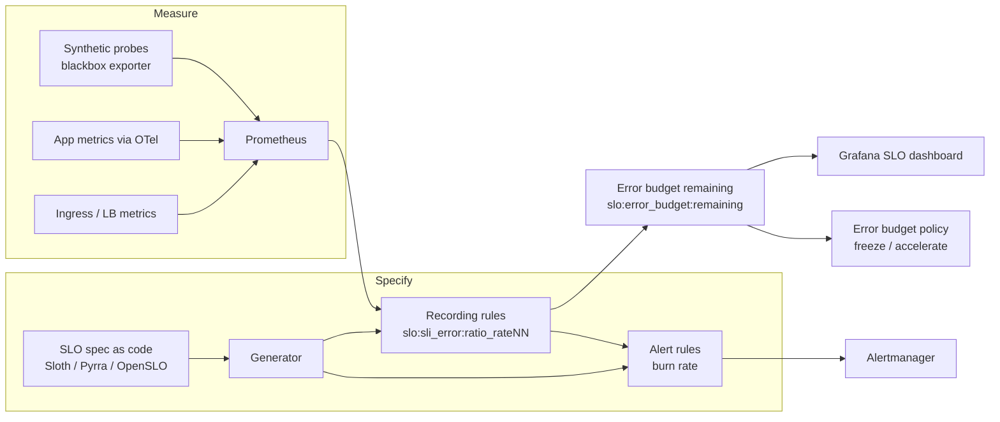

# SLIs, SLOs and Error Budgets

| | |
|---|---|
| **Cluster** | 11 SRE |
| **Role** | Anchor |
| **Category** | Reliability specification and measurement practice |
| **Prerequisites** | [Prometheus](../../09-observability/prometheus/README.md) (PromQL, histograms, recording rules), [Grafana](../../09-observability/grafana/README.md), [Kubernetes](../../04-containers-and-idp/kubernetes/README.md) basics |
| **Target version** | Prometheus 2.55+/3.x, Alertmanager 0.27+, Kubernetes 1.31+, Sloth 0.12+, Pyrra 0.7+ |
| **Capstone phase** | Phase 4 (Months 13-16) |
| **Official docs** | https://sre.google/workbook/implementing-slos/ , https://sloth.dev , https://pyrra.dev , https://openslo.com |

> An SLI is a ratio of good events to valid events measured where the user is. An SLO is a target for that ratio over a window. The error budget is 1 minus the target, and it is the only number the rest of this cluster needs. After this folder you will be able to pick the right SLIs for HTTP services and AI endpoints, write them as Prometheus recording rules from histograms, choose a defensible target, compute the budget in minutes and in failed requests, write an error budget policy, and manage all of it as code with Sloth, Pyrra, or OpenSLO.

## Why This Practice Exists

Before SLOs, a team's reliability conversation went: "Is the site up?" "Mostly." "Is that good?" "I don't know." Alerts were on CPU and disk because those were the things you could measure, and every alert was equally important because nothing was tied to the user. Releases were slowed by fear, not data.

Three insights fixed this:

1. **Measure what the user experiences, as a ratio.** Not "CPU is 90%" but "99.95% of requests in the last 5 minutes succeeded in under 300 ms". A ratio is comparable across services, aggregates cleanly, and can be targeted.
2. **The target is a business decision, not an engineering constant.** 99.9% is a choice that says "we accept 43.2 minutes of badness per month in exchange for shipping faster". Making it explicit makes the trade-off negotiable.
3. **The remainder is a budget you spend deliberately.** If you are under budget you release more aggressively; if you are over, you stop and fix. The policy is agreed in advance so the argument never happens during an outage.

## Architecture

- **Measurement sources** feed Prometheus: the load balancer or ingress controller (closest to the user without leaving your infrastructure), the application via OpenTelemetry (richest labels), and synthetic probes (catch "the site is down" even with zero traffic).
- **The spec** is a small YAML file declaring the SLI queries and the objective. A generator (Sloth CLI, Pyrra operator, or your own) turns it into Prometheus recording rules at several windows and alert rules.
- **Recording rules** pre-compute the error ratio so dashboards and alerts are cheap and consistent.
- **Error budget remaining** is derived from the 30-day error ratio and drives both the dashboard and the policy.

## The Core Mental Model

1. **SLI = good / valid.** Everything you measure must be expressible this way. Latency is not an SLI; "fraction of requests faster than 300 ms" is. Averages are never SLIs.
2. **The error budget is a currency.** 99.9% over 30 days = 0.1% of 43,200 minutes = 43.2 minutes, or 1,000 bad requests per million. Deploys, experiments, and incidents all spend from the same account. Burn rate is the spend rate relative to the sustainable 1.0x.
3. **SLO stricter than SLA.** The SLO (internal, 99.9%) is the early warning; the SLA (contractual, 99.5%) is the penalty line. You never want to learn about a breach from the customer's lawyer.
4. **Fewer, better SLOs.** One to three per user journey. If every metric is an SLO, nothing is.

## Anchor-and-Bridge Mapping

| Concept | Sloth | Pyrra | OpenSLO | Grafana SLO (Cloud/Enterprise) |
|---|---|---|---|---|
| SLI good/valid queries | `sli.events.error_query`, `total_query` | `indicator.ratio.errors.metric`, `total.metric` | `indicator.spec.ratioMetric.good`, `total` | `query.ratio.successMetric`, `totalMetric` |
| Latency SLI | ratio of `le` bucket to count (write it yourself) | `indicator.latency.success`, `total` | `ratioMetric` with bucket query | `ratio` with bucket query |
| Objective | `objective: 99.9` (percent) | `target: "99.9"` (string percent) | `target: 0.999` (fraction) | `value: 0.999` |
| Window | 30d fixed | `window: 4w` (rolling) | `timeWindow.duration`, `isRolling` | `window: 30d` |
| Generated recording rule | `slo:sli_error:ratio_rate5m{sloth_id=...}` | `<metric>:burnrate5m{slo=...}` | tool-specific | `grafana_slo_sli_error_ratio_rate5m` |
| Multi-window alerts | `alerting.page_alert`, `ticket_alert` | `ErrorBudgetBurn` critical/warning | `alertPolicies` | fastBurn / slowBurn |
| Runs as | CLI (generate rules in CI) or Kubernetes operator | Kubernetes operator + UI | Spec only (needs a converter) | SaaS feature |

## Learning Path

| Step | File | Time |
|---|---|---|
| 1 | [01-getting-started.md](01-getting-started.md) - adopting SLOs in a team and installing the tooling on kind | 2 h |
| 2 | [02-core-concepts.md](02-core-concepts.md) - SLI types, where to measure, targets, budgets, policy | 4 h |
| 3 | [03-reference-and-cheatsheet.md](03-reference-and-cheatsheet.md) - formulas, nines table, PromQL, Sloth/Pyrra/OpenSLO YAML, SLO document template | 2 h |
| 4 | [04-hands-on-labs.md](04-hands-on-labs.md) - six labs from first recording rule to composite SLO | 6 h |
| 5 | [05-production-patterns.md](05-production-patterns.md) - SLOs as code, dependency SLOs, reviews, multi-tenant, AI SLIs | 2 h |
| 6 | [06-troubleshooting.md](06-troubleshooting.md) - anti-patterns and broken recording rules | 1 h |
| 7 | [07-interview-questions.md](07-interview-questions.md) - 30 questions junior to principal | 1 h |

## Role in the Capstone

The capstone commits to a **99.9% availability SLO and a 99% latency SLO (300 ms) over a rolling 30-day window** for both the FastAPI and Spring Boot services, measured at the ingress, plus a **TTFT SLO (95% of requests under 800 ms)** and a **grounded answer rate SLO (98%)** for the vLLM-backed agent. The specs live in `capstone/slo/*.yaml`, Sloth generates `PrometheusRule` objects in CI, Argo CD applies them, and the Grafana SLO dashboard sits beside the Backstage catalog entry so that `catalog-info.yaml` can carry the SLO status annotation. The error budget policy in `docs/slo/error-budget-policy.md` is what the progressive-delivery pipeline reads to decide whether canary promotion is allowed.

## Further Reading

- SRE Book, chapter 4 "Service Level Objectives"; SRE Workbook, chapter 2 "Implementing SLOs" and chapter 3 "SLO Engineering Case Studies".
- Alex Hidalgo, *Implementing Service Level Objectives* (O'Reilly, 2020) - the deepest single text on SLI design.
- Google Cloud "The Art of SLOs" workshop materials (free).
- Sloth documentation (sloth.dev), Pyrra documentation (pyrra.dev), OpenSLO specification v1 (openslo.com).
- Prometheus documentation on histograms and `histogram_quantile`, and on native histograms (Prometheus 2.40+ experimental, 3.x).
