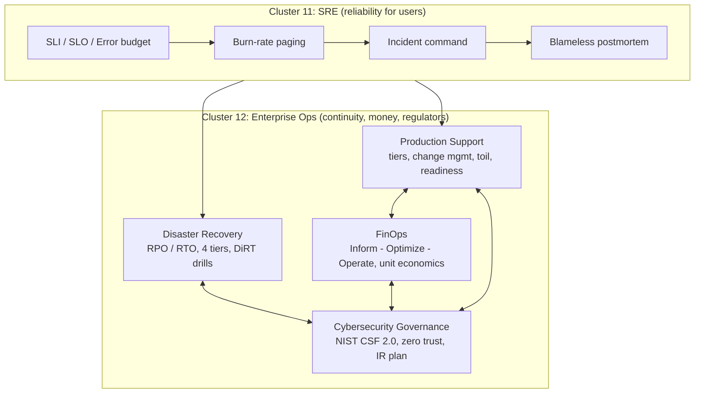

# Cluster 12: Enterprise Operations — Production Support, Disaster Recovery, FinOps & Cybersecurity Governance

| | |
|---|---|
| **Cluster** | 12 Enterprise Ops |
| **Anchors** | FinOps Framework (money), NIST Cybersecurity Framework 2.0 (risk) |
| **Bridges** | Production Support (extends 11-sre), Disaster Recovery (extends 11-sre and 01-cloud) |
| **Prerequisites** | Clusters 01 (AWS), 04 (Kubernetes, Argo CD), 05 (Terraform), 08 (DevSecOps gates), 09 (LGTM observability), 11 (SLI/SLO, on-call) |
| **Capstone phase** | Phase 5 (Months 17-20), capstone deliverable: multi-AZ failover drill validating RPO/RTO |
| **Core unifying pattern** | RPO/RTO resilience, unit economics, zero-trust defence |

> Cluster 11 taught you to engineer reliability as a product feature: SLIs, SLOs, error budgets, burn-rate paging. Cluster 12 is what the business, the finance department and the regulator add on top of that. After this cluster you will be able to run a production service as an *enterprise* service: keep it supportable 24x7 with a tiered support model, survive the loss of an availability zone or region with measured RPO/RTO, explain and reduce what it costs per request and per token, and prove to an auditor that the controls protecting it map to a recognised framework.

---

## 1. What "Enterprise Ops" Adds on Top of SRE

SRE answers the question *"is the service reliable for users?"*. Enterprise operations answers three further questions that SRE alone does not:

| Question | Who asks it | Pillar in this cluster | Primary artefact |
|---|---|---|---|
| "Who fixes it at 03:00, and how do changes get into production without breaking it?" | Business, support organisation | **Production Support** | Support tiers, runbook automation, change management, operational readiness review |
| "If a data centre, a region or a provider disappears, how much data do we lose and how long are we down?" | Board, regulators (SOC 2, ISO 27001 A.17, DORA), customers' procurement | **Disaster Recovery / Business Continuity** | RPO/RTO targets, DR tier choice, tested failover runbooks, DiRT drill evidence |
| "What does each request, tenant and AI task cost, and is the cloud bill going the right direction?" | CFO, product owners, FinOps practitioners | **FinOps** | Cost allocation tags, showback/chargeback, unit-economics dashboards, optimisation backlog |
| "Can we prove the system is defended and governed against a recognised standard?" | CISO, auditors, cyber-insurers, customers' security questionnaires | **Cybersecurity Governance** | NIST CSF 2.0 profile, control mapping, zero-trust architecture, incident response plan, risk register |

The thread that joins them is **resilience economics**: every pillar is a trade-off between the cost of a control (a warm-standby region, a 24x7 L2 rota, mTLS everywhere) and the cost of the event it prevents (hours of outage, data loss, a breach, a surprise invoice). Principal engineers are expected to make those trade-offs explicit with numbers, not adjectives.

---

## 2. The Four Pillars: Frameworks and Metrics

| Pillar | Core frameworks | Headline metrics | Concrete implementation playbook (cloud, Kubernetes, AI) |
|---|---|---|---|
| **Production Support** | Four Golden Signals (latency, traffic, errors, saturation); USE and RED methods; Progressive Delivery; Google SRE toil model | MTTA, MTTR, ticket volume by tier, toil % (< 50%), automation rate, change failure rate, deployment frequency | Automate L1/L2 triage via diagnostic runbooks and an AI incident agent with read-only MCP tools; deploy with Argo Rollouts / Flagger and Prometheus canary analysis (auto-rollback if 5xx rate > 0.5%); keep SRE toil below 50% through an automation backlog |
| **Disaster Recovery** | RPO (max tolerable data loss) and RTO (max tolerable recovery time); the four DR tiers; DiRT (Disaster Recovery Testing) drills; chaos engineering | Target vs measured RPO/RTO per tier, drill cadence, backup restore success rate, failover decision time | Backup & Restore (hours RTO/RPO; cross-region immutable S3 + Velero) -> Pilot Light (15-30 min RTO; live DB replication + scaled-down compute) -> Warm Standby (minutes RTO) -> Multi-Region Active-Active (near-zero RTO/RPO via Route 53 / Cloudflare health checks, Aurora Global Database / Spanner) |
| **FinOps** | FinOps Foundation Framework (principles; Inform -> Optimize -> Operate; personas; capabilities; crawl/walk/run maturity); FOCUS billing spec; FinOps for AI | Allocated spend %, unit cost (per request / tenant / token / task), commitment coverage and utilisation, idle %, forecast accuracy, anomaly MTTR | Enforce mandatory cost-allocation tags at `terraform plan` time via Checkov; OpenCost / Kubecost namespace showback; Karpenter Spot consolidation and Graviton / ARM64; cut AI token spend 40-70% via semantic caching, model routing (small models for classification, frontier models for reasoning) and batch inference |
| **Cybersecurity Governance** | NIST CSF 2.0 (Govern, Identify, Protect, Detect, Respond, Recover); NIST SP 800-207 Zero Trust; ISO 27001, SOC 2, CIS Controls v8; OWASP Top 10 for LLM Applications 2025; NIST AI RMF | Control coverage vs target profile, % workloads on OIDC (zero static keys), MFA / phishing-resistant auth %, vulnerability SLA compliance by severity, MTTD / MTTR for security incidents, risk register ageing | Zero-trust identity and micro-segmentation (service-mesh mTLS via Cilium / Istio, default-deny NetworkPolicy); replace all long-lived cloud keys with OIDC workload federation; KMS CMEK at rest, TLS 1.3 in transit; defend LLM endpoints against prompt injection, excessive agency and data exfiltration |

### How the pillars map onto workload types

| Concern | Cloud (AWS anchor; Azure / GCP bridge) | Kubernetes | AI workloads (Bedrock, vLLM, RAG, agents) |
|---|---|---|---|
| Support triage | CloudWatch / Azure Monitor / Cloud Monitoring golden signals at the load balancer | PromQL on OTel `http_server_request_duration_seconds`, `kubectl debug`, `stern`, `k9s` | TTFT, tokens/sec, grounded-answer rate, tool-call error rate, guardrail block rate |
| DR | Multi-AZ RDS / Aurora Global DB; S3 CRR + Object Lock; Route 53 failover; Terraform-provisioned DR region | Velero backups + CSI snapshots; GitOps re-creation via Argo CD; etcd snapshots for self-managed control planes | Versioned model weights in S3; Qdrant snapshots; LangGraph checkpoint store (Postgres) replicated; vLLM warm-up after failover |
| FinOps | CUR 2.0 + Athena; Budgets and anomaly detection; Savings Plans; VPC endpoints to kill NAT costs | OpenCost showback; requests-vs-usage efficiency; Karpenter consolidation; Spot and ARM64 NodePools | Cost per task; token budgets; prompt and semantic caching; model routing; batch APIs; provisioned-vs-on-demand break-even; GPU utilisation targets |
| Security governance | Organization CloudTrail, Security Hub, GuardDuty, Config conformance packs, SCPs, KMS | Kyverno / Gatekeeper admission, NetworkPolicy, mTLS, audit policy, Falco runtime, Cosign verification | OWASP LLM Top 10 mitigations, Bedrock Guardrails, MCP tool allow-lists, human approval for mutating tools, Promptfoo red-team evals in CI |

---

## 3. Anchor-and-Bridge Mapping

The cluster has two anchors, both *frameworks* rather than tools. Once you can run a FinOps "Inform -> Optimize -> Operate" loop and a NIST CSF "Govern -> Identify -> Protect -> Detect -> Respond -> Recover" loop, the two bridge pillars are deltas:

| Concept | FinOps (anchor) | NIST CSF 2.0 (anchor) | Production Support (bridge) | Disaster Recovery (bridge) |
|---|---|---|---|---|
| Governing body | FinOps team / Cloud Centre of Excellence | GOVERN function, risk committee | Service owner, change advisory | BC/DR steering, crisis management team |
| Inventory | Allocation (tags, accounts, namespaces) | IDENTIFY: asset management (ID.AM) | Service catalogue (Backstage) | Business Impact Analysis, application tiering |
| Target | Budget, unit-cost target | Target Profile | SLA / SLO, toil ceiling | RPO / RTO per tier |
| Measurement | Showback dashboards, KPIs | Current Profile, control metrics | MTTA / MTTR, golden signals | Measured RPO / RTO in drills |
| Continuous loop | Inform -> Optimize -> Operate | Detect -> Respond -> Recover -> Govern | Triage -> fix -> automate toil | Tabletop -> DiRT drill -> fix -> re-test |
| Evidence for auditors | CUR exports, budget reports | Control evidence, audit logs, risk register | Change records, ORR sign-off | Drill reports, restore test logs |

---

## 4. Learning Order and Time Budget

Roadmap context: Phase 5 (Months 17-20, about 180 hours) wires the seven DevSecOps gates into the pipeline and then maps the bridge topics FinOps, NIST CSF 2.0 and DR drills; it culminates in a **multi-AZ failover drill validating RPO/RTO** on the capstone. Budget roughly 45-55 hours for this cluster.

| Step | Folder | Why this order | Time |
|---|---|---|---|
| 1 | [production-support/](production-support/README.md) | Closest to what you already know from Cluster 11; introduces support tiers, change management and the operational readiness review that every later pillar feeds | 10 h |
| 2 | [disaster-recovery/](disaster-recovery/README.md) | Builds on Multi-AZ VPC/RDS from Cluster 01 and Velero/GitOps from Cluster 04; delivers the capstone failover drill | 14 h |
| 3 | [finops/](finops/README.md) (anchor) | Once DR exists you have a real cost trade-off to analyse; FinOps gives you the tags, reports and optimisation levers | 12 h |
| 4 | [cybersecurity-governance/](cybersecurity-governance/README.md) (anchor) | Last because it ties *everything* in the wiki (20 tools, cloud controls, SRE and DR evidence) into one framework profile | 14 h |

Suggested weekly rhythm (12-15 h/week): 60% hands-on labs on kind / k3d and short-lived AWS resources, 25% reading the primary sources listed in each folder, 15% writing ADRs and drill reports into the capstone `docs/` folder.

---

## 5. Folder Index

Each folder uses the standard eight-file kit adapted for practices rather than tools:

| File | Production Support | Disaster Recovery | FinOps | Cybersecurity Governance |
|---|---|---|---|---|
| `README.md` | [link](production-support/README.md) | [link](disaster-recovery/README.md) | [link](finops/README.md) | [link](cybersecurity-governance/README.md) |
| `01-getting-started.md` (adopting the practice, tooling) | [link](production-support/01-getting-started.md) | [link](disaster-recovery/01-getting-started.md) | [link](finops/01-getting-started.md) | [link](cybersecurity-governance/01-getting-started.md) |
| `02-core-concepts.md` | [link](production-support/02-core-concepts.md) | [link](disaster-recovery/02-core-concepts.md) | [link](finops/02-core-concepts.md) | [link](cybersecurity-governance/02-core-concepts.md) |
| `03-reference-and-cheatsheet.md` (frameworks, formulas, commands, checklists) | [link](production-support/03-reference-and-cheatsheet.md) | [link](disaster-recovery/03-reference-and-cheatsheet.md) | [link](finops/03-reference-and-cheatsheet.md) | [link](cybersecurity-governance/03-reference-and-cheatsheet.md) |
| `04-hands-on-labs.md` | [link](production-support/04-hands-on-labs.md) | [link](disaster-recovery/04-hands-on-labs.md) | [link](finops/04-hands-on-labs.md) | [link](cybersecurity-governance/04-hands-on-labs.md) |
| `05-production-patterns.md` | [link](production-support/05-production-patterns.md) | [link](disaster-recovery/05-production-patterns.md) | [link](finops/05-production-patterns.md) | [link](cybersecurity-governance/05-production-patterns.md) |
| `06-troubleshooting.md` (anti-patterns and failure modes) | [link](production-support/06-troubleshooting.md) | [link](disaster-recovery/06-troubleshooting.md) | [link](finops/06-troubleshooting.md) | [link](cybersecurity-governance/06-troubleshooting.md) |
| `07-interview-questions.md` | [link](production-support/07-interview-questions.md) | [link](disaster-recovery/07-interview-questions.md) | [link](finops/07-interview-questions.md) | [link](cybersecurity-governance/07-interview-questions.md) |

---

## 6. Shared Capstone Vocabulary Used Across This Cluster

All four folders refer to the same unified capstone so that labs compose:

| Item | Value used in docs |
|---|---|
| Production account / backup-and-log-archive account | `123456789012` / `210987654321` |
| Primary region / DR region | `us-east-1` / `us-west-2` |
| EKS cluster | `capstone-eks`, nodes across `us-east-1a`, `us-east-1b`, `us-east-1c`, Karpenter NodePools |
| Application namespace and services | `capstone`: `fastapi-api` (Python 3.12 / FastAPI), `spring-api` (Java 21 / Spring Boot 3.3), `incident-agent` (Strands / LangGraph agent) |
| Platform namespaces | `monitoring` (Prometheus, Alertmanager, Grafana, Loki, Tempo), `argocd`, `ai` (vLLM, Qdrant), `velero`, `opencost` |
| Database | Aurora PostgreSQL cluster `capstone-db` (Multi-AZ writer + reader) |
| Public endpoint | `https://api.example.com` |
| Metrics | OpenTelemetry semantic conventions exported to Prometheus, e.g. `http_server_request_duration_seconds_count{service_name="fastapi-api", http_response_status_code="500"}` |
| SLO | 99.9% availability over 30 days (43.2 minutes of error budget) |
| DR targets for the drill | RPO 5 minutes, RTO 30 minutes (pilot-light tier) |
| Mandatory cost tags | `owner`, `cost-center`, `environment`, `service`, `data-classification` |
| Lab cost ceiling | < $15/month, nightly `terraform destroy` cron, kind / k3d for local work |

---

## 7. Role in the Capstone

- **Production Support** produces the operational readiness review that gates `fastapi-api` and `spring-api` into production, the Alertmanager-to-Jira integration, the k6 load-test job in GitHub Actions, and the guardrails for the Phase 6 `incident-agent` acting as L1 support.
- **Disaster Recovery** produces Velero schedules, Aurora cross-region replication, Route 53 failover records in Terraform, the failover and failback runbooks, and the **Phase 5 capstone deliverable**: a multi-AZ failover drill report with measured RPO/RTO against the 5-minute / 30-minute targets.
- **FinOps** produces the Checkov tag policy in the pipeline, OpenCost showback per namespace, Karpenter Spot and ARM64 NodePools, Infracost comments on Terraform PRs, token-spend dashboards for the agent, and the nightly destroy workflow that keeps the lab under $15/month.
- **Cybersecurity Governance** produces the NIST CSF 2.0 target profile for the capstone, the control-mapping table covering all 20 DevSecOps tools, default-deny NetworkPolicies and mTLS, the Kubernetes audit policy, the incident response playbooks, and the OWASP LLM Top 10 mitigations wrapped around the `incident-agent`.

---

## 8. Further Reading

- Google SRE Book, chapters on Monitoring Distributed Systems, Eliminating Toil, and Managing Incidents: https://sre.google/sre-book/table-of-contents/
- AWS Well-Architected Framework, Reliability Pillar, "Plan for Disaster Recovery": https://docs.aws.amazon.com/wellarchitected/latest/reliability-pillar/
- AWS whitepaper "Disaster Recovery of Workloads on AWS: Recovery in the Cloud": https://docs.aws.amazon.com/whitepapers/latest/disaster-recovery-workloads-on-aws/
- FinOps Foundation, FinOps Framework: https://www.finops.org/framework/
- FOCUS (FinOps Open Cost and Usage Specification): https://focus.finops.org/
- NIST Cybersecurity Framework 2.0: https://www.nist.gov/cyberframework
- NIST SP 800-207 Zero Trust Architecture: https://csrc.nist.gov/pubs/sp/800/207/final
- OWASP Top 10 for Large Language Model Applications 2025: https://genai.owasp.org/
- Google "DiRT: Disaster Recovery Testing" (ACM Queue, "Weathering the Unexpected"): https://queue.acm.org/detail.cfm?id=2371516
