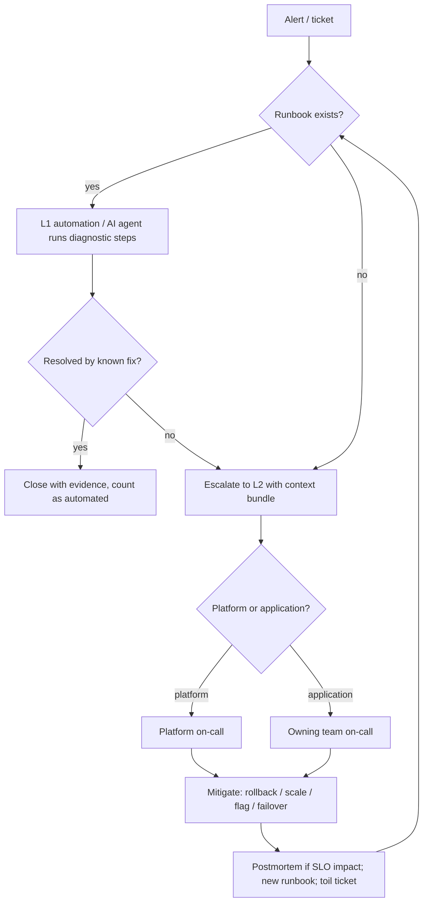

# Production Support: Core Concepts

| | |
|---|---|
| **Cluster** | 12 Enterprise Ops |
| **Role** | Bridge (extends 11-sre) |
| **Prerequisites** | [01-getting-started.md](01-getting-started.md); 11-sre SLI/SLO and on-call fundamentals |
| **Target version** | Kubernetes 1.31+, Prometheus 2.5x / 3.x, Argo Rollouts 1.7+ |
| **Capstone phase** | Phase 5 (Months 17-20) |

> This file explains *how* production support works as a system: why tiers exist and how "you build it, you run it" reshapes them, why four signals are sufficient for triage and how USE and RED complement them, how changes are governed without a committee, how toil is measured and capped, how support SLAs relate to SLOs, and what the AI incident agent may and may not do as L1. Read it once end to end; the cheat sheet in the next file assumes this vocabulary.

---

## 1. Support Tiers and "You Build It, You Run It"

### Traditional tiers

| Tier | Classic definition | Weakness |
|---|---|---|
| L1 | Help desk; scripted triage; password resets; routing | No system knowledge; escalates almost everything |
| L2 | Operations/system administrators; restarts, config fixes | Cannot read code; "throw it over the wall" back to L3 |
| L3 | Developers / vendor; code fixes | Paged last, with the least context, after hours of delay |

### The modern model

"You build it, you run it" collapses the wall between L2 and L3: the owning team is on-call for its own service. Three things then make this sustainable:

1. **Platform/SRE team as shared L2 for the platform layer.** Product teams own application alerts; the platform team owns cluster, ingress, database platform, observability and CI/CD alerts. The boundary is written down per alert.
2. **Runbook automation (and later an AI agent) as L1.** Anything an L1 human could do by following a script, a script should do. Humans join at the point that requires judgement.
3. **Toil budget.** If a team is on-call and spends more than 50% of its time on operational work, the roadmap stops until automation brings it back under.



## 2. The Four Golden Signals as Universal Triage

Google's SRE book proposes that for any user-facing system, four measurements are enough to detect and localise most problems.

| Signal | Definition | What a change in it usually means | Capstone metric |
|---|---|---|---|
| **Latency** | Time to serve a request, split by success and failure | Slow dependency, saturation, GC pauses, lock contention; a drop in latency with a rise in errors means fast failures | `histogram_quantile(0.99, ... http_server_request_duration_seconds_bucket ...)` |
| **Traffic** | Demand on the system (requests/s, tokens/s, messages/s) | Marketing event, retry storm, bot, upstream outage (traffic drops), DNS failover | `rate(http_server_request_duration_seconds_count[5m])` |
| **Errors** | Rate of failed requests (explicit 5xx, implicit wrong-answer, policy failures like latency > 300 ms) | Bad deploy, dependency failure, quota exhaustion, bad data | `... http_response_status_code=~"5.." ...` ratio |
| **Saturation** | How "full" the service is relative to its most constrained resource | Approaching capacity; the leading indicator for latency and errors | CPU/memory vs requests, connection pool usage, queue depth, GPU KV-cache utilisation |

### Why four is enough

The signals form a causal chain: *traffic* drives *saturation*, saturation drives *latency*, latency past a timeout becomes *errors*. Reading them together lets you classify any incident into one of four shapes within one dashboard view:

| Shape | Traffic | Saturation | Latency | Errors | Likely class |
|---|---|---|---|---|---|
| Overload | up | up | up | up (timeouts) | Capacity; scale out, shed load |
| Bad deploy | flat | flat or down | any | up sharply at deploy time | Change; roll back |
| Dependency failure | flat | down (less work being done) | up or fast-fail | up | Dependency; circuit-break, fail over |
| Upstream outage | down | down | flat | flat | Someone else's outage or DNS/ingress; check synthetic probes |

### PromQL for each signal on the capstone services

Traffic (per route, per service):

```promql
sum by (service_name, http_route) (
  rate(http_server_request_duration_seconds_count{namespace="capstone"}[5m])
)
```

Errors (ratio, with a floor so an idle service does not divide by zero):

```promql
sum by (service_name) (rate(http_server_request_duration_seconds_count{namespace="capstone", http_response_status_code=~"5.."}[5m]))
/
clamp_min(sum by (service_name) (rate(http_server_request_duration_seconds_count{namespace="capstone"}[5m])), 1e-9)
```

Latency (p50/p95/p99, successful requests only, so timeouts do not hide behind fast failures):

```promql
histogram_quantile(0.99,
  sum by (service_name, le) (
    rate(http_server_request_duration_seconds_bucket{namespace="capstone", http_response_status_code!~"5.."}[5m])
  )
)
```

Saturation (several resources; the one closest to 1.0 is the bottleneck):

```promql
# CPU utilisation vs request
sum by (service_name) (rate(container_cpu_usage_seconds_total{namespace="capstone", container!=""}[5m]))
/ sum by (service_name) (kube_pod_container_resource_requests{namespace="capstone", resource="cpu"})
```

```promql
# Memory working set vs limit (OOMKill predictor)
max by (pod) (container_memory_working_set_bytes{namespace="capstone", container!=""})
/ max by (pod) (kube_pod_container_resource_limits{namespace="capstone", resource="memory"})
```

```promql
# Spring Boot HikariCP pool saturation
hikaricp_connections_active{namespace="capstone"} / hikaricp_connections_max{namespace="capstone"}
```

```promql
# FastAPI/uvicorn event loop lag or async DB pool (if exported), or vLLM KV cache for the agent's model
vllm:gpu_cache_usage_perc{namespace="ai"}
```

### Golden signals for AI endpoints

The same four signals apply to `incident-agent` and vLLM with different units: latency becomes time-to-first-token and tokens/second; traffic becomes requests and tokens per second; errors include guardrail blocks, tool-call failures and ungrounded answers; saturation is GPU KV-cache utilisation and Bedrock throttling (`ThrottlingException` rate).

## 3. USE vs RED

| Method | Author | Applies to | Metrics | Question answered |
|---|---|---|---|---|
| **USE** | Brendan Gregg | Resources (CPU, memory, disk, network, GPU, connection pools) | **U**tilisation, **S**aturation, **E**rrors | "Is this *resource* the bottleneck?" |
| **RED** | Tom Wilkie | Request-driven services | **R**ate, **E**rrors, **D**uration | "Is this *service* healthy for its callers?" |
| Golden Signals | Google SRE | Both | Latency, Traffic, Errors, Saturation | RED plus resource saturation; the union of the two |

Practical rule: dashboards for a microservice are RED at the top (what callers see) and USE at the bottom (why). A triage walks top-down: RED tells you *which service*, USE tells you *which resource in that service*.

USE example for a node:

```promql
# Utilisation
1 - avg by (instance) (rate(node_cpu_seconds_total{mode="idle"}[5m]))
# Saturation (run queue length per CPU)
node_load1 / count by (instance) (node_cpu_seconds_total{mode="idle"})
# Errors
rate(node_network_receive_errs_total[5m]) + rate(node_network_transmit_errs_total[5m])
```

## 4. Diagnostic Runbook Automation

A runbook has three layers of maturity:

| Level | Form | Example |
|---|---|---|
| 1. Documented | Markdown steps a human follows | "Run `kubectl get pods -n capstone`; look for CrashLoopBackOff" |
| 2. Scripted | A script that executes the read-only steps and prints a report | `./triage.sh fastapi-api` outputs rollout status, restarts, top errors, sample trace link |
| 3. Automated / agentic | Triggered by the alert, output attached to the ticket; agent reasons over the result | Alertmanager webhook -> Job runs `triage.sh` -> posts to Jira; incident agent summarises and proposes mitigation |

A level-2 triage script for the capstone (read-only, safe for L1):

```bash
#!/usr/bin/env bash
# triage.sh <deployment> [namespace]  -- read-only diagnostic bundle
set -euo pipefail
DEPLOY="${1:?deployment name}"; NS="${2:-capstone}"
PROM="${PROM:-http://localhost:9090}"
q() { curl -sG "$PROM/api/v1/query" --data-urlencode "query=$1" | jq -r '.data.result[] | "\(.metric | tostring) => \(.value[1])"'; }

echo "== Rollout / recent change =="
kubectl rollout status deployment/"$DEPLOY" -n "$NS" --timeout=5s || true
kubectl rollout history deployment/"$DEPLOY" -n "$NS" | tail -n 3
kubectl get deployment "$DEPLOY" -n "$NS" -o jsonpath='{.spec.template.spec.containers[0].image}{"\n"}'

echo "== Pods =="
kubectl get pods -n "$NS" -l app="$DEPLOY" -o wide
kubectl get pods -n "$NS" -l app="$DEPLOY" -o json \
  | jq -r '.items[] | "\(.metadata.name) restarts=\(.status.containerStatuses[0].restartCount) lastState=\(.status.containerStatuses[0].lastState | keys[0] // "none")"'

echo "== Events (warnings, last 30m) =="
kubectl get events -n "$NS" --field-selector type=Warning --sort-by=.lastTimestamp | tail -n 15

echo "== Golden signals (5m) =="
q "sum(rate(http_server_request_duration_seconds_count{namespace=\"$NS\",service_name=\"$DEPLOY\"}[5m]))"
q "sum(rate(http_server_request_duration_seconds_count{namespace=\"$NS\",service_name=\"$DEPLOY\",http_response_status_code=~\"5..\"}[5m])) / clamp_min(sum(rate(http_server_request_duration_seconds_count{namespace=\"$NS\",service_name=\"$DEPLOY\"}[5m])),1e-9)"
q "histogram_quantile(0.99, sum by (le) (rate(http_server_request_duration_seconds_bucket{namespace=\"$NS\",service_name=\"$DEPLOY\"}[5m])))"

echo "== Top error log lines (Loki, 15m) =="
logcli query --quiet --since=15m --limit=20 "{namespace=\"$NS\", app=\"$DEPLOY\"} | json | level=\"error\" | line_format \"{{.msg}}\"" 2>/dev/null || echo "logcli not configured"
```

This script is what the Phase 6 agent wraps as an MCP tool: deterministic, read-only, and already trusted by humans.

## 5. Request Tracing for Support

A support engineer's most common question is "customer X says their request at 10:42 failed; what happened?" The answer path is **ticket -> request_id -> trace_id -> spans and logs**.

1. The ingress/API gateway sets `X-Request-ID` if absent and the application logs it with every line; the OTel SDK injects `trace_id` into the same log record.
2. Loki query by request id:

   ```logql
   {namespace="capstone"} | json | request_id="req_01J9X2M7K3" | line_format "{{.ts}} {{.app}} {{.level}} {{.msg}} trace={{.trace_id}}"
   ```

3. Tempo lookup by the trace id found in the log (Grafana "derived field" on `trace_id` makes this one click):

   ```traceql
   { trace:id = "4bf92f3577b34da6a3ce929d0e0e4736" }
   ```

4. Or search Tempo without the id, by attribute and error status:

   ```traceql
   { resource.service.name = "fastapi-api" && span.http.route = "/v1/chat" && status = error && duration > 2s }
   ```

5. Correlate back to metrics via exemplars: the latency histogram carries `trace_id` exemplars so a spike on the dashboard links to a representative trace.

Grafana Loki data source derived field (provisioned):

```yaml
jsonData:
  derivedFields:
    - name: TraceID
      matcherRegex: '"trace_id":"(\w+)"'
      url: '$${__value.raw}'
      datasourceUid: tempo
```

Return the user a precise answer ("your request hit a 2.4 s timeout to Aurora during a failover at 10:42:17 UTC") rather than "we are looking into it".

## 6. Change Management

### CAB vs lightweight peer review

| Aspect | Change Advisory Board (classic ITIL) | Lightweight peer review (DORA-aligned) |
|---|---|---|
| Approval | Weekly meeting approves each change | Pull request review by a peer + automated gates (tests, security scans, policy) |
| Lead time | Days | Minutes to hours |
| Evidence base | Intuition of board members | DORA research: external approval boards correlate with *worse* stability and slower delivery |
| Where it still fits | Cross-team, high-blast-radius changes (DNS, IAM, network, database engine upgrades) | Everything else, which is > 95% of changes |

Recommended model: **standard changes** (pre-approved, low risk, fully automated, e.g. a service deploy via the pipeline) need no human beyond the PR reviewer; **normal changes** (database migration, infrastructure change touching shared components) need a written change record with rollback plan and a second reviewer from the affected team; **emergency changes** follow the incident process and are reviewed afterwards.

### Change calendar and freeze windows

- Keep a shared calendar of planned normal changes; conflicting changes to the same component on the same day are the most common cause of confused incidents.
- Freeze windows (for example Black Friday week, financial year end, or when the error budget is exhausted) block normal changes; standard changes continue only if the error-budget policy allows. Encode the freeze as policy, not as an email:

```yaml
# Kyverno ClusterPolicy: block Rollout/Deployment updates in capstone during a freeze label
apiVersion: kyverno.io/v1
kind: ClusterPolicy
metadata:
  name: change-freeze
spec:
  validationFailureAction: Enforce
  rules:
    - name: deny-updates-during-freeze
      match:
        any:
          - resources:
              kinds: [Deployment, Rollout]
              namespaces: [capstone]
              operations: [UPDATE]
      context:
        - name: freeze
          configMap:
            name: change-freeze
            namespace: platform
      validate:
        message: "Change freeze is active ({{ freeze.data.reason }}). Use the emergency change process."
        deny:
          conditions:
            all:
              - key: "{{ freeze.data.active }}"
                operator: Equals
                value: "true"
              - key: "{{ request.object.metadata.annotations.\"change.example.com/emergency\" || '' }}"
                operator: NotEquals
                value: "approved"
```

### Change failure rate and the other DORA metrics

| Metric | Definition | How to measure in the capstone |
|---|---|---|
| Deployment frequency | Production deploys per day per service | Argo CD sync events / GitHub deployments API |
| Lead time for changes | Commit to running in production | GitHub commit timestamp to Argo CD `Synced`/`Healthy` |
| Change failure rate | % of deploys causing a rollback, hotfix or incident | Rollouts aborted by analysis + incidents linked to a deploy, divided by deploys |
| Time to restore | Incident start to mitigation | Ticket timestamps (MTTR) |

## 7. Release and Rollback Procedures

| Mechanism | Command | Rollback granularity | Notes |
|---|---|---|---|
| Deployment | `kubectl rollout undo deployment/fastapi-api -n capstone --to-revision=12` | Pod template | Fine for stateless; keeps old ReplicaSets (`revisionHistoryLimit`) |
| Argo Rollouts | `kubectl argo rollouts undo fastapi-api -n capstone` / `abort` | Pod template with canary/blue-green semantics | Automated by `AnalysisTemplate` |
| Argo CD (GitOps) | `argocd app rollback capstone-fastapi-api <HISTORY_ID>` or revert the Git commit | Whole application manifest set | Preferred: Git revert keeps the audit trail; direct rollback sets the app out of sync until Git is fixed |
| Helm | `helm rollback fastapi-api 7 -n capstone` | Whole release | Only if Helm is the deploy mechanism (not with Argo CD rendering) |
| Database | Expand/contract migrations | Schema | Never roll back a destructive migration; deploy the *contract* step only after the old code is gone |
| Feature flag | Disable the flag | Behaviour | Fastest rollback of all; seconds, no redeploy |

Expand/contract for a column rename on `capstone-db`:

1. **Expand**: add the new column, dual-write from the application (release N).
2. **Backfill**: copy data in batches.
3. **Switch reads** to the new column (release N+1); old column still written.
4. **Contract**: stop writing the old column and drop it (release N+2), only once no running version reads it.

Every step is forward-compatible with the previous release, so rolling back any single release is safe.

## 8. Progressive Delivery (Summary)

Progressive delivery is covered in depth in [11-sre/progressive-delivery](../../11-sre/progressive-delivery/README.md). From a support perspective the essential facts are:

- A canary receives a small share of traffic (for example 5% -> 25% -> 50% -> 100%) with a pause between steps.
- An `AnalysisTemplate` queries Prometheus during each step; the capstone rule aborts and rolls back when the canary's 5xx ratio exceeds **0.5%**:

```yaml
apiVersion: argoproj.io/v1alpha1
kind: AnalysisTemplate
metadata:
  name: error-rate-below-0-5-percent
  namespace: capstone
spec:
  args: [{name: service}]
  metrics:
    - name: error-ratio
      interval: 1m
      count: 5
      failureLimit: 1
      successCondition: result[0] < 0.005
      provider:
        prometheus:
          address: http://prometheus-operated.monitoring.svc:9090
          query: |
            sum(rate(http_server_request_duration_seconds_count{service_name="{{args.service}}", rollouts_pod_template_hash!="", http_response_status_code=~"5.."}[2m]))
            / clamp_min(sum(rate(http_server_request_duration_seconds_count{service_name="{{args.service}}", rollouts_pod_template_hash!=""}[2m])), 1e-9)
```

- Flagger offers the same with `Canary` objects and works with Istio, Linkerd, Gateway API and NGINX.
- For support, this means a bad release is usually reverted *before* the alert fires; your job is to confirm the auto-rollback happened (`kubectl argo rollouts get rollout fastapi-api -n capstone`) and to open the follow-up with L3.

## 9. Toil: Identification, the 50% Rule, Automation Backlog

Toil (SRE book, ch. 5) is work that is **manual, repetitive, automatable, tactical, without enduring value, and scales linearly with service growth**. Not everything unpleasant is toil: a hard postmortem is not toil; restarting a pod every Monday is.

Measure it: each on-call shift logs hours spent on toil versus engineering (a field in the shift report). The 50% rule says a team's aggregate operational load (toil plus on-call plus interrupts) must stay under 50%. Above it, the team is converging on a pure operations team and the service is accumulating operational debt.

Automation backlog scoring (ICE-style):

| Task | Frequency / month | Minutes each | Toil hours / month | Automation effort (days) | Risk reduced | Score = hours / effort |
|---|---|---|---|---|---|---|
| Restart stuck Argo CD sync | 8 | 15 | 2.0 | 0.5 | medium | 4.0 |
| Rotate Jira webhook token | 1 | 30 | 0.5 | 1 | high | 0.5 |
| Manually resize PVC for Loki | 2 | 45 | 1.5 | 2 (switch to autoscaler) | medium | 0.75 |

Sort by score; the top items go into the next sprint. Report *toil hours eliminated* as a KPI.

## 10. Support SLAs vs SLOs

| | SLA | SLO |
|---|---|---|
| Nature | Contract (often with penalties) | Internal engineering target |
| Measures | Human response and resolution times, and sometimes availability | Service behaviour from the user's perspective |
| Typical numbers | P1 response 15 min; availability 99.5% | Availability 99.9%; p99 latency 300 ms |
| Relationship | Always looser than the SLO so engineering has a buffer | Drives alerting and the error-budget policy |

A support SLA on *availability* (99.5%) with an internal SLO of 99.9% means the error budget (43.2 min/month) is consumed long before the contractual budget (216 min/month) is at risk; burn-rate alerts protect the SLA automatically. A support SLA on *response time* is met by the on-call tooling (acknowledgement within 15 min) and measured as MTTA.

## 11. Ticketing Integration Basics

- **Jira Service Management**: request types map to priorities; SLAs are configured per request type with calendars; automation rules can transition issues when an Alertmanager webhook posts a resolve. Use the REST API `POST /rest/api/2/issue` and the `jira_configs` receiver (Alertmanager 0.27+) or `jiralert`.
- **ServiceNow**: incidents (`incident` table), changes (`change_request`), and the Event Management module which ingests alerts and correlates them into incidents; Alertmanager posts to the `em_event` API or via a webhook adapter.
- Rule: every page must produce a ticket (for metrics and audit), but not every ticket is a page.

## 12. On-Call Handover and Shift Reports

The handover transfers *state*, not just the pager: open incidents with next actions, recent and planned changes, alerts that fired, toil observed, risks. The template is in [01-getting-started.md](01-getting-started.md#7-shift-handover-minimum-template). Shift reports feed three metrics: toil hours, alert counts by action taken (automation candidates), and error budget status.

## 13. Capacity Planning

Capacity planning is saturation management on a longer time horizon.

1. **Forecast demand** from traffic trends:

   ```promql
   # Projected requests/s in 30 days based on the last 14 days of weekly-smoothed traffic
   predict_linear(sum(rate(http_server_request_duration_seconds_count{service_name="spring-api"}[1h]))[14d:1h], 30*24*3600)
   ```

2. **Know the per-replica ceiling** from load tests (k6): for example `spring-api` sustains 450 req/s per replica at p99 < 300 ms with 1 vCPU.
3. **Apply headroom**: plan for peak = forecast p99 traffic x 1.5 (handles a lost AZ at 3 AZs plus burst), and never run above 70% of the known ceiling on a steady basis.
4. **Check the cluster**: `kubectl resource-capacity --util` and Karpenter limits; database connections (`max_connections`), IOPS, Bedrock quotas, GPU count.
5. **Review quarterly**, and after every incident whose shape was "overload".

Worked example: forecast 1,800 req/s peak in 90 days; headroom x 1.5 = 2,700 req/s; at 450 req/s per replica at 70% target utilisation (315 req/s effective) you need 2,700 / 315 = 8.6, so 9 replicas, spread across 3 AZs, with the HPA max set to 12. The k6 script that produces the per-replica ceiling is in [05-production-patterns.md](05-production-patterns.md#5-capacity-planning-and-load-testing-with-k6).

## 14. Operational Readiness Review (ORR)

An ORR is a structured checklist review before a service's first production launch and after major architectural changes. It covers observability, alerting, runbooks, on-call, capacity, security, DR, cost and documentation. The full checklist is in [05-production-patterns.md](05-production-patterns.md#2-production-readiness-checklist). The rule is "no ORR, no production traffic", enforced by the platform team's Argo CD project permissions.

## 15. Production Access Controls

| Control | Purpose | Implementation |
|---|---|---|
| Read-only by default | L1 and most engineers only read | ClusterRole `view` bound to the on-call group via OIDC groups claim |
| Just-in-time elevation | Write access for a bounded window | AWS IAM Identity Center permission-set with time-bound assignment; Entra PIM; Teleport access requests; `kubectl` via short-lived OIDC tokens |
| Break-glass | Emergency access when IdP is down | Sealed credentials in a vault with dual control; use triggers an alert and a mandatory postmortem |
| Audit | Prove who did what | CloudTrail, Kubernetes audit log at `RequestResponse` level for `exec`, `delete`, `patch` in production namespaces; forwarded to the log-archive account |

## 16. The AI Incident Agent as L1

The Phase 6 `incident-agent` (Strands / LangGraph with MCP servers) is an L1 engineer with the following contract:

- **Scope**: triage and diagnosis; retrieve runbooks (RAG over `docs/runbooks/` in Qdrant); run read-only MCP tools (Prometheus query, Kubernetes get/describe/logs, Loki query, Argo CD app status); produce a structured incident summary and a proposed mitigation.
- **Guardrails**: no mutating tools without a human approval step (LangGraph interrupt / Strands human-in-the-loop); tool allow-list enforced by the MCP server, not by the prompt; per-incident token budget; output validated against a schema; all tool calls traced with OpenTelemetry and stored with the ticket.
- **Evaluation**: DeepEval/Promptfoo test suites replay past incidents and assert the agent's diagnosis matches the postmortem root cause at a set accuracy; prompt-injection tests run on every change to the system prompt (see [cybersecurity-governance](../cybersecurity-governance/README.md)).
- **Metrics**: % of alerts fully triaged by the agent, diagnosis accuracy, time saved, false mitigation proposals.

## 17. Metrics for the Practice

| Metric | Formula | Target (capstone) |
|---|---|---|
| MTTA | mean(acknowledged_at - alert_at) | < 5 min for pages |
| MTTR (time to restore) | mean(mitigated_at - started_at) | P1 < 30 min |
| Ticket volume by tier and by alert | count per week | Trending down for repeat alerts |
| Toil % | toil hours / total on-call team hours | < 50%, aim < 30% |
| Automation rate | alerts resolved without human action / total alerts | > 40% within two quarters |
| Change failure rate | failed deploys / deploys | < 10% |
| Runbook coverage | alerts with runbook_url / alerts | 100% |
| ORR pass rate before first prod release | services with signed ORR / services in prod | 100% |

Continue with [03-reference-and-cheatsheet.md](03-reference-and-cheatsheet.md).
