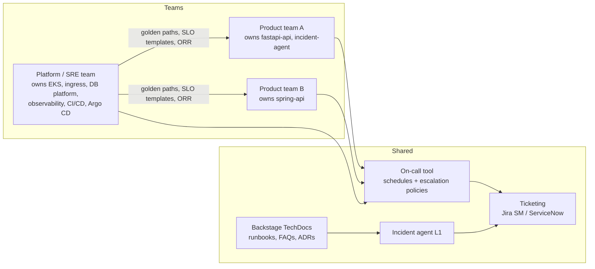
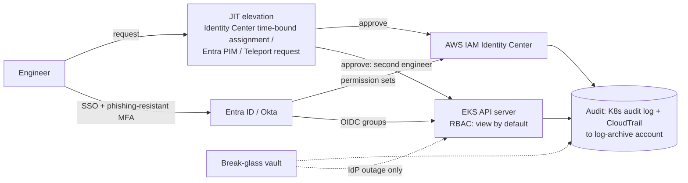

# Production Support: Production Patterns

| | |
|---|---|
| **Cluster** | 12 Enterprise Ops |
| **Role** | Bridge (extends 11-sre) |
| **Prerequisites** | [02-core-concepts.md](02-core-concepts.md), [04-hands-on-labs.md](04-hands-on-labs.md) |
| **Target version** | Kubernetes 1.31+, Argo Rollouts 1.7+, k6 0.5x+, GitHub Actions |
| **Capstone phase** | Phase 5 (Months 17-20) |

> How the practice looks when it is run for real: the operating model, the complete production readiness checklist, production access controls with break-glass and JIT, ticketing and knowledge management at scale, the k6 capacity job in CI, change management policy, the AI L1 agent's operating envelope, multi-team and multi-tenant considerations, cost of support, anti-patterns and a decision checklist.

---

## 1. Operating Model



Rules that make the model work:

| Rule | Why |
|---|---|
| Every alert has exactly one owning team, encoded as a label (`team=`) that Alertmanager routes on | Ambiguous ownership is the top cause of slow MTTA |
| Platform team is L2 for platform alerts and *advisor* for application alerts, never the default dumping ground | Prevents the platform team becoming a NOC |
| Product teams cannot ship to production without a signed ORR; the platform team cannot block an ORR for more than 5 business days | Balanced incentives |
| One ticket per incident, one incident channel, one incident commander | Single source of truth for the postmortem |
| Toil hours reported per team per month; teams above 50% get roadmap relief | Makes the 50% rule enforceable |

## 2. Production Readiness Checklist

Complete before first production traffic and re-validate after major changes. Items marked **M** are mandatory; **R** recommended.

### Ownership and documentation

- [ ] **M** Service registered in Backstage with `spec.owner`, `spec.lifecycle: production`, on-call escalation alias, Slack channel.
- [ ] **M** Architecture overview and dependency list (upstream and downstream, including SaaS and cloud services) in TechDocs.
- [ ] **M** ADRs for key decisions (database, messaging, model provider).
- [ ] **R** Service tier declared (tier 1: customer-facing revenue path; tier 2: internal critical; tier 3: best effort) and tied to SLA matrix.

### Observability

- [ ] **M** OTel instrumentation for metrics, logs, traces; `service.name` matches catalogue name.
- [ ] **M** Golden-signal dashboard provisioned as code.
- [ ] **M** Structured JSON logs with `trace_id`, `request_id`, `level`; no secrets or PII in logs (verified by a log-scrubbing test).
- [ ] **M** Request id propagated from ingress and returned in responses (`X-Request-ID`).
- [ ] **R** Exemplars enabled on latency histograms.
- [ ] **R** Synthetic probe (blackbox exporter or external) against the public endpoint from two regions.

### SLOs and alerting

- [ ] **M** SLIs and SLOs defined (availability, latency) and recorded in the catalogue.
- [ ] **M** Multi-window burn-rate alerts; page only on fast burn; ticket on slow burn.
- [ ] **M** Every alert has `runbook_url`, `severity`, `team` labels.
- [ ] **M** Alert review: fewer than 2 pages per shift on average in the last 4 weeks of staging/canary.
- [ ] **R** Error-budget policy agreed with product (what happens when budget is exhausted).

### Runbooks, support and on-call

- [ ] **M** Runbook for each alert, tested by someone other than the author.
- [ ] **M** On-call schedule with at least 4 engineers (primary/secondary), escalation to the platform team defined.
- [ ] **M** Support SLA matrix published; ticket routing configured.
- [ ] **R** Triage script (`triage.sh`) wired to the alert webhook.
- [ ] **R** FAQ for the top 10 anticipated customer questions.

### Release and change

- [ ] **M** Deploy via GitOps (Argo CD) from a protected branch; no manual `kubectl apply` in production (enforced by RBAC).
- [ ] **M** Progressive delivery (Argo Rollouts/Flagger) with automated analysis; rollback tested in staging within the last 30 days.
- [ ] **M** Database migrations follow expand/contract; migration rollback documented.
- [ ] **M** Feature flags for risky features.
- [ ] **R** Change record template adopted for normal changes; freeze-window policy in Kyverno.

### Capacity and performance

- [ ] **M** Load test defines per-replica ceiling at SLO thresholds; result stored with the ORR.
- [ ] **M** Requests and limits set from measured usage (VPA recommendations reviewed); no `BestEffort` pods.
- [ ] **M** HPA or KEDA configured; max replicas sized for forecast peak with N-1 AZ headroom.
- [ ] **M** `PodDisruptionBudget`, `topologySpreadConstraints` across zones, at least 3 replicas for tier-1.
- [ ] **R** Dependency quotas checked (Bedrock TPM/RPM, RDS connections, API rate limits).
- [ ] **R** Graceful shutdown handles SIGTERM, `terminationGracePeriodSeconds` > longest request, readiness fails before shutdown.

### Resilience and DR

- [ ] **M** Timeouts, retries with backoff and jitter, circuit breakers on every outbound call.
- [ ] **M** Backups configured and a restore tested; RPO/RTO documented ([disaster-recovery](../disaster-recovery/README.md)).
- [ ] **M** Service survives loss of one AZ (verified in a drill) and a restart of all pods.
- [ ] **R** Dependency failure modes documented with degraded behaviour (cached responses, read-only mode).

### Security

- [ ] **M** All seven DevSecOps gates green; no critical/high vulnerabilities with fixes available.
- [ ] **M** No static cloud credentials; workload identity (IRSA / Pod Identity); secrets from External Secrets Operator or Vault.
- [ ] **M** Non-root, read-only root filesystem, dropped capabilities, seccomp `RuntimeDefault`; image signed with Cosign and verified by Kyverno.
- [ ] **M** NetworkPolicy default-deny with explicit allows; TLS to all dependencies.
- [ ] **M** Production access via SSO groups; write access JIT only; audit logging on.
- [ ] **R** Threat model reviewed; for AI services, OWASP LLM Top 10 mitigations checklist completed ([cybersecurity-governance](../cybersecurity-governance/README.md)).

### Cost

- [ ] **M** Mandatory tags/labels present (`owner`, `cost-center`, `environment`, `service`, `data-classification`).
- [ ] **M** Budget alert for the service's namespace/account; showback visible in OpenCost.
- [ ] **R** Unit cost (per request, per task) baseline recorded ([finops](../finops/README.md)).

### Sign-off

- [ ] Service owner, platform/SRE reviewer, security reviewer. Date, ORR version, link to evidence.

## 3. Production Access Controls

### Layers



### Read-only by default (EKS access entries + RBAC)

```bash
# Map the on-call SSO role to the built-in view policy cluster-wide, and edit only in capstone via JIT
aws eks create-access-entry --cluster-name capstone-eks \
  --principal-arn arn:aws:iam::123456789012:role/aws-reserved/sso.amazonaws.com/AWSReservedSSO_OnCallReadOnly_<HASH>
aws eks associate-access-policy --cluster-name capstone-eks \
  --principal-arn arn:aws:iam::123456789012:role/aws-reserved/sso.amazonaws.com/AWSReservedSSO_OnCallReadOnly_<HASH> \
  --policy-arn arn:aws:eks::aws:cluster-access-policy/AmazonEKSViewPolicy --access-scope type=cluster
```

### JIT elevation

- **AWS IAM Identity Center**: a separate permission set `OnCallOperator` (EKS edit in `capstone`, RDS reboot/failover, no IAM) assigned on request with a time-bound assignment; automate the approval with a Step Functions or a small Lambda behind a Slack command, logging requester, approver, reason, ticket.
- **Entra PIM**: eligible assignment to the `AKS Cluster Admin` or custom role; activation requires MFA, justification and a ticket number; maximum 4 hours.
- **Teleport** (cloud-agnostic): `tsh request create --roles k8s-operator --reason "INC-4821"`; approvals via Slack plugin; sessions recorded.

Policy: elevation never exceeds the incident; every elevation references a ticket; the approver is not the requester; elevation events raise an informational alert in the incident channel.

### Break-glass

- One or two emergency identities (for example an IAM user with a hardware MFA token, or a cluster-admin kubeconfig) stored in a vault with dual control (two people needed to open).
- Any use triggers a page to the security on-call and a mandatory postmortem.
- Credentials rotated after each use and tested quarterly (an untested break-glass is a locked fire exit).

### Audit

Kubernetes audit policy capturing mutating and sensitive read actions (full policy in [cybersecurity-governance/03](../cybersecurity-governance/03-reference-and-cheatsheet.md)):

```yaml
apiVersion: audit.k8s.io/v1
kind: Policy
rules:
  - level: RequestResponse
    verbs: [create, update, patch, delete, deletecollection]
    namespaces: [capstone, ai, argocd]
  - level: Request
    resources: [{group: "", resources: [pods/exec, pods/attach, pods/portforward, secrets]}]
  - level: Metadata
    omitStages: [RequestReceived]
```

Query who ran `exec` in production this week (EKS control-plane logs in CloudWatch Logs Insights):

```text
fields @timestamp, user.username, objectRef.namespace, objectRef.name, requestURI
| filter objectRef.subresource = "exec"
| sort @timestamp desc | limit 50
```

## 4. Ticketing and Knowledge Management at Scale

| Concern | Pattern |
|---|---|
| Alert storms | Alertmanager `group_by` plus inhibition rules (node down inhibits pod alerts); one ticket per group |
| Ticket hygiene | Automation closes tickets on alert resolve after a cool-down; weekly report of tickets without a runbook link |
| Knowledge rot | Each runbook has `Last reviewed`; a CI check fails the docs build when older than 180 days; on-call reviews one runbook per shift |
| Discoverability | Runbooks live beside code (`docs/runbooks/`) and render in Backstage TechDocs; the incident agent indexes the same Markdown into Qdrant so humans and the agent read identical content |
| FAQs | Customer-facing FAQ generated from resolved P3/P4 tickets monthly |
| Postmortem linkage | Every P1/P2 ticket must link a postmortem before closing; action items become Jira issues with owners and due dates |

## 5. Capacity Planning and Load Testing with k6

### Full load-test script with stages, thresholds and custom metrics

```javascript
// tests/load/capstone-load.js
import http from 'k6/http';
import { check, group, sleep } from 'k6';
import { Rate, Trend, Counter } from 'k6/metrics';
import { randomItem } from 'https://jslib.k6.io/k6-utils/1.4.0/index.js';

const BASE = __ENV.BASE_URL || 'https://staging.api.example.com';
const TOKEN = __ENV.API_TOKEN || '';   // injected from CI secret; never hard-coded

const errorRate = new Rate('errors');
const chatTTFT = new Trend('chat_ttft_ms', true);
const ordersDur = new Trend('orders_ms', true);
const rateLimited = new Counter('rate_limited');

export const options = {
  scenarios: {
    orders_read: {
      executor: 'ramping-arrival-rate', startRate: 20, timeUnit: '1s',
      preAllocatedVUs: 100, maxVUs: 600,
      stages: [{ target: 300, duration: '3m' }, { target: 300, duration: '10m' }, { target: 0, duration: '1m' }],
      exec: 'orders',
    },
    chat: {
      executor: 'constant-arrival-rate', rate: 5, timeUnit: '1s', duration: '14m',
      preAllocatedVUs: 50, maxVUs: 200, exec: 'chat',
    },
  },
  thresholds: {
    'http_req_duration{scenario:orders_read}': ['p(99)<300'],
    'chat_ttft_ms': ['p(95)<800'],
    'errors': ['rate<0.005'],
    'http_req_failed': ['rate<0.01'],
  },
  summaryTrendStats: ['avg', 'p(95)', 'p(99)', 'max'],
};

const headers = { 'Content-Type': 'application/json', Authorization: `Bearer ${TOKEN}` };

export function orders() {
  group('orders', () => {
    const res = http.get(`${BASE}/api/orders?limit=20&cursor=${randomItem(['', 'abc', 'def'])}`, { headers, tags: { route: 'orders' } });
    ordersDur.add(res.timings.duration);
    if (res.status === 429) rateLimited.add(1);
    errorRate.add(!check(res, { 'orders 200': (r) => r.status === 200 }));
  });
}

export function chat() {
  group('chat', () => {
    const res = http.post(`${BASE}/v1/chat`, JSON.stringify({ q: 'Summarise the HighErrorRate runbook' }), { headers, tags: { route: 'chat' }, timeout: '30s' });
    chatTTFT.add(res.timings.waiting);   // time to first byte approximates TTFT for streaming endpoints
    errorRate.add(!check(res, { 'chat 200': (r) => r.status === 200 }));
  });
  sleep(1);
}

export function handleSummary(data) {
  return { 'summary.json': JSON.stringify(data, null, 2), stdout: JSON.stringify({
    orders_p99: data.metrics['http_req_duration{scenario:orders_read}']?.values['p(99)'],
    chat_ttft_p95: data.metrics.chat_ttft_ms?.values['p(95)'],
    error_rate: data.metrics.errors?.values.rate }) };
}
```

### GitHub Actions job (PR smoke against review env; nightly load against staging)

```yaml
# .github/workflows/load-test.yml
name: load-test
on:
  pull_request:
    paths: ['services/**', 'tests/load/**']
  schedule:
    - cron: '0 2 * * *'   # nightly 02:00 UTC
permissions:
  contents: read
  id-token: write
  pull-requests: write
jobs:
  k6:
    runs-on: ubuntu-latest
    steps:
      - uses: actions/checkout@v4
      - uses: grafana/setup-k6-action@v1
      - name: Resolve target
        id: target
        run: |
          if [ "${{ github.event_name }}" = "pull_request" ]; then
            echo "url=https://pr-${{ github.event.number }}.review.example.com" >> "$GITHUB_OUTPUT"; echo "mode=smoke" >> "$GITHUB_OUTPUT"
          else
            echo "url=https://staging.api.example.com" >> "$GITHUB_OUTPUT"; echo "mode=load" >> "$GITHUB_OUTPUT"
          fi
      - name: Run k6
        env:
          BASE_URL: ${{ steps.target.outputs.url }}
          API_TOKEN: ${{ secrets.LOADTEST_API_TOKEN }}
          K6_PROMETHEUS_RW_SERVER_URL: ${{ vars.PROM_RW_URL }}
        run: |
          if [ "${{ steps.target.outputs.mode }}" = "smoke" ]; then
            k6 run --vus 5 --duration 1m tests/load/capstone-load.js --summary-export summary.json
          else
            k6 run --out experimental-prometheus-rw tests/load/capstone-load.js --summary-export summary.json
          fi
      - uses: actions/upload-artifact@v4
        if: always()
        with: {name: k6-summary, path: summary.json}
      - name: Comment on PR
        if: github.event_name == 'pull_request'
        uses: actions/github-script@v7
        with:
          script: |
            const s = require('./summary.json');
            const p99 = s.metrics['http_req_duration{scenario:orders_read}']?.values['p(99)'];
            const err = s.metrics.errors?.values.rate;
            const ok = Object.values(s.root_group?.checks || {}).length >= 0;
            github.rest.issues.createComment({ ...context.repo, issue_number: context.issue.number,
              body: `### k6 smoke\n| metric | value |\n|---|---|\n| orders p99 | ${p99?.toFixed(1)} ms |\n| error rate | ${(err*100).toFixed(2)}% |\n| thresholds | ${ok ? 'passed' : 'failed'} |` });
```

Thresholds failing make `k6` exit non-zero, which fails the job. Keep the nightly job's token short-lived (OIDC-exchanged where the API supports it).

### Capacity review cadence

| When | What |
|---|---|
| Weekly (on-call) | `predict_linear` forecast vs HPA max; Karpenter NodePool limits; disk and DB storage growth |
| Monthly | Re-run load test on current release; compare ceiling to baseline (a 20% regression is a bug) |
| Quarterly | Business forecast (product launches, seasonality) into capacity plan; reserved capacity decisions with FinOps |
| After incidents of shape "overload" | Re-derive headroom; add load shedding if missing |

## 6. Change Management Policy in Practice

- **Standard changes**: pipeline deploys of services with progressive delivery. No ticket; the PR, pipeline run and Argo CD history are the record.
- **Normal changes**: anything touching shared infrastructure, data schema (contract step), IAM, networking, DNS, or a dependency's major version. Change record (template in 03) reviewed by a second team; scheduled on the change calendar; never during a freeze.
- **Emergency changes**: executed under incident command, documented in the incident ticket, reviewed within 2 business days.
- **Freeze windows**: declared in a `ConfigMap` read by the Kyverno policy and shown on the status page; standard changes continue only if the service's error budget is above 25%.
- **Change failure rate target**: < 10%; tracked per team; teams above 15% for two months pause feature work for a reliability sprint.

## 7. The AI Incident Agent in Production

| Dimension | Envelope |
|---|---|
| Trigger | Alertmanager webhook (page or ticket) or `/triage INC-1234` Slack command |
| Inputs | Alert labels/annotations; runbooks via RAG (Qdrant); read-only MCP tools |
| Outputs | Structured JSON (summary, evidence, hypothesis, proposed mitigation, confidence) posted to the ticket and channel |
| Actions | None without approval. Approved mitigations are executed by the *existing* automation (e.g. Argo Rollouts abort) via a separate, audited tool with a human-approved token |
| Identity | Own ServiceAccount and IAM role; `view` RBAC; Bedrock access scoped to the model and guardrail ARNs; no internet egress |
| Guardrails | Bedrock Guardrails for PII and topic denial; input/output schema validation; log/tool output treated as untrusted data; token and time budgets per incident |
| Evals | Replay of historical incidents (accuracy of hypothesis vs postmortem root cause); Promptfoo red-team on every prompt change; regression gate in CI |
| Observability | Every LLM and tool call traced via OTel; cost per incident tracked ([finops](../finops/README.md)) |
| Kill switch | Feature flag disables the webhook route; humans resume full L1 |

## 8. Multi-Team and Multi-Tenant Considerations

- Namespaces per team with `ResourceQuota` and `LimitRange` so one team's overload cannot starve another; alerts carry the `team` label from the namespace.
- Tenant-aware golden signals: add a bounded `tenant_tier` label (not tenant id, which is high-cardinality) to measure per-tier SLOs; use exemplars and logs for per-tenant investigation.
- Support SLA per tenant tier (enterprise vs self-serve) maps to priority matrix impact rows.
- Shared platform incidents: the platform team runs incident command; product teams join as subject-matter experts.

## 9. Cost of Support

Support is a cost line that FinOps should see: on-call compensation, toil hours x loaded hourly rate, tooling (on-call, ticketing, observability retention), and the opportunity cost of change freezes. A toil reduction of 10 hours/month per team at a loaded rate of $120/hour is $14,400/year per team, which usually justifies the automation work in one quarter. Report *toil hours eliminated* and *incidents prevented by auto-rollback* next to cloud savings.

## 10. Anti-Patterns

| Anti-pattern | Consequence | Better |
|---|---|---|
| NOC-style L1 with no system knowledge and no automation | Everything escalates; MTTR dominated by handovers | Runbook automation and AI L1 with escalation context |
| Paging on CPU, disk and every 5xx | Alert fatigue; real pages ignored | Page on SLO burn rate only |
| Weekly CAB for all changes | Slow lead time, batched risky releases | Standard changes via pipeline; CAB only for high-blast-radius normal changes |
| Rollback via `kubectl edit` in production | Drift from Git; no audit | Git revert / Argo Rollouts undo |
| Shared admin kubeconfig | No attribution; credential leak risk | SSO groups, JIT, audit |
| Runbooks in a wiki nobody updates | Runbook rot; wrong steps during incidents | Runbooks beside code, reviewed on a schedule, tested |
| Capacity by intuition | Overload incidents or 3x over-provisioning | Measured ceilings, forecasts, headroom rules |
| AI agent with `kubectl apply` rights | One prompt injection from a cluster-wide outage | Read-only tools; approvals for mutations |

## 11. Decision Checklist

- Who owns each alert, and is that encoded in routing?
- What is the SLA matrix, and is the SLO stricter than the SLA?
- Which changes are standard vs normal vs emergency, and where is that written?
- What is the measured per-replica ceiling and the N-1 headroom?
- How does someone get write access to production at 03:00, and how is it audited?
- Which runbooks are automated, and what is the toil % this month?
- What can the AI agent do without a human, and how is that enforced technically?

Continue with [06-troubleshooting.md](06-troubleshooting.md).
