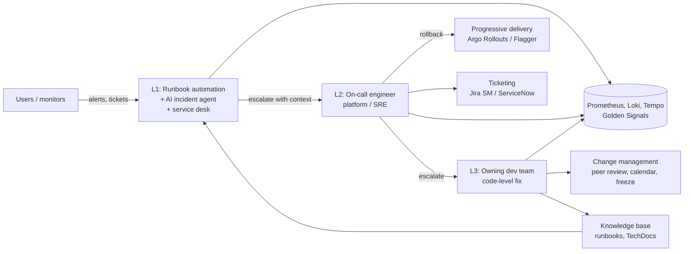

# Production Support

| | |
|---|---|
| **Cluster** | 12 Enterprise Ops |
| **Role** | Bridge (extends 11-sre) |
| **Category** | Operational practice: tiered support, triage, change management, readiness |
| **Prerequisites** | 11-sre (SLI/SLO, burn-rate alerting, on-call, postmortems), 09-observability (Prometheus, Loki, Tempo), 04-containers-and-idp (Kubernetes, Argo CD, Backstage) |
| **Target version** | Kubernetes 1.31+, Prometheus 2.5x / 3.x, Grafana 11+, Argo Rollouts 1.7+, k6 0.5x+ |
| **Capstone phase** | Phase 5 (Months 17-20) |
| **Official docs** | https://sre.google/sre-book/monitoring-distributed-systems/ , https://argo-rollouts.readthedocs.io/ , https://grafana.com/docs/k6/latest/ |

> Production support is the discipline of keeping a live service *supportable*: anyone on the rota can triage an unknown problem in minutes using the Four Golden Signals, find a single user's failed request across logs and traces, roll a bad release back safely, and hand the shift over without losing context. After this folder you will be able to design a tiered support model for the capstone services, automate the diagnostic steps of L1/L2 triage, run change management that is both safe and fast, pass an operational readiness review, and give the Phase 6 AI incident agent a bounded, auditable L1 role.

## Why This Practice Exists

Before SRE, support was a separate organisation: an L1 help desk followed scripts, an L2 operations team restarted things, and L3 developers were paged only when everything else failed. Each handover lost context, mean time to resolution (MTTR) was measured in hours, and developers had no incentive to make software operable because they never felt the pain.

Two insights changed this. First, **"you build it, you run it"** (Werner Vogels, 2006): the team that ships a service carries the pager for it, which makes operability a design requirement. Second, Google's SRE model showed that a small, engineering-focused operations function can scale if it caps **toil** at 50% of its time and spends the rest automating itself out of repetitive work. Production support as taught here combines both: product teams own L3 and share L2, a platform/SRE team owns tooling and the escalation path, and an increasing share of L1 is executed by runbook automation and, in Phase 6 of the roadmap, an AI incident agent.

## Architecture

- **L1** receives every signal (Alertmanager, synthetic checks, user tickets), runs the matching diagnostic runbook, and either resolves known problems or escalates with a pre-filled context bundle.
- **L2** is the on-call engineer with production access; they own mitigation (rollback, scale, failover) and the incident command role.
- **L3** is the owning team; they fix root causes, own change management for their service, and keep the runbooks current.
- **Observability** is shared by every tier; the Four Golden Signals are the common language.
- **Change management and progressive delivery** reduce the number of incidents that reach L2 in the first place.

## The Core Mental Model

1. **Four signals explain almost every outage.** Latency, traffic, errors and saturation, measured per service, are enough to localise a fault to "which service, which dependency, demand or capacity" within minutes. Everything else (logs, traces, dashboards) is drill-down.
2. **Every incident is either a change or a capacity problem until proven otherwise.** Roughly 70% of incidents correlate with a recent change (deploy, config, infrastructure, dependency). Your first triage question is always "what changed?" and your first mitigation is usually "undo it".
3. **Toil is a budget, not a job.** Any support action that is manual, repetitive, automatable and scales with service growth is toil. Measure it, cap it at 50%, and convert the remainder into an automation backlog. The AI incident agent is simply the newest automation lever.

## Anchor-and-Bridge Mapping

| Concept in Production Support | Equivalent in 11-sre | Equivalent in ITIL 4 | Equivalent in DORA metrics |
|---|---|---|---|
| Support SLA (response/resolution by priority) | SLO (user-facing reliability target) | Service level agreement, service desk | — |
| L1 / L2 / L3 tiers | On-call primary / secondary / escalation | Tiered service desk, functional escalation | — |
| Golden-signal triage | SLI measurement | Event management | — |
| Change management (peer review, freeze) | Error-budget policy (freeze when budget exhausted) | Change enablement (standard / normal / emergency) | Change failure rate, lead time |
| Release and rollback | Progressive delivery, canary analysis | Release management, deployment management | Deployment frequency, time to restore |
| Toil % and automation backlog | Toil (SRE book ch. 5) | Continual improvement | — |
| Operational readiness review | Production readiness review (PRR) | Service validation and testing | — |
| Shift report / handover | On-call handover | Shift handover | — |

## Learning Path

| Step | File | Time |
|---|---|---|
| 1 | [01-getting-started.md](01-getting-started.md) — adopting the practice, tooling setup (krew, k9s, stern, k6, Alertmanager webhooks) | 1.5 h |
| 2 | [02-core-concepts.md](02-core-concepts.md) — tiers, golden signals, USE/RED, change management, toil, SLAs vs SLOs | 2.5 h |
| 3 | [03-reference-and-cheatsheet.md](03-reference-and-cheatsheet.md) — PromQL/LogQL/TraceQL, kubectl triage, checklists, templates | 1.5 h |
| 4 | [04-hands-on-labs.md](04-hands-on-labs.md) — six labs from golden-signal dashboards to an AI L1 agent guardrail test | 4 h |
| 5 | [05-production-patterns.md](05-production-patterns.md) — production readiness checklist, access controls, ticketing, capacity planning | 1.5 h |
| 6 | [06-troubleshooting.md](06-troubleshooting.md) — anti-patterns and failure modes of the practice | 1 h |
| 7 | [07-interview-questions.md](07-interview-questions.md) | 1 h |

## Role in the Capstone

In the unified capstone repository (`example-org/capstone-platform`), production support contributes:

- `docs/runbooks/` — one runbook per alert for `fastapi-api` and `spring-api`, rendered in Backstage TechDocs and indexed into Qdrant for the Phase 6 incident agent's RAG.
- `platform/alerting/alertmanager.yaml` — routes that page L2 on burn-rate alerts and open Jira Service Management tickets for low-urgency alerts via webhook.
- `platform/rollouts/` — Argo Rollouts `Rollout` and `AnalysisTemplate` objects that auto-rollback when the canary's 5xx ratio exceeds 0.5% (detailed in [11-sre/progressive-delivery](../../11-sre/progressive-delivery/README.md)).
- `.github/workflows/load-test.yml` — a k6 job that runs against the review environment on every PR and nightly against staging, publishing capacity headroom.
- `docs/orr/` — the operational readiness review checklist completed before each service's first production release.
- `services/incident-agent/` — the Strands / LangGraph agent with read-only MCP tools (Prometheus, Kubernetes, Loki) acting as L1; mutating actions require human approval.

The practice also produces the metrics that the FinOps and governance pillars consume: toil hours (a cost), change failure rate (a risk), and access audit logs (evidence).

## Further Reading

- Google SRE Book: "Monitoring Distributed Systems", "Eliminating Toil", "Being On-Call", "Managing Incidents" — https://sre.google/sre-book/table-of-contents/
- Google SRE Workbook: "On-Call", "Eliminating Toil", "Configuration Design" — https://sre.google/workbook/table-of-contents/
- Brendan Gregg, "The USE Method" — https://www.brendangregg.com/usemethod.html
- Tom Wilkie, "The RED Method" (GrafanaCon 2018) — https://grafana.com/blog/2018/08/02/the-red-method-how-to-instrument-your-services/
- Accelerate (Forsgren, Humble, Kim) and the DORA State of DevOps reports — https://dora.dev/
- Argo Rollouts documentation — https://argo-rollouts.readthedocs.io/
- Grafana k6 documentation — https://grafana.com/docs/k6/latest/
- Kubernetes "Debugging Running Pods" (ephemeral containers) — https://kubernetes.io/docs/tasks/debug/debug-application/debug-running-pod/
