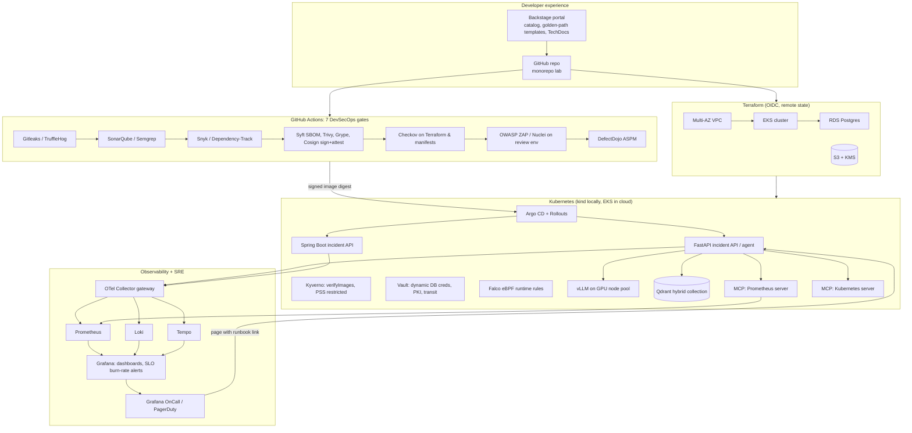

# The Unified Production Capstone

| | |
|---|---|
| **Purpose** | One living, production-grade repository that every phase of the roadmap extends |
| **Golden rule** | Rule 2: "Build one living platform repository" (see [../roadmap/README.md](../roadmap/README.md)) |
| **Local footprint** | kind or k3d cluster, Docker Compose observability stack, CPU-only model serving |
| **Cloud footprint** | Ephemeral EKS + RDS + S3 under $15/month with nightly teardown |

> Instead of forty disconnected hello-world repos, you maintain a single monorepo where Terraform provisions the cluster, GitHub Actions runs the seven DevSecOps gates, Backstage catalogs the FastAPI and Spring Boot services, the OpenTelemetry/Prometheus/Grafana stack monitors SLOs, and a LangGraph/Strands AI agent troubleshoots incidents through MCP servers. This folder describes that repository: its architecture, layout, per-phase definition of done, and the ADRs that justify each choice.

## Documents in this folder

| File | Contents |
|---|---|
| [architecture.md](architecture.md) | End-state architecture with diagrams for every layer, data flows and trust boundaries |
| [repository-layout.md](repository-layout.md) | The exact directory tree of the capstone monorepo and what lives where |
| [phase-checklists.md](phase-checklists.md) | Definition of done for each of the six phases, as checkboxes |
| [adrs/](adrs/) | Architecture Decision Records, starting with the four the roadmap names |

## The Two Reference Services

Both services implement the same contract so that every platform concern (containers, CI, GitOps, observability, security gates, SLOs) can be exercised against two runtimes.

| Concern | FastAPI (Python 3.12+) | Spring Boot 3.3+ (Java 21) |
|---|---|---|
| Domain | Incident API: CRUD over incidents, `/agent/triage` SSE endpoint | Same endpoints, same OpenAPI shape |
| Liveness / readiness | `GET /healthz`, `GET /readyz` | `/actuator/health/liveness`, `/actuator/health/readiness` |
| Metrics | `GET /metrics` via `prometheus-fastapi-instrumentator` | `/actuator/prometheus` via Micrometer |
| Tracing | OTel Python SDK auto-instrumentation | OTel Java agent / Micrometer Tracing |
| Database | Postgres via SQLAlchemy 2.0 async + asyncpg | Postgres via Spring Data JPA + HikariCP |
| Secrets | Vault Agent sidecar dynamic DB credentials | Spring Cloud Vault dynamic DB credentials |
| Image | Multi-stage, `uv`, distroless, non-root | Multi-stage, layered jar or jlink, non-root, `-XX:MaxRAMPercentage=75.0 -XX:+UseZGC` |
| SLO | 99.9% of requests non-5xx and under 300 ms over 30 days | Same |

In Phase 6 the FastAPI service grows into the **Incident & Platform AI Agent**, adding hybrid RAG over the runbooks in [../11-sre/postmortems-and-runbooks/](../11-sre/postmortems-and-runbooks/), MCP tool servers for Prometheus and Kubernetes, and CI-gated evals.

## End-State Architecture at a Glance

## Lab Cost Controls

| Control | Implementation |
|---|---|
| Local first | kind/k3d for Kubernetes, Docker Compose for Postgres, Vault dev server, LGTM stack, Qdrant, small CPU models |
| Ephemeral cloud | `terraform apply` only when a lab needs EKS/RDS/Bedrock/GPU; destroy the same day |
| Nightly guard rail | Scheduled GitHub Actions workflow runs `terraform destroy -auto-approve` on lab workspaces at 02:00 |
| Budgets | AWS Budget at $15 with email + SNS action; Cost Anomaly Detection enabled |
| Tag enforcement | Checkov custom policy fails `terraform plan` without `owner`, `cost-center`, `environment`, `ttl` tags |
| GPU | Spot `g5.xlarge` via Karpenter NodePool with `ttl` label; vLLM on CPU with a 0.5B model for daily work |

## How to Use This Folder

1. Read [architecture.md](architecture.md) once to see where you are going.
2. Keep [phase-checklists.md](phase-checklists.md) open; tick items as the capstone grows.
3. Write an ADR in [adrs/](adrs/) every time you choose between sibling tools. The four seed ADRs show the expected depth.
4. Mirror [repository-layout.md](repository-layout.md) when you create the actual capstone repo (this wiki is documentation; the capstone is code).
