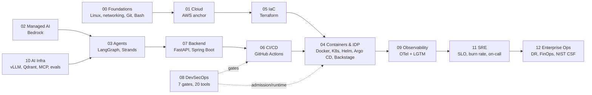
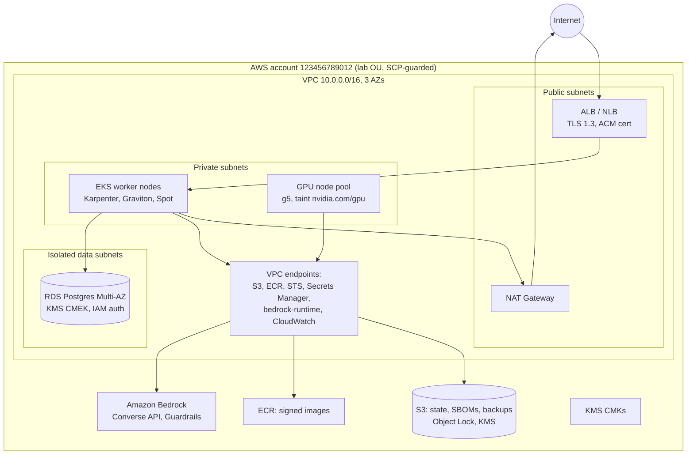
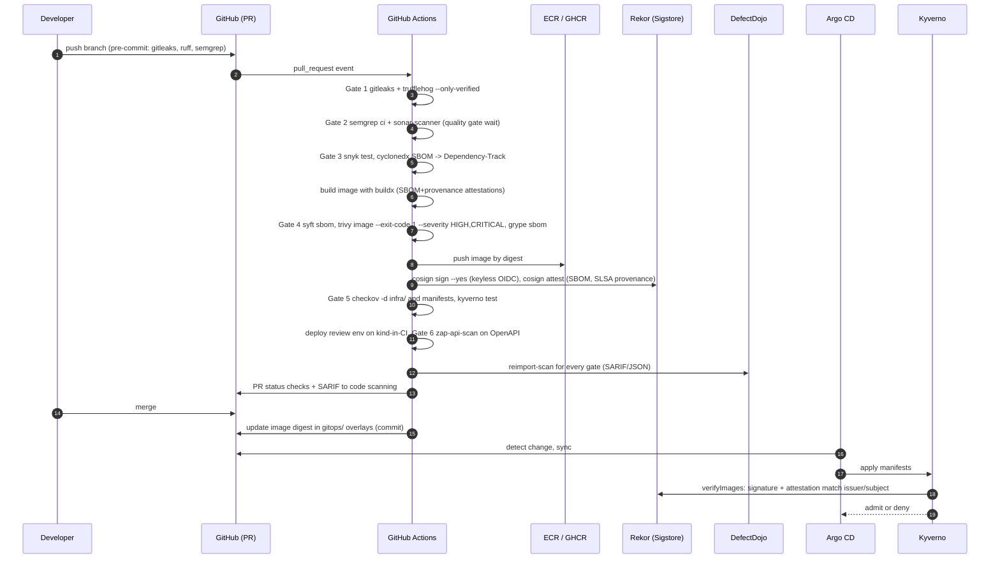
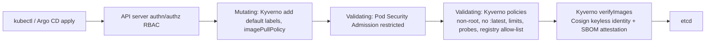
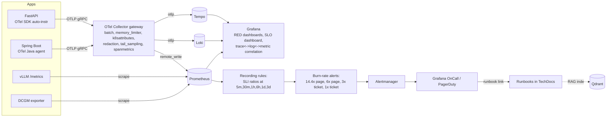
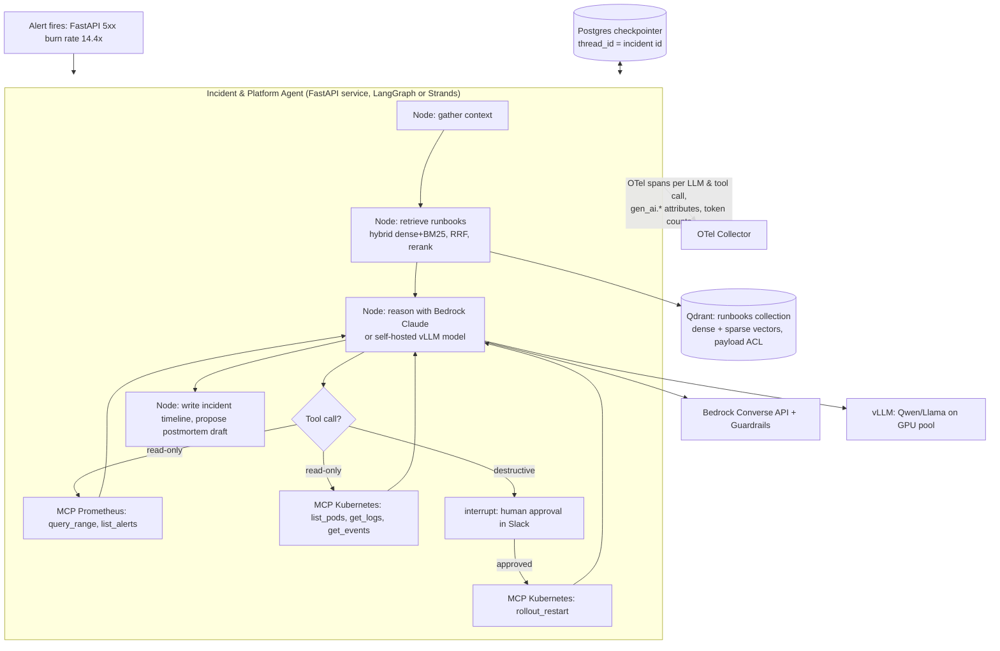

# Capstone Architecture

> The end state after Phase 6, described layer by layer with the data flows, trust boundaries and the specific tools from each cluster. Each section links to the wiki folder that teaches the tool.

---

## 1. Layered View

---

## 2. Network and Trust Boundaries (Cloud)

Rules enforced by Terraform and Checkov:

- No `0.0.0.0/0` ingress except on the ALB security group ports 443.
- Every S3 bucket: Block Public Access on, default SSE-KMS, versioning, lifecycle to Glacier after 30 days.
- RDS: `publicly_accessible = false`, `storage_encrypted = true`, deletion protection in `prod` workspace only.
- Every resource tagged `owner`, `cost-center`, `environment`, `ttl`.
- All CI access via GitHub Actions OIDC; no IAM user access keys exist in the account.

See [../01-cloud/aws/](../01-cloud/aws/), [../05-infrastructure-as-code/terraform/](../05-infrastructure-as-code/terraform/), [../08-devsecops/gate-5-policy-as-code/checkov/](../08-devsecops/gate-5-policy-as-code/checkov/).

---

## 3. Build and Supply Chain

See [../06-cicd/github-actions/](../06-cicd/github-actions/) and the whole of [../08-devsecops/](../08-devsecops/).

---

## 4. Runtime Platform (Kubernetes)

| Namespace | Workloads | Policies |
|---|---|---|
| `platform-system` | Argo CD, Argo Rollouts, Kyverno, External Secrets Operator, cert-manager | PSS `restricted` (except Kyverno webhooks as documented) |
| `observability` | OTel Collector (gateway), Prometheus Operator stack, Loki, Tempo, Grafana, Alertmanager | NetworkPolicy allows only OTLP 4317/4318 ingress from app namespaces |
| `security` | Falco + falcosidekick, Trivy Operator, Vault (Raft HA) | Falco needs privileged DaemonSet; documented exception |
| `incident-api` | FastAPI incident API/agent (Rollout, canary), Spring Boot incident API (Rollout), Vault Agent sidecars | PSS `restricted`, default-deny NetworkPolicy, verifyImages, requests/limits required |
| `ai-infra` | vLLM (GPU), Qdrant StatefulSet, MCP servers (Prometheus, Kubernetes, runbooks) | MCP K8s server ServiceAccount has read-only ClusterRole plus a single `rollout restart` verb gated by human approval |
| `backstage` | Backstage frontend/backend, Postgres | OIDC login via GitHub |

Admission flow:

See [../04-containers-and-idp/kubernetes/](../04-containers-and-idp/kubernetes/), [../08-devsecops/gate-5-policy-as-code/kyverno/](../08-devsecops/gate-5-policy-as-code/kyverno/), [../08-devsecops/gate-7-runtime-and-secrets/](../08-devsecops/gate-7-runtime-and-secrets/).

---

## 5. Observability and Reliability

SLO definition for both services:

| Field | Value |
|---|---|
| SLI (availability) | `sum(rate(http_requests_total{code!~"5.."}[w])) / sum(rate(http_requests_total[w]))` measured at the ingress |
| SLI (latency) | `sum(rate(http_request_duration_seconds_bucket{le="0.3"}[w])) / sum(rate(http_request_duration_seconds_count[w]))` |
| SLO | 99.9% over rolling 30 days |
| Error budget | 0.1% = 43.2 minutes or 1,000 bad requests per million |
| Paging | Burn rate 14.4× over 1 h and 5 m; 6× over 6 h and 30 m |
| Ticketing | 3× over 1 d and 2 h; 1× over 3 d and 6 h |

For the agent and vLLM: TTFT under 800 ms at p95, grounded-answer rate above 95% (from RAGAS faithfulness on sampled production traces), tool-call success rate above 99%.

See [../09-observability/](../09-observability/) and [../11-sre/](../11-sre/).

---

## 6. The AI Layer (Phase 6)

Quality gates in CI for the agent:

| Layer | Tool | Gate |
|---|---|---|
| RAG triad | RAGAS | faithfulness ≥ 0.85, context precision ≥ 0.8 on the golden runbook dataset |
| Agent behaviour | DeepEval | `ToolCorrectnessMetric` ≥ 0.9, `TaskCompletionMetric` ≥ 0.8, G-Eval rubric for "safe remediation proposal" |
| Prompt regression + red team | Promptfoo | 0 failures on prompt-injection, PII leakage and excessive-agency plugins against the staging agent |
| Production grading | LangSmith (or self-hosted alternative) | Sample 5% of traces, online faithfulness evaluator, feed failures to the dataset |

See [../03-agentic-frameworks/](../03-agentic-frameworks/), [../10-ai-infra-rag-mcp/](../10-ai-infra-rag-mcp/), [../02-managed-ai-platforms/amazon-bedrock/](../02-managed-ai-platforms/amazon-bedrock/).

---

## 7. Disaster Recovery and FinOps Posture

| Area | Decision |
|---|---|
| DR tier | Pilot light for the lab (RDS cross-region read replica, Terraform-recreatable cluster, Velero backups of stateful namespaces to S3 with Object Lock) |
| RPO / RTO targets | RPO 5 minutes (RDS replication lag), RTO 30 minutes (Terraform + Argo CD bootstrap) |
| Drill | Quarterly: drain one AZ's nodes, verify SLO holds; annual: full region failover in a lab account |
| FinOps | OpenCost showback per namespace; Infracost on PRs; Karpenter consolidation; Graviton images; token spend dashboard; semantic cache in front of Bedrock |
| Governance | NIST CSF 2.0 profile mapping every control in [../12-enterprise-ops/cybersecurity-governance/](../12-enterprise-ops/cybersecurity-governance/) |

See [../12-enterprise-ops/](../12-enterprise-ops/).
