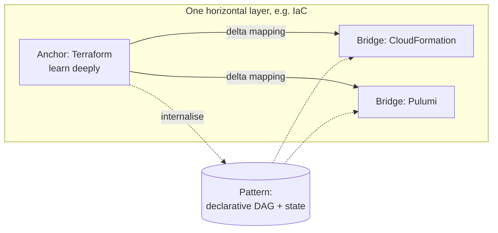
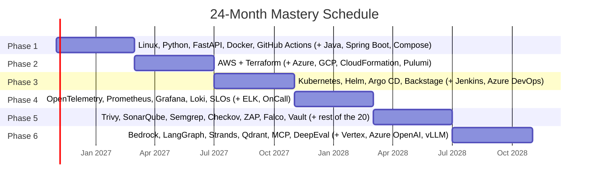

# The 24-Month Cloud, Platform, DevSecOps, SRE & AI Engineering Roadmap

> This is the source roadmap ([full_stack_devops_ai_platform_roadmap.pdf](full_stack_devops_ai_platform_roadmap.pdf)) rewritten as Markdown so it can be linked, diffed and rendered in Backstage TechDocs. Every cluster below links to its documentation folder in this wiki.

---

## 1. The Thesis: Anchor-and-Bridge Learning

The twelve clusters in this roadmap look like five separate careers: cloud architect, platform engineer, backend developer, security engineer, SRE and AI engineer. They are not. Tools inside each horizontal layer share most of the same underlying computer-science primitives:

| Pattern | Where it shows up |
|---|---|
| Declarative desired state + reconciliation loop | Kubernetes, Argo CD, Terraform, CloudFormation, Pulumi, Kyverno |
| OIDC workload identity (no static keys) | GitHub Actions to AWS/Azure/GCP, IRSA, Entra Workload Identity, GKE Workload Identity, Cosign keyless, Vault JWT auth |
| DAG execution | Terraform plan graph, GitHub Actions job graph, Jenkins stages, Azure Pipelines stages, LangGraph state graphs |
| Label-indexed time series | Prometheus, Loki, Tempo, DCGM GPU metrics |
| Ratio-of-events reliability | SLIs, error budgets, burn rates, canary analysis |
| Approximate nearest neighbour over vectors | pgvector, Qdrant, Milvus, Pinecone, Bedrock Knowledge Bases, Azure AI Search |
| Policy as code | Checkov, OPA/Rego, Kyverno, Sentinel, CrossGuard, Semgrep rules |

The method: **master one anchor tool per layer deeply** until the pattern is internalised, then learn the **delta mapping** to its siblings. Mapping a sibling takes days, not months.

---

## 2. The Twelve Clusters

| # | Cluster | Listed technologies | Traditional silo | Anchor tool(s) | Core unifying pattern | Wiki folder |
|---|---|---|---|---|---|---|
| 1 | Hyperscale Cloud | AWS, Azure, GCP | Cloud Infrastructure Architect | AWS | IAM, VPC SDN, object storage, managed compute | [01-cloud](../01-cloud/) |
| 2 | Managed Cloud AI | Amazon Bedrock, Vertex AI, Azure OpenAI | Cloud AI / ML Platform Engineer | Amazon Bedrock | Serverless FM APIs, guardrails, PTUs, private RAG | [02-managed-ai-platforms](../02-managed-ai-platforms/) |
| 3 | Agentic Frameworks | LangChain, LangGraph, Strands Agents | Applied AI / Agent Engineer | LangGraph & Strands | Stateful ReAct loops, checkpointing, tool calling | [03-agentic-frameworks](../03-agentic-frameworks/) |
| 4 | Containers & IDP | Kubernetes, Docker, Backstage | Platform Engineer | Kubernetes & Docker | OCI containers, control-loop reconciliation, golden paths | [04-containers-and-idp](../04-containers-and-idp/) |
| 5 | Infrastructure as Code | Terraform, CloudFormation, Pulumi | Infrastructure Automation Engineer | Terraform | Declarative DAG state graphs, drift detection, modules | [05-infrastructure-as-code](../05-infrastructure-as-code/) |
| 6 | CI/CD Pipelines | Jenkins, GitHub Actions, Azure DevOps | Build & Release Engineer | GitHub Actions | Event-driven DAG runners, ephemeral containers, OIDC | [06-cicd](../06-cicd/) |
| 7 | Backend & APIs | Python, Java, FastAPI, Spring Boot | Backend Software Engineer | FastAPI & Spring Boot | Async / virtual-thread REST & gRPC, DI, OpenAPI | [07-backend](../07-backend/) |
| 8 | DevSecOps (20 tools) | SonarQube, Checkmarx, OWASP ZAP + 17 more | AppSec / DevSecOps Engineer | Trivy, Semgrep, ZAP | Shift-left SAST/SCA/SBOM/DAST gates, runtime eBPF | [08-devsecops](../08-devsecops/) |
| 9 | Observability Stack | OpenTelemetry, Prometheus, Grafana, Loki, ELK | Observability Engineer | OpenTelemetry + LGTM | Unified OTLP telemetry and correlation | [09-observability](../09-observability/) |
| 10 | AI Infra & RAG/MCP | GPU workloads, RAG, agents, vector DBs, MCP, evals | AI Infrastructure / LLMOps Engineer | vLLM, Qdrant, MCP, DeepEval | CUDA/K8s scheduling, hybrid retrieval, tool protocol, CI evals | [10-ai-infra-rag-mcp](../10-ai-infra-rag-mcp/) |
| 11 | SRE Reliability | SLI, SLO, error budget, on-call | Site Reliability Engineer | Google SRE framework | User-centric reliability targets, burn-rate governance | [11-sre](../11-sre/) |
| 12 | Enterprise Ops | Prod support, DR, cost optimisation, cybersecurity | Principal Systems / FinOps Architect | FinOps & NIST CSF 2.0 | RPO/RTO resilience, unit economics, zero-trust defence | [12-enterprise-ops](../12-enterprise-ops/) |

A prerequisite layer, [00-foundations](../00-foundations/) (Linux, networking, Git, Bash), has been added because every cluster above assumes it.

---

## 3. Cluster Summaries

### Clusters 1 & 2: Multi-cloud foundations and managed AI platforms

Every provider exposes the same four primitives: identity (IAM), software-defined networking (VPC/VNet), compute (VMs, containers, serverless) and durable storage (object, block, relational, NoSQL). Learn how AWS evaluates an IAM policy and routes traffic through public and private subnets, NAT gateways and VPC endpoints, and Azure and GCP become vocabulary translation.

| Layer | AWS | Azure | GCP |
|---|---|---|---|
| Resource hierarchy | Org root → OU → Account (regional VPCs) | Management Group → Subscription → Resource Group | Org → Folder → Project (global VPC, regional subnets) |
| Identity & workload auth | IAM roles, IRSA / EKS Pod Identity | Entra ID, Managed Identities | Cloud IAM service accounts, GKE Workload Identity |
| Managed Kubernetes & serverless | EKS, Fargate, Lambda | AKS, Container Apps, Functions | GKE, Cloud Run, Cloud Functions |
| Managed enterprise AI | Bedrock (Converse API, Knowledge Bases, AgentCore) | Azure OpenAI / Microsoft Foundry (PTUs, AI Search) | Vertex AI / Gemini Enterprise Agent Platform (Model Garden) |

Enterprise teams do not call consumer LLM endpoints. They use managed platforms that guarantee no training on prompts, private VPC ingress, customer-managed keys and deterministic throughput.

### Clusters 3 & 10: Agentic frameworks, GPU workloads, RAG, vector DBs, MCP and evals

AI applications combine probabilistic reasoning loops (agents) with deterministic retrieval (RAG), standardised tool interfaces (MCP), GPU-accelerated serving (vLLM) and automated regression testing (evals).

- **LangChain** standardises model, prompt, structured-output and tool interfaces so providers can be swapped.
- **LangGraph** models agents as explicit state machines with checkpointing to Postgres or Redis for time travel, fault recovery and human-in-the-loop approval.
- **Strands Agents** lets the model drive the loop: a model provider, a system prompt and `@tool` functions, with built-in OpenTelemetry tracing.
- **GPU on Kubernetes** means the NVIDIA GPU Operator, `nvidia.com/gpu` device plugins, DCGM metrics and MIG partitioning, with **vLLM** serving via PagedAttention and continuous batching.
- **Production RAG** means semantic or hierarchical chunking, dense plus BM25 hybrid search, Reciprocal Rank Fusion and cross-encoder reranking.
- **Vector stores**: pgvector under roughly 10 to 50 million vectors when ACID matters; Qdrant for rich payload filtering and quantisation; Milvus for hundreds of millions to billions; Pinecone for zero-ops serverless.
- **MCP** turns M×N integrations into M+N via a JSON-RPC protocol exposing Resources, Prompts and Tools.
- **Evals**: RAGAS for the RAG triad, DeepEval for pytest-native CI gates and G-Eval, Promptfoo for matrix benchmarking and red-teaming, LangSmith for production trace grading.

### Clusters 4 to 7: The delivery backbone

Source code in Python or Java is packaged into immutable images, tested and signed in CI, deployed to Kubernetes provisioned by IaC, and exposed as self-service golden paths in Backstage.

| Tool | Language & state | Core production capabilities | When to choose |
|---|---|---|---|
| Terraform (anchor) | Declarative HCL; remote state with locking | Multi-cloud providers, modules, plan/apply DAG, workspaces, import blocks | Multi-cloud and hybrid; master first |
| CloudFormation | YAML/JSON or CDK; AWS-managed state | Server-side rollbacks, change sets, drift detection, StackSets | AWS-only shops; resources map 1:1 to Terraform |
| Pulumi | Python, TypeScript, Go, Java | Loops and classes without HCL limits, unit tests, CrossGuard, Backstage plugin | Platform teams embedding IaC in software |
| GitHub Actions (anchor) | `.github/workflows/*.yml`; hosted or self-hosted runners | Matrix builds, reusable workflows, composite actions, OIDC, GHAS | Default modern CI/CD |
| Jenkins | Groovy Jenkinsfile; controller + ephemeral K8s agents | Shared libraries, 1,800+ plugins, JCasC | Large enterprises and on-prem |
| Azure DevOps | Multi-stage `azure-pipelines.yml` | Stage/job/step templates, environments with approvals, Boards | Microsoft enterprise shops |

### Cluster 8: The 20 DevSecOps tools across 7 gates

No single scanner can inspect source ASTs, third-party dependencies, container OS layers, Terraform templates, live HTTP endpoints, Kubernetes admission and kernel syscalls at once. Twenty specialised tools are distributed across seven sequential gates and aggregated into one ASPM hub.

| Gate | Purpose | Tools |
|---|---|---|
| 1 | Pre-commit and repository secrets | Gitleaks, TruffleHog |
| 2 | SAST and code quality | SonarQube, Checkmarx One, Semgrep |
| 3 | SCA and continuous SBOM analysis | Snyk, OWASP Dependency-Track |
| 4 | Container, SBOM and supply-chain signing | Trivy, Grype, Syft, Sigstore Cosign |
| 5 | IaC policy-as-code and admission control | Checkov, Kyverno, OPA Gatekeeper |
| 6 | DAST | OWASP ZAP, Nuclei, Burp Suite |
| 7 | Runtime security and dynamic secrets | Falco, HashiCorp Vault |
| Hub | ASPM, XDR and SIEM | DefectDojo, Wazuh |

### Clusters 9, 11 & 12: Observability, SRE and enterprise governance

- **OpenTelemetry** instruments once and ships OTLP to a Collector whose receivers, processors and exporters decouple instrumentation from storage.
- **Prometheus and Grafana** store and visualise dimensional time series, correlating a latency spike to the exact trace exemplar and log stream.
- **Loki vs ELK**: Loki indexes only labels and stores compressed chunks in object storage (5 to 10 times cheaper for operational debugging); ELK builds full inverted indexes for sub-second full-text search, SIEM and hybrid vector search.
- **SRE**: an SLI is good events over valid events measured from the user's perspective. A 99.9% SLO over 30 days leaves a 43.2-minute error budget. Multi-window burn-rate alerts (14.4× over 1 h and 5 min pages; 1× to 3× creates a ticket) replace CPU-spike paging.
- **Enterprise ops**: Four Golden Signals and progressive delivery with automated canary analysis; four DR tiers from backup-and-restore to multi-region active-active; the FinOps Framework and FinOps for AI; NIST CSF 2.0 and zero trust.

---

## 4. The 24-Month Phased Plan

Total budget: roughly 1,040 hours at 12 to 15 hours per week. Every phase extends a single **Unified Production Capstone Repository** (see [../capstone](../capstone/)).

| Phase | Window | Anchor tools mastered deeply | Bridge tools mapped | Capstone deliverable |
|---|---|---|---|---|
| 1 | Months 1-4 (160 h) | Linux kernel/networking, Python, FastAPI, Docker, GitHub Actions | Java 21 & Spring Boot (Actuator, virtual threads), Docker Compose | Polyglot microservice pair (async FastAPI + Spring Boot) in multi-stage distroless images with GitHub Actions tests and OCI publishing |
| 2 | Months 5-8 (160 h) | AWS (VPC, IAM, EKS, RDS, S3, KMS), Terraform | Azure, GCP, CloudFormation, Pulumi (Python) | Multi-AZ VPC, managed Postgres and container cluster via modular Terraform with remote state locking; equivalent Pulumi and CloudFormation for one service |
| 3 | Months 9-12 (180 h) | Kubernetes (EKS/kind, Helm, Argo CD, HPA, NetworkPolicy), Backstage | Jenkins (shared libraries), Azure DevOps YAML templates | Both services on Kubernetes via GitOps; Backstage portal with catalog and a one-click golden-path template |
| 4 | Months 13-16 (160 h) | OpenTelemetry, Prometheus, Grafana, Loki, SLI/SLO/error budgets | ELK, OnCall routing | OTel-instrumented services, unified Grafana correlation dashboards, 99.9% SLO with multi-window burn-rate paging |
| 5 | Months 17-20 (180 h) | Trivy, SonarQube, Semgrep, Checkov, OWASP ZAP, Falco, Vault | Checkmarx, Snyk, Kyverno, DefectDojo, FinOps, NIST CSF 2.0, DR drills | All 7 security gates wired into the pipeline; multi-AZ failover drill validating RPO/RTO |
| 6 | Months 21-24 (200 h) | Amazon Bedrock, LangGraph, Strands Agents, Qdrant/pgvector, MCP, DeepEval | Vertex AI, Azure OpenAI, vLLM GPU serving, Milvus, Promptfoo | FastAPI service upgraded into an autonomous Incident & Platform AI Agent with hybrid RAG over runbooks, custom MCP servers for Prometheus/Kubernetes, vLLM serving and CI-gated evals |

### Calibrated entry points

| Background | Timeline | Path |
|---|---|---|
| Complete beginner / junior | 24 months | Phases 1 to 6 in order |
| Experienced backend engineer | 14-16 months | Phase 1 in 3 weeks (multi-stage Dockerfiles, Actions OIDC), then Phases 2, 3 and 6 |
| Practising DevOps / cloud engineer | 9-12 months | Skim Phases 1-3 for gaps (Pulumi, Backstage, Spring Boot Actuator), then Phases 4, 5 and 6 intensively |

### Weekly allocation (12-15 hours)

| Activity | Share |
|---|---|
| Hands-on GitOps labs in the capstone repo | 50% |
| Official documentation study | 20% |
| Chaos and security drills | 15% |
| Cross-cloud pattern mapping and ADR writing | 15% |

---

## 5. Five Golden Rules

1. **Never learn two sibling tools simultaneously.** Not AWS, Azure and GCP in the same month. Not Terraform, CloudFormation and Pulumi side by side. Reach production fluency in the anchor first; mapping a sibling then takes about 10% of the effort.
2. **Build one living platform repository.** One production-grade repo where Terraform provisions the cluster, GitHub Actions runs the 7 gates, Backstage catalogs the services, the OTel/Prometheus/Grafana stack monitors SLOs, and the AI agent troubleshoots incidents via MCP.
3. **Treat AI agents as first-class distributed systems.** Trace every LLM and MCP call with OpenTelemetry, scan prompts and tools with Promptfoo and Semgrep, enforce token budgets, block merges when DeepEval/RAGAS faithfulness drops below threshold.
4. **Automate teardown to keep lab cost under $15 per month.** kind or k3d locally for 85% of work; nightly `terraform destroy` on a GitHub Actions cron for ephemeral cloud resources (EKS, Bedrock endpoints, GPU nodes).
5. **Document every phase with Architecture Decision Records.** One-page ADRs explaining why each tool was chosen and how the alternatives compare. They become the portfolio for principal-level interviews. Template: [../templates/adr-template.md](../templates/adr-template.md).

---

## 6. How This Wiki Maps to the Roadmap

| Roadmap element | Where to find it |
|---|---|
| Per-tool deep dives | `NN-cluster/tool/` folders, each with the same 8-file kit |
| Anchor-and-bridge delta tables | Each cluster `README.md` and each bridge tool's "Coming from <anchor>" section |
| Capstone architecture, repo layout and phase checklists | [../capstone/](../capstone/) |
| ADRs | [../capstone/adrs/](../capstone/adrs/) |
| Templates (docs, ADR, runbook, postmortem) | [../templates/](../templates/) |
